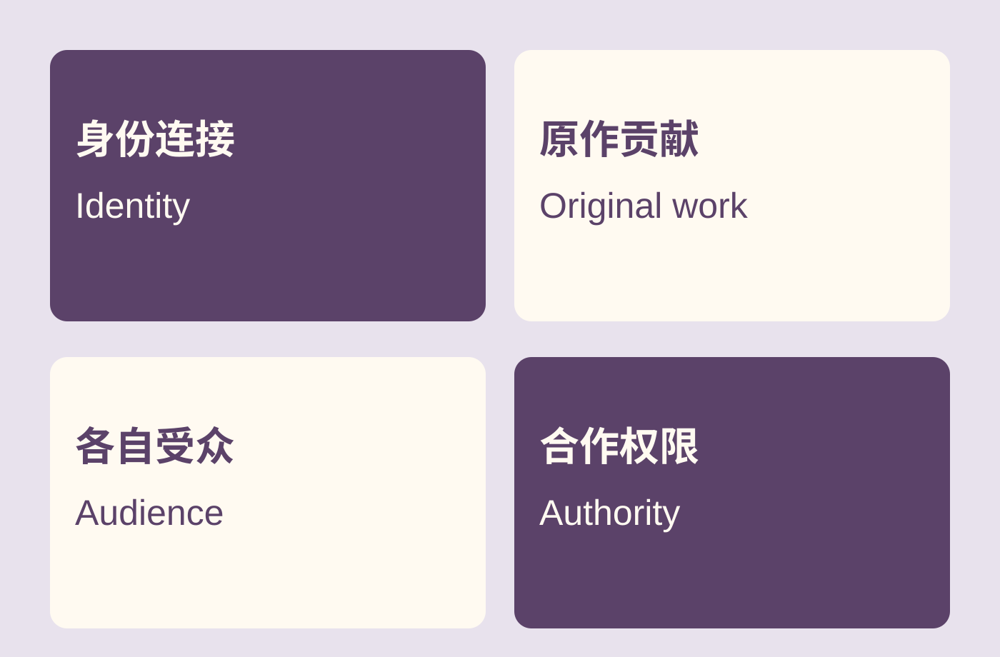

# What’s Blue Sky? Creator Credibility

Status: local review draft; confirm the publication date before release.

Use Bluesky explanations, exchanges and original work to enrich a creator profile while keeping identity and cross-platform audience claims separate.

In a social-platform context, “what’s blue sky” usually refers to Bluesky. For an influencer-marketing team, it can add public explanations, discussions and original work to a creator’s profile. It does not transfer follower counts, verification or performance from another platform. Establish that the records concern the same person, examine the contribution and decide whether that work supports the proposed commission. This is a way to connect evidence, not a live ranking or a claim that every capable expert needs a Bluesky account.

## Define what the additional record should answer

Begin with the partnership question. A team may already have watched a creator’s videos but want to understand whether they can explain a complex limitation, respond to a reasoned objection or make their thinking clear without relying on an edited presentation.

[Bluesky’s platform and domain explanation](https://bsky.social/about/blog/09-04-2024-welcome) places the app within an open-network context and describes feeds and domain usernames. That helps establish where the record comes from. It does not establish a common audience or commercial intention across everyone using the service.

Do not collect an entire posting history merely to fill a research sheet. Identify one capability to investigate, then choose relevant original work. If the brand needs long-form instruction, short posts can supplement research but cannot substitute for an actual long-form sample.

Starting with a question prevents presence on several platforms from becoming a credibility claim in itself. Platform count describes the shape of a public portfolio. The useful judgment concerns what this creator contributed and whether that contribution can serve the brand’s proposed task. Record that distinction before looking at any popularity measure, so an interesting platform profile does not quietly redefine the commission.

## Connect identity through specific evidence

Look for reciprocal references from the creator’s public website, channel biography or already confirmed materials. A shared name and avatar are leads, not independent confirmation that two accounts belong to the same person. They also do not establish that an agency contact represents that person.

[Bluesky’s verification explanation](https://bsky.social/about/blog/04-21-2025-verification) describes domain usernames and the later badge layer. Its April 21, 2025 announcement said more than 270,000 accounts had connected website domains at that time. That is a dated announcement figure, not today’s platform size or a guarantee for commercial partnerships.

Keep the actual profile URL, observation date and reason for connecting records. If a website points to one account but a proposal supplies a similar handle, check through the established business route before merging them.

Identity signals help establish provenance. They do not by themselves answer whether the work is expert, whether the audience fits or whether the contact can authorize a contract. Give each conclusion its own basis. If a connection remains uncertain, preserve the uncertainty rather than treating an attractive portfolio as a reason to skip verification or allowing an administrative guess to become a permanent contact record.

## Identify the contribution in the original post

Prefer the original post and its context to a screenshot of someone else’s summary. Record whether the creator offers a new explanation, cites another person’s research, shares their own work or republishes an announcement. Each contribution can be useful, but they are not interchangeable credentials.

An accurate summary may demonstrate comprehension and communication without proving the author conducted the underlying experiment. A careful answer to a practical question does not automatically establish a professional licence.

The [Bluesky public-conversation context method](https://www.quickkol.com/blog/bluesky-creator-public-conversation-context/#answer) helps retain the original post and reply relationships. Check whether an important limitation appears only in a later reply. Extracting the most confident sentence can turn a cautious discussion into a stronger claim than its author made.

Write one sentence explaining what the work supports. If that sentence is only appears knowledgeable, look for a specific example or prepare a bounded question for outreach. The purpose is not to award a general expert label. It is to explain why this particular contribution is relevant to the role under discussion and which parts of the assignment would still need another sample or direct confirmation.

## Separate continuing work from a single appearance

A strong post can justify contact without establishing a repeatable working method. Look for other task-relevant contributions and consider whether the creator continues to explain similar questions, acknowledge limitations and maintain corrections.

[Bluesky’s custom-feed explanation](https://bsky.social/about/blog/7-27-2023-custom-feeds) describes user choice and feeds built by third parties. Repeatedly encountering one person may therefore partly reflect the researcher’s reading configuration, rather than that person’s representativeness across a whole field.

Record how the sample was selected instead of collecting only its most polished examples. A defined topic and observation period make the search easier to explain. Name the areas where relevant material was not found, while distinguishing not found from incapable.

Respect publishing cadence as well. Infrequent posting does not automatically mean poor professional capability. Suitability for recurring commissioned work requires a discussion of actual production conditions. Research should produce better questions rather than promise delivery on the creator’s behalf.

A useful note might say that several explanations show careful treatment of one topic, while the team has not yet reviewed the live-presentation format required by the campaign. That is more informative than turning a small sample into a universal assessment of reliability.

Evidence for one field does not automatically answer the others.

## Keep each platform’s numbers in place

Do not add YouTube subscribers, Instagram followers and Bluesky followers into a unique-audience total. People may follow the same creator in several places, and the counts do not describe identical behaviours or observation windows.

If Bluesky work is being used only to assess explanatory capability, there is no need to turn that account’s scale into a procurement threshold. Conversely, if the brand intends to commission publication on Bluesky, numbers from another service do not forecast distribution there.

Use a creator’s existing work as a role-specific record. For every number retain platform, object, period and source, identifying public observation separately from information the creator has authorized for review. Capability evidence and distribution evidence can sit next to each other without becoming the same claim.

Compare at the level the task supports, such as clarity of explanation. Do not force incompatible counts into an unexplained overall-influence score. Where quantification is necessary, define the comparable component first and retain unknown or inapplicable fields separately. A narrower, understandable comparison is easier for the purchasing team to use than a composite figure whose inputs cannot be reconstructed or whose apparent precision hides missing evidence.

## Turn the research into a suitable inquiry

Refer to one genuinely relevant piece of work and explain the role the brand wants to discuss. Do not turn incidental personal-life details into a sales opening or claim the research team knows the creator’s entire audience.

For example, ask whether the creator would consider developing a public explanation into a new demonstration. Make clear that this is not a request to reproduce the original post or acquire blanket permission for historical content. New commissioning, quotation and media licensing are separate discussions.

A useful inquiry also supplies platform, deliverable format, intended usage and timing conditions. Public posting does not mean the creator is available for commercial work. A friendly public reply does not establish acceptance of a defined commission.

If an agency handles the conversation, confirm its representative scope. Record actual states such as no response, requested information, interested or agreed to specific work. Do not count an encouraging response as a completed partnership.

The extra research is valuable when it makes the invitation more precise and less burdensome. It should reduce the need for the creator to guess what the brand has seen, why the work matters and which permissions the conversation is intended to cover.

## Use a counterexample to test the inference

Imagine a video creator who uses Bluesky to explain limitations in a product category. A brand thinks the work could suit a technical explanation. This is a hypothetical editorial scenario, not an assessment of a named creator.

The record may support relevant explanatory samples. It does not establish that followers hold the purchasing roles required by the brand or that filming can be completed by its deadline. The former needs suitable audience evidence; the latter needs a production conversation.

If the post mainly cites another expert, preserve that source chain. The creator’s contribution may still be clear communication, and commissioning that role can be entirely reasonable. There is no need to describe the communicator as the original researcher to justify a collaboration.

This counterexample also prevents missing evidence from becoming a negative personal judgment. The team can narrow the role, request a sample or ask a question instead of choosing between not credible and completely verified. The best research notes explain the exact inference being considered, what currently supports it and what would resolve the remaining uncertainty. That makes the material useful to another reviewer who did not participate in the original browsing session.

## Hand over a usable creator record

Organize the final record into identity connections, relevant original work, role assessment, audience information and open questions. Preserve the actual source for each piece rather than leaving only screenshots in a collection.

When sharing research with collaborators, provide information relevant to the task. An open network is not a reason for unlimited collection or reproduction. If an original is corrected or deleted, update the note rather than presenting an old screenshot as the creator’s current position.

The [Bluesky pilot opportunity-cost method](https://www.quickkol.com/blog/bluesky-creator-pilot-opportunity-cost/#answer) can help decide whether to proceed beyond research into a bounded trial. Interesting work does not automatically justify a complete new channel operation.

QuickKOL can help interpret a brief, discover relevant creators and prepare personalized outreach. The appropriate sources and counterparties must still confirm meaning, data scope, representation and commercial conditions.

A good creator record is not the longest one. It lets the next owner understand why this person is being contacted, what role is proposed and what remains unconfirmed. Include the intended decision alongside the evidence so that later readers do not extend a limited capability assessment into an audience guarantee. Used this way, Bluesky supplements a concrete judgment rather than merely adding another platform icon to a profile or another unsupported reason to approve a partnership.

## What cross-platform evidence supports

| Record | May support | Does not replace |
| --- | --- | --- |
| Reciprocal links | Identity connection | Representative confirmation |
| Original explanation | Relevant communication sample | All professional credentials |
| Platform count | Specific observation | Unique cross-platform audience |
| Positive reply | Willingness to discuss | Acceptance of defined work |

Editorial research framework; verification figures retain their historical dates.

## Hand over the cross-platform record

Preserve the basis of each inference.

- [ ] Define the capability question.
- [ ] Record the actual identity connection.
- [ ] Preserve original work and context.
- [ ] Keep platform numbers separate.
- [ ] Separate new commissioning from existing-work permission.
- [ ] Name unconfirmed commercial conditions.

## Research date and limitations

Sources reviewed November 20, 2026. Methods, tables and decision rules are editorial recommendations. Hypothetical examples are not actual client results or industry benchmarks. Source geography and periods are specified where relevant.

## Start creator research with a clear task

Use QuickKOL to interpret a brief, discover relevant creators and research their work and contact routes. Verify data, commercial terms and outcomes at their source.

[Explore QuickKOL](https://www.quickkol.com/#capabilities)

## Sources

- [Bluesky’s platform and domain explanation](https://bsky.social/about/blog/09-04-2024-welcome)
- [Bluesky’s verification explanation](https://bsky.social/about/blog/04-21-2025-verification)
- [Bluesky’s custom-feed explanation](https://bsky.social/about/blog/7-27-2023-custom-feeds)
