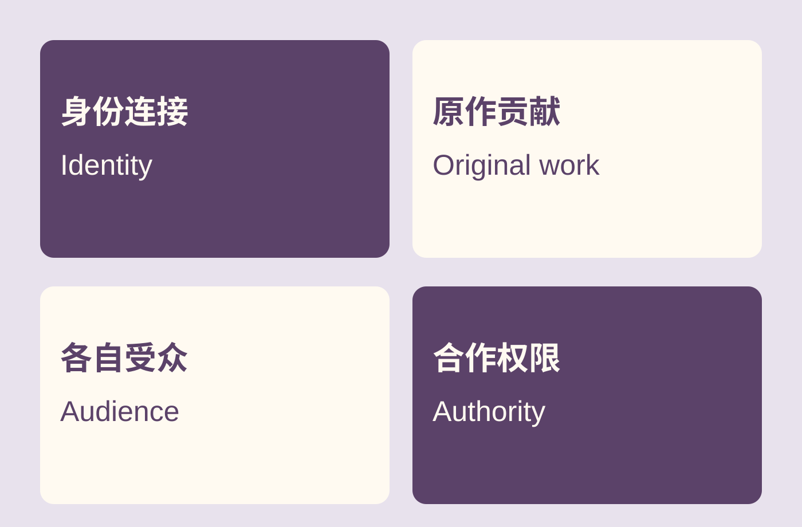

# Bluesky 作品怎样补充达人履历

状态：本地审阅稿；正式发布日期待确认。

把 Bluesky 上的解释、交流与原作放回达人履历，补充专业判断，同时保留身份与跨平台受众的边界。

“What’s blue sky” 在社交平台语境下通常指 Bluesky。对达人营销团队，它可以补充一个人的公开解释、讨论与原创履历，但不能把其他平台粉丝、认证或互动表现自动转移过来。先确认同一创作者，再看具体贡献，最后决定这些作品能否支持当前委托。这里研究的是证据之间的关系，不是新的实时达人排行榜。

## 先确定资料要补充什么

先从合作问题出发。团队可能已经看过达人视频，却想知道对方能否解释一个复杂限制、回应有依据的异议，或在不依赖剪辑的情况下说明自己的判断。

[Bluesky 平台与域名说明](https://bsky.social/about/blog/09-04-2024-welcome)将应用放在开放网络语境中，也介绍信息流与域名用户名。这有助于理解资料从哪里来，不代表所有用户具有同样受众或商业意愿。

不要为了补齐资料表而搜集全部动态。写清需要验证的一项能力，再选择相关原作。如果品牌需要的是长视频教学，短帖可以补充研究，却不能替代实际长视频样本。

先有问题能避免把“在多个平台出现”本身当作可信度。平台数量只是履历形态，真正需要判断的是这位创作者做了什么、是否能服务本次品牌任务。

## 同一身份需要逐条连接

从创作者公开网站、频道简介或已确认资料中寻找相互指向。名字和头像相同是线索，不能独立确认两个账号属于同一人，更不能证明某个代理联系人代表对方。

[Bluesky 认证说明](https://bsky.social/about/blog/04-21-2025-verification)介绍域名用户名和后来增加的认证标记。2025 年 4 月 21 日公告提到当时已有超过 270,000 个账号连接网站域名；这是历史公告数量，不是今日规模或品牌合作保障。

核对时记录实际账号链接、观察日期与连接理由。若官网链接指向一个账号，而提案给出另一个相近 Handle，先向已确认的业务渠道核实，不擅自合并。

认证信号帮助判断身份出处，不能直接回答作品是否专业、受众是否适合、或联系人是否有权签约。每一项结论都应有自己的依据。

## 从原帖判断具体贡献

优先看原作及其上下文，而不只是转述截图。记录创作者是在提出新解释、引用他人研究、分享自己的作品，还是转发一项公告。不同贡献可以有价值，但不能互相冒充。

例如，一段准确总结体现的是理解与表达，不一定证明作者亲自完成了原始实验。细致回答一个使用问题，也不自动表明对方获得某种专业执照。

从 [Bluesky 公开讨论语境方法](https://www.quickkol.com/zh/blog/bluesky-creator-public-conversation-context/#answer)继续往下，可以保留原帖与回复关系，判断关键限定是否在后续才出现。若只截取最肯定的一句话，可能把谨慎讨论变成过度承诺。

给研究表写一句“这份作品支持什么”。如果一句话只能是“看起来很懂”，就继续找具体例子，或在联系时提出范围明确的问题。

## 区分持续能力与偶然出现

单条好帖子可以成为联系理由，但不一定代表稳定的创作方式。选择与任务有关的其他作品，观察是否继续解释同类问题、承认限制并维护更正。

[Bluesky 自定义信息流说明](https://bsky.social/about/blog/7-27-2023-custom-feeds)允许不同人选择不同信息流，且第三方也能建立信息流。因此，研究者经常看见某个人，可能部分反映自己的阅读配置，而非对方在整个领域的代表性。

记录样本怎样选，避免只收集最漂亮的例子。可以按一个明确主题和观察期查找公开作品，并写明未找到资料的部分，而不是把未找到等同于没有能力。

也尊重创作者发布节奏。低频不自动意味着不专业；是否适合定期合作，需要询问实际制作条件。研究只能帮助提出更好的问题，不能替对方承诺交付。

某一项证据成立，不会自动替其他项目作答。

## 跨平台数字各自保留

不要把 YouTube 订阅者、Instagram 粉丝与 Bluesky 关注者相加成独立受众。同一个人可能重复关注，不同平台数字也不说明同一种行为或观察窗口。

如果 Bluesky 作品只用于证明表达能力，就不必把该账号规模提升为采购门槛。反过来，若品牌打算在 Bluesky 发布委托内容，也不能借用别处规模预测这里的触达。

跨平台达人内容证明方法可以帮助把每份作品对应到一个能力问题。对每项数字保留平台、对象、时间与来源，明确哪些仅为公开观察，哪些由达人授权提供。

比较应该发生在同一任务层面，例如解释是否清楚，而不是强行把不同计数标准化成一个“综合影响力”。需要量化时先定义可比较部分，未知与不适用单独保留。

## 把研究变成合适的询问

联系时指出一项真正相关的作品，并说明品牌想讨论的角色。不要把观察到的私人生活线索变成销售切入点，也不要宣称团队掌握了创作者全部受众。

例如，品牌可以询问对方是否愿意把某个公开解释扩展成新的演示，明确这不是要求复制原帖或授权所有历史内容。先区分新委托、引用和素材许可。

询价还需要平台、交付形式、预计用途与时间条件。公开发帖并不表示开放商业合作，也不意味着公开回复就是正式接受。

如果由代理接洽，确认其代表范围。对联系结果记录实际状态：未回应、要求资料、有兴趣或已就具体工作达成一致，而不是把一次积极回复直接计为合作成功。

## 用反例检查跨平台判断

假设一位视频创作者在 Bluesky 上详细解释了某个产品类别的限制，品牌觉得适合技术讲解。这是编辑假设，不是对具名创作者的评估。

研究可以支持“有相关解释样本”，却不能直接证明其粉丝具有品牌所需采购角色，也不能证明能按品牌期限完成拍摄。前者需要适当受众依据，后者需要制作沟通。

若原帖主要引用另一位专家，则应该保留来源链；如果达人自己的贡献在于清楚转述，也可以合理委托表达工作，而不是将其描述为原始研究者。

反例提醒团队，证据不足时不必否定整个人。可以缩小角色、补样本或询问，而不是在“不够强”和“完全可信”之间强行二选一。

## 交接可引用的达人履历

把最终记录整理成身份连接、相关原作、角色判断、受众信息和未解问题。每条作品保留实际出处，避免只留下收藏夹里的截图。

对合作方共享资料时，只提供与任务相关的信息，不把开放网络当作无限制收集与复制的理由。若原作修改或删除，更新研究说明，不能继续把旧截图当作当前观点。

[Bluesky 信息流机会成本方法](https://www.quickkol.com/zh/blog/bluesky-creator-pilot-opportunity-cost/#answer)可以继续判断研究之外是否值得安排试点。不要因看到好作品就自动扩展到完整渠道运营。

QuickKOL 可帮助理解 Brief、发现相关达人并准备个性化联系；作品原意、数据范围、代表关系与合作条件仍应在来源和对方核对。

合格的履历不是越长越好，而是下一位负责人能看懂为什么联系此人、准备委托什么，以及还没有确认什么。这样 Bluesky 才是在补充具体判断，而不是给资料表多加一个平台图标。

## 跨平台证据能说明什么

| 资料 | 可以支持 | 不能替代 |
| --- | --- | --- |
| 相互链接 | 身份连接 | 商业代表确认 |
| 原创解释 | 相关表达样本 | 全部专业资格 |
| 平台计数 | 特定观察 | 独立跨平台受众 |
| 积极回复 | 愿意继续沟通 | 明确委托接受 |

编辑研究框架，认证公告数字仅保留其历史日期。

## 交接跨平台履历

为下一位负责人保留推断依据。

- [ ] 写明需要补充的能力问题。
- [ ] 记录实际身份连接。
- [ ] 保存原作及限定语境。
- [ ] 让不同平台数字各自保留。
- [ ] 区分新委托与旧作许可。
- [ ] 明确未确认的合作条件。

## 研究日期与使用边界

资料核验于 2026 年 11 月 20 日。文中方法、表格和决策规则为编辑建议，标为假设的示例不是实际客户结果或行业基准。外部资料的适用地区与时期按各段说明。

## 从任务开始达人研究

用 QuickKOL 理解 Brief、发现相关达人并研究作品与联系路径；数据、合作条件和结果仍需核验。

[了解 QuickKOL](https://www.quickkol.com/#capabilities)

## 来源

- [Bluesky 平台与域名说明](https://bsky.social/about/blog/09-04-2024-welcome)
- [Bluesky 认证说明](https://bsky.social/about/blog/04-21-2025-verification)
- [Bluesky 自定义信息流说明](https://bsky.social/about/blog/7-27-2023-custom-feeds)
