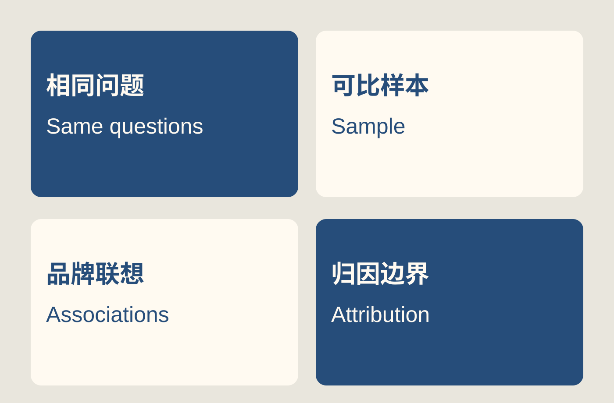

# Brand Health Tracking for Creator Messages

Status: local review draft; confirm the publication date before release.

Use stable questions and comparable samples to observe brand associations around creator messages, separating survey change, communication observations and attribution.

Brand health tracking repeatedly observes awareness, associations, consideration and related brand perceptions within a defined audience. Around a creator partnership, start with what viewers should understand and keep core questions, population and timing comparable. Public mentions and account interactions can add context; they do not replace a survey. A before-and-after difference alone does not prove the creator caused it. Research design, observed result and attribution conclusion each need their own support, so the brand can learn from a message without describing every change as demonstrated campaign impact.

## Choose a brand question with a use

Do not start by collecting every brand-health metric. Begin with the creator task: whether people understand a use condition, for example, or associate the brand with a supported capability.

[Qualtrics’ brand-tracking explanation](https://www.qualtrics.com/articles/strategy-research/brand-tracking-guide/) connects recurring surveys with awareness, associations and consideration, using comparable questions and populations. This is a supplier’s methodological account, not evidence that the present creator campaign worked.

Write a question that can affect the next step. A misunderstanding may prompt a brief correction. Where the direction is unclear, suitable exploratory work may precede a fixed growth target.

Unwanted associations can also matter, such as whether viewers believe a product serves an unsupported situation. Research should not search only for positive answers; it should clarify how the message is received.

This keeps the study connected to the commission. The creator explains a particular task, and the research examines an appropriate part of that communication rather than attempting to prove every desirable business result at once. A narrower question can support a clearer decision and reduce the temptation to select whichever metric later happens to look favourable.

## Define association, consideration and use separately

[Qualtrics’ brand-funnel explanation](https://www.qualtrics.com/support/brand-experience/common-use-cases-bx/conversion-funnel-reporting-bx/) distinguishes awareness, consideration and usage through survey questions. These can be related without being identical. Knowing a brand does not establish willingness to buy it.

For each question define population, response form and measure. Is the brand mentioned without prompting or recognized from a list? Does the question concern consideration during a particular choice, or completed use? Those differences change the meaning of the number.

A creator partnership may mainly supply explanation. If the objective concerns a professional association, choose a question that matches that task rather than turning every commercial goal into a creator assessment.

Avoid leading wording. A question containing the answer the brand wants may produce a response to the question itself. Give wording suitable research review instead of using it simply because it resembles good marketing copy.

This is also why a funnel should not be created by relabelling platform counts. A view, a follow and a purchase do not automatically correspond to survey-defined awareness, consideration and use. Keep the instrument’s actual definitions with the report so later readers do not substitute familiar marketing labels for what respondents were asked.

## Make survey waves comparable

Retain core wording, response options, question order, population, recruitment, language and time. If one changes materially, explain the comparison consequence rather than drawing the results as one uninterrupted trend.

Distinguish repeated responses from the same people and separate but comparable samples. The former may involve continuing participation effects; the latter requires checking composition. Both are target customers is not a sufficient method description.

The survey window should relate to the communication plan without assuming everyone encountered the creator’s work. If exposure is self-reported, retain that status. Remembering an encounter is not the same as verified exposure.

Confirm the comparable scope with the research owner. Where conditions cannot be aligned, preserve each wave’s description and narrow the change conclusion instead of using extra decimal places to conceal a design difference.

The team can still learn from an imperfect sequence if it describes what is known. What it should avoid is presenting a changed question or a different population as a precise movement in brand perception caused by the partnership. Comparability is an input to interpretation, not a cosmetic detail to add after the result looks promising.

## Interpret percentage change with its full basis

Suppose two comparable hypothetical surveys each contain four hundred responses meeting the definition. One brand association is selected by one hundred twenty people in the first and one hundred forty-four in the second. The editorial calculation is thirty percent and thirty-six percent: a difference of six percentage points, not six people and not automatically a creator effect.

The example supplies no representativeness, sampling-error assessment or causal conclusion. Actual research must also check design, missing answers and whether multiple choices were permitted. Correct arithmetic is not a substitute for valid research.

If denominators differ, retain each. Percentages from a multiple-selection question may not sum to one hundred; do not adjust the definition merely to tidy a chart.

Keep wording, valid sample and calculation beside the result, distinguishing observation from interpretation. Where support is limited, observed difference requiring further study is a legitimate conclusion rather than positioning succeeded.

This makes the figure reusable. A colleague can cite the actual descriptive result without accidentally inheriting a stronger campaign claim. The research owner can then decide what additional work is needed before recommending a change in creator selection or media investment.

An observed change does not automatically establish that a creator partnership caused it.

## Separate change observation from attribution

[Meta Blueprint’s study-type overview](https://www.facebookblueprint.com/student/path/219763-ab-test-conversion-brand-lift-course) distinguishes A/B tests, creative tests, conversion lift and brand lift. The public course overview shows that study purposes differ. It does not establish that the team used a tool or completed a suitable design.

Prices, products, news and other communication may change around the campaign. Even comparable survey conditions do not justify ignoring that background and assigning the association difference to one creator.

If the decision genuinely needs a causal answer, have the appropriate research owner design the relevant method and check feasibility. Do not rename a general questionnaire a brand-lift experiment, or describe unfinished research as verified.

A creator can deliver a strong explanation while the research remains unable to estimate its effect. Separate delivery assessment from causal assessment so a design limitation does not become a personal performance failure.

This distinction also keeps the next action proportionate. The brand might revise an ambiguous message immediately, retain a useful creator relationship or commission further research. None requires pretending that the available descriptive change has answered a causal question it was never designed to address.

## Use public discussion for appropriate context

Mentions, comments and questions can show how visible participants express an issue. Visible discussion is not a representative survey. Absence of comments should not become absence of interest, and a few positive replies should not stand in for brand health.

The [brand-monitoring correction method](https://www.quickkol.com/blog/brand-monitoring-creator-mention-corrections/#answer) records actual public statements and misunderstandings. It can complement a survey: one examines visible content, the other observes answers through defined questions and samples.

Return important issues to original work and distinguish reference, criticism, experience and commissioned endorsement. A brand name appearing does not necessarily mean approval. Discussion volume does not directly become a consideration percentage.

Use discussion findings to formulate another question or correct the brief, not to answer for a missing survey. Evidence types can sit together in one report while keeping their objects and limitations.

This combined view is useful precisely because the sources do different jobs. A comment may explain a possible misunderstanding worth investigating, while the survey describes how a defined sample answered. Neither needs to be inflated into the other to justify a practical content decision or a further research task.

## Translate findings into a content decision

If the intended association shows no clear movement, first examine whether the work actually conveyed it, whether the survey is comparable and whether observation is sufficient. Replacing the creator should not be the automatic response.

A misunderstanding may call for another condition, a revised demonstration or a clearer invitation. Involve the product-fact owner instead of asking the creator to solve every issue through stronger language.

The [social-KPI decision method](https://www.quickkol.com/blog/social-kpi-creator-decision-contract/#answer) connects the next step with evidence conditions. Research may support continuation, revision, additional information or waiting. It does not need to recommend more distribution every time.

Record why the action follows and what future information would change the decision. This makes the report useful for the partnership rather than leaving only an attractive brand-health score.

A later owner should be able to trace the sequence from question to observation to recommendation. If the recommendation relies mainly on an interpretation not yet checked, retain it as such. That preserves a productive learning path without giving a speculative explanation the status of a demonstrated audience result or making the creator responsible for factors outside the commission.

## Deliver tracking that can be cited accurately

Deliver question version, sample description, period, valid denominator, observations and limitations, while separating the team’s recommendation. Even an extracted conclusion should identify whom it concerns, when and through which method it was reached.

If no survey was conducted, do not publish our research found. A plan, hypothetical calculation and unresolved questions can be useful deliverables when their current state is clear.

QuickKOL helps interpret briefs, discover creators suited to explanation tasks and prepare contact. This article does not make it a verified brand-lift research system. Sources must still confirm data, method and commercial conditions.

The value of brand health tracking is not proving every partnership successful. It is a clearer understanding of messages and people. A bounded, reviewable finding can guide the next creator commission more reliably than a broad success claim.

Keep the evidence and recommendation together in the handoff. The next team can preserve the useful core, revise a question where appropriate and recognize when stronger research is needed, without treating an illustrative percentage or a platform interaction as something the actual study established.

## Different levels of brand-health evidence

| Level | Needed | Does not replace |
| --- | --- | --- |
| Question | Population and definition | Preferred slogan |
| Change | Comparable waves and denominator | Arithmetic alone as validity |
| Attribution | Suitable study design | General before-and-after observation |
| Action | Reason, owner and conditions | Unexplained score |

Editorial research framework; the four-hundred-response calculation is hypothetical, not an owned survey.

## Confirm the brand-health review

Start with a specific communication task.

- [ ] Choose an association question with a use.
- [ ] Retain question and sample versions.
- [ ] Check waves and denominators.
- [ ] Separate percentage points and people.
- [ ] Separate observation from attribution.
- [ ] Deliver a bounded conclusion and owner.

## Research date and limitations

Sources reviewed November 20, 2026. Methods, tables and decision rules are editorial recommendations. Hypothetical examples are not actual client results or industry benchmarks. Source geography and periods are specified where relevant.

## Start creator research with a clear task

Use QuickKOL to interpret a brief, discover relevant creators and research their work and contact routes. Verify data, commercial terms and outcomes at their source.

[Explore QuickKOL](https://www.quickkol.com/#capabilities)

## Sources

- [Qualtrics’ brand-tracking explanation](https://www.qualtrics.com/articles/strategy-research/brand-tracking-guide/)
- [Qualtrics’ brand-funnel explanation](https://www.qualtrics.com/support/brand-experience/common-use-cases-bx/conversion-funnel-reporting-bx/)
- [Meta Blueprint’s study-type overview](https://www.facebookblueprint.com/student/path/219763-ab-test-conversion-brand-lift-course)
