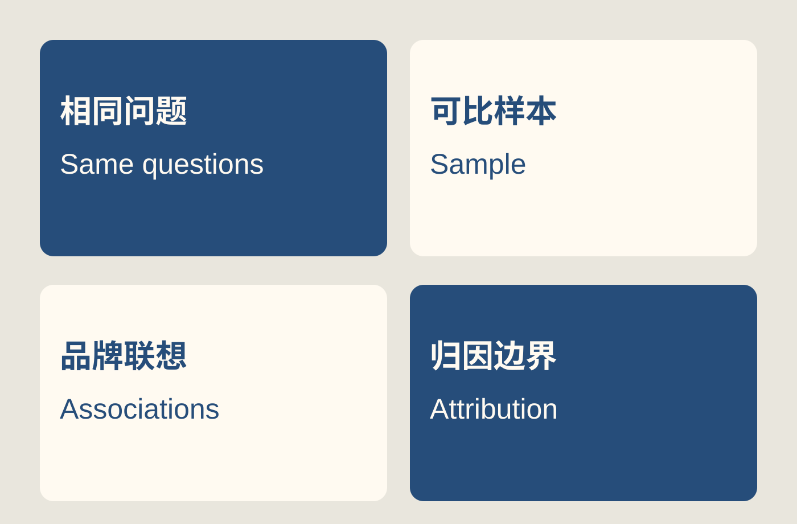

# 品牌健康怎样复盘达人信息

状态：本地审阅稿；正式发布日期待确认。

用稳定问题与可比样本观察达人信息对应的品牌联想，把调查变化、传播观察与因果归因分开。

品牌健康追踪用于持续观察特定人群对品牌的认知、联想与考虑等变化。围绕达人合作，先明确希望观众理解什么，再保持核心问题、对象与时期可比。公开提及和账号互动可以补充语境，不能替代调查，也不能仅凭活动前后差异证明达人造成变化。调查设计、观察结果与归因结论需要各自依据。

## 选择一项有用途的品牌问题

不要先收集全部“品牌健康指标”。从达人任务开始，例如观众是否理解某个使用条件，或是否将品牌与一种有依据的能力联系起来。

[Qualtrics 品牌追踪说明](https://www.qualtrics.com/articles/strategy-research/brand-tracking-guide/)将持续调查与认知、联想、考虑等概念连接，并强调可比较的问题与人群。它是供应商的方法介绍，不是本次达人活动有效的证明。

把研究问题写成能影响下一步的句子。若发现误解，团队可能修正 Brief；若尚无清楚方向，可以先做适当探索，而不是硬设一个增长指标。

也可以研究不希望形成的联想，例如观众是否误以为产品适用于未支持场景。研究不只寻找正面答案，而应帮助品牌理解信息到底被怎样接收。

## 联想、考虑与使用分别定义

[Qualtrics 品牌漏斗说明](https://www.qualtrics.com/support/brand-experience/common-use-cases-bx/conversion-funnel-reporting-bx/)按调查问题区分认知、考虑、使用等层次。它们可以相关，却不是同一件事；不能从知道品牌直接推断愿意购买。

为每个题目写清对象、回答方式与口径。是自发提及品牌，还是看到列表后辨认？是考虑一次具体选择，还是已经使用？这些差异会改变数字含义。

达人合作可能主要承担解释任务。若希望提升某项专业联想，就选择与该任务相符的题目，不把品牌所有商业目标都转成创作者考核。

同时避免诱导。如果问题直接包含品牌希望被认可的答案，得到的回应可能只是对提问方式的反应。题目需要适当研究审阅，不因它看起来像营销文案就直接使用。

## 让不同波次具有可比基础

保留核心题目、回答选项、提问顺序、人群、招募方式、语言和时间。若其中一项实质变化，说明它如何影响比较，不把新旧结果直接画成同一趋势。

同一人重复回答与不同但可比的人群样本，也需要分别说明。前者可能有持续参与影响，后者需要核对样本组成；不能只用“都是目标客户”代替方法。

调查窗口应与传播安排有关，但不必假设所有人已经接触达人作品。若询问自报接触，保留其性质，不把记得看过等同于已验证曝光。

与负责研究的人确认可比较范围。若条件无法对齐，可以保留各波描述，并缩小变化结论，而不是用更精细的小数掩盖设计差异。

## 百分比变化需要完整口径

假设两次可比调查各有 400 份符合定义的回答，某项品牌联想分别得到 120 与 144 份选择。按这个编辑算例，对应 30% 与 36%，相差 6 个百分点，不是增加了 6 个人，也不自动是达人效果。

这个算例没有给出代表性、抽样误差或因果结论。实际研究还需核对设计、回答缺失和是否允许多选，不能拿计算正确代替研究有效。

若分母不同，分别保留。多选题的比例之和也未必为 100%；不要为了图表整齐随意调整口径。

把原始问题、有效样本和计算方式放在结果旁，明确哪些是观察、哪些是解释。没有足够依据时可以说观察到差异，需要进一步研究，而不是宣布定位已成功。

观察到变化，不自动证明某次达人合作造成变化。

## 观察变化与归因分别处理

[Meta Blueprint 研究类型说明](https://www.facebookblueprint.com/student/path/219763-ab-test-conversion-brand-lift-course)区分 A/B、创意测试、转化提升与品牌提升等研究。这份公开课程介绍说明研究目的不同，不代表团队已经使用过相应工具或完成合适设计。

活动前后同时可能发生价格、产品、新闻或其他传播变化。即使调查条件可比，也不能忽略这些背景，直接把联想差异归给一位达人。

若确实需要因果问题，由适当研究负责人设计对应方法，并核对可用条件。不要把一般问卷改名为品牌提升实验，也不要把未完成的研究写成已经验证。

创作者可以完成高质量解释，而研究仍无法确定影响大小。评价交付与评价因果效果分开，能避免将设计限制误当成个人表现失败。

## 公开讨论只补充相应语境

提及、评论与问题可以提示受众怎样表达疑问，但可见讨论不是代表性调查。不要将没有评论写成没有兴趣，也不要用几条积极回复代替品牌健康。

[品牌监测更正方法](https://www.quickkol.com/zh/blog/brand-monitoring-creator-mention-corrections/#answer)可以帮助记录实际公开表述与误解。它与调查互补：一方看可见内容，另一方按明确题目和样本观察回答。

对重要问题回到原作，区分引用、批评、体验与委托代言。某项品牌名称出现，不必然代表认可；讨论热度也不能直接成为考虑比例。

将讨论发现用于提出下一轮问题或修正 Brief，而不是让其替缺失调查作答。不同证据可以并列放在报告里，只要每一项仍保留自己的对象和限制。

## 把研究结果变成内容决定

若目标联想没有清楚变化，先检查作品是否真正表达了相关信息、调查是否可比，以及是否有足够观察，而不是立即更换达人。

若发现误解，可以补充必要条件、调整演示或改写下一次邀请。负责产品事实的人应参与，不把所有问题交给创作者用更强语气解决。

[社媒 KPI 决策方法](https://www.quickkol.com/zh/blog/social-kpi-creator-decision-contract/#answer)帮助将下一步与证据条件对应。研究可以支持继续、修改、补资料或暂缓判断，不必每次都得出扩大投放的结论。

记录为什么采取这个动作，以及下次什么信息会改变决定。这样报告能服务实际合作，而不是只留下一个漂亮的品牌健康分数。

## 交付可以被正确引用的追踪

最终提供问题版本、样本说明、时期、有效分母、观察结果与限制，并区分团队建议。引用者即使截取一段结论，也应知道它针对谁、在何时、通过什么方法得出。

若没有完成实际调查，不发布“我们的研究发现”。可以交付研究计划、假设算例和待核对事项，清楚说明当前阶段。

QuickKOL 帮助理解 Brief、发现适合表达任务的达人并准备联系；它不因本文而被描述为已验证的品牌提升研究系统。数据、方法与合作条件仍需来源确认。

品牌健康追踪的价值不是证明每次合作成功，而是让品牌更准确理解信息与人群。有限且可复核的结果，才能为下一次达人合作提供可靠方向。

## 品牌健康证据的不同层次

| 层次 | 需要 | 不能替代 |
| --- | --- | --- |
| 题目 | 明确对象与定义 | 想要的口号 |
| 变化 | 可比波次与分母 | 计算正确即有效 |
| 归因 | 适合问题的研究设计 | 一般前后观察 |
| 行动 | 理由、负责人和条件 | 无解释总分 |

编辑研究框架；400 份回答与百分比均为假设算例，不是自有调查。

## 确认品牌健康复盘

从具体信息任务开始。

- [ ] 选择有用途的联想问题。
- [ ] 保留题目与样本版本。
- [ ] 核对波次与分母可比性。
- [ ] 区分百分点与人数。
- [ ] 将观察与归因分开。
- [ ] 交付有限结论与负责人。

## 研究日期与使用边界

资料核验于 2026 年 11 月 20 日。文中方法、表格和决策规则为编辑建议，标为假设的示例不是实际客户结果或行业基准。外部资料的适用地区与时期按各段说明。

## 从任务开始达人研究

用 QuickKOL 理解 Brief、发现相关达人并研究作品与联系路径；数据、合作条件和结果仍需核验。

[了解 QuickKOL](https://www.quickkol.com/#capabilities)

## 来源

- [Qualtrics 品牌追踪说明](https://www.qualtrics.com/articles/strategy-research/brand-tracking-guide/)
- [Qualtrics 品牌漏斗说明](https://www.qualtrics.com/support/brand-experience/common-use-cases-bx/conversion-funnel-reporting-bx/)
- [Meta Blueprint 研究类型说明](https://www.facebookblueprint.com/student/path/219763-ab-test-conversion-brand-lift-course)
