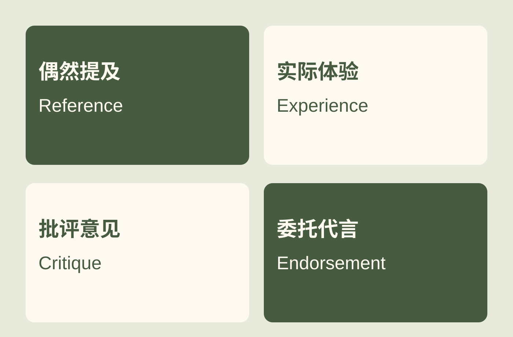

# Brand Mentions: Interpret Creator References

Status: local review draft; confirm the publication date before release.

Return a brand mention to the creator’s original context before distinguishing reference, experience, critique and commercial endorsement.

A brand mention is not automatically a creator recommendation. Open the original work and check object, tone, time and context before distinguishing incidental reference, experience, critique and commercial partnership. Tags and search results are discovery routes, not proof of complete conversation coverage. For quotation, outreach or media use, confirm the actual relationship and relevant permission separately. Treat a mention as a clue for understanding a question and researching a relevant creator, not as confirmed advocacy or an asset freely available for advertising.

## Read the original expression, not only the keyword

The same brand name can appear in a demonstration, comparison, joke, critique or cited material. Inspect the original work, necessary surrounding content and publication date rather than turn a keyword match into praise.

The [social-listening query and sample-validation method](https://www.quickkol.com/blog/social-listening-query-sample-validation/#answer) establishes discovery scope. This article addresses interpreting the creator’s expression after discovery, rather than offering another tool list.

The question may require more than one item from a series. If a creator introduces a test in one post and explains its limitations in another, retain that relationship rather than extract only the more favourable fragment. A short note identifying the related pieces can preserve meaning without reproducing the creator’s entire archive or collecting unrelated personal material. Record whether the reference concerns the brand, a product, a namesake or someone else’s statement. When a creator quotes another person, distinguish whose view is actually being expressed.

If the content is inaccessible, retain a limited state. A screenshot can provide a lead while omitting a correction, irony or important condition. Do not confidently supply context that was never reviewed.

This first reading keeps research close to the creator’s work. The useful finding may be a specific question, an unresolved product condition or a relevant demonstration. None requires the team to declare that the creator supports the brand before it has understood what the person actually said and why the reference appeared. 

## Separate the discovery route from complete coverage

[Meta’s Page-feed publishing reference](https://developers.facebook.com/docs/graph-api/reference/page/feed/) distinguishes Page-related content objects and publishing conditions. Such an entry point is not a complete directory of every brand mention across the internet, and a tag does not establish complete coverage.

Query, platform, language and period affect discovery. State the reviewed scope rather than declare that a long list contains no omissions.

Not finding a creator’s mention does not establish they have never used or discussed a product. Finding one does not establish continuing preference. Both observations and gaps need boundaries.

For cross-platform research, preserve each source. Do not count repeated distribution of one piece as independent opinions, or automatically merge different people and contexts because the wording resembles another result.

The point is to keep a useful sample from becoming an exaggerated market claim. A brand can learn from several relevant expressions while acknowledging how they were found. That makes later creator selection more defensible because the shortlist reflects actual task relevance rather than an unsupported assertion that the search has identified every potential advocate.

## Describe the expression before assigning sentiment

Start with a plain description: the creator demonstrates a step, raises a drawback, compares an alternative or has a product in the background. That can be more useful than immediately assigning positive or negative sentiment.

One work can approve a design choice and criticize another condition. Retain mixed views rather than force the whole expression into one emotional category.

Imagine a creator saying a cup looks attractive but does not suit their grip. The brand can investigate use conditions; removing the qualification would turn the statement into an unconditional recommendation. This is hypothetical, not an actual product review.

For uncertain tone or language, seek capable review and record its basis. A machine label should not override the original expression or present an internal judgment as the creator’s confirmed position.

Descriptive research also improves outreach. The brand can refer accurately to the question raised and explain why a new commission might be relevant. It avoids opening a conversation with an exaggerated compliment that demonstrates the team has not actually understood the creator’s work or the limitation central to the original observation.

## A commercial relationship needs its own evidence

In the U.S. advertising context, [the FTC’s endorsement FAQ](https://www.ftc.gov/business-guidance/resources/ftcs-endorsement-guides-what-people-are-asking) addresses endorsements and material relationships. Seeing a product is not enough to conclude someone was paid, and not seeing a label does not prove no relationship exists.

Inspect the actual expression and known relationship, leaving unknown parts unconfirmed. If proposing a commission, explain the new commercial arrangement rather than treat a spontaneous comment as acceptance.

Disclosure and positive sentiment are different questions. Disclosed critical content need not be excluded from research, while spontaneous praise is not automatically an endorsement available to purchase.

This article makes no compliance determination about a particular creator. For a specific issue, return to facts, jurisdiction and appropriate professional input rather than accuse someone from one public signal.

That distinction lets the brand respect the creator’s independent expression. A later partnership should be a new, explicit conversation about work and conditions, not an assumption that mentioning the product has already made the creator part of a campaign or obliged them to repeat their earlier statement in advertising.

Expressions can be mixed; read original context before classifying.

## Record sources and uncertain states accurately

In the UK data-protection context, [the ICO’s accuracy guidance](https://ico.org.uk/for-organisations/uk-gdpr-guidance-and-resources/data-protection-principles/a-guide-to-the-data-protection-principles/accuracy/) emphasizes source, status and necessary correction. For research, keep subjective interpretation, incomplete observation and established facts distinct.

Record original link, observation date, concise description and open questions. Do not infer private relationships, purchase history or undisclosed contact details to make a list appear complete.

The [brand-mention correction method](https://www.quickkol.com/blog/brand-monitoring-creator-mention-corrections/#answer) addresses changing research records. If the original work adds conditions or corrects a fact, update the current interpretation while retaining suitable historical context.

Labels should serve the actual task. Context review needed identifies a next action; false endorser can create an unsupported personal allegation and should not be casually assigned.

This makes the record easier to maintain. Another reviewer can understand why a lead was included and which part remains uncertain without reproducing the entire search. It also prevents a provisional interpretation from becoming more confident each time the list is copied, even though nobody has added new evidence about the creator or the expression being discussed.

## Confirm quotation and media use separately

Reading a public work during research does not automatically permit advertising with an excerpt. For quotation, check meaning, source and actual usage conditions, obtaining suitable permission where needed.

Do not remove a negative condition to manufacture a recommendation, or use an avatar to imply participation in a partnership. Attractive presentation cannot make a relationship real.

For internal analysis, limit quotation and access to what the task needs instead of circulating complete assets indefinitely. Recheck if the use later becomes public; internal research does not automatically cover that change.

Another option is commissioning new work around a clear question and relationship. That still needs independent agreement rather than requiring the person to repeat an old view or promise positive judgment.

The distinction helps the brand choose an honest next step. It can learn from the original reference without appropriating the work, then discuss a new task when there is a relevant reason. The resulting collaboration has its own scope instead of relying on an earlier public statement as an unlimited source of promotional material.

## Begin outreach with task relevance

If the work reveals a question the brand genuinely needs to answer, research whether the creator has the relevant explanatory capability. Fit comes from work, not simply mention frequency or sentiment.

Outreach can accurately reference what was reviewed and the proposed new task while respecting the original position. Do not claim you have always supported us without a basis, or require removal of reasonable criticism before discussing collaboration.

Confirm availability, actual experience and scope too. A spontaneous reference does not mean willingness to endorse or knowledge of every product.

If the person declines, keep the actual state and stop unsuitable follow-up. The objective is an appropriate partnership, not repeated sales-style pressure on everyone who mentions the brand.

A specific invitation gives the creator room to respond meaningfully. They can explain whether the question fits their work, suggest another format or identify a limitation. That produces better information than assuming enthusiasm from a keyword match and then treating a cautious reply as a surprising change of attitude.

## Hand over an interpretation, not only a count

Retain discovery scope, original expression, relationship state, possible task and next action. Mention count within a documented sample can be a limited observation without independently proving brand health, market share or partnership value.

QuickKOL helps research relevant work and contact routes from a brief. Original posts, commercial relationships and permission require their own sources. Do not claim every public mention has been automatically collected and verified.

When evidence is mixed or insufficient, retain qualifications. A careful interpretation may conclude unsuitable for outreach but useful for improving an explanation; that is still valuable.

The research helps the brand understand the questions creators and audiences raise. Commissioning work around a real question serves long-term collaboration better than packaging every appearance of the name as support or endorsement.

A useful handover allows the next reviewer to act without distorting the original voice. They can return to the source, understand the limited finding and decide whether the appropriate response is a new commission, a factual correction, further research or no commercial action at all.

## The same brand name can raise different questions

| Expression | Check | Avoid inferring |
| --- | --- | --- |
| Background appearance | Object and context | Willingness to endorse |
| Experience | Conditions and original wording | Continuing unconditional preference |
| Critique | Support and question | Discussion should be suppressed |
| Commercial expression | Relationship and requirements | All assets freely usable |

Editorial interpretation framework, not a compliance finding about a person.

## Hand over a brand-mention lead

Preserve the original voice and its scope.

- [ ] Open the original work and retain date.
- [ ] Identify object and full conditions.
- [ ] Separate observation, opinion and fact.
- [ ] Check relationships without guessing payment.
- [ ] Confirm scope before public quotation or media use.
- [ ] Base outreach on the actual question.

## Research date and limitations

Sources reviewed November 20, 2026. Methods, tables and decision rules are editorial recommendations. Hypothetical examples are not actual client results or industry benchmarks. Source geography and periods are specified where relevant.

## Start creator research with a clear task

Use QuickKOL to interpret a brief, discover relevant creators and research their work and contact routes. Verify data, commercial terms and outcomes at their source.

[Explore QuickKOL](https://www.quickkol.com/#capabilities)

## Sources

- [Meta’s Page-feed publishing reference](https://developers.facebook.com/docs/graph-api/reference/page/feed/)
- [the FTC’s endorsement FAQ](https://www.ftc.gov/business-guidance/resources/ftcs-endorsement-guides-what-people-are-asking)
- [ICO: accuracy principle](https://ico.org.uk/for-organisations/uk-gdpr-guidance-and-resources/data-protection-principles/a-guide-to-the-data-protection-principles/accuracy/)
