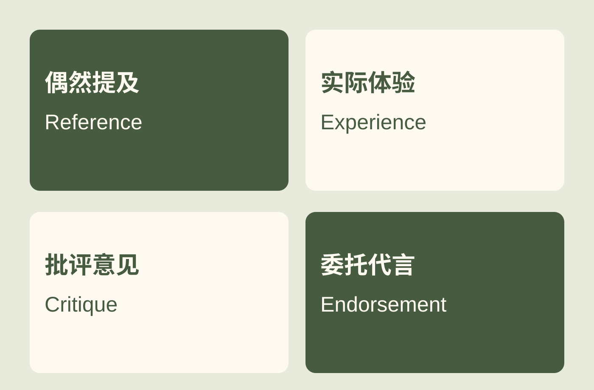

# 品牌提及怎样分清达人表达

状态：本地审阅稿；正式发布日期待确认。

把品牌提及放回创作者的原始语境，区分偶然引用、真实体验、批评与商业代言，再决定引用或外联。

品牌提及不自动等于达人推荐。先打开原始内容，确认提及对象、语气、时间与上下文，再区分偶然引用、实际体验、批评和商业合作。标签与搜索结果只是发现路径，不能证明已经覆盖所有讨论。若要引用、联系或使用作品，分别核对真实关系与所需许可。把提及作为理解问题与研究相关创作者的线索，不直接当成已确认的品牌支持或可自由投放的素材。

## 回到原始表达而非只读关键词

同一品牌名可以出现在使用演示、对比、玩笑、批评或引用资料中。先查看原文、必要前后段与发布时间，不把关键词匹配直接改写成好评。

[社交倾听查询与样本验证方法](https://www.quickkol.com/zh/blog/social-listening-query-sample-validation/#answer)帮助确定发现范围。本篇继续处理找到内容以后怎样理解创作者表达，而不是整理另一份工具清单。

必要语境可能跨越同一系列的几项作品。如果一条介绍测试，另一条解释限制，保留这种关系，而不是只选较正面的片段。简短记录相关作品即可，不需要复制完整归档或收集无关私人材料。记录提及的是品牌、某个产品、同名对象还是他人转述。如果只是引用另一人的话，要区分谁实际表达了观点。

内容无法打开时保留有限状态。截图可以提供线索，但可能缺少更正、反讽或重要条件，不能用肯定语气补全没有看到的语境。

## 区分发现路径与完整讨论范围

[Meta 主页发布接口说明](https://developers.facebook.com/docs/graph-api/reference/page/feed/)区分主页相关内容对象与发布条件。这类技术入口不是互联网中全部品牌提及的完整目录，也不能把标签出现当作所有内容都被覆盖。

搜索词、平台、语言和时期都会影响发现结果。报告说明实际查看的范围，不因一份列表较长就宣称没有遗漏。

没有找到某位创作者提及品牌，不等于其从未使用或讨论过产品；找到一次，也不代表持续偏好。观察与缺失都需要合适边界。

跨平台研究时保留各自来源。不要将同一作品的转载多次计算成独立意见，也不要因文字相似就自动合并不同人物或不同语境。

## 先描述表达再讨论情感分类

先用简单句描述发生了什么：创作者展示一个步骤、提出缺点、比较替代方案，或仅在背景中出现产品。这样的描述通常比直接贴正面或负面标签更有用。

同一作品可能同时赞同某个设计、批评另一项条件。保留混合观点，不要求所有表达都落在单一情绪格子里。

假设创作者说某个杯子好看，但不适合自己的握法。品牌可以研究使用条件，不应截去后半句当成无条件推荐。这是假设编辑例子，不是真实产品评价。

若语气或语言不确定，请有能力的人复核，记录解释依据。不用机器标签覆盖创作者原话，也不把内部判断伪装成已经由本人确认的立场。

## 商业关系需要自己的证据

[FTC 代言问答](https://www.ftc.gov/business-guidance/resources/ftcs-endorsement-guides-what-people-are-asking)在美国广告语境下讨论代言与重要关系。品牌研究不能仅凭出现产品就判定某人接受了报酬，也不能因未看见标签就断言没有合作。

核对作品中的真实表达与已知关系，未知部分保留未确认。如果后续准备委托，向对方清楚说明新的商业安排，不能把原本自发评论当作已经接受合作。

合作披露与观点是否正面是不同问题。有披露的批评内容不必被删除出研究，自发赞美也不自动变成可自由购买的代言。

本篇不是对某位创作者作合规判定。需要具体判断时回到实际事实、适用地区和有关专业意见，避免仅凭单一公开指标作指控。

表达可以混合，先读原始语境再分类。

## 准确记录来源与不确定状态

[ICO 准确性说明](https://ico.org.uk/for-organisations/uk-gdpr-guidance-and-resources/data-protection-principles/a-guide-to-the-data-protection-principles/accuracy/)在英国数据保护语境下强调来源、状态与必要更正。本篇借此提醒研究团队，不把主观解释、不完整观察与已经核实的事实混成同一栏。

记录原始链接、观察日期、简短描述及未决问题。不要为了让名单看起来完整，推测创作者的私人关系、购买记录或未公开联系方式。

[品牌提及更正方法](https://www.quickkol.com/zh/blog/brand-monitoring-creator-mention-corrections/#answer)讨论如何处理研究记录变化。若原帖后来补充条件或纠正事实，应更新现行结论，同时保留适当历史背景。

研究标签应服务真实任务。例如“需要语境复核”说明下一步，而“虚假代言者”在没有充分事实时可能造成不当结论，不应随意用于个人记录。

## 引用与素材使用另行确认

研究中可以阅读某个公开作品，不代表品牌可以截取画面用于广告。若计划引用，先核对准确语义、来源和实际使用条件，必要时取得适当许可。

不要把负面条件删掉，让原话看起来像推荐；也不要用创作者头像暗示其已参与合作。文件漂亮不代表关系真实。

若只是内部分析，限定必要引用与访问范围，不把完整素材无限传播给不相关人员。后续转为公开用途时重新确认，而不是默认内部研究已经覆盖。

可以选择委托新的作品，让创作者在明确关系下回答一个问题。新的合作仍要有独立同意，不要求对方无条件重说旧观点或保证只给正面评价。

## 从问题相关性进入达人外联

若作品揭示一个品牌确实需要回答的问题，研究创作者是否具备相关解释能力。相关性来自作品，不只来自提及次数或情感标签。

外联可以准确提到你看过的内容与需要的新任务，尊重原本观点。不要声称“你一直支持我们”，除非有适当依据，更不要求先删除合理批评才谈合作。

同时确认可用时间、真实体验与商业范围。一次自然提及不意味着对方愿意代言，也不意味着其熟悉全部产品。

如果对方拒绝，保留真实状态并停止不合适的跟进。研究的目标是找到合适合作，而不是让每个提及品牌的人都进入销售式的反复催促流程。

## 交接理解而不是累积提及数

报告保留发现范围、原始表达、关系状态、可能任务与下一步。提及数可以作为有限观察，但不能单独证明品牌健康、市场份额或达人合作价值。

QuickKOL 可以帮助从 Brief 研究相关作品与联系路径。实际原帖、合作关系和使用许可仍回到各自来源，不声称所有公开提及都已被自动抓取并核验。

如果资料混合或不足，如实保留限定。一次认真理解可以得出“不适合外联，但值得改进解释”的结论，这同样有用。

品牌提及研究的价值是更准确地听懂创作者与观众提出的问题。围绕真实问题安排新内容，比把每次出现品牌名都包装成支持和代言更能服务长期合作。

## 同样提到品牌，不同研究问题

| 表达 | 适合核对 | 避免推出 |
| --- | --- | --- |
| 背景出现 | 实际对象与语境 | 愿意代言 |
| 使用体验 | 具体条件与原话 | 持续无条件偏好 |
| 批评 | 依据与问题 | 必须压低讨论 |
| 商业表达 | 真实关系与适用要求 | 所有素材可自由使用 |

编辑理解框架，不是对具体个人的合规结论。

## 交接一个品牌提及线索

保留原始声音及其范围。

- [ ] 打开原始内容并保留日期。
- [ ] 确认提及对象和完整条件。
- [ ] 分开观察、意见与事实。
- [ ] 核对真实关系，不猜测报酬。
- [ ] 公开引用或用图前确认范围。
- [ ] 按具体问题决定是否外联。

## 研究日期与使用边界

资料核验于 2026 年 11 月 20 日。文中方法、表格和决策规则为编辑建议，标为假设的示例不是实际客户结果或行业基准。外部资料的适用地区与时期按各段说明。

## 从任务开始达人研究

用 QuickKOL 理解 Brief、发现相关达人并研究作品与联系路径；数据、合作条件和结果仍需核验。

[了解 QuickKOL](https://www.quickkol.com/#capabilities)

## 来源

- [Meta 主页发布接口说明](https://developers.facebook.com/docs/graph-api/reference/page/feed/)
- [FTC 代言问答](https://www.ftc.gov/business-guidance/resources/ftcs-endorsement-guides-what-people-are-asking)
- [ICO：准确性原则](https://ico.org.uk/for-organisations/uk-gdpr-guidance-and-resources/data-protection-principles/a-guide-to-the-data-protection-principles/accuracy/)
