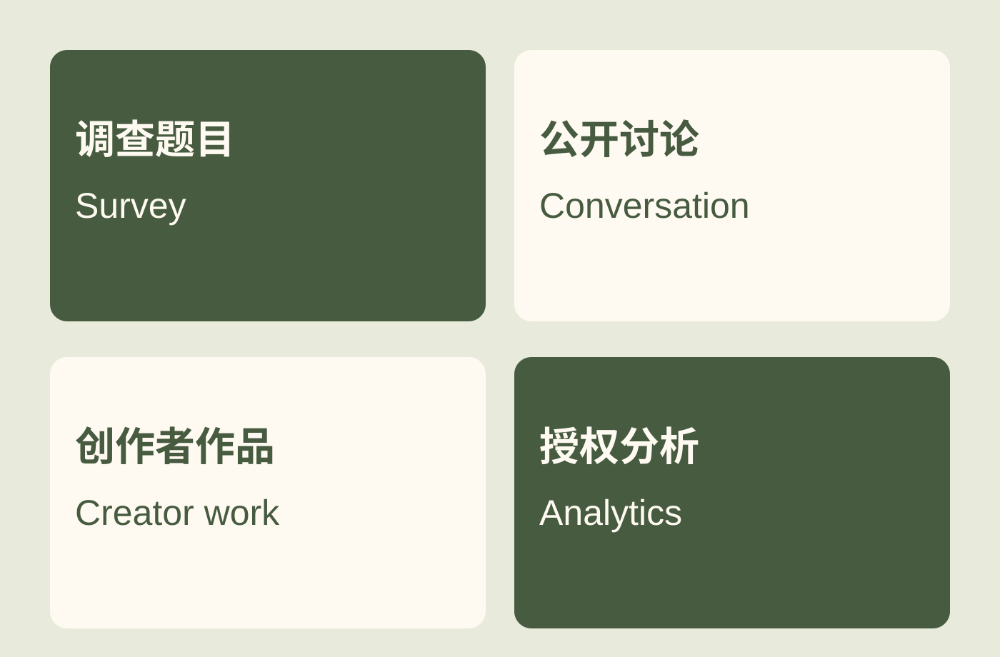

# Brand Research Platforms for Creator Decisions

Status: local review draft; confirm the publication date before release.

Choose survey, listening, content research or authorized analytics around a creator-partnership question, then evaluate the platform through a real task.

A brand research platform is useful when it supplies suitable evidence for a particular creator-partnership question. A survey can ask a defined audience about understanding or consideration; public-conversation research can reveal language and questions; authorized analytics can describe observations about a specific account or asset. Match the question to the evidence object before comparing coverage, method, permissions and handoff quality. A feature on a supplier’s website does not establish that the available data can answer the team’s question, and a large dashboard does not remove the need to understand its inputs.

## Translate procurement into a research question

Do not begin procurement with we need a brand research platform. State the decision first. The brand may need to identify a creator capable of explaining a product difference, understand whether viewers interpret a commissioned message correctly or examine a change in a particular brand association.

[SBA’s market-research explanation](https://www.sba.gov/counseling/plan-your-business/) distinguishes existing information from direct research with consumers. It is US small-business guidance, not a creator-procurement standard, but it helps the team recognize that different questions need different inputs.

Give the question an audience, content object, period and possible action. If an answer would not change a decision, narrow the scope before adding more charts. Research can support learning, but the team should still state what knowledge it wants.

Several questions can coexist. Keep them separately identifiable. Combining explanatory capability, audience fit and brand consideration into one unexplained score can make a platform look comprehensive while making the actual creator choice harder to explain. A useful request names the decision and invites suppliers to show how their method could support it, rather than rewarding whichever demonstration contains the largest collection of unrelated metrics.

## Choose the evidence type for the question

Surveys, public-conversation research, work review and authorized analytics are not four interchangeable interfaces. Surveys depend on questions and sampling. Conversation research depends on accessible sources and retrieval. Work review concerns actual contribution. Account analytics depend on object, permission and metric.

[Qualtrics’ brand-tracking explanation](https://www.qualtrics.com/articles/strategy-research/brand-tracking-guide/) describes repeated comparable questions about awareness, associations and consideration. This is a supplier’s methodological explanation. Using the platform does not automatically produce a causal conclusion or a finding applicable to every audience.

If the question is whether a creator can explain an operation, relevant original work and a sample may be more direct starting points. If the question concerns how the target audience interprets a message, observing the creator’s own opinion is insufficient.

During a demonstration, ask the supplier to identify which input answers which question. A tool can legitimately solve only part of the job. A clear boundary is more useful than labelling every information type consumer insight. It also makes a combined research approach easier to plan: the team can see what another method must supply rather than assume that a single purchased platform has eliminated every evidence gap.

Choose the evidence object before comparing platforms.

## Inspect coverage and the meaning of missing data

A platform covering a channel does not mean it covers everything on that channel. Check the boundaries around public, authorized, historical, deleted and restricted material, along with retrieval language and observation period.

[Meta’s Insights overview](https://developers.facebook.com/docs/insights/overview) describes access through specific objects, metrics and permissions. It supports checking object and permission, not a claim that a particular supplier can read every account’s data.

Ask the demonstration to include something not found. How does the system distinguish no observation, no access, outside coverage and an observed zero? If all become zero, subsequent comparisons may acquire false certainty.

Creator research also needs stable work and account objects. A brand name can refer to several entities, and a repost can appear repeatedly. Include duplicate and similar names in a pilot instead of viewing only the supplier’s cleanest prepared result.

The goal is not to prove that missing data makes a product unusable. It is to understand which decisions remain possible and how absent information will be labelled in the deliverable. That knowledge should travel with the report rather than remain in a sales conversation that the eventual analyst never sees.

## Evaluate the demonstration through one task

Prepare one question the team actually needs to answer and provide inputs it is permitted to use. Ask the supplier to show the route from input to output instead of only navigating a prepared dashboard.

Imagine a brand selecting creators to explain a category of software workflow. A pilot could require returning to original work, identifying contribution, preserving sources and listing unresolved questions. This is an editorial pilot scenario, not a report of testing any named platform.

Agree acceptance conditions beforehand: recoverable provenance, an explained observation period, export of task-relevant fields and preservation of unknown states. Do not wait until after the demonstration to decide that the result looks intelligent.

If the supplier uses modelled estimates, ask what is estimated and how the output should be interpreted. A demonstration can provide leads for further checking; it does not automatically establish personal audience facts, certify identity or guarantee availability for a partnership. Retain enough detail for the person running the pilot to explain why a result meets the agreed task. This produces a concrete evaluation record rather than an endorsement based on presentation quality.

## Make the exported record understandable

A research result should be usable by someone who did not attend the demonstration. That requires more than a screenshot: field definitions, object, window, source and limitations should remain available. If the supplier can display only a number, ask how the team will review it later.

The [social-listening coverage pilot method](https://www.quickkol.com/blog/social-listening-tools-kol-coverage-pilot/#answer) helps inspect sources and sampling without treating coverage as the whole market. Including those requirements also helps compare whether different quotations actually promise equivalent work.

An export should distinguish original values from editorial judgments. A role assessment added by an analyst should not resemble platform certification. Information not obtained should not turn into an implied positive conclusion through an unexplained blank field.

Check how later corrections will be retained. If original work changes or an account reference is updated, the team should know which conclusions depend on it. It should not have to reconstruct every source from a static image.

Export quality matters because creator decisions often move between researchers, procurement and campaign owners. The usefulness of the research depends on whether those people can carry its boundaries forward, not simply whether the initial analyst can navigate the supplier’s interface.

## Compare the work behind the cost

Do not invent platform prices or usage allowances. A quotation should correspond to the current region, plan, seats, data scope and pilot conditions, using the supplier’s actual explanation.

Separate subscription, research design, sample or data acquisition, manual review and report maintenance. A lower subscription fee does not necessarily mean lower total task cost if the team must still perform substantial organizing work.

Human participation is not automatically a platform failure. Interpreting creator work, checking sources and preparing contact can be necessary parts of a complex decision. Compare whether responsibilities are clear rather than pursuing a claim of complete automation.

State the procurement conclusion as a usage boundary: suitable for a defined public-work research task, for example, while target-audience questions still require a separate method. This can guide use without producing an all-purpose ranking whose competitors were never assessed on a common basis.

The commercial comparison becomes more useful when it identifies what the team will receive, what it must still supply and who maintains the evidence. That is more actionable than a recommendation built around an unverified entry price or a collection of features unrelated to the current creator brief.

## Write a bounded pilot conclusion

Suppose two approaches both find relevant work, but only one preserves provenance and unknown states in the form the team needs. The brand can prefer it for this handoff requirement without concluding that it is more accurate in every field.

If the other approach supplies a different survey capability, it may remain suitable for another task. Different tools do not need one overall score to have value. A single demonstration also does not establish every user’s experience.

Record inputs, scope, steps actually completed and untested areas. If current pricing, account permissions or Chinese-language retrieval were not tested, say so. A supplier demonstration should not silently fill those gaps.

The pilot conclusion should tell the owner whether to proceed, what is missing and which uses should wait. It is not a certification of security, legal compliance or complete data accuracy. This bounded conclusion is easier to maintain: a later change can be assessed against the specific requirement rather than forcing the team to defend an overly broad statement that the platform is best for influencer marketing in general or that its estimates are equivalent to verified creator records.

## Connect research with the partnership action

After choosing a platform, assign a real purpose to its output: formulate candidate questions, choose a communication role, improve the brief or design further research. Do not leave the result as charts without an owner.

The [social-metric decision method](https://www.quickkol.com/blog/social-media-metrics-creator-decision-tree/#answer) helps turn observations into proportionate action while retaining unknowns, responsibility and conditions for another review. Research and outreach also remain distinct: finding relevant work does not establish willingness to collaborate.

QuickKOL helps interpret a brief, discover relevant creators, research work and prepare personalized contact. Audience evidence, commercial conditions and outcomes still require verification at their source. The method in this article does not imply an untested product integration.

Platform selection should make the team clearer about what it knows, what it does not and whom to ask next. A tool can expand research capability while leaving judgment visible. Attach the usage conclusion to the procurement record, so later users understand both the intended benefit and the limits of the pilot. That turns a supplier choice into a practical research arrangement instead of an unsupported promise that purchasing software will settle every creator-marketing question.

## Research question and evidence type

| Question | Input | Limit |
| --- | --- | --- |
| How people interpret | Suitable sample and survey | Not everyone is represented |
| What is discussed publicly | Visible sources and retrieval | Visible is not complete |
| What a creator can do | Original work and contribution | Work does not establish availability |
| How work was observed | Authorized objects and metrics | Observation is not automatic attribution |

Editorial procurement framework, not a platform test or ranking.

## Confirm the research-platform pilot

Use one actual creator question.

- [ ] Define the decision and audience.
- [ ] Match the evidence type.
- [ ] Check coverage and missing states.
- [ ] Request a reviewable demonstration route.
- [ ] Retain exported definitions and limits.
- [ ] Specify manual work and the next step.

## Research date and limitations

Sources reviewed November 20, 2026. Methods, tables and decision rules are editorial recommendations. Hypothetical examples are not actual client results or industry benchmarks. Source geography and periods are specified where relevant.

## Start creator research with a clear task

Use QuickKOL to interpret a brief, discover relevant creators and research their work and contact routes. Verify data, commercial terms and outcomes at their source.

[Explore QuickKOL](https://www.quickkol.com/#capabilities)

## Sources

- [SBA’s market-research explanation](https://www.sba.gov/counseling/plan-your-business/)
- [Qualtrics’ brand-tracking explanation](https://www.qualtrics.com/articles/strategy-research/brand-tracking-guide/)
- [Meta’s Insights overview](https://developers.facebook.com/docs/insights/overview)
