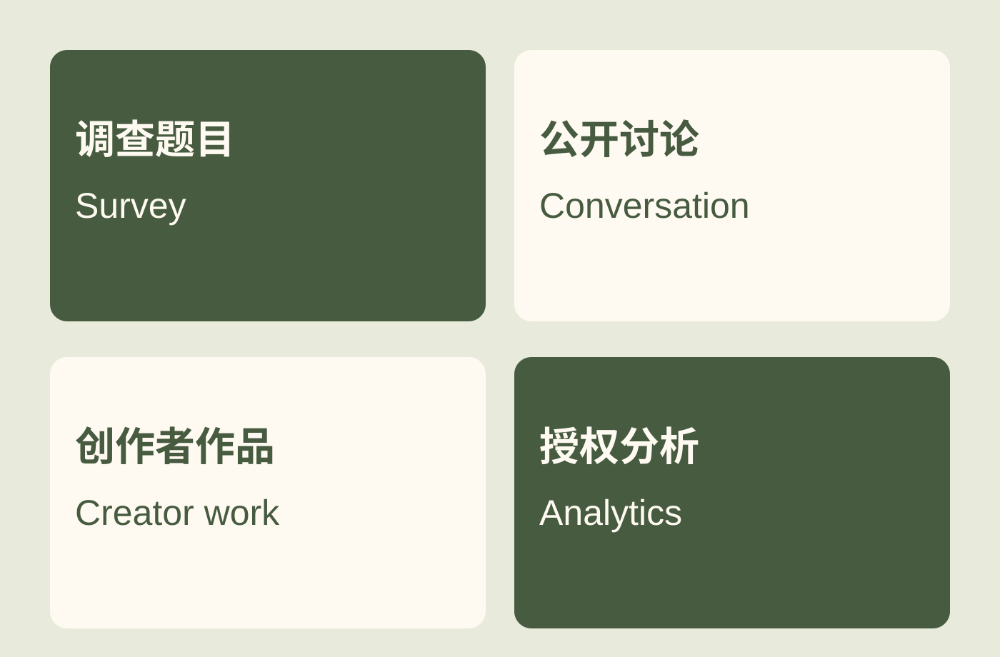

# 品牌研究平台怎样服务达人问题

状态：本地审阅稿；正式发布日期待确认。

先确定品牌需要从达人合作中回答什么，再选择调查、聆听、内容研究或授权分析工具，并用真实任务评估平台。

品牌研究平台的价值取决于它能否为当前达人合作问题提供适用证据，而不只在于功能清单。调查适合询问特定人群的理解与考虑，公开讨论研究帮助发现表达和问题，授权分析核对具体账号或作品的观察。先把问题与资料对象对应，再评估覆盖、方法、权限和可交接结果。平台声称拥有某项功能，不等于本次数据足以支持决定。

## 把采购需求写成研究问题

不要从“需要一个品牌研究平台”开始询价，先说明决定。例如，品牌想知道哪位达人适合解释产品差异，观众能否理解委托信息，或合作后某种品牌联想是否变化。

[SBA 市场研究说明](https://www.sba.gov/counseling/plan-your-business/)区分利用现有资料与直接向消费者研究。它是美国小企业指导，不是达人采购标准，但有助于团队承认不同问题需要不同输入。

给问题写上人群、内容、时期和可能的行动。若答复不会改变任何决定，先缩小范围，而不是增加更多图表。研究也可以支持学习，但仍应说明希望获得什么知识。

品牌可以同时有多个问题，不过应分别列出。用一个总分把表达能力、受众匹配与品牌考虑混在一起，会使平台看似完整，却让负责人难以解释为什么选某位达人。

## 按问题选择证据类型

调查、公开讨论、作品研究和授权分析不是互相替代的四个界面。调查取决于题目与样本，讨论研究取决于可见来源和检索，作品研究看具体贡献，账号分析则依赖对象、权限和指标。

[Qualtrics 品牌追踪说明](https://www.qualtrics.com/articles/strategy-research/brand-tracking-guide/)讨论持续使用可比较问题观察认知、联想与考虑等变化。这是供应商的方法介绍，不代表使用该平台就获得因果结论或适用所有人群。

如果问题是达人能否讲清某个操作，先看相关原作与样片可能更直接。若问题是目标受众如何理解信息，仅观察创作者自己的观点还不够。

在平台演示中让对方说明哪种输入回答哪项问题。允许一个工具只解决一部分任务；清楚的范围比把所有资料都叫“消费者洞察”更有帮助。

先选择证据对象，再比较平台。

## 检查覆盖与缺失的含义

平台收录某个渠道，不代表覆盖该渠道全部内容。核对公开、授权、历史、删除和受限资料的范围，并说明检索语言与实际观察时期。

[Meta Insights 概览](https://developers.facebook.com/docs/insights/overview)按具体对象、指标与权限说明访问。它支持权限与对象需要核对的原则，不能扩展成某个供应商可以访问全部账号数据的证明。

要求演示一项未找到的结果。系统如何区分没有观察、无法访问、未纳入覆盖和真实为零？如果都显示为零，后续比较可能产生错误确定性。

达人研究尤其需要保留作品与账号对象。一个品牌名字可能对应多个主体，一条转载也可能重复出现。让演示包含重复与近似名称，比只看最干净的预设结果更能发现任务限制。

## 用一项任务检验演示

准备一个团队确实需要回答的问题，并提供允许使用的输入。要求供应商展示从输入到结果的步骤，而不只翻看预先做好的仪表盘。

假设品牌想选择适合解释某类软件工作流的创作者。试用可以要求回到原作、辨认贡献、保留来源和列出无法确认的问题。这是编辑试用案例，不是对任何平台的实测结果。

先约定验收：能否恢复出处，能否说明观察期，能否导出与任务有关的字段，以及是否能够保留未知。不要等演示后才凭印象决定“看起来很智能”。

如果供应商使用模型估计，问清估计对象与解释范围。演示结果可以成为进一步核验的线索，不能自动作为个人受众事实、身份认证或合作可用性的保证。

## 让导出文件独立可读

研究结果应能交给没有参加演示的人。需要的不只是截图，还包括字段含义、对象、窗口、来源与限制。若供应商只能展示一个数字，问清团队以后怎样复核。

[社交聆听覆盖试点方法](https://www.quickkol.com/zh/blog/social-listening-tools-kol-coverage-pilot/#answer)可以帮助检查来源和样本，不把平台覆盖当成市场全貌。将相关方法放进研究需求，也有助于比较不同报价是否实际承诺相同工作。

导出也应保留原始值与编辑结论的区别。由分析人员补充的角色判断，不应看起来像平台官方认证；没有拿到的资料也不应在交接中变成空白的肯定。

核对是否能保留后续更正。某项原作更新或账号变化时，团队应知道哪些结论依赖它，而不是必须从一张静态图重新猜测全部来源。

## 比较费用时比较实际工作

不编造平台价格或使用量。报价应对应当前地区、计划、席位、数据范围和试用条件，以供应商实际说明为准。

区分平台订阅、研究设计、样本或数据取得、人工复核和报告维护。一个较低的订阅费用，如果仍需团队完成大量资料整理，不一定意味着整个任务成本更低。

不要把人工参与视为平台失败。对复杂达人判断，研究员解释作品、核对来源和准备沟通本来就可能是必要工作；应比较职责是否清楚，而不是追求“完全自动”。

将采购结论写成用途范围，例如适合某类公开作品研究、仍需另行调查目标受众。这样的结论可以指导实际使用，不必给一个没有统一口径的全能排名。

## 把一次试用的结果写有限

假设两种方案都找到了相关作品，但只有一种能够保留出处与未知状态。品牌可以就本次交接需求偏好后者，不必推断它在所有领域都更准确。

如果另一方案能提供不同的调查能力，也可以作为另一个任务的候选。不同工具的价值不必通过同一总分决定，更不能从一次演示推断所有用户体验。

记录试用输入、范围、实际完成步骤和未测试部分。没有测试当前价格、账号权限或中文检索，就明确没有测试，不用供应商演示自动填补。

试用结论应该告诉负责人能否继续、需要补什么，以及哪些使用方式应暂缓。它不是对平台安全、法律合规或全部数据准确性的认证。

## 将研究连接到合作行动

决定平台之后，为输出指定实际用途：形成候选问题、选择表达角色、完善 Brief 或设计后续研究。不要让报告只停留在一组没有负责人的图表。

[社媒指标决策方法](https://www.quickkol.com/zh/blog/social-media-metrics-creator-decision-tree/#answer)帮助把观察转换成适当行动，保留未知、负责人和重新观察条件。研究与外联之间也要区分：发现相关作品不代表达人愿意合作。

QuickKOL 帮助理解 Brief、发现相关达人、研究作品并准备个性化联系；受众证据、商业条件和结果仍需来源核验。不能从本文的方法推断某个未验证的产品集成功能。

平台选择应让团队更清楚自己知道什么、还不知道什么，以及下一步找谁确认。工具可以扩大研究能力，判断依据仍需要被看见和负责任地使用。

## 研究问题与证据类型

| 问题 | 输入 | 限制 |
| --- | --- | --- |
| 人群如何理解 | 适当样本与调查题目 | 样本不代表所有人 |
| 公开讨论什么 | 可见来源与检索 | 可见不等于全量 |
| 达人能做什么 | 原作与贡献 | 作品不保证可用性 |
| 作品怎样被观察 | 授权对象与指标 | 观察不自动归因 |

编辑采购框架，不是具名平台实测或排名。

## 确认研究平台试点

围绕一项真实达人问题进行。

- [ ] 写清决定与人群。
- [ ] 匹配证据类型。
- [ ] 检查覆盖与缺失状态。
- [ ] 要求可复核的演示路径。
- [ ] 保留导出字段与限制。
- [ ] 说明人工工作与下一步。

## 研究日期与使用边界

资料核验于 2026 年 11 月 20 日。文中方法、表格和决策规则为编辑建议，标为假设的示例不是实际客户结果或行业基准。外部资料的适用地区与时期按各段说明。

## 从任务开始达人研究

用 QuickKOL 理解 Brief、发现相关达人并研究作品与联系路径；数据、合作条件和结果仍需核验。

[了解 QuickKOL](https://www.quickkol.com/#capabilities)

## 来源

- [SBA 市场研究说明](https://www.sba.gov/counseling/plan-your-business/)
- [Qualtrics 品牌追踪说明](https://www.qualtrics.com/articles/strategy-research/brand-tracking-guide/)
- [Meta Insights 概览](https://developers.facebook.com/docs/insights/overview)
