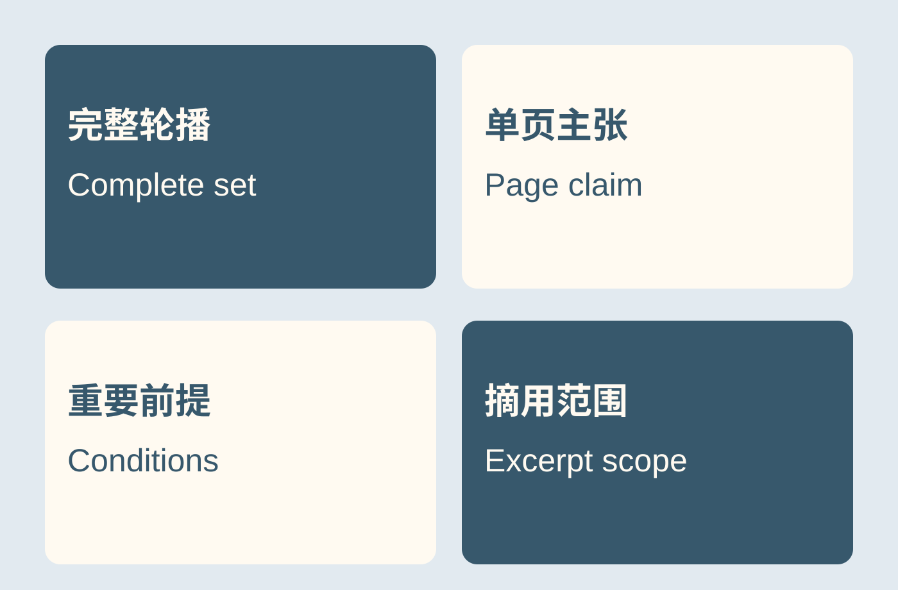

# 达人轮播怎样让单页保留语境

状态：本地审阅稿；正式发布日期待确认。

轮播不只需要顺序清楚，还要让单页被转述或截取时保留必要前提。为达人合作同时检查整组、单页和用途。

Carousel post 是在一条帖子中放入多张图片或视频的形式。用于达人营销时，它可以让观众逐步理解选择、操作或体验，但不能假定每个人都会从第一页读到最后。除整体顺序外，每页也应保留影响理解的产品信息、条件与语境。本文关注单页被分享或引用时如何不失真，而不是给出所有账号统一的页数或效果保证。

## 定义格式，同时保留任务

[Meta 轮播发布说明](https://developers.facebook.com/documentation/instagram-platform/content-publishing)将多图片或视频帖子与单项媒体区分，并讨论专业账号通过平台接口发布的条件。这份技术资料可以支持格式定义，不能直接当成所有原生账号当前页数与功能的统一说明。

品牌先写轮播帮助谁完成什么：比较两个适用情境、看懂一个操作，或理解一次真实体验。不要为了容纳更多卖点就把无关内容拼成一组。

达人可以通过作品中的解释和观察建立连续性，但页面数量本身不证明内容更专业。每页应承担可说清的任务，删掉某页时也能说明为什么。

[轮播分镜 Brief 方法](https://www.quickkol.com/zh/blog/instagram-carousels-kol-sequence-brief/#answer)处理整体顺序与试拍。本篇进一步检查页面离开顺序后是否仍容易理解。这个问题在品牌摘用、内部提案和观众转述时尤其重要。

## 选择需要留在单页的前提

不是每页都要复制全部介绍。先找离开上下文会改变意思的内容：产品型号、演示条件、观察时期、对比对象、来源和限制。

例如，展示某种使用结果的照片，可能需要说明是哪个版本、在什么条件下观察。若只在最后一页放限定，截取中间图片的人就可能看不到。

把条件安排在真正对应的画面旁，用清楚的短句，而不是堆满小字。若必须靠大量注释才能避免误解，考虑拆开主张或改用更合适的解释形式。

页面应能被理解，不等于品牌已经授权任何人单独使用。理解问题与用途许可仍需分开，不能因为做了完整标注就推断素材可随意转载。

整组顺序与单页语境分别检查。

## 整组顺序仍然需要检查

单页可理解不能替代整组叙事。按最终导出顺序看，确认问题、依据、比较和下一步之间没有断裂，也没有把某个限制推到与主张很远的位置。

如果页面包含动作步骤，检查是否省略必要前提，或将不同演示拍成同一连续过程。产品版本不一致时，不应靠相同背景让观众以为完全可比。

[轮播解释页序方法](https://www.quickkol.com/zh/blog/canva-carousel-creator-explanation-page-order/#answer)可以帮助给每页安排角色。更换一张照片后重新检查相邻页面，而不是只审替换图；局部修改可能改变整个选择逻辑。

实际发布前还要核对账号内预览与顺序，保留通过审稿的完整文件组。不能仅凭共享文件夹里每个单图都通过，就宣布最终帖子已经验收。

## 共创、提及与摘用分别确认

[Meta 2023 共创与轮播说明](https://about.fb.com/news/2023/08/music-and-collabs-on-instagram/)介绍过照片轮播音乐与 Collabs 等功能。这是 2023 年公告，应与当前账号可用性分开，不把历史功能描述当成所有项目的完整许可。

在合作中说明谁原创、谁发布、谁作为共同作者、谁只是被提及。品牌拿到文件，不等于可以把创作者改成未参与的新声明的作者。

若品牌希望把某页用于其他渠道、广告或提案，明确页码、编辑、期限与身份展示。整组用途与单页用途可能不同，特别是截取后语境会改变时。

创作者接受共创邀请也不自动完成所有商业条款。将实际平台动作与双方另行确认的工作和用途连接起来，而不是用其中一个替代所有条件。

## 商业语境不能只靠读完

在适用的美国指导中，[FTC 达人披露说明](https://www.ftc.gov/business-guidance/resources/disclosures-101-social-media-influencers)要求重要品牌关系清楚可理解。对轮播，编辑应检查观众能否在实际接触内容时理解商业关系，而不只在整组读完后才知道。

本文不替每个地区规定唯一排版。品牌需要与合作方核对适用要求、原生标记和文字表达，不能把平台标记或图片里的一个缩写视为所有情境自动充分。

对单页摘用重新审查语境。某张产品体验图如果从付费合作组里抽出，新的用途不能让它看起来是与品牌完全无关的独立意见。

披露也不能修复没有依据的产品宣称。说明商业关系后，画面与文字仍需要真实、准确并符合创作者实际经验。

## 用假设单页检查理解

假设达人轮播解释一款工具的两种用法。某页写“更适合外出”，但真正依据是某个型号在特定任务下更容易携带。这是编辑示例，不是产品实测。

单独看到那页，读者可能把它理解为整条产品线普遍更适合旅行。可以缩小文案，保留型号与任务，并调整画面，使表达与依据一致。

如果页面只在另一页引用来源，也要检查单页转述是否容易把外部事实变成达人自有研究。可以在适当位置保留来源标识与路径，而不是复制大段原文。

案例的目标不是要求每页变成研究报告，而是找出会改变决定的缺失。一次有针对性的单页审查，往往比增加更多装饰页面更能提高交付质量。

## 版本交接包含实际用途

给完整轮播与获准摘用页分别标识，记录顺序、语言、产品与批准状态。不同语言不能只替换标题，却留下不一致的数值、条件或来源。

如果需要字幕、替代文字或视频片段，保留与最终文件对应的版本。不能把源文件里的未审文案误当成公开 alt，也不能让移动端裁切移除必要信息。

说明哪些改动需要回审，例如删去限制、改变对比对象、重排步骤或把个人体验改成通用保证。纯技术导出也要确认没有损坏清晰度和顺序。

共享给下一位使用者时，连同用途条件一起交接。不把文件名中的“final”当成已经获准所有渠道使用的证明。

## 按解释任务复盘轮播

发布后检查实际作品是否对应通过的文件组，并记录读者真正提出的问题。收藏、互动或浏览可以提供观察，但不能自动证明每个人读完了所有页。

如果某个页面反复被误解，先看它缺少什么语境，而不是只换封面或增加页数。若观众需要的是动作演示，可以考虑后续视频，不必坚持每个问题都用轮播。

QuickKOL 可以帮助理解 Brief、研究适合表达任务的达人并准备联系；具体页面依据、用途和效果仍需核对。工具关联应服务选择，不冒充已经验证某种格式的结果。

一条好的轮播让整组与单页都尽可能清楚，并让后续使用尊重原来的意思。品牌要交付的是可以被理解的解释，而不是仅仅一摞漂亮图片。

## 整组与单页的检查

| 对象 | 检查 | 避免 |
| --- | --- | --- |
| 整组 | 问题、依据与顺序 | 必要步骤断裂 |
| 单页 | 产品与重要条件 | 片段扩大主张 |
| 摘用 | 范围与身份表达 | 文件等于许可 |
| 发布 | 实际顺序与商业语境 | 只看源文件 |

编辑解释框架，不是原生功能上限说明。

## 确认轮播交付

同时检查完整帖子与可能摘用的页面。

- [ ] 定义一个观众问题。
- [ ] 给每页安排实际任务。
- [ ] 保留会改变含义的前提。
- [ ] 单独确认摘用范围。
- [ ] 复核商业语境与原作来源。
- [ ] 保存最终顺序与版本。

## 研究日期与使用边界

资料核验于 2026 年 11 月 20 日。文中方法、表格和决策规则为编辑建议，标为假设的示例不是实际客户结果或行业基准。外部资料的适用地区与时期按各段说明。

## 从任务开始达人研究

用 QuickKOL 理解 Brief、发现相关达人并研究作品与联系路径；数据、合作条件和结果仍需核验。

[了解 QuickKOL](https://www.quickkol.com/#capabilities)

## 来源

- [Meta 轮播发布说明](https://developers.facebook.com/documentation/instagram-platform/content-publishing)
- [Meta 2023 共创与轮播说明](https://about.fb.com/news/2023/08/music-and-collabs-on-instagram/)
- [FTC 达人披露说明](https://www.ftc.gov/business-guidance/resources/disclosures-101-social-media-influencers)
