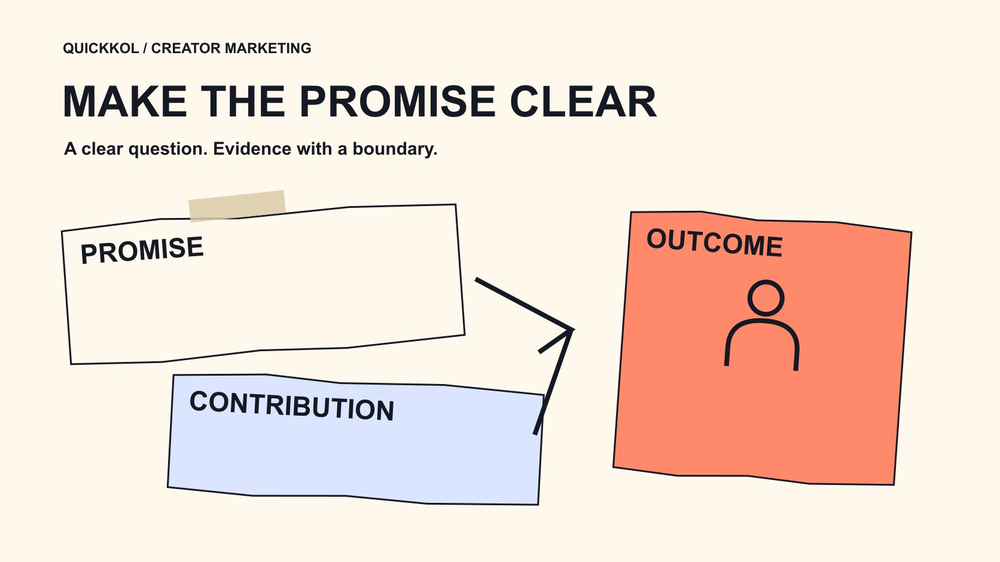
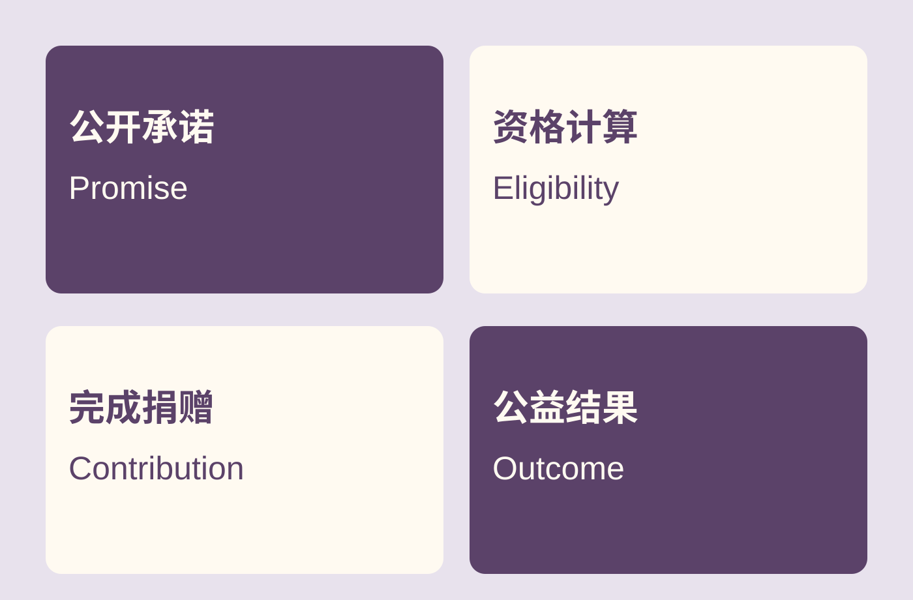

# Cause Marketing: Brief a Creator Donation Claim

Status: local review draft; confirm the publication date before release.

A cause-related creator campaign should explain beneficiary, donation trigger, amount basis, period and reconciliation rather than substitute attention for charitable outcomes.

QuickKOL editorial graphic; not actual account metrics or a platform interface.

Cause marketing here means a promotional arrangement connected to defined support for a cause. In a creator partnership, viewers should understand who benefits, which action triggers support, how the amount is determined and which conditions limit the promise. Keep creator compensation, the brand’s donation and eventual charitable impact separate. Clear wording reduces ambiguity but does not certify the campaign. The appropriate owners must confirm the particular arrangement and applicable local requirements before the creator presents a commitment to the public.

## Define the commitment before the story

Support a cause can mean a fixed donation, a donation linked to sales, goods, volunteering or communication about an activity. These are different commitments. A moving narrative should not conceal which arrangement actually exists.

Have the brand and beneficiary confirm the support before the creator develops the expression. If the activity involves one fixed donation, do not imply that every like or purchase increases it.

Separate who promises, who performs and who records the action. The creator may explain the campaign without receiving donations or verifying charitable expenditure. The brand’s communications team should not promise figures that finance or the beneficiary has not confirmed.

The [ambassador feedback-and-renewal method](https://www.quickkol.com/blog/ambassador-program-feedback-renewal-loop/#answer) can support learning and relationship maintenance in a continuing partnership. The immediate question here is whether a public commitment can be understood accurately. Establish that before promotional wording becomes difficult to change.

A useful first record states the type of contribution and the owner able to confirm it. This gives the creator a factual foundation and keeps the campaign from developing around an attractive but undefined phrase that different departments interpret differently.

## Place donation conditions beside the promise

[BBB’s cause-marketing disclosure standard](https://give.org/bbb-standards-for-charity-accountability), number 19, calls for clarity about how a sale benefits a charity, including the contribution basis, campaign period and maximum or guaranteed minimum. This is a BBB Wise Giving Alliance accountability standard, not a universal statute.

Applied to a brief, the idea becomes a record of beneficiary, eligible product or action, amount basis, starting and ending conditions, and limits. If a percentage is used, define its base. A portion of proceeds should not replace the actual arrangement.

Material conditions should appear where viewers understand the promise, rather than in disconnected information. Do not remove a limitation that changes the donation’s meaning simply to make the video feel lighter.

If the arrangement is too complex to explain, simplify the campaign design or provide a clear information route. Do not ask the creator to compress it into an ambiguous promise. Clear communication depends on the brand first understanding its own commitment. The brief should therefore identify which wording has been confirmed by the owners of the arrangement, rather than treating a draft slogan as the source of truth for financial or beneficiary details.

## A charitable motive does not erase commercial context

In US guidance, [the FTC’s endorsement FAQ](https://www.ftc.gov/business-guidance/resources/ftcs-endorsement-guides-what-people-are-asking) addresses reviews encouraged by charitable donations and explains that the incentive can affect how readers assess them. This is US guidance, not a claim that every jurisdiction has identical requirements.

A creator can receive a fee, a sample or another benefit while sincerely supporting a cause. Both can be true. A worthwhile motivation does not mean viewers should have to guess the commercial arrangement.

Separately, [the FTC’s influencer-disclosure guide](https://www.ftc.gov/business-guidance/resources/disclosures-101-social-media-influencers) emphasizes making material brand relationships understandable. In the brief, separately address the creator’s relationship with the brand and the brand’s support arrangement with the beneficiary. Explaining one does not automatically explain the other.

Avoid describing every participant as a donor. If the creator provides commissioned production, identify that role accurately. Any separate personal donation should be confirmed by the person concerned, including what is appropriate to disclose.

This distinction helps preserve a respectful partnership. The team can communicate genuine support without requiring the creator to present paid work as unpaid advocacy, or to speak for a beneficiary whose approval and responsibilities have not been confirmed. The resulting content can be engaging while remaining clear about the different relationships behind it.

## Confirm the beneficiary and media permissions

Retain the beneficiary’s accurate name and public source, then have an appropriate contact confirm the arrangement. A logo image or screenshot of an earlier project does not establish that an organization approved this promotion.

Names, logos, staff images, participant stories and locations can have different conditions. Identify source, permission and appropriate public scope for each asset. Agreement to one activity does not automatically permit permanent advertising use.

In particular, do not ask a creator to invent participant experiences or speak on someone’s behalf to make the story more moving. Explain support through confirmed work, actions and information. A private story is not decoration the campaign must acquire.

If permission is missing, adjust the treatment or wait for confirmation. Lack of available material does not justify copying a public photograph, and a charitable purpose does not replace agreement from the author and people involved.

The practical objective is to give the creator usable, approved material rather than a collection of emotionally suggestive references. That makes it easier to tell a concrete story without implying that every person pictured benefited from the campaign or personally endorses the sponsoring brand.

## Make a hypothetical calculation follow its conditions

Consider a hypothetical promise to contribute two currency units for each eligible completed product transaction, capped at one hundred units. If thirty transactions meet those defined conditions, the calculation under this example is sixty units. This is not a customer result, tax conclusion or industry practice.

With seventy eligible transactions, the same hypothetical cap still limits the commitment to one hundred, rather than one hundred forty. The creator should not continue saying every purchase increases support without limit. If cancellations or returns affect eligibility, define that in advance rather than changing it during reconciliation.

Keep transaction eligibility, calculation, pending adjustments and completed payment separate. An order count supplied to communications does not establish the amount payable or already paid.

The example explains how conditions affect a conclusion; it does not choose a contribution model for the campaign. The actual basis needs agreement between the relevant parties, review by the responsible owner and only then inclusion in public results. Retain the basis with the calculation so that a later reviewer can distinguish an arithmetic correction from a change in the underlying promise made to viewers.

Each stage needs its own confirmation; communication counts do not establish a completed donation.

## Separate communication from charitable impact

Views, interactions, clicks, eligible transactions, an amount payable, a completed donation and beneficiary outcomes describe different levels. A view should not be presented as a person already helped.

The beneficiary may hold information about expenditure and outcomes, the brand about reconciliation, and the creator about the work and their own observations. Collect evidence according to those responsibilities instead of asking anyone to confirm something outside their knowledge.

If the project is unfinished, report progress and pending information accurately. Do not announce impact in advance. Absence of individual outcome tracking is not a reason to invent a story.

The [brand-monitoring correction method](https://www.quickkol.com/blog/brand-monitoring-creator-mention-corrections/#answer) can help identify differences between promotion and the actual commitment. When a question arises, return to the conditions and assign clarification or correction to the appropriate owner. A reasonable audience question is not simply a negative interaction to suppress.

This separation makes final reporting more useful. The team can show what the communication achieved and what is known about the contribution without using one to stand in for the other. A transparent account of limited progress is preferable to an expansive impact statement that none of the participants can substantiate.

## Update the expression when conditions change

A campaign may reach its cap early, extend its period, change the eligible range or encounter delay. First determine whether the change affects an earlier public commitment. Do not treat an internal spreadsheet update as sufficient.

Check published creator work, queued content, brand destinations and public answers. Editing a landing page does not revise conditions already spoken in a video. Nor should the brand directly alter a creator’s work without the relevant agreement.

Write a change notice with old condition, new condition, effective time, affected scope and action needed. Separate a reconciliation correction from a new promotional promise.

Use an explanation viewers can understand rather than internal process detail that shifts responsibility. The creator should know which questions they can answer and which belong with the brand or beneficiary.

A defined correction route is particularly useful when several creators participate. Each may have different assets and publication states. The team can notify the right people and verify the actual update, instead of assuming a message in one shared channel has corrected every public statement or that silence from a creator confirms their queued material has changed.

## Close with an evidenced handoff

Retain the public promise version, participant roles, media permission, reconciliation record and confirmed results. State which information is suitable for publication and which exists only for internal review.

Continuation should consider execution, communication and task fit, rather than attention alone. Give unresolved conditions a next step instead of concealing unfinished support beneath a polished closing statement.

QuickKOL can help interpret a cause-related brief, discover relevant creators and prepare appropriate contact. Sources and counterparties still need to confirm beneficiary relationships, contribution execution and outcomes. Creator discovery should not be presented as certification of a charitable project.

A responsible partnership helps viewers understand the relationship between their action and the support, while helping the creator understand the commitment being expressed. Clear conditions are not an obstacle to the story. They provide the basis on which the story can be trusted and reviewed.

Close the project only as far as its evidence allows. If payment or outcome confirmation remains pending, the handoff should identify that state and its owner. That leaves the next team with a usable responsibility record instead of a public success claim that the underlying project has not yet earned.

## Fields for a cause-related creator brief

| Field | Confirm | Avoid implying |
| --- | --- | --- |
| Beneficiary | Exact entity and arrangement | Logo means permission |
| Trigger | Eligible action | Every interaction contributes |
| Amount and limits | Basis, period and cap | Unlimited increase |
| Creator relationship | Compensation and role | Paid production means personal donation |
| Result | Completed and pending | Attention equals charitable impact |

Editorial field list; regional guidance retains its scope and hypothetical calculations are not actual campaigns.

## Confirm cause-campaign communication

Check with the relevant owners before making the promise public.

- [ ] Confirm beneficiary and support type.
- [ ] Explain trigger, amount, dates and limits.
- [ ] Explain creator and brand relationships separately.
- [ ] Check media and participant permission.
- [ ] Separate payable, paid and impact.
- [ ] Assign change and reconciliation owners.

## Research date and limitations

Sources reviewed November 20, 2026. Methods, tables and decision rules are editorial recommendations. Hypothetical examples are not actual client results or industry benchmarks. Source geography and periods are specified where relevant.

## Start creator research with a clear task

Use QuickKOL to interpret a brief, discover relevant creators and research their work and contact routes. Verify data, commercial terms and outcomes at their source.

[Explore QuickKOL](https://www.quickkol.com/#capabilities)

## Sources

- [BBB’s cause-marketing disclosure standard](https://give.org/bbb-standards-for-charity-accountability)
- [the FTC’s endorsement FAQ](https://www.ftc.gov/business-guidance/resources/ftcs-endorsement-guides-what-people-are-asking)
- [the FTC’s influencer-disclosure guide](https://www.ftc.gov/business-guidance/resources/disclosures-101-social-media-influencers)
