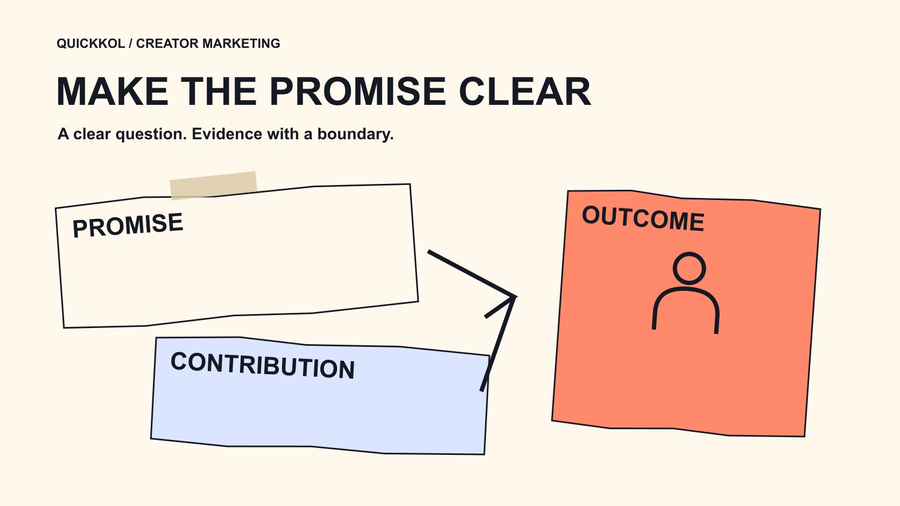
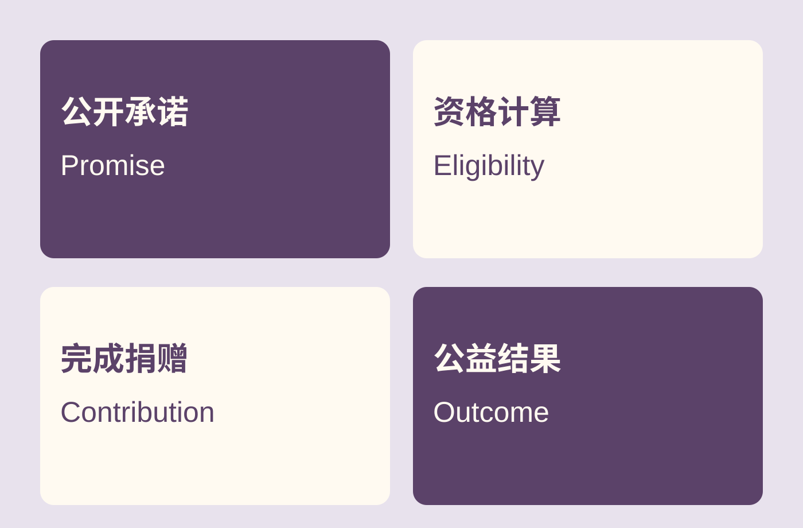

# 公益合作怎样说清捐赠承诺

状态：本地审阅稿；正式发布日期待确认。

公益达人合作应把受益方、捐赠触发条件、金额口径、时期和结算分别说清，不用传播热度代替公益结果。

QuickKOL 编辑图形；不呈现真实账号指标或平台界面。

Cause marketing 在本文指品牌把推广与明确公益支持相连接的安排。达人合作必须让观众知道谁受益、什么行为触发支持、金额怎样确定，以及哪些条件限制承诺。达人报酬、品牌捐赠和最终公益影响分别记录。清楚表述能减少误解，却不等于活动已经得到认证；具体项目与地区要求仍由相应负责人核对。

## 先定义合作实际承诺

“支持公益”可能指固定捐赠、按销售捐赠、提供物资、志愿服务或传播一项活动。它们不是同一种承诺，不能用一句动人的叙事将差异掩盖。

先让品牌与受益方确认具体支持，达人再据此设计表达。如果活动仅安排一次固定捐赠，不应让观众以为每一次点赞或购买都会增加捐款。

区分谁承诺、谁执行、谁记录。达人可能负责解释活动，不负责接收捐款或确认慈善用途。品牌的传播团队也不应替财务或受益组织承诺尚未确认的数字。

[品牌大使反馈续约方法](https://www.quickkol.com/zh/blog/ambassador-program-feedback-renewal-loop/#answer)可以继续处理长期公益合作中的学习与关系维护。本篇首先关注一次公开承诺能否被读者准确理解，避免先有宣传话术、最后才补交易条件。

## 让捐赠口径出现在承诺旁

[BBB 公益营销披露标准](https://give.org/bbb-standards-for-charity-accountability)的第 19 项要求清楚说明销售如何使慈善组织受益，包括捐赠部分、活动期限与最高或保证最低金额。它是 BBB Wise Giving Alliance 的问责标准，不是全球统一法律。

将这个思路用于 Brief，可以列出受益组织、适用商品或行为、金额基础、起止条件和上下限。若是销售额比例，说明具体基数；不能让“收益的一部分”代替真正约定。

重要条件应在观众理解承诺的位置得到清楚说明，不藏到与主张脱节的资料里。不能为了让视频更轻快，就删除会改变捐赠意义的限制。

如果条件过于复杂，先简化活动设计或提供清楚的说明路径，而不是要求达人用一句模糊承诺概括。传播清楚的前提是品牌自己已经把支持安排说清。

## 公益动机不消除商业关系

[FTC 代言问答](https://www.ftc.gov/business-guidance/resources/ftcs-endorsement-guides-what-people-are-asking)讨论了以慈善捐赠激励评价的情形，指出如果这会影响读者对评价的理解，需要披露。这里引用美国指导，不能扩展为所有地区完全相同的规则。

达人可能获得报酬、寄样或其他利益，同时真诚支持公益目标。两者可以同时成立，不能因为动机值得肯定就让观众猜测商业安排。

[FTC 达人披露说明](https://www.ftc.gov/business-guidance/resources/disclosures-101-social-media-influencers)强调重要品牌关系应让人清楚理解。Brief 应分别处理达人与品牌的关系，以及品牌与受益方的支持安排；其中一个说明不自动替另一个完成表达。

也不要把所有参与者称作捐赠人。如果达人提供的是制作服务，应准确描述其角色；若另外个人捐赠，由其本人确认适合公开的内容，不替他人宣称金额或动机。

## 核对受益方与素材权限

保留受益方的准确名称与公开来源，并由合适联系人确认本次安排。不要只凭一张标志图片或旧项目截图，推断某组织已经同意支持品牌宣传。

受益组织名称、标志、工作人员影像、参与者故事和地点可能各有条件。为每项素材明确来源、许可与适合公开的范围，不将一次活动同意扩大为永久广告用途。

尤其不要为了制作感人内容，要求达人猜测参与者经历或替其表达感受。可以围绕已经确认的工作、行动和信息解释支持方式；私人故事不是项目必须拥有的装饰。

如果相关许可尚未取得，调整故事结构或等待确认。没有素材不等于可以复制公开照片；公益目的也不自动代替原作者和当事人的同意。

## 让假设算例遵循真实条件

假设活动承诺每件符合条件且完成交易的商品捐赠 2 个货币单位，最高 100 个单位。观察到 30 件符合条件的完成交易，则按这组假设计算为 60 个单位。这不是客户结果、税务结论或行业惯例。

若有 70 件，按相同假设，承诺上限仍为 100，而不是 140。创作者不能继续说每件都无限增加支持。若取消与退货影响资格，也要在活动规则中预先说明，而不是结算时临时改变。

把交易资格、实际计算、待确认调整和完成支付分别记录。传播团队得到一个订单数，不等于已经知道实际应付或已付金额。

算例只解释条件怎样改变结论，不替活动决定采用哪种金额模式。真正的口径由合作方确认，再由有责任的人复核，最后才进入公开结果。

每个阶段需要自己的确认，传播数字不能替代完成捐赠。

## 传播成果与公益影响分开

观看、互动、点击、符合条件交易、应捐金额、完成捐赠与受益结果，属于不同层次。不要把一条内容被观看写成同等数量的人已经得到帮助。

受益方可能掌握资金使用和实际结果，品牌掌握活动结算，达人掌握作品与自己的观察。按这些职责收集可核验资料，不要求任何一方确认自己无法知道的事项。

如果项目尚未完成，可以如实报告进展和待确认内容，不用提前宣布影响。没有追踪到个人结果也不必杜撰故事来填补。

[品牌提及与更正方法](https://www.quickkol.com/zh/blog/brand-monitoring-creator-mention-corrections/#answer)可帮助发现宣传与实际承诺不一致的地方。出现疑问时先回到活动条件，再决定由谁说明或更正，不把观众合理提问当成负面互动需要压下。

## 活动变化需要同步表达

活动可能提前达到上限、延长时间、改变商品范围或出现延期。先判断这是否改变此前公开承诺，再由相应负责人处理，不只更新内部表格。

检查达人已发布作品、排期内容、品牌目的地与对外问答是否仍准确。不能假设修改落地页会同步改变视频里说出的条件，也不能未经同意直接修改达人的作品。

将变化通知写具体：旧条件、新条件、发生时间、影响范围与需要采取的动作。若只是结算更正，与新的推广承诺分开说明。

对观众应使用能理解的解释，不把内部流程细节当作推卸责任的理由。创作者需要知道自己能回答什么，哪些问题应交给品牌或受益方。

## 用有依据的交接结束合作

保留公开承诺版本、合作角色、素材许可、结算记录和已经确认的结果。哪些内容适合公开，哪些仅供内部复核，也要分别说明。

后续是否继续公益合作，应看实际执行、沟通与任务适配，而不是只凭热度。对未解决的条件提出下一步，不用漂亮的总结掩盖尚未完成的支持。

QuickKOL 可以帮助理解公益 Brief、寻找相关创作者并准备合适的联系；受益方关系、捐赠执行和效果仍由来源及合作方确认。不能把达人发现描述成对慈善项目的认证。

一项负责任的公益合作让观众理解自己的行动与支持之间有什么关系，也让达人知道自己正在表达什么。清楚的条件不是故事的障碍，而是使故事可以被信任与复核的基础。

## 公益达人 Brief 的必要字段

| 字段 | 确认内容 | 避免误读 |
| --- | --- | --- |
| 受益方 | 准确主体与安排 | 看到标志即有授权 |
| 触发条件 | 哪些行为符合资格 | 所有互动都捐赠 |
| 金额与限制 | 基数、期限与上限 | 无限增加 |
| 达人关系 | 报酬与实际角色 | 付费制作即个人捐赠 |
| 结果 | 已完成与待确认 | 热度等于公益影响 |

编辑字段表；地区性指导保留其适用范围，假设算例不是实际活动。

## 确认公益合作表达

在公开承诺前由相关负责人核对。

- [ ] 确认受益方和支持类型。
- [ ] 说明触发、金额、日期与限制。
- [ ] 分别披露达人与品牌关系。
- [ ] 核对素材与人物授权。
- [ ] 区分应捐、已捐与影响。
- [ ] 安排变化与结算的负责人。

## 研究日期与使用边界

资料核验于 2026 年 11 月 20 日。文中方法、表格和决策规则为编辑建议，标为假设的示例不是实际客户结果或行业基准。外部资料的适用地区与时期按各段说明。

## 从任务开始达人研究

用 QuickKOL 理解 Brief、发现相关达人并研究作品与联系路径；数据、合作条件和结果仍需核验。

[了解 QuickKOL](https://www.quickkol.com/#capabilities)

## 来源

- [BBB 公益营销披露标准](https://give.org/bbb-standards-for-charity-accountability)
- [FTC 代言问答](https://www.ftc.gov/business-guidance/resources/ftcs-endorsement-guides-what-people-are-asking)
- [FTC 达人披露说明](https://www.ftc.gov/business-guidance/resources/disclosures-101-social-media-influencers)
