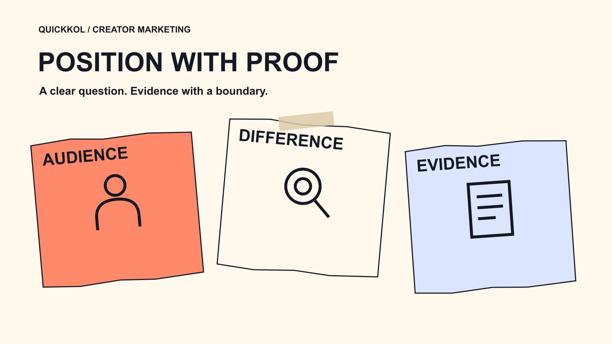
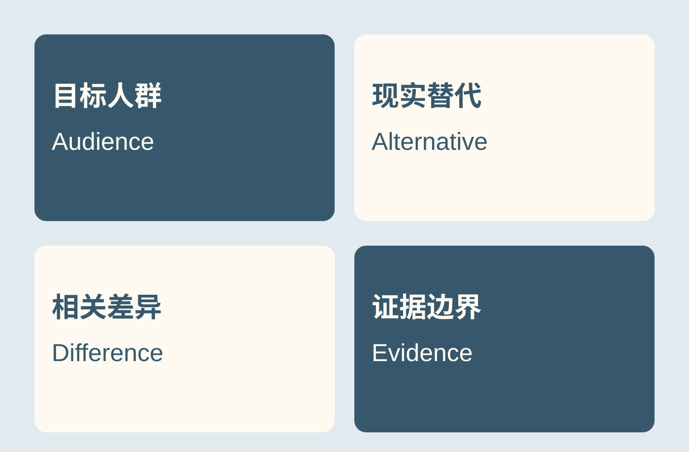

# Positioning Statements With Creator Proof

Status: local review draft; confirm the publication date before release.

Translate audience, alternatives, relevant difference and evidence into a creator’s communication task without turning an internal positioning hypothesis into a guarantee.

QuickKOL editorial graphic; not actual account metrics or a platform interface.

In a creator partnership, a positioning statement is an internal working explanation: for which people, in which task, against which realistic alternative, should the brand be considered for which supported difference? It is not a slogan the creator must read verbatim, and it does not prove best or establish personal experience. Check facts and hypotheses before asking the creator to develop expression suited to their work. Good positioning narrows the assignment instead of expanding everyone’s promise, and gives reviewers a reason for the commission beyond repeating the brand’s preferred adjectives.

## Start with the choice situation, not a slogan

Positioning needs a choice situation. The audience can be a purchasing role, user group or event participant, rather than everyone who values quality.

[SBA’s market-research explanation](https://www.sba.gov/counseling/plan-your-business/) discusses demand, alternatives and competitive context. It is US small-business research guidance, not evidence of this brand’s difference, but it helps the team ask what people realistically choose between.

Add the triggering situation to the creator brief. A team arranging remote demonstrations for the first time may need a different explanation from one upgrading an established workflow. A shared title or age category does not necessarily make those the same communication task.

Broader is not always better. Identifying who is not currently served can help the creator choose relevant examples and prevent one general story from covering unsupported circumstances.

The working statement should therefore name a practical audience and situation before it describes the brand. A reviewer can then evaluate relevance instead of debating whether a flattering phrase sounds distinctive. The creator also gains a usable starting point: a problem they can explain through work, rather than an abstract demographic profile that gives little guidance for what to show or say.

## Make the alternative realistic

An alternative can be another product, a manual method, an existing process or taking no action for now. Do not highlight the brand by choosing an obviously unsuitable comparison and presenting the result as general superiority.

Establish how the intended audience actually completes the task. Public information can provide leads, with suitable research where necessary. The team’s own habits should not become every customer’s preference.

A creator can use relevant experience to explain conditions for choosing. They should not be asked to speak for the entire market. Supply a factual foundation and genuinely comparable conditions, then let the creator identify which comparison suits their work.

A named competitor is not always needed. Explaining the limitations of another working method can supply context. The purpose is relevance, not disparagement or an unsupported first-place claim.

This step helps reviewers distinguish a meaningful difference from a constructed contrast. If the comparison stops making sense when the audience’s actual situation is restored, the positioning needs more work before it becomes a creator script. Resolve that during planning rather than expecting an enthusiastic performance to compensate for a weak underlying comparison.

## Connect the difference to use value

A difference is not merely a feature list. Explain why it affects the present task and under which conditions it holds. Has a feature should not automatically become everyone works faster.

[Qualtrics’ brand-funnel explanation](https://www.qualtrics.com/support/brand-experience/common-use-cases-bx/conversion-funnel-reporting-bx/) distinguishes survey-defined awareness, consideration and usage. Remembering a feature does not establish consideration, and consideration does not establish use. Observe intended brand associations separately from business outcomes.

A workable statement can explain how one role completes a particular step more clearly, while naming necessary conditions. If the difference exists only in a version or configuration, retain that scope in both positioning and the creator demonstration.

The brand may want viewers to form an association, but it still needs research to know whether that happened. Wants to be seen as expert is not evidence that the intended audience already thinks so.

This keeps strategy and evidence in their proper relationship. Positioning can guide the communication before the result is known, provided the team labels it as an intention or hypothesis. The creator should receive that distinction rather than a draft that presents an untested audience response as an established fact.

Internal positioning guides expression; it does not substantiate a public claim.

## Give evidence and hypotheses different fields

Give important terms a basis. Product facts can come from checked material, personal observations from actual experience, and the desired impression from the strategy. These should not substitute for one another inside a single sentence.

In the relevant US context, [the FTC’s endorsement FAQ](https://www.ftc.gov/business-guidance/resources/ftcs-endorsement-guides-what-people-are-asking) addresses the relationship between endorsement claims and genuine support or experience. This article supplies no universal compliance conclusion; the appropriate owners still review particular claims and local requirements.

If the team cannot support only, best or suitable for everyone, narrow the statement to the actual task and conditions. Asking a creator to say the same broad promise in a personal voice does not solve the evidence gap.

An unresolved basis can become a research task. The positioning document need not pretend to be complete, but reviewers should know which statements are usable, which await confirmation and who will supply the missing information.

This record also improves collaboration. The creator can suggest another way to demonstrate a supported difference instead of being asked to defend a strategic adjective. The brand can review the proposal against evidence rather than against a vague requirement to make the claim feel stronger.

## Translate positioning into the creator’s task

The creator needs an explainable or demonstrable question, not the internal sentence itself. Supply audience, current choice, relevant difference and required evidence, then ask for expression suited to the creator’s work.

The [creator-strategy hypothesis portfolio method](https://www.quickkol.com/blog/influencer-marketing-strategy-hypothesis-portfolio/#answer) can help distribute roles. One collaborator may demonstrate operation while another explains purchasing conditions. They do not all need to read the same positioning statement.

During review ask whether the work answers the original question, changes a condition or turns personal observation into a brand fact. Do not accept it solely because certain preferred adjectives appear.

Leave real creative space. If the creator proposes a clearer treatment consistent with the facts and scope, assess its value rather than sacrificing understanding to document uniformity.

A useful commission can include a short explanation of why the difference matters, approved factual material and questions the creator may explore. That is enough to guide an informed proposal without writing every expressive choice in advance. The positioning then becomes a shared decision aid, rather than a hidden script whose exact language is repeatedly imposed after the creator has already developed a different but valid explanation.

## Check the work through a hypothetical statement

Consider a hypothetical team tool for small groups arranging multi-role review for the first time. Against tracking through scattered messages, the brand wants to be considered for a clear display of task state. This is an editorial assumption, not a statement about an actual product’s capability or results.

The creator task could demonstrate one defined review situation, showing what participants encounter and which conditions require configuration. It should not automatically promise a percentage of labour saved or suitability for every organization.

If the creator has not used the product, arrange appropriate experience and fact review rather than asking for an immediate testimonial saying I have always relied on it. Sample work and a complete partnership also require separate scope agreement.

Use the example to check whether positioning produces an executable action. If the instruction remains make it look more professional, add the viewer question, situation and evidence. More adjectives will not fill that gap.

The scenario illustrates a connection between strategy and production. A specific internal rationale leads to a bounded public explanation, with facts and experience checked before claims are made. It does not establish a template that every product or creator should copy without adapting the audience and alternative.

## Hand over positioning through stable fields

Retain audience, triggering situation, alternative, relevant difference, support, limitation, creator role and next step. The accompanying bilingual CSV files are fillable field lists, not complete contracts or completed research.

Keep the relationship between the internal position and public expression. A creator’s script can change, but reviewers should trace which facts support which part and which changes require renewed confirmation.

Identify a version owner. Product updates, market changes or new research may make an older statement inaccurate. Do not silently replace every historical record, or allow an old proposal to remain the apparent basis for current work.

Record the reason and affected scope of a change. Positioning can then support continuing partnerships rather than become a sentence everyone copies without understanding why it exists.

This maintenance need is practical, not an instruction to create extensive process for minor wording. Focus on changes that affect audience, meaning, evidence or the commissioned role. A stable field list makes those material differences visible while leaving ordinary stylistic refinement with the people producing and reviewing the actual work.

## Review the expression through understanding

After publication, observe the questions people raise, whether they can find the explanation and which conditions need clarification. Researching brand associations or consideration requires a suitable method. Viewing numbers do not establish acceptance of the positioning.

The [brand-health tracking method](https://www.quickkol.com/blog/brand-health-creator-message-associations/#answer) can supply a later research route. Separate research stages from commercial outcomes so the owner can see how far the current evidence reaches.

QuickKOL can help interpret a positioning-related brief, discover creators suited to the communication role and prepare contact. Product differences, experiential support and audience conclusions still need verification. Matching a candidate does not demonstrate that the positioning is effective.

The final handoff should help the creator understand why the brand chose this task and help the brand understand why this creator is suitable. Positioning earns its value by narrowing the communication problem and giving actual work a reviewable direction.

Preserve that rationale alongside the resulting asset and the unresolved questions. The next commission can then build on what was learned without turning the first internal statement into an unquestionable public promise or treating a single piece of creative work as proof of the entire strategy.

## From positioning input to creator work

| Input | Commission question | Evidence |
| --- | --- | --- |
| Audience | Who needs the explanation? | Task and situation |
| Alternative | How is the choice made now? | Actual method and comparison conditions |
| Difference | Why does it matter? | Facts and limits |
| Creator role | What can this person contribute? | Original work and appropriate experience |

Editorial positioning framework; the hypothetical example is not a client result.

## Hand over the positioning brief

Download the fields and complete them with checked project information.

- [ ] Define audience and trigger.
- [ ] Identify a realistic alternative.
- [ ] Connect difference with task value.
- [ ] Separate facts, experience and hypotheses.
- [ ] Give the creator executable work.
- [ ] Record version and open questions.

[Download Chinese positioning fields CSV](/downloads/creator-positioning-brief-2026-11-20.zh.csv)

[Download English positioning fields CSV](/downloads/creator-positioning-brief-2026-11-20.en.csv)

## Research date and limitations

Sources reviewed November 20, 2026. Methods, tables and decision rules are editorial recommendations. Hypothetical examples are not actual client results or industry benchmarks. Source geography and periods are specified where relevant.

## Start creator research with a clear task

Use QuickKOL to interpret a brief, discover relevant creators and research their work and contact routes. Verify data, commercial terms and outcomes at their source.

[Explore QuickKOL](https://www.quickkol.com/#capabilities)

## Sources

- [SBA’s market-research explanation](https://www.sba.gov/counseling/plan-your-business/)
- [Qualtrics’ brand-funnel explanation](https://www.qualtrics.com/support/brand-experience/common-use-cases-bx/conversion-funnel-reporting-bx/)
- [the FTC’s endorsement FAQ](https://www.ftc.gov/business-guidance/resources/ftcs-endorsement-guides-what-people-are-asking)
