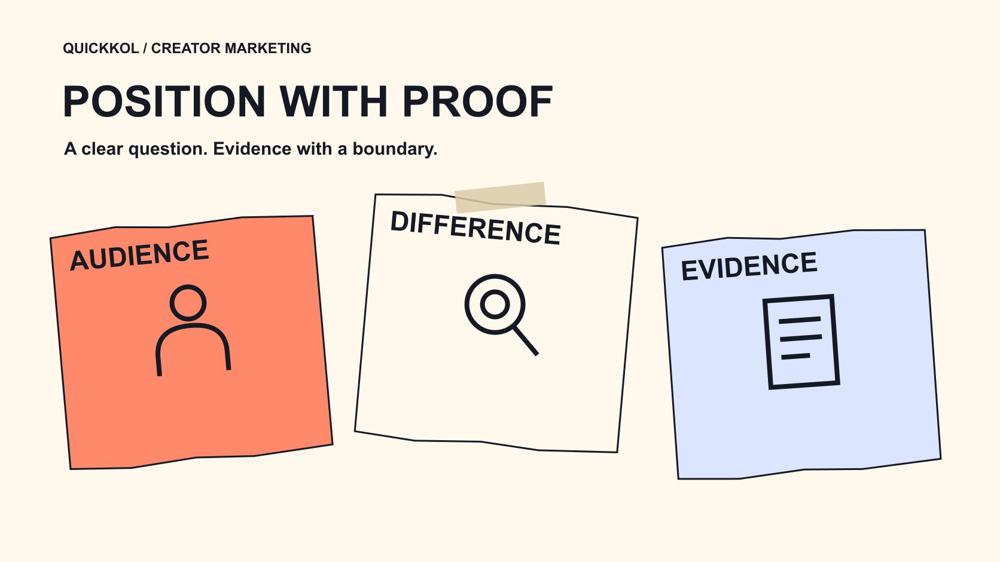
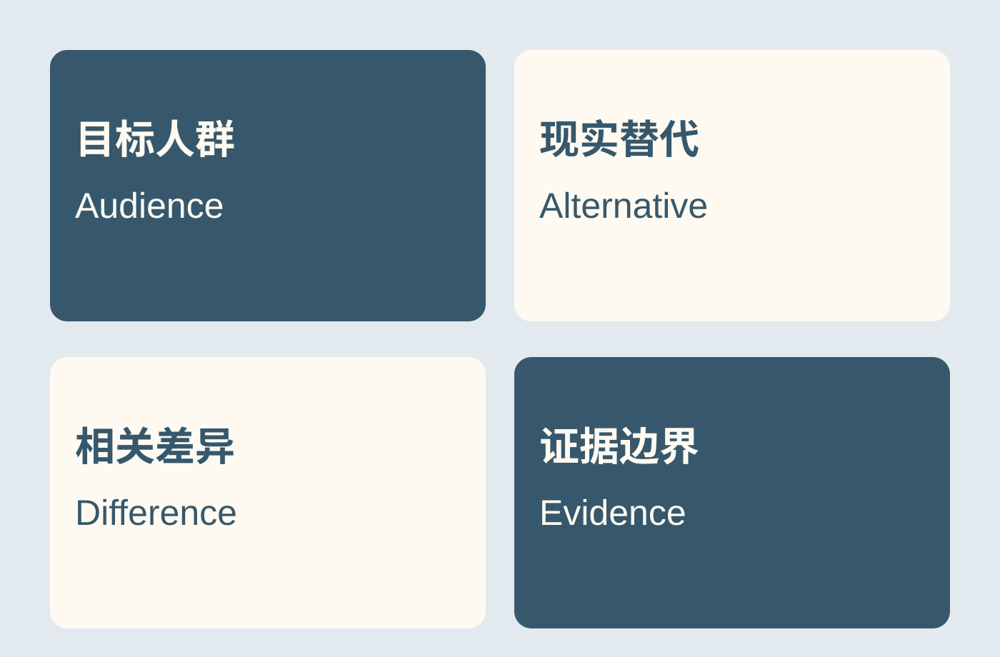

# 定位陈述怎样进入达人 Brief

状态：本地审阅稿；正式发布日期待确认。

把品牌定位拆成目标人群、现实替代、相关差异与证据，再转成达人可以完成的沟通任务，避免将内部假设变成产品保证。

QuickKOL 编辑图形；不呈现真实账号指标或平台界面。

定位陈述在达人合作中是一份内部工作说明：为哪类人、在什么任务中，相对什么现实选择，品牌希望因何种有依据的差异被考虑。它不是需要创作者逐字朗读的口号，也不自动证明“最佳”或个人体验。先确认陈述中的事实与假设，再让达人提出适合自己作品的表达。好的定位缩小任务，而不是扩大所有人的承诺。

## 先写选择情境，不先写口号

定位需要说明观众面对什么选择。目标人群可以是某类采购角色、使用者或活动参与者，不应只写“所有追求品质的人”。

[SBA 市场研究说明](https://www.sba.gov/counseling/plan-your-business/)讨论需求、替代与竞争背景。这是美国小企业研究指导，不能直接证明本品牌差异，但可以帮助团队先问现实选择是什么。

在达人 Brief 中补上触发情境。例如，某类团队第一次需要安排远程演示，与已有成熟流程的团队升级工具，可能需要不同解释。不能只按相同职位或年龄视作一个任务。

定位不是越宽越好。能够说明谁暂时不适合，可以让创作者选择相关案例，也让品牌避免用一个泛化故事覆盖无法支持的所有场景。

## 把替代选择写得真实

替代可能是另一款产品、人工方法、现有流程，或暂时不采取行动。不能为了突出品牌，故意选择明显不适合的对比对象，再把结果当成普遍优势。

先确认目标人群实际怎样完成任务。公开资料可以提供线索，需要时通过适当研究补充。不要把团队自己的使用习惯写成所有客户的偏好。

达人能够用具体经验解释选择条件，但不应被要求替整个市场发言。品牌可以提供事实底稿与实际可比条件，让其指出哪些比较适合自己的作品。

如果不打算做具名比较，也可以说明另一种工作方式的限制。清楚替代的任务是建立相关语境，不是制造贬损竞品的段落或未经支持的榜首主张。

## 差异需要对应使用价值

差异不只是特征清单。说明它为什么影响当前任务，以及在什么条件下成立。不要把“具有某功能”直接写成“所有人工作更快”。

[Qualtrics 品牌漏斗说明](https://www.qualtrics.com/support/brand-experience/common-use-cases-bx/conversion-funnel-reporting-bx/)区分调查中的认知、考虑、使用等层次。这提醒团队，被记住某个特征不等于进入购买考虑，更不等于实际使用；定位希望形成的联想与业务结果分别观察。

可用的陈述可以是帮助某种角色更清楚完成一个具体步骤，并列明必要条件。若差异只在特定版本或配置存在，陈述与达人演示都应保留。

品牌可以希望观众形成某项联想，但仍需研究这种理解是否发生。希望被认为专业，不等于已经被目标受众这样评价，定位假设不应变成自有调研结果。

内部定位指导表达，不自动证明公开主张。

## 证据与假设用不同字段

为每个重要词说明依据。产品事实可以来自已核对资料，个人观察来自实际体验，品牌希望形成的印象属于策略目标。不要让三者在一句话里互相替代。

在适用的美国语境，[FTC 代言问答](https://www.ftc.gov/business-guidance/resources/ftcs-endorsement-guides-what-people-are-asking)提醒代言表达仍要与真实依据和经验相符。本文不提供全球统一合规结论；具体主张与地区要求仍由相应负责人核对。

如果团队无法支持“唯一”“最好”或“适合所有人”，可以缩小到实际任务与条件，而不是要求达人用个人语气说出同样宽的承诺。

证据缺口可以成为下一步研究任务。定位文档不必假装完整，但要让审稿者知道哪些句子可用、哪些尚待确认，以及谁负责补充。

## 从定位转成创作者任务

给创作者的不是内部长句，而是一个可以演示或解释的问题。说明人群、当前选择、重要差异和所需依据，再请对方提出适合的表达。

[达人策略假设组合方法](https://www.quickkol.com/zh/blog/influencer-marketing-strategy-hypothesis-portfolio/#answer)可以继续安排不同合作角色。某位达人负责展示操作，另一位适合解释采购条件，不必让每个人朗读同一套定位。

审稿时问：作品是否回答原问题？有没有改变条件？个人体验是否被误写成品牌事实？不要只按是否出现某几个指定形容词验收。

留出真实创作空间。如果创作者有更清楚的表达，只要事实与任务范围一致，就应按实际价值判断，而不是为了文件一致牺牲可理解性。

## 用假设定位检查工作量

假设一款团队工具面向首次安排多角色审阅的小团队，相对靠零散消息追踪，希望因清楚展示任务状态而被考虑。这是编辑假设，不是对实际产品功能或效果的声明。

达人任务可以是演示一次明确的审阅情境，说明参与者看到什么、哪些条件需要配置。它不应自动变成保证节省某个比例工时，或宣称适用所有组织。

如果创作者从未使用产品，可以先安排合适体验与资料核对，而不是要求其马上发表“我一直依赖它”的证言。样片与完整合作的范围也需分别确认。

用这个例子检查定位是否产生了可执行动作。若仍只有“表现更专业”的要求，就补充观众问题、场景和证据，不靠增加更多修饰词解决。

## 用稳定字段交接定位

建议保留目标人群、触发情境、现实替代、相关差异、依据、限制、达人角色和下一步。附带的双语 CSV 是可填写字段表，不是完整合同或已经完成的研究。

保持原始定位与公开表达的关系。创作者的脚本可以变化，但审稿人应能追溯哪些事实支持哪部分，哪些变化需要再次确认。

对内还要说明版本负责人。产品更新、市场变化或新研究可能使旧陈述不再准确，不应默默替换所有历史资料，也不应让旧提案继续作为当前依据。

每次改动记录理由与影响范围。这样定位能够支持连续合作，而不是变成一个无人知道为什么存在、却人人必须照抄的固定句子。

## 用理解验证定位表达

发布后可以观察读者提出什么问题、能否找到解释，以及哪些条件需要澄清。若需要研究品牌联想或考虑，应使用相应方法，不能从观看数字直接判断定位已被接受。

[品牌健康追踪方法](https://www.quickkol.com/zh/blog/brand-health-creator-message-associations/#answer)可以作为后续研究路径。研究阶段与商业结果分开，让负责人知道当前证据支持到哪一步。

QuickKOL 可以帮助理解定位相关 Brief、寻找合适表达角色的达人并准备联系；产品差异、体验依据和受众结论仍要核验。不能从工具匹配推断定位有效性。

最终交接应该让创作者理解品牌为什么选择这项任务，也让品牌明白为什么这位创作者适合。定位的价值是缩小沟通问题，并给实际作品一个可以复核的方向。

## 从定位输入到达人工作

| 输入 | 委托问题 | 证据 |
| --- | --- | --- |
| 目标人群 | 为谁解释 | 具体任务与情境 |
| 现实替代 | 现在如何选择 | 实际方法与比较条件 |
| 相关差异 | 为何影响任务 | 事实与限制 |
| 达人角色 | 能实际贡献什么 | 原作与适当体验 |

编辑定位框架；假设案例不是客户结果。

## 交接定位 Brief

下载字段表后，填入本项目已核对的内容。

- [ ] 明确人群与触发情境。
- [ ] 选择真实替代。
- [ ] 让差异对应使用价值。
- [ ] 区分事实、体验与假设。
- [ ] 给达人安排可执行工作。
- [ ] 记录版本和未解问题。

[下载中文定位字段 CSV](/downloads/creator-positioning-brief-2026-11-20.zh.csv)

[下载英文定位字段 CSV](/downloads/creator-positioning-brief-2026-11-20.en.csv)

## 研究日期与使用边界

资料核验于 2026 年 11 月 20 日。文中方法、表格和决策规则为编辑建议，标为假设的示例不是实际客户结果或行业基准。外部资料的适用地区与时期按各段说明。

## 从任务开始达人研究

用 QuickKOL 理解 Brief、发现相关达人并研究作品与联系路径；数据、合作条件和结果仍需核验。

[了解 QuickKOL](https://www.quickkol.com/#capabilities)

## 来源

- [SBA 市场研究说明](https://www.sba.gov/counseling/plan-your-business/)
- [Qualtrics 品牌漏斗说明](https://www.qualtrics.com/support/brand-experience/common-use-cases-bx/conversion-funnel-reporting-bx/)
- [FTC 代言问答](https://www.ftc.gov/business-guidance/resources/ftcs-endorsement-guides-what-people-are-asking)
