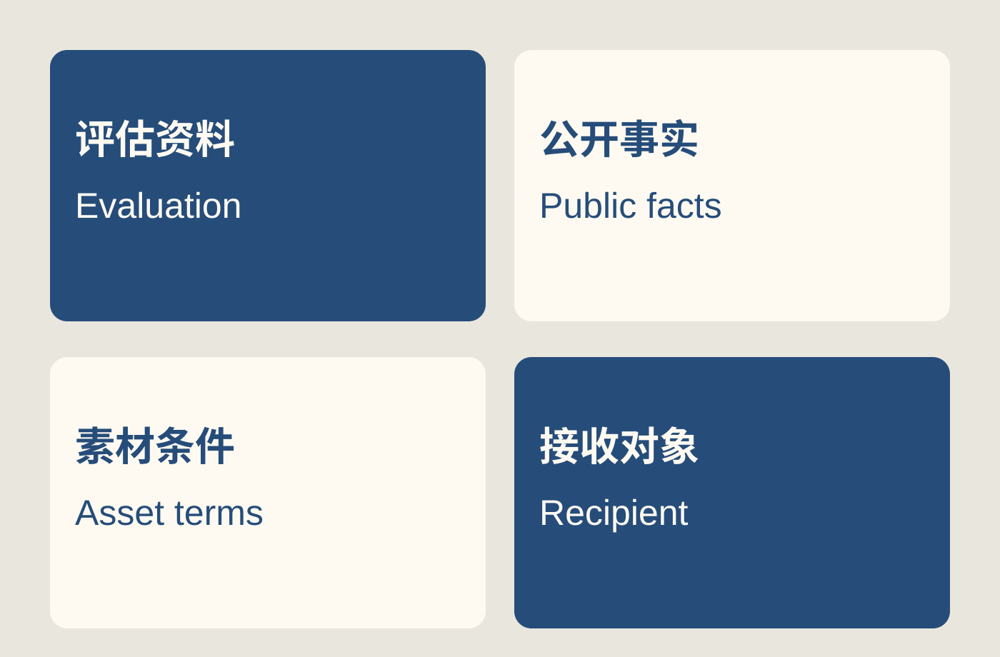

# Media Kit or Press Kit for a Creator Partnership?

Status: local review draft; confirm the publication date before release.

Names may overlap, so distinguish kits by recipient and use: commercial evaluation material is not automatically publishable fact or media.

Media kit and press kit are not labels with guaranteed uniform use. For creator partnerships, distinguish them by purpose: one helps a brand evaluate a creator and commercial task; another helps a recipient understand facts and use permitted information or assets accurately. Establish the recipient’s decision and what may be public before selecting material. Sending, downloading or naming a file press kit does not automatically permit every use. A clear packet explains both what its contents support and what the recipient still needs to confirm.

## Begin with the recipient’s task

The same creator may communicate with brand procurement, event communications, journalists and production teams. These recipients need different material. Do not send every file to everyone.

Commercial evaluation may require relevant work, audience definitions and a proposed role. Editorial preparation may need accurate names, project facts, usable statements and suitable assets. The packets can share information while having different default recipient scopes.

Do not infer permission from the title. When a media kit arrives, inspect intended use, version and contact. If these are absent, ask about the specific part needed instead of assuming everything is public.

The [creator media-kit version method](https://www.quickkol.com/blog/media-kits-creator-proposal-version-fit/#answer) concerns matching materials to a current proposal. This article adds a recipient question: who receives the information and which judgment does it support? That prevents commercial-evaluation figures from becoming public claims without review.

A useful request is therefore narrow. Explain whether the team is assessing a partnership, preparing an announcement or seeking permission for an image. The creator can supply an appropriate packet without having to guess which confidential, estimated or unfinished material might travel beyond the original conversation.

## Preserve reporting boundaries in commercial material

[YouTube’s Media Kit guide](https://support.google.com/youtube/answer/11322980?hl=en) describes material for brand opportunities and notes estimated audience categories, customizable cards and the creator’s choice about sharing with the recipient. A platform-generated file still has a scope. It is not necessarily a complete, live or independently audited profile.

Retain account, window, object and version. A missing card should not automatically mean zero, and the team should not request unrelated backend information merely because the creator has provided one report.

Work examples should identify what the creator actually contributed. In team production, distinguish presenting, research, filming and publishing. A client logo does not describe the role.

Commercial material helps the brand ask suitable questions and assess a task. It is not an unlimited supply of figures for public reuse. If the recipient later wants to publish a number, check the intended use and current interpretation first.

This keeps evaluation proportional. The brand can understand the evidence relevant to the proposed partnership without treating the packet as a guarantee of every future result, or assuming that willingness to share with one marketing manager establishes willingness to distribute the same data to every downstream recipient.

## Confirm public information separately

Public facts can include project name, participant role, confirmed date, suitable description and contact route. Not everything in a commercial packet belongs in an announcement, and an announcement should not add unconfirmed honours to a creator biography.

Assign a confirmation owner for each fact. The creator or appropriate representative checks the biography, the brand checks brand facts and the relevant organizer checks event conditions. One creator should not be asked to guarantee every participant’s information.

A quotation should correspond to expression actually confirmed. A suggested line in a draft is not something the person has already said, and an internal approval comment should not become a public testimonial.

If information is not final, identify its state and next step. Attractive formatting should not make pending facts appear publication-ready.

The value of public material is fewer avoidable errors, not an end to recipient judgment. A journalist or partner may still need independent context, and a creator may still need to explain the intended meaning in an interview. A factual packet supports those activities without claiming control over another party’s editorial conclusion or promising that supplied wording will be adopted unchanged.

## Separate downloading an asset from permission

In the US context, [the U.S. Copyright Office’s photography guide](https://www.copyright.gov/engage/photographers/) explains protection of original photographs when fixed and the photographer’s usual initial ownership, subject to exceptions. This supports checking provenance and usage, not a conclusion about every jurisdiction or particular dispute.

A packet can identify suitable uses, cropping conditions, attribution, period and other relevant limits. If a brand wants to turn a press photograph into an advertisement, confirm that use separately rather than relying on the fact it was downloaded.

Participant agreement, photographic copyright and a brand mark are not one permission. Having one condition does not automatically establish all the others. Refer each question to someone able to confirm its scope instead of asking the creator to guess.

Where terms are unclear, make a specific usage request. That is often easier to answer than can we use these assets?

For example, identify the image, intended destination, proposed edit and duration. This gives the counterparty enough information to assess the request and prevents an approval meant for a factual announcement from being read later as permission for unrelated commercial promotion.

The same material can serve different purposes; confirm them before sharing.

## Make recipient scope and retention purpose clear

In the UK context, [the ICO’s data-minimisation guidance](https://ico.org.uk/for-organisations/uk-gdpr-guidance-and-resources/data-protection-principles/a-guide-to-the-data-protection-principles/data-minimisation/) emphasizes information relevant and necessary to its purpose, while noting that the guidance is under review. The working recommendation here is limited; it is not a complete global rule for data processing.

Sending relevant sections to each recipient reduces unnecessary circulation. A media contact needing public facts does not need the entire quotation history. Procurement evaluating work may not need private contact details and every backend screenshot.

State which contents serve the present evaluation, which are prepared for publication and who handles questions. Labels should match actual sharing arrangements. Do not describe material as internal while placing it somewhere inconsistent with that scope.

At task completion or expiry, follow applicable team rules. The need to preserve evidence and performance records can coexist with removal of unrelated information; everything does not need to remain together indefinitely.

This is a practical handoff issue as well as a privacy consideration. A smaller, well-defined packet is easier to keep accurate. Recipients can identify the current source without searching through outdated versions or assuming that material supplied for one earlier purpose remains appropriate for a different public use.

## Make timing conditions understandable

For an unreleased event or piece of work, confirm when material may be used, which recipients are covered and how time and geography are expressed. Adding a word to an attachment does not by itself establish that the recipient accepted every condition.

Keep publication date, research date and partnership start separate. For expressions such as today or next week, provide explicit context so a forwarded file does not lose its period or time zone.

When the packet changes, notify people actually affected. Revising a shared sheet does not update downloaded photographs, proposals or queued material. For a material change, state old value, new value and required action.

If the recipient has an independent editorial process, supplying information should not be presented as guaranteed coverage or guaranteed wording. Explain commercial commissioning separately from independent reporting.

These distinctions keep expectations realistic. The creator can prepare accurate information while the brand knows which parts of the release it controls and which remain another party’s decision. Timing then becomes a condition people can act on, rather than an assumed agreement discovered only after the material has circulated or publication has already occurred.

## Check the packet through a hypothetical release

Imagine a creator participating in a brand demonstration. Procurement receives a commercial media kit, while event communications prepares a public introduction. Audience estimates in the evaluation packet should not automatically enter the announcement, and a proposed role should not become a completed result.

The public packet can supply the confirmed role, event facts and approved photographs. If an editorial recipient needs additional information, they can ask the specified contact without receiving every commercial condition.

If the brand later wants one image for continuing advertising, return to the specific usage question instead of saying it was already in the press kit. This is a hypothetical workflow, not the terms of a named institution or platform.

The scenario checks whether information reaches the right person, supports the right judgment and avoids presenting unfinished material as public fact. A filename cannot perform those tasks.

Use the same check before circulation: can a recipient identify what they may quote, what needs confirmation and whom to ask? If not, improve the packet before adding more pages. A clear, shorter handoff can be more effective than an extensive collection whose intended use remains ambiguous to everyone except the person who assembled it.

## Deliver a packet suited to the task

Hand over recipient scope, version, factual owners, media usage and open questions. Where two purposes exist, provide clearly separated sections instead of forcing every item into one document.

The [brand media-kit review method](https://www.quickkol.com/blog/what-is-a-media-kit-brand-review/#answer) can continue the evidence assessment. The distinction here comes earlier: put the information into the right working context. Completed procurement does not mean completed public release, and supplying press information does not establish a commercial partnership.

QuickKOL can help interpret a brief, research relevant creators and prepare contact. Sources and counterparties must still confirm meaning, reporting scope and asset usage. Discovering a candidate does not acquire permission for their work.

Choosing media kit or press kit is not a search for the more professional name. It is a way to give a recipient suitable material for a defined task. Purpose does more than the file title to prevent misunderstanding.

Retain that purpose with the archive so a later colleague does not recycle an old packet under new assumptions. The next request can then build on confirmed facts while reopening only the permissions, dates or relationships that actually need a new decision.

## Arrange packets by purpose

| Purpose | Suitable content | Confirm separately |
| --- | --- | --- |
| Commercial evaluation | Relevant work and scoped metrics | Public quotation of data |
| Public introduction | Confirmed facts and role | Unconfirmed biography |
| Media use | Specific assets and terms | Ads, adaptation and period |
| Timing | Explicit date and state | Recipient agreement |

Labels may overlap; this task distinction is not a universal industry format.

## Confirm the kit handoff

Make permitted and intended uses understandable.

- [ ] Define the recipient’s task.
- [ ] Retain metric object and version.
- [ ] Confirm public facts and quotations.
- [ ] Check media usage separately.
- [ ] State timing and sharing scope.
- [ ] Provide a correction contact.

## Research date and limitations

Sources reviewed November 20, 2026. Methods, tables and decision rules are editorial recommendations. Hypothetical examples are not actual client results or industry benchmarks. Source geography and periods are specified where relevant.

## Start creator research with a clear task

Use QuickKOL to interpret a brief, discover relevant creators and research their work and contact routes. Verify data, commercial terms and outcomes at their source.

[Explore QuickKOL](https://www.quickkol.com/#capabilities)

## Sources

- [YouTube’s Media Kit guide](https://support.google.com/youtube/answer/11322980?hl=en)
- [U.S. Copyright Office: photography and copyright](https://www.copyright.gov/engage/photographers/)
- [the ICO’s data-minimisation guidance](https://ico.org.uk/for-organisations/uk-gdpr-guidance-and-resources/data-protection-principles/a-guide-to-the-data-protection-principles/data-minimisation/)
