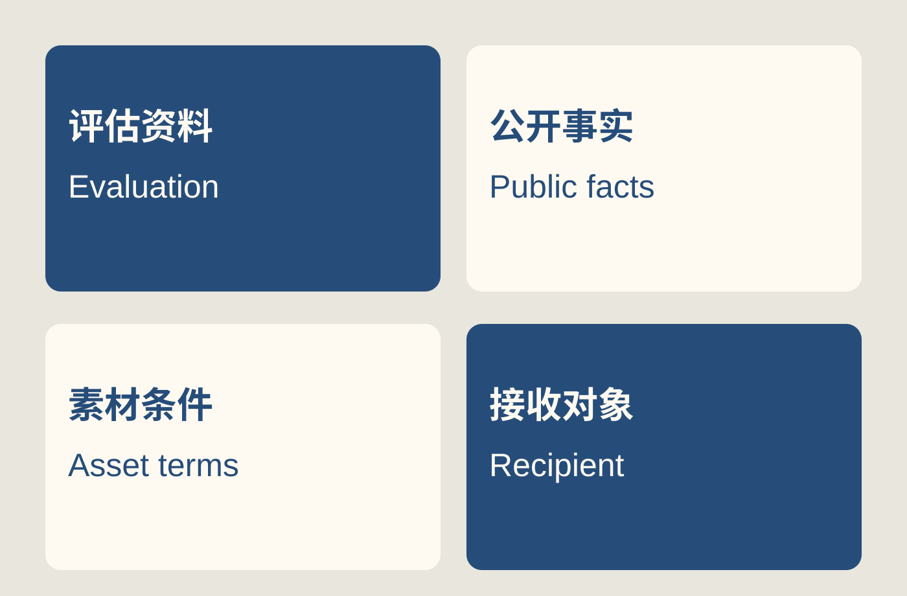

# 达人媒体包与新闻资料怎样分工

状态：本地审阅稿；正式发布日期待确认。

媒体包与新闻资料包名称可能重叠，先按接收者和用途分工：商业评估资料不等于可以直接公开的事实与素材。

Media kit 与 press kit 的名称没有保证一致的行业用法。达人合作时，更可靠的区分是用途：一份帮助品牌评估创作者与商业任务，另一份帮助接收者准确理解并在允许范围内引用事实与素材。先确认接收者需要判断什么、哪些内容可公开，再选择资料。文件被发送、下载或叫作 press kit，都不自动构成任意使用许可。

## 先问接收者要做什么

同一位创作者可能同时与品牌采购、活动传播、记者和制作团队沟通。这些人需要的资料不同，不应把所有文件都发给每一个人。

商业评估可能需要相关作品、受众口径和拟议角色；新闻准备可能更需要准确姓名、项目事实、可以引用的说明与合适素材。两者可以共享一部分信息，但默认接收范围不同。

不要仅凭标题判断能否使用。收到一个“媒体包”，先查看它说明的用途、版本与联系人；没有说明时，询问具体需要的那部分，而不是推断内容全部公开。

[达人媒体包版本方法](https://www.quickkol.com/zh/blog/media-kits-creator-proposal-version-fit/#answer)处理资料怎样对应当前提案。本篇进一步区分资料交给谁、支持哪种判断，避免商业评估里的数字不经复核就变成公开报道。

## 商业资料应保留报告边界

[YouTube 媒体包说明](https://support.google.com/youtube/answer/11322980?hl=en)介绍了创作者用于品牌机会的资料，并说明其中有估计受众类别、可调整卡片以及接收者分享选择。平台生成文件也仍有具体范围，不应被当作完整、实时、经独立审计的画像。

保留账号、窗口、对象与版本。若某个卡片未提供，不能自动当成零，也不能要求对方共享与当前评估无关的全部后台。

作品样例说明创作者实际做了什么。若由团队共同制作，区分出镜、研究、拍摄与发布，不让一张客户标志代替具体贡献。

商业资料的目的在于提出合适问题并评估任务，不是为品牌提供可以无限引用的所有数据。接收方需要再次公开某个数字时，应先核对用途和当前解释。

## 公开资料需要独立确认

公开事实可以包括项目名称、参与角色、确认日期、适合发布的描述和联系路径。不是商业包中所有内容都适合进入公告，也不是公告可以替作品补充未经确认的荣誉。

让每项事实有负责确认的人。达人介绍由本人或适当代表核对，品牌事实由品牌核对，活动条件由相应组织方核对。不要要求一位创作者替所有参与方保证准确。

引语应对应实际确认的表达。草稿里的建议句不等于对方已经说过，内部审批意见也不应被包装为公开证言。

如果资料尚未最终确认，清楚标注当前状态与下一步。不能用一个漂亮版式让待确认事实看起来已可直接发布。公开资料的价值在于减少错误，而不是让接收者停止判断。

## 下载素材与取得许可分开

[美国版权局摄影说明](https://www.copyright.gov/engage/photographers/)解释美国语境中原创照片在固定时受到保护，摄影者通常是最初权利人，另有特定例外。这说明素材来源与使用条件需要核对，不能扩展为所有地区具体案件的结论。

资料包可以说明哪些图适合什么用途、是否允许裁切、需要怎样署名，以及期限或其他条件。若品牌希望把新闻照片改成广告，另行确认，而不是只因为它已经被下载。

人物同意、摄影版权和品牌标志也不是同一项。拥有其中一种条件，不自动取得其他全部条件。由能确认相应范围的人处理，不让创作者猜测。

缺少清楚许可时，提出具体使用请求。一个精确的请求通常比“我们能用这些素材吗”更容易得到可执行答复。

同一资料可以有不同用途，分享前分别确认。

## 接收范围与保留目的清楚

[ICO 数据最小化说明](https://ico.org.uk/for-organisations/uk-gdpr-guidance-and-resources/data-protection-principles/a-guide-to-the-data-protection-principles/data-minimisation/)在英国语境强调与目的相关且限于必要的信息，并说明该指导正在审查。本文据此提出有限的工作建议，不当作完整的全球数据处理规则。

按接收者发送相关部分，可以减少无关资料传播。媒体需要的是公开事实时，不必附上整个报价历史；采购需要评估作品时，也不一定需要私人联系和所有后台截图。

让文件说明哪些内容仅供当前评估，哪些已准备公开，以及问题应交给谁。标签需要与实际共享方式一致，不能一边说内部资料，一边把文件放进没有相应控制的公共位置。

当任务结束或资料失效，按团队适用规则处理。保留依据与履约记录的需要，可以与删除无关信息同时安排，不必把所有材料永久堆在一起。

## 时间条件需要双方理解

若涉及尚未公开的活动或内容，先确认何时可以使用、对哪些接收者适用，以及时间与地区表达是否清楚。不能单方面在附件里加一个词，就假定接收者已经接受所有条件。

发布日期、资料核验日与合作开始日分别保留。对“今天”“下周”等容易过期表达，提供明确背景，避免转发后失去时区与时期。

资料包更新时通知真正受影响的人。修改一张共享表，不会同步更改已经下载的照片、提案或排期内容。对关键变化说明旧值、新值和需要采取的动作。

如果接收者有独立编辑流程，不应将提供资料等同于保证报道或保证某种措辞。商业委托与独立报道关系也应讲清，不把两种工作混成一份默认承诺。

## 用假设发布场景检查资料

假设创作者参与一次品牌演示，采购团队拿到商业媒体包，活动传播团队准备公开介绍。采购资料中的受众估计，不应自动进入介绍稿；拟议角色也不应写成已经完成的结果。

公开包可以提供已经确认的角色、活动信息和获准照片。若新闻接收者需要额外事实，可向指定联系人核对，不必获得所有商业条件。

品牌后来希望将某张照片用于持续广告，则回到具体用途确认，而不是援引“已经在 press kit 中”。这是假设流程示例，不是某家机构或平台的既定条件。

场景检查的目的是发现资料是否送对人、是否支持正确判断，以及有没有把未确认内容包装成公开事实。文件名称本身不能完成这些工作。

## 交付适合当前任务的包

交接时附上接收范围、版本、事实负责人、素材用途和未解问题。若存在两个用途，提供清楚分开的部分，不必强求所有内容都放在一份文件。

[媒体包品牌审阅方法](https://www.quickkol.com/zh/blog/what-is-a-media-kit-brand-review/#answer)可以继续处理证据质量；当前文章的区分是先让资料进入正确场景。采购完成不等于公开发布完成，提供新闻资料也不代表达成商业合作。

QuickKOL 可以帮助理解 Brief、研究相关达人并准备联系。资料原意、数据范围与素材用途仍需来源和合作方核对，不能把发现候选人当成已经获得作品许可。

选择 media kit 或 press kit，不是选更专业的名字，而是让接收者有合适材料完成一个明确任务。清楚的用途比文件标题更能减少误解。

## 按用途安排资料包

| 用途 | 适合内容 | 另行确认 |
| --- | --- | --- |
| 商业评估 | 相关作品与有范围指标 | 公开引用数据 |
| 公开介绍 | 确认事实与角色 | 尚未确认经历 |
| 素材使用 | 具体文件与条件 | 广告、改编与期限 |
| 时间安排 | 明确日期与状态 | 接收者接受条件 |

名称可能重叠；本表按任务区分，不规定统一行业格式。

## 确认资料包交接

让接收者知道哪些内容能用于什么。

- [ ] 明确接收者的任务。
- [ ] 保留指标对象与版本。
- [ ] 确认公开事实与引语。
- [ ] 分别检查素材用途。
- [ ] 说明时间与共享范围。
- [ ] 提供更正联系人。

## 研究日期与使用边界

资料核验于 2026 年 11 月 20 日。文中方法、表格和决策规则为编辑建议，标为假设的示例不是实际客户结果或行业基准。外部资料的适用地区与时期按各段说明。

## 从任务开始达人研究

用 QuickKOL 理解 Brief、发现相关达人并研究作品与联系路径；数据、合作条件和结果仍需核验。

[了解 QuickKOL](https://www.quickkol.com/#capabilities)

## 来源

- [YouTube 媒体包说明](https://support.google.com/youtube/answer/11322980?hl=en)
- [美国版权局：摄影与版权](https://www.copyright.gov/engage/photographers/)
- [ICO 数据最小化说明](https://ico.org.uk/for-organisations/uk-gdpr-guidance-and-resources/data-protection-principles/a-guide-to-the-data-protection-principles/data-minimisation/)
