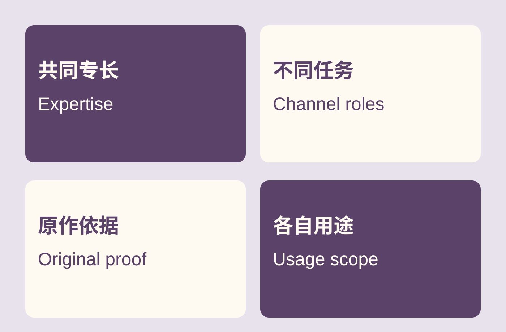

# Grow Your Creator Presence Across Social Media

Status: local review draft; confirm the publication date before release.

Build a creator’s cross-platform presence through continuing expertise and original proof, with different jobs for each channel instead of identical copies.

Growing a social media presence involves more than opening accounts or publishing identical copies. In a brand–creator partnership, it means helping relevant people encounter consistent evidence of expertise, accurate identity and useful work across different routes, while giving each channel an appropriate job. Expression can change, but product facts, contribution and usage boundaries should remain clear. Map work to roles before expanding channels. A stronger presence is one a viewer can understand and a team can maintain, not simply a larger number of profiles carrying a shared logo.

## Define presence through recognizable contribution

Begin with why relevant viewers should remember the creator: explaining a class of questions, demonstrating a task or contributing continuing experience in a field. Do not define presence as simultaneous growth on every channel.

A brand commission can strengthen that contribution or pull the work away from it. Evaluate whether the proposed partnership supports a role the creator can demonstrate, rather than expecting every collaborator to become a general brand spokesperson.

For example, a professional-tool educator can continue explaining real use conditions without turning into a lifestyle publisher on every service. This is an editorial direction, not a performance forecast for an individual.

Write audience, question and contribution as the common foundation. Channels can then use different expression while the team can still explain why the work belongs to one professional identity. Matching colours alone should not conceal a scattered subject.

This foundation is useful during partner selection as well as production. A brand can assess whether its task adds a relevant piece of work to the creator’s portfolio, rather than treating access to several accounts as the principal value of the commission.

## Give each channel a different job

Do not assume one asset must appear in full everywhere. Long-form video can retain a demonstration, a short post can explain one judgment, and an image sequence can compare conditions. Choose according to the task and actual capability.

[YouTube’s channel-creation guide](https://support.google.com/youtube/answer/1646861?hl=en-ca) distinguishes a Google Account from the public channel needed for activities such as uploading. Browsing, publishing and managing are not the same capability. An account name in a document does not establish the conditions for this deliverable.

Identify the primary work before deciding whether other routes provide background, excerpts or a path to the original. Each route should offer some useful information rather than only repeatedly requesting another click.

A new channel also requires maintenance time. Where there is no suitable work or owner, research can precede publication. Broad coverage is not a reason to establish an unattended partnership destination.

The result can be a smaller but clearer channel plan. The creator knows which contribution belongs where, and the brand can assess whether an additional route supplies a new function or merely duplicates an existing asset without adding value for the viewer.

## Consistent identity does not mean identical audiences

Make connections between the creator’s public website and profiles reviewable, while retaining separate platform and work objects. A matching avatar or name alone should not merge records.

[Bluesky’s platform and domain explanation](https://bsky.social/about/blog/09-04-2024-welcome) describes identity signals such as domain usernames. These can help establish public provenance. They do not transfer another platform’s verification, followers or performance into Bluesky.

State what each platform contributes to the research. Original work in one place can support explanatory capability, while an authorized report elsewhere can support a bounded audience observation. The records may complement one another without becoming a unique cross-platform population.

When information differs, establish why. Creators may change names, representation or studio relationships. A change is not automatically suspicious, but neither should the team guess to force consistency.

Keep the basis of the identity connection visible. That is more important than requiring every profile to use one display style. It allows later colleagues to understand which records concern the same creator and which describe a different role, without letting superficial uniformity stand in for actual verification.

## Use original work as the factual foundation

Retain the primary work, factual material and creator’s actual contribution for each partnership. Before adapting, identify what must not change: product version, demonstration conditions, scope of experience and source attribution.

[Meta’s carousel-publishing guide](https://developers.facebook.com/documentation/instagram-platform/content-publishing) distinguishes media formats and actual publishing conditions. Technical ability to upload content does not establish that it can be extracted appropriately from another format or retain all of its original context.

A qualified conclusion in a long video, for example, may become an absolute promise when reduced to one short sentence. Review what the new reader encounters, not only word count or dimensions.

Consistent facts do not require identical wording everywhere. A creator can use expression suited to the medium while explaining how the adaptation still corresponds to the underlying evidence.

This gives the brand a practical review boundary. It can allow stylistic variation without reopening every agreed fact, while recognizing changes that genuinely need renewed approval. The main asset becomes a reference for meaning rather than a file that every channel must reproduce unchanged, regardless of how people encounter it.

Keep shared facts consistent while allowing channel roles to differ.

## Do not transfer usage conditions automatically

Permission to publish on one platform does not automatically include every channel, advertisement or third-party element. Explain the new use and check editing, identity treatment, music, period and other relevant conditions.

Routes can share a factual foundation without sharing every asset. If a piece of music or external footage lacks support for the new use, adapt production rather than assume cross-platform distribution is a default right.

Separate agreed versions, versions awaiting confirmation and internal samples. A colleague should not treat every file in a shared drive as publication-ready. Clear states reduce rework and preserve the creator’s appropriate control over their work.

The brand can ask for consistent facts and experience boundaries. Keep the identity consistent should not become unlimited revisions or permanent usage. Describe added work, timing and fees before confirmation.

These distinctions help maintain a presence over time. The team can see which asset belongs to which channel and why, instead of relying on memory when someone later proposes a new use. That makes adaptation a defined commercial task rather than an unnoticed expansion of the original partnership.

## Maintain a path that fulfils its promise

A route from a short post to the primary work should reach relevant material. When pages change, products update or a series ends, maintain the route proportionately. Older partnerships should not keep promising information that no longer exists.

The [creator social-audit retrieval method](https://www.quickkol.com/blog/creator-campaign-social-audit-record-retrieval/#answer) helps find relevant work and owners. This is not a reason to update the dates of all old content. It is a check of routes that still affect current understanding.

Agree response scope for each channel. The brand may handle product-service questions while the creator addresses an explanation. Adding a platform does not establish round-the-clock creator support.

Include maintenance in the resource plan. If an entry point cannot be maintained, narrow the promise or stop expanding it instead of preserving a network of apparently active but broken routes.

A viewer’s experience of presence depends partly on these practical connections. Useful work can feel unreliable when the route repeatedly fails. Conversely, a modest collection of accurate, maintained links can support a clearer professional identity than a much larger set of accounts whose relationship to the current partnership nobody can explain.

## Observe outcomes through channel-specific jobs

Do not ask only which account grew fastest. If one route supplies specialist explanation, review whether it performed that job. If another supports continuing discussion, retain actual questions and answers rather than comparing only interaction totals.

Keep windows, objects and sources with each platform’s counts. Do not add incompatible measures into a unique audience or attribute every concurrent change to one adapted asset.

Imagine long-form video carrying the full demonstration, a short post adding conditions and a carousel comparing choices. The team can review each task’s clarity instead of using the short post’s numbers to declare the whole partnership unsuccessful. This is an editorial scenario, not a benchmark.

For a stronger conclusion, identify the additional research required. Limited observation can justify another expressive adjustment without proving that channel expansion caused growth or sales.

The point is to preserve the logic of the plan during review. If every channel is ultimately judged by one undifferentiated total, the distinct roles established at commissioning disappear. A channel-specific assessment helps the brand decide what to maintain, adapt or discontinue without pretending that all forms of presence contribute in the same measurable way.

## Give expansion a clear stopping condition

The next step can be to continue one useful treatment, add an original sample, repair a route or avoid another platform for now. A stopping condition helps keep resources with work that has a defined value.

The [Bluesky creator-record method](https://www.quickkol.com/blog/bluesky-creator-credibility-cross-platform/#answer) can support proportionate research on a new service without turning an interesting discovery into a complete operating commitment. Each expansion should explain which additional job it supplies.

QuickKOL helps interpret a brief, discover suitable creators and prepare contact. Actual platform capability, evidence and usage still need checking. Candidate discovery should not be described as a cross-platform growth system already built.

Recognizable expertise and accurate connections to work provide a more durable common foundation than repeated publication. Brand and creator can use different expression in different places while helping viewers understand who is speaking, what is explained and why continuing may be worthwhile.

Close the plan with that purpose, its owners and its maintenance conditions. The presence can then grow through deliberate additions rather than an expanding list of accounts whose content, permissions and intended audiences have become progressively harder to distinguish.

Use the Bluesky creator-record method for that bounded extension.

## Common elements and channel differences

| Object | Common foundation | Confirm separately |
| --- | --- | --- |
| Identity | Actual creator | Account and representative |
| Work | Facts and contribution | Expression and context |
| Usage | Defined partnership | Channel, edit and period |
| Observation | Common brand question | Object and metric |

Editorial planning framework; no guaranteed channel growth.

## Confirm the cross-platform work map

Give every added route a task.

- [ ] Define demonstrable expertise.
- [ ] Give channels distinct roles.
- [ ] Check identity connections.
- [ ] Retain original and adaptation conditions.
- [ ] Confirm asset usage separately.
- [ ] Plan maintenance and stopping conditions.

## Research date and limitations

Sources reviewed November 20, 2026. Methods, tables and decision rules are editorial recommendations. Hypothetical examples are not actual client results or industry benchmarks. Source geography and periods are specified where relevant.

## Start creator research with a clear task

Use QuickKOL to interpret a brief, discover relevant creators and research their work and contact routes. Verify data, commercial terms and outcomes at their source.

[Explore QuickKOL](https://www.quickkol.com/#capabilities)

## Sources

- [YouTube’s channel-creation guide](https://support.google.com/youtube/answer/1646861?hl=en-ca)
- [Bluesky’s platform and domain explanation](https://bsky.social/about/blog/09-04-2024-welcome)
- [Meta’s carousel-publishing guide](https://developers.facebook.com/documentation/instagram-platform/content-publishing)
