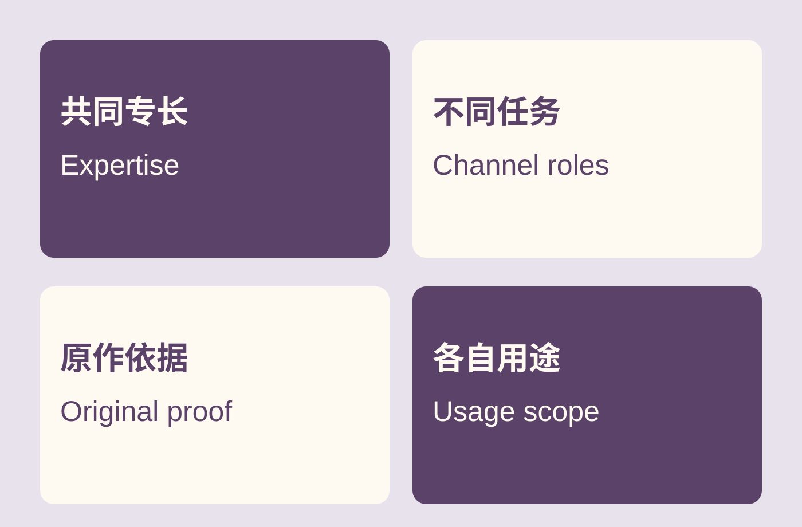

# 达人跨平台作品怎样保持一致

状态：本地审阅稿；正式发布日期待确认。

把达人跨平台形象建立在持续专长和可核对作品上，为每个渠道安排不同任务，而不是复制同一份内容。

增长社媒存在感，不只是开更多账号或重复发布。对品牌与达人合作，它意味着让相关人群在不同入口看到一致的专长依据、准确身份与可继续阅读的作品，同时为每个平台安排适合的任务。表达可以变化，产品事实、个人贡献与用途边界不能因改编变得模糊。先建立作品与角色的对应，再决定是否扩展渠道。

## 把存在感定义为可识别贡献

先说明这位达人为什么值得被相关观众记住：能解释某类问题、演示某种任务，或持续提供某个领域的经验。不要先把存在感写成所有渠道必须同时增长。

品牌委托可以强化这种贡献，也可能把作品拉向不适合的方向。筛选合作时，看它是否支持创作者已经能够证明的角色，不要求每位达人都成为泛领域品牌发言人。

例如，专业工具讲解者可以持续说明实际使用条件，而不必在每个平台改做生活方式内容。这是编辑方向示例，不是对任何个人的表现预测。

写清人群、问题和工作贡献，作为跨平台共同基础。之后每个渠道可以采取不同表达，但团队仍能解释它为何属于同一个专业形象，而不靠一致配色掩盖主题已经分散。

## 给不同渠道不同任务

不要默认一份内容必须在所有地方完整出现。长视频可以保留演示过程，短帖可以说明一个判断，图片序列可以对照条件；选择取决于任务与实际功能。

[YouTube 频道创建说明](https://support.google.com/youtube/answer/1646861?hl=en-ca)区分普通 Google 账号与用于公开发布等活动的频道。这提醒团队，浏览、发布和管理不是同一种能力；资料中出现一个账号名称，不足以确认本次交付条件。

先确定主作品在哪里，再决定其他入口是补充背景、提供片段还是引导到原作。让每个入口本身提供一些有用信息，不只反复要求观众跳转。

新增渠道也需要维护时间。若没有合适内容或负责人，可以先研究而不发布，不必为了看起来覆盖广就建立一个无人维护的合作入口。

## 身份一致不等于受众相同

让创作者的公开网站与账号之间有可核对联系，同时分别保留平台和作品对象。不要仅凭相同头像或名字合并资料。

[Bluesky 平台与域名说明](https://bsky.social/about/blog/09-04-2024-welcome)介绍域名用户名等身份线索。它能够帮助理解公开出处，不会把其他平台的认证、关注者或效果自动迁移到 Bluesky。

品牌资料应写清每个平台提供什么证据。某处原作支持讲解能力，另一处授权报告支持有限受众观察；两者可以互补，却不应该混成一个跨平台独立人数。

遇到不一致，先确认原因。创作者可能改变名称、代表或工作室关系，不必把变化直接视为异常；也不能为了资料统一而猜测。保持身份连接的依据可见，比强制所有资料使用一个展示样式更重要。

## 原作是改编的事实基础

为每次合作保留主作品、事实资料与创作者实际贡献。改编时先判断什么不能改变，例如产品版本、演示条件、体验范围和来源归属。

[Meta 轮播发布说明](https://developers.facebook.com/documentation/instagram-platform/content-publishing)展示了多项媒体与实际发布条件的区别。技术上能上传一种内容，不意味着它适合从另一种作品直接截取，也不意味着原来的所有语境都能保留。

例如，长视频里带限制的结论被截成一句短帖，可能变成绝对承诺。缩短内容时要重新判断读者看见什么，而不是只检查字数或画幅。

保持核心事实一致，也不要求每个渠道逐字复制。创作者可以用符合媒介的表达，但应能指出新版本如何仍然对应原有依据。

共同事实保持一致，渠道任务可以不同。

## 用途与制作不能一概迁移

一个平台的发布同意，不自动涵盖所有渠道、广告或第三方素材。为改编说明新用途，确认是否涉及重新剪辑、人物身份、音乐和期限等条件。

不同入口可以共享事实底稿，不一定共享全部素材。若某段音乐或外部画面没有对应用途依据，调整制作，而不是假定跨平台传播属于默认权利。

将已同意版本、待确认版本和纯内部样片分开，避免下一位同事把共享盘中的文件都当作可发布内容。清楚状态可以减少返工，也能保护创作者对作品的合理控制。

品牌可以要求一致的事实和体验边界，却不应把“保持形象”变成无限修改或永久使用。新增工作说明范围、时间与费用，再由双方确认。

## 维护可以兑现的观看路径

从短帖进入主作品的链接应指向实际相关内容。若页面改版、产品更新或系列结束，按实际需要维护入口，不让旧合作继续承诺已经不存在的信息。

[社媒审计取回方法](https://www.quickkol.com/zh/blog/creator-campaign-social-audit-record-retrieval/#answer)可以帮助找到相关作品和负责人。审计不是把所有旧内容改成今天，而是检查哪些入口仍影响当前观众理解。

为不同渠道约定回应范围。产品服务问题可能由品牌接手，创作解释可能由达人回应；不能因为新增一个平台，就默认创作者提供全天候支持。

把维护工作放进资源安排。没有时间持续更新的入口，可以缩小承诺或停止新增，而不是保留一片看似活跃、实际断裂的链接网络。

## 按渠道任务观察结果

不要只问哪个账号增长最快。若某个入口承担专业解释，核对它是否完成相应任务；若另一个用于持续讨论，保留实际问题与回应，而非只比较总互动。

各平台计数分别保留窗口、对象和来源。不能把不同计数相加为独立受众，也不能将同期变化全部归给一段改编内容。

假设长视频负责完整演示，短帖补充条件，轮播比较选择。团队可以分别评价每项工作是否清楚，而不是用短帖数字来宣布整组合作失败。这是编辑示例，不是效果基准。

如果需要更强结论，说明还缺什么研究。有限观察可以支持下一次表达调整，但不自动证明渠道扩张带来增长或销售。

## 让扩展有明确的停止条件

下一步可以是继续一种有效表达、补一份原作、修正入口，或暂不增加平台。清楚的停止条件有助于团队把资源留给真正有价值的工作。

[Bluesky 履历补充方法](https://www.quickkol.com/zh/blog/bluesky-creator-credibility-cross-platform/#answer)可以帮助在新平台只做适当研究，不因发现相关作品就立即开启完整运营。每个渠道扩展都应说明增加了哪项任务。

QuickKOL 帮助理解 Brief、发现合适达人并准备联系；具体平台功能、证据与用途仍需核对。不要将候选发现直接称作已经建成跨平台增长体系。

可识别的专长与准确作品连接，是比重复发布更稳固的共同基础。品牌与达人可以在不同地方用不同表达，仍然让观众知道是谁、解释什么，以及为什么值得继续。

Bluesky 履历补充方法可作为这种有限研究的进一步阅读。

## 跨平台作品的共同项与差异

| 对象 | 共同基础 | 分别确认 |
| --- | --- | --- |
| 身份 | 实际创作者 | 账号与代表 |
| 作品 | 事实与贡献 | 表达与前提 |
| 用途 | 明确合作范围 | 渠道、编辑与期限 |
| 观察 | 同一品牌问题 | 对象与指标 |

编辑规划框架，不保证渠道增长。

## 确认跨平台作品地图

每个新增入口都要说明任务。

- [ ] 明确可证明的专长。
- [ ] 给各渠道不同职责。
- [ ] 核对实际身份连接。
- [ ] 保留原作与改编条件。
- [ ] 分别确认素材用途。
- [ ] 安排维护与停止条件。

## 研究日期与使用边界

资料核验于 2026 年 11 月 20 日。文中方法、表格和决策规则为编辑建议，标为假设的示例不是实际客户结果或行业基准。外部资料的适用地区与时期按各段说明。

## 从任务开始达人研究

用 QuickKOL 理解 Brief、发现相关达人并研究作品与联系路径；数据、合作条件和结果仍需核验。

[了解 QuickKOL](https://www.quickkol.com/#capabilities)

## 来源

- [YouTube 频道创建说明](https://support.google.com/youtube/answer/1646861?hl=en-ca)
- [Bluesky 平台与域名说明](https://bsky.social/about/blog/09-04-2024-welcome)
- [Meta 轮播发布说明](https://developers.facebook.com/documentation/instagram-platform/content-publishing)
