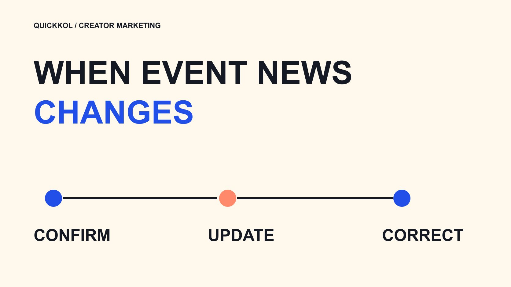
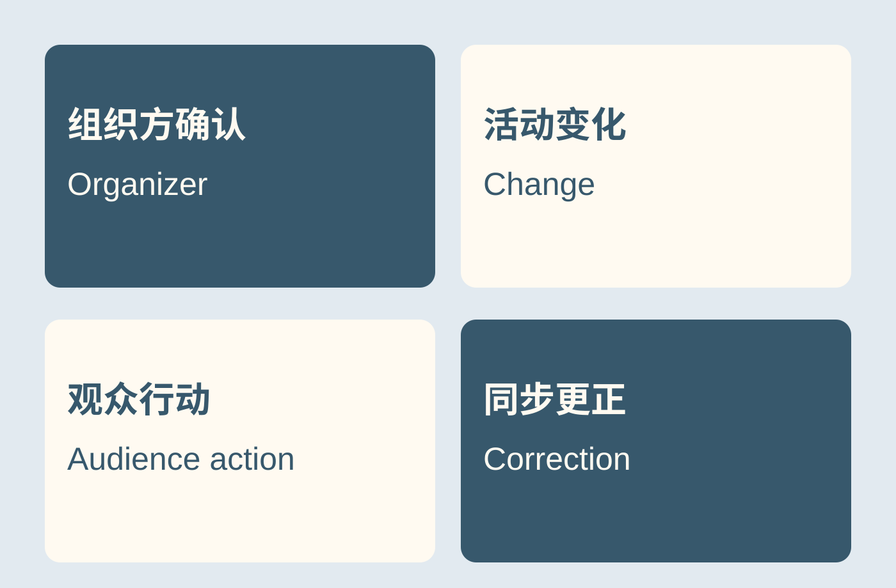

# Event Marketing News: Update a Creator Brief

Status: local review draft; confirm the publication date before release.

When event news changes dates, location or participation conditions, confirm organizer facts before updating creator work, audience actions and public corrections.

QuickKOL editorial graphic; not actual account metrics or a platform interface.

For a creator-marketing team, event news matters through the work and audience decisions it changes. Confirm facts, date and state with the organizer, then identify creator attendance, deliverables, timing and the action viewers now need. This article provides a method for handling changes, not an invented roundup of today’s headlines. An announcement, acceptance of a revised assignment, an updated queue and a completed public correction are distinct states. Connecting them prevents a valid news item from becoming an inaccurate or unowned creator instruction.

## Identify what the news changes

Do not forward every event report to every creator. Determine whether it changes date, location, participation, content conditions or a public brand promise, then identify who needs the information.

An organizer announcement, media paraphrase, creator comment and unconfirmed rumour have different evidentiary status. Preserve original source and time rather than treating a circulating screenshot as a complete announcement.

For example, news of an added livestream does not automatically assign hosting to a creator who accepted on-site filming. Examine the original work and ask the appropriate parties about the change. This is an editorial scenario, not the arrangement for a particular event.

Write one executable statement: which fact changed, which asset is affected and who needs to do what. If unconfirmed, keep it in a verification state instead of letting it enter the public script.

This first step keeps the workload proportionate. Some information belongs in background research; some requires a contract discussion; some requires immediate correction of a public invitation. Separating those cases is more useful than assuming every new headline demands a revised deliverable from every person in the programme.

## Distinguish postponement from rescheduling

[Eventbrite’s postponed-event policy](https://www.eventbrite.com/help/en-nz/articles/169121/eventbrites-postponed-event-policy/) distinguishes a postponement without a confirmed new date from a rescheduled event whose new date has been updated and communicated. These are terms within that platform’s policy scope, not universal legal definitions for every organizer or region.

Retain the organizer’s actual state in the creator brief. If no new date exists, do not invent one to complete the sheet. An internal placeholder should not become a public invitation.

[Eventbrite’s rescheduling guide](https://www.eventbrite.com.au/help/en-au/articles/267763/how-to-postpone-or-reschedule-an-event/) treats event state, date and attendee communication as separate actions. It supplies a concrete platform example: updating one field does not automatically complete every other task.

Record announced, new arrangements pending, relevant people notified and public material corrected separately. These states are more useful than event updated.

This distinction also protects the creator’s scheduling decision. They can respond to a definite proposed change or say what remains unknown, rather than appearing to accept a time that the organizer has not confirmed. The brand can then arrange its own next step without converting a planning assumption into a public fact or a new obligation.

Confirm the announcement, acceptance, queue change and public outcome separately.

## Return from news to the creator’s role

Check attendance, filming, explanation, hosting, publication and later responses separately. A factual change may affect only some of them. Do not silently expand the whole assignment.

If a new venue changes filming conditions, check equipment, attendance and permission. If the activity moves online, discuss the deliverable again. Agreement to an on-site experience does not establish agreement to every online performance.

The brand should supply confirmed changes and the creator should explain production consequences. Discuss added work and time directly instead of presenting synchronize the news as a free additional content package.

The [creator-event release-clock method](https://www.quickkol.com/blog/facebook-scheduling-creator-event-release-clock/#answer) connects timing with deliverables. The question here is how to reconfirm the relationship when conditions change, rather than create another generic publication calendar.

A useful revised brief shows the old task, the proposed new task and what remains unchanged. This gives both parties something concrete to evaluate. It also helps procurement distinguish a factual correction within the original work from a new production requirement that needs another commercial discussion before anyone promises it publicly.

## Explain the audience’s next step

A public update should explain not only that something changed but what viewers should do now. They may need a confirmed date, a replacement route or a contact for organizer questions.

Do not assign the creator refund, admission or service promises they cannot confirm. The organizer or appropriate brand team supplies actual policy and handling routes; the creator accurately communicates confirmed information.

For questions without a settled answer, identify the current state and the channel for later updates. Announced soon should not replace a real arrangement. Viewers can understand uncertainty; the problem is an internal guess appearing approved.

Likewise, do not turn creator attendance into an unagreed promise. If presence or performance is unconfirmed, public material should retain that state instead of listing the person early for promotional effect.

This turns the update into useful communication. A viewer can act on it without needing to know the team’s internal workflow, and a creator can explain what is known without becoming the source of every operational commitment. The brand should review that distinction before distributing a template for several partners to repeat.

## Review changed media as well as wording

Changes to venue, participants or programme can make an older photograph unsuitable as a current representation. Check whether the image implies new attendance, product or experience rather than only replacing a date in the caption.

In the US context, [the U.S. Copyright Office’s photography guide](https://www.copyright.gov/engage/photographers/) supports checking original photographs and the relevant rights. Finding an event image publicly does not establish permission for this creator advertisement or adaptation; other jurisdictions and particular arrangements need their own confirmation.

Provide accurate approved media and captions so the creator knows what is available. If no new photograph exists, choose an expression that does not mislead instead of presenting an old image as the actual new setting.

Preserve the relationship between source and corrected versions. If several partners downloaded the old image, changing a shared drive does not mean they received the replacement. Notify and confirm according to the affected scope.

This is a meaning check as well as an asset-management task. Even when the rights are sufficient, an image can communicate an inaccurate impression of what the audience will encounter. Review both questions before treating the revised packet as ready for publication.

## Confirm changes in the actual queue

List affected public content, queued material, reminders and brand destinations, each with an owner and state. Notification sent should not automatically become everything modified.

Creators may manage queues in their own tools, and the brand can confirm only the parts available to it. Check actual changes appropriately without requesting unnecessary account access or claiming the platform will automatically stop every outdated item.

For work that cannot be changed in time, explain accurate available responses and let the relevant owner decide. Do not meet a deadline by publishing an unconfirmed date or new role promise.

Connect the change record to the final public work. Evidence of correction is accurate information the viewer encounters, not only an internal task turning green.

This matters when several collaborators act independently. One person’s completed update cannot confirm another’s queue. A small record of actual outcomes is more dependable than a broad completion label, and it helps the team locate remaining work without reopening parts already handled. The creator’s responsibility can then be assessed against the specific action requested rather than against every consequence of the event change.

## Test the process through a hypothetical change

Imagine a branded event being postponed without a confirmed replacement date. A creator has finished an invitation video and other material is queued. This is an editorial example, not live news or a client result.

First avoid inserting an unknown date into another invitation. Check dates and destinations in existing work. The brand supplies the confirmed state, the parties discuss queued and published material, and suitable channels handle audience questions.

If a new date is later confirmed, check the creator’s actual availability and production conditions again. The organizer announcing a date does not mean every collaborator accepted attendance.

The example supplies no universal pause procedure for every platform and does not handle refunds for the organizer. It shows how news becomes a set of bounded, confirmable tasks instead of a vague synchronize this instruction.

The team can then distinguish a creator who completed a requested correction from unresolved venue or service questions outside that person’s role. Keeping those responsibilities separate improves both public accuracy and the fairness of the partnership review, especially when the underlying event remains uncertain for some time.

## Keep a traceable news decision

Retain the original announcement, confirmed facts, affected scope, task owners and actual public outcome. Leave unresolved parts as questions instead of hiding them behind closeout language.

The [brand-mention correction method](https://www.quickkol.com/blog/brand-monitoring-creator-mention-corrections/#answer) can help identify outdated information still circulating. Keep the scope proportionate rather than turning one event change into an unlimited review of every creator’s historical work.

QuickKOL can help interpret a revised brief, discover relevant creators and prepare suitable contact. Appropriate sources must still confirm organizer facts, attendance, media and publication state. Discovery does not complete every part of event execution.

Good handling of event news tells viewers the current facts and creators their next task. It depends on connecting sources with responsibility, not treating every partner as an always-available redistribution channel.

Keep that connection in the project archive. The next team can see what was announced, what the partners accepted and what actually changed, without inferring one state from another. That makes a fast response compatible with accurate communication and a defined commercial relationship, even when the event itself continues to evolve.

## From event news to creator tasks

| State | Required evidence | Next step |
| --- | --- | --- |
| News appears | Original organizer source | Verify facts |
| Work affected | Old task and new condition | Confirm scope |
| Queue changed | Actual content state | Check public information |
| Correction complete | Accurate audience-facing material | Retain record and remaining work |

Editorial change workflow; platform policies retain their scope. This is not a live news roundup.

## Hand over an event change

Start with confirmed facts and finish with the actual public result.

- [ ] Preserve original announcement and time.
- [ ] Separate postponement and confirmed rescheduling.
- [ ] Check the creator’s actual role.
- [ ] Explain the audience’s next step.
- [ ] Check media and the actual queue.
- [ ] Confirm correction and retain unresolved work.

## Research date and limitations

Sources reviewed November 20, 2026. Methods, tables and decision rules are editorial recommendations. Hypothetical examples are not actual client results or industry benchmarks. Source geography and periods are specified where relevant.

## Start creator research with a clear task

Use QuickKOL to interpret a brief, discover relevant creators and research their work and contact routes. Verify data, commercial terms and outcomes at their source.

[Explore QuickKOL](https://www.quickkol.com/#capabilities)

## Sources

- [Eventbrite: postponed-event policy](https://www.eventbrite.com/help/en-nz/articles/169121/eventbrites-postponed-event-policy/)
- [Eventbrite’s rescheduling guide](https://www.eventbrite.com.au/help/en-au/articles/267763/how-to-postpone-or-reschedule-an-event/)
- [U.S. Copyright Office: photography and copyright](https://www.copyright.gov/engage/photographers/)
