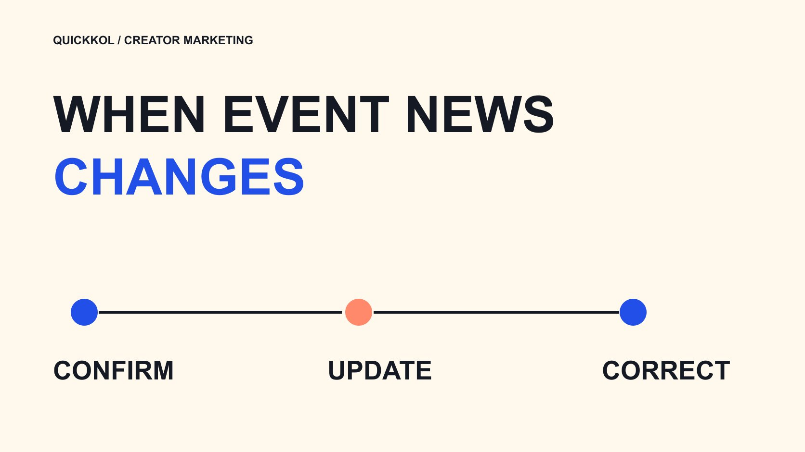
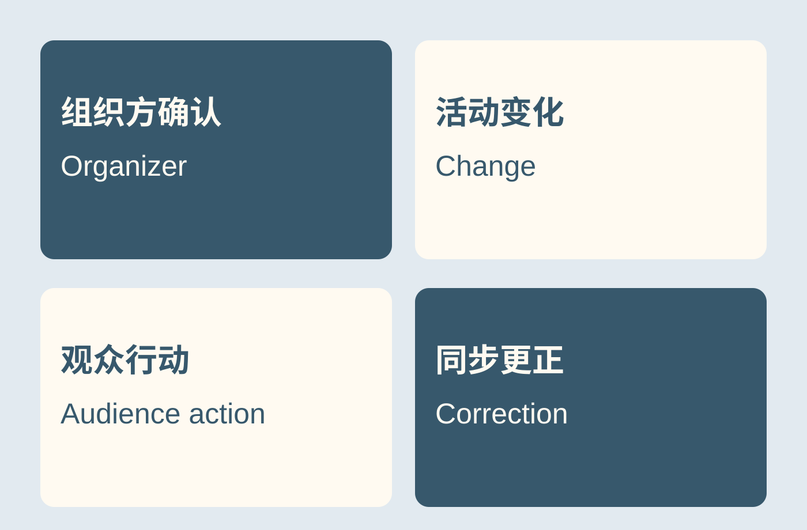

# 活动新闻怎样更新达人委托

状态：本地审阅稿；正式发布日期待确认。

活动新闻改变日期、地点或参与条件时，先确认组织方事实，再更新达人任务、观众行动和公开更正。

QuickKOL 编辑图形；不呈现真实账号指标或平台界面。

对达人营销团队，活动新闻的价值在于它改变了哪些已经安排的工作与观众选择。先从组织方核对事实、日期和状态，再明确创作者是否出席、制作什么、何时发布，以及观众现在需要做什么。本篇提供处理变化的方法，不编造今日新闻榜单。公告、达人接受新任务、排期修改和实际更正，是需要分别确认的状态。

## 先确认新闻改变了什么

不要把每条活动报道都转给所有创作者。先判断它影响日期、地点、参与方式、内容条件还是品牌公开承诺，再确定谁需要知道。

组织方公告、媒体转述、创作者评论和未确认传闻具有不同证据地位。保留原始出处与时间，不把一个流传截图当成完整公告。

例如，新闻说新增直播，不自动意味着已接受现场拍摄的达人也负责直播主持。先看原工作与变化关系，再向适当合作方询问。这是编辑情境，不是某活动的实际安排。

给变化写一句可执行说明：哪项事实改变、影响哪份内容、需要谁采取什么动作。若还没有确认，先记录待核对，而不是让它进入公开脚本。

## 延期与改期不是同一状态

[Eventbrite 延期政策](https://www.eventbrite.com/help/en-nz/articles/169121/eventbrites-postponed-event-policy/)分别定义尚未确定新日期的延期与已经更新并通知参与者的改期。这是该平台在相应政策范围内的用法，不是所有组织方或地区的统一法律定义。

在达人 Brief 中保留组织方实际使用的状态。没有新日期时，不为了把表格填完整而猜一个时间；临时内部占位也不应出现在公开邀请中。

[Eventbrite 改期说明](https://www.eventbrite.com.au/help/en-au/articles/267763/how-to-postpone-or-reschedule-an-event/)将活动状态、日期与参与者沟通作为需要处理的动作。它提供一个具体平台例子，提醒团队更新某一处信息不能替其他工作自动完成。

因此，把“已宣布”“新安排待确认”“已通知相关人”“公开内容已更正”分别记录。用准确状态沟通，比一句“活动已更新”更有帮助。

消息、接受、队列修改与公开结果分别确认。

## 从新闻回到达人实际角色

分别检查出席、拍摄、讲解、主持、发布与后续回应。一个事实变化可能只影响其中部分，不能把所有工作一起默默扩大。

如果新场地改变拍摄条件，核对设备、到场和许可；如果活动改成线上，重新讨论交付形式，不能假设原来同意现场体验就是同意所有线上演出。

品牌应提供已经确认的变化，创作者再说明制作影响。对增加的工作与时间明确沟通，不将“帮忙同步新闻”包装成免费追加内容。

[活动排期时钟方法](https://www.quickkol.com/zh/blog/facebook-scheduling-creator-event-release-clock/#answer)帮助将时间与具体交付连接。本篇关注变化来临时怎样重新确认关系，而不是再给一套通用发布日历。

## 观众需要知道下一步

公开更新不仅说发生变化，还要让观众知道现在该做什么。可能是查看确认日期、停止使用旧入口，或向组织方提出问题。

不要让达人承担无法确认的退款、入场或服务承诺。具体政策与处理路径由组织方或相应品牌团队提供，创作者只准确转述已经确认的信息。

对没有确定答案的问题，说明当前状态和后续发布渠道，不用“马上公布”代替真实安排。观众可以理解不确定性，关键是不要让内部猜测看起来已被批准。

同样，不把创作者到场变成未获同意的承诺。若出席或演出尚未确认，公开资料应保持相应状态，而不是为了促销效果提前列入名单。

## 素材变化也需要核对

场地、人物和节目变化可能使旧照片不再适合作为当前展示。检查画面是否暗示新的到场、产品或体验，而不只替换日期文字。

在美国语境，[美国版权局摄影说明](https://www.copyright.gov/engage/photographers/)提醒原创照片与相应权利需要核对。公开找到一张活动图，不自动得到本次达人广告或改编用途；其他地区与具体安排仍需相应确认。

品牌可以提供准确的已批准素材和图注，让创作者明确哪些可用。若没有新图，选择不误导的表达，不把旧照片冒充本次实际现场。

保存源文件与更正版本的关系。若多个合作方已经下载旧图，修改共享盘不代表他们都已收到新材料，需要按影响范围通知并确认。

## 排期改变需要实际确认

列出受影响的公开内容、排期内容、提醒与品牌目的地。每项有负责人和状态，不让“通知已发出”直接变成“全部已修改”。

创作者可能在自己的工具里管理队列，品牌只能确认自己看到的部分。以适当方式核对实际变更，不要求不必要的账号访问，也不声称平台会自动停止所有旧内容。

对不能及时修改的作品，先说明可采取的准确处理，再由相应负责人决定。不要为了赶时间发布未经确认的新日期或新的角色承诺。

将变化与最终公开作品连接。真正的更正证据是观众接触的信息已准确，而不只是内部任务变绿。这个区别可以减少收尾时的误报。

## 用假设改期检验新闻处理

假设品牌活动宣布延期，但尚无新日期。达人已完成一条邀请视频，另有内容排在队列里。这是编辑例子，不是实时新闻或客户结果。

先暂停把未知日期写进新邀请，再核对原作品中的日期与目的地。品牌向达人提供确认状态，双方讨论队列与已发布内容的处理，观众问题由适当渠道接手。

如果后来确定新日期，重新确认达人实际可用性与制作条件。不能把组织方公布日期当成每位合作方已经同意出席。

这个例子没有规定所有平台的暂停步骤，也没有替组织方处理退款。它展示的是新闻如何变成一组有限、可确认的任务，而不是变成一句需要所有人自行猜测的“同步一下”。

## 留下可追溯的新闻决定

最终记录原始公告、确认事实、影响范围、任务负责人和实际公开结果。对还没有解决的部分保留问题，不用结项语言掩盖未知。

[品牌提及与更正方法](https://www.quickkol.com/zh/blog/brand-monitoring-creator-mention-corrections/#answer)可继续帮助发现仍流传的旧信息。核对范围应与实际需要相称，不把一次活动变化扩大成对所有创作者历史作品的无边界审查。

QuickKOL 可以帮助理解新的 Brief、寻找相关创作者并准备适当联系；组织方事实、到场、素材和发布状态仍由相应来源确认。工具发现不等于完成全部活动执行。

好的活动新闻处理让观众知道当前事实，也让创作者知道下一步工作。它依赖来源与责任对应，而不是把所有合作方都变成随时可调用的新闻转发渠道。

## 活动新闻进入达人任务的路径

| 状态 | 需要依据 | 下一步 |
| --- | --- | --- |
| 消息出现 | 原始组织方来源 | 核对事实 |
| 任务受影响 | 旧任务与新条件 | 确认范围 |
| 排期变更 | 实际内容状态 | 检查公开信息 |
| 结果已更正 | 观众可见准确内容 | 保留记录与余项 |

编辑变化流程；平台政策仅适用于各自范围，不是实时新闻榜单。

## 交接活动变化

从确认事实开始，回到实际公开结果。

- [ ] 保存原公告与时间。
- [ ] 区分延期与确定改期。
- [ ] 核对达人实际角色。
- [ ] 说明观众下一步。
- [ ] 检查素材与真实队列。
- [ ] 确认更正并保留余项。

## 研究日期与使用边界

资料核验于 2026 年 11 月 20 日。文中方法、表格和决策规则为编辑建议，标为假设的示例不是实际客户结果或行业基准。外部资料的适用地区与时期按各段说明。

## 从任务开始达人研究

用 QuickKOL 理解 Brief、发现相关达人并研究作品与联系路径；数据、合作条件和结果仍需核验。

[了解 QuickKOL](https://www.quickkol.com/#capabilities)

## 来源

- [Eventbrite：延期政策](https://www.eventbrite.com/help/en-nz/articles/169121/eventbrites-postponed-event-policy/)
- [Eventbrite 改期说明](https://www.eventbrite.com.au/help/en-au/articles/267763/how-to-postpone-or-reschedule-an-event/)
- [美国版权局：摄影与版权](https://www.copyright.gov/engage/photographers/)
