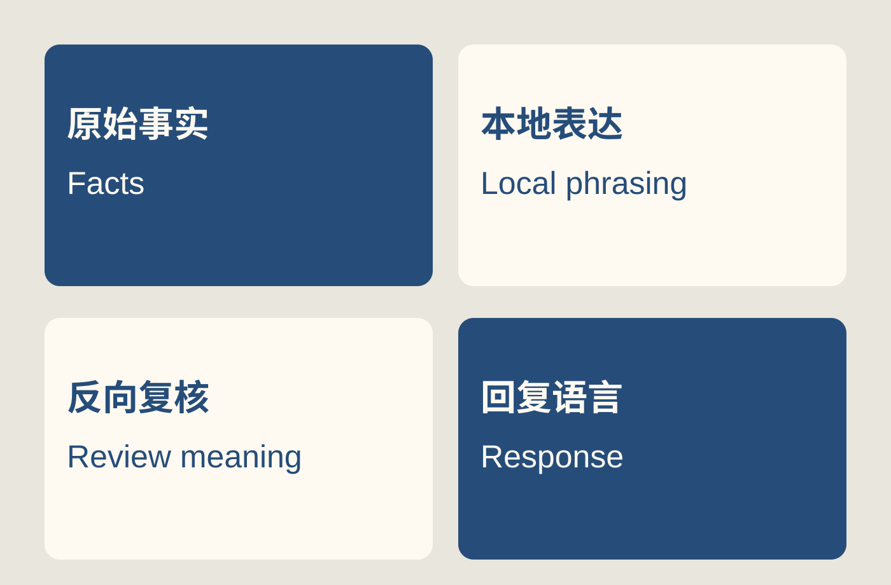

# Fejsbuk Marketing: Brief a Local Creator Clearly

Status: local review draft; confirm the publication date before release.

Treat Fejsbuk as a Facebook-context query and use a local creator’s expression while checking facts, commercial context and response language.

This article treats “fejsbuk marketing” as a Facebook-marketing query without inferring a country or creator nationality from the spelling. For local-language creator work, confirm the viewer question, actual language and service conditions before asking a suitable creator for natural expression. Review meaning, product facts, commercial context and response routes after localization. Speaking a language does not by itself establish a particular geographic audience or capacity to provide every local service. A useful brief connects expression with a defined task instead of treating translation as the entire partnership.

## Confirm language and working context

A spelling can suggest search context without establishing the project’s market or audience. Confirm population, language and task with the brand owner instead of filling regional facts from the query.

Distinguish content language, creator location, filming location and audience location. They may align or differ. Confirm each through appropriate evidence rather than combining them into one local field.

For example, communicating with professionals using a language may require relevant working experience. A city event adds attendance and service conditions. Language ability alone does not make those assignments interchangeable.

The [Facebook Page service method](https://www.quickkol.com/blog/facebook-marketing-page-service-workflow/#answer) helps define the next step the brand can provide. The question here is how a creator explains that task clearly, not whether Fejsbuk is an independent service with another unverified set of account features.

This starting distinction prevents a familiar procurement mistake: choosing someone from a language label and only later discovering that the actual role required local filming, professional explanation or a response capacity never discussed. A clear context lets the creator and brand assess the real work before either makes a public promise.

## Check platform capability in the actual account

[Meta’s Business Suite launch explanation](https://about.fb.com/news/2020/09/a-faster-and-easier-way-to-manage-your-business-on-facebook-and-instagram/) supplies historical context for cross-app management and publication. Retain the scope of this 2020 material instead of treating it as a current tutorial for every market, account and interface language.

Brand and creator should separately confirm publisher, Page or account, content form and actions handled by the actual owner. Translating a platform name does not change permission or establish a partnership feature.

If the tool differs from the reference, check current official guidance and the actual account rather than instruct a creator from another region’s screenshot. Keep unverified capabilities labelled and discuss a workable alternative.

Local-language content still needs accurate public identity, role and links. Fluent copy cannot repair the wrong account or an unsuitable destination.

These checks should stay proportionate to the commission. The brand does not need control of the creator’s entire account to understand the agreed route. It needs enough confirmation to know where the work will appear and which party can complete the relevant action, without assuming that familiarity with one language version of Facebook establishes every operational condition.

## Ask for explanation, not word substitution

Supply brand-confirmed facts and the viewer question, then ask the creator for expression suited to their work. Literal translation may preserve words while losing use context, tone or a necessary premise.

The creator should explain why wording affects understanding, rather than only say everyone here uses it. If an informal expression may be understood as a product guarantee, return to the supported scope and choose a natural accurate alternative.

Do not invent local slang, preferences or cultural rules. Where evidence is unavailable, use clear ordinary wording and appropriate language review. One person’s experience can inform a question without becoming research about a whole market.

Preserve the creator’s own style as well. The brand can require consistent facts without asking someone to copy another language’s performer or emotional tone. Relevant expression is more valuable than superficial accent imitation.

A good localized proposal explains the intended meaning in a way reviewers can assess. This gives the brand a basis for approval even where not every stakeholder speaks the production language, while allowing the creator to contribute more than a direct replacement of words from an earlier script.

## Review meaning rather than identical wording

Review claim, condition, object, time and next step across versions. The question is whether meaning changed or expanded, not whether every word returns to a dictionary equivalent.

Suitable for one task should not become everyone gets the same result. Available to ask should not become guaranteed acceptance. Those differences affect viewer decisions and may alter a partner’s responsibility.

Preserve the relationship between source and localized versions and have someone capable explain material differences. Machine translation can provide a drafting lead without completing specialist factual or language review.

If the brand cannot assess a passage, clarify it rather than treating an unfamiliar language as approved. A concise account of meaning may resolve the issue faster than an extended word-by-word argument.

This method also protects useful localization. Natural wording can differ substantially while retaining the same supported claim. Reviewers can accept it for the right reason instead of forcing awkward phrasing merely to resemble the original. The result should be both understandable in the production language and traceable to the facts and scope the parties agreed.

Natural expression and accurate conditions need to hold together.

## Make commercial context understandable

Where the US guidance applies, [the FTC’s influencer-disclosure guide](https://www.ftc.gov/business-guidance/resources/disclosures-101-social-media-influencers) calls for clear material brand relationships. In local-language work, check expression against the actual audience and applicable requirements rather than assume one foreign-language abbreviation is universally understood.

This is not a prescription of one label for every country. The appropriate owners should confirm wording, platform settings and placement. A treatment used in a reference draft should not be copied automatically into every language version.

Review relationship context separately from product support. Clear disclosure does not establish a fact or turn an unexperienced opinion into a genuine first-hand account.

The creator needs to understand the commercial relationship being expressed. The brand should supply accurate information rather than expect a translator or creator to infer payment, sampling and usage from a quotation screenshot.

These checks can remain concise in the public work. The objective is understandable context, not a display of internal process. Make the relationship clear and let the creator’s relevant explanation carry the main content, while preserving the basis for any product or experience claim.

## Match response language with service capacity

People may ask questions in the content language. Identify who can respond, what they can answer and when to hand over. Translating the publication alone can leave an inquiry route the team cannot operate.

If the creator supplies explanation rather than customer service, provide a suitable brand route. Avoid requesting order or identity information in public comments for an issue that needs private handling.

In the UK context, [the ICO’s accuracy guidance](https://ico.org.uk/for-organisations/uk-gdpr-guidance-and-resources/data-protection-principles/a-guide-to-the-data-protection-principles/accuracy/) emphasizes clear source and state. Operationally, retain the original question and a checked interpretation, distinguishing what the person actually said from team inference. This is not a complete global legal rule.

If continuing support in a language is unavailable, narrow the invitation or arrange an appropriate handoff. Natural local wording should not imply support capability the brand has not prepared.

This is part of the communication promise, not a secondary translation detail. The team can commission excellent creator work and still disappoint viewers if the next step leads to a language mismatch. Resolving the response route early gives the invitation a practical destination and prevents the creator from becoming an unintended permanent interpreter for every later service issue.

## Check scope through a hypothetical local commission

Imagine a brand commissioning a creator to explain event registration in a language familiar to the intended audience. The creator proposes natural wording, but one passage could imply that registration guarantees a place. This is an editorial example, not an actual event.

Return to the real conditions and correct that passage while preserving the creator’s other natural expression. The issue is an expanded promise, not localization being inherently unreliable.

If the event page supports another language only, arrange accurate explanation and response or revise the invitation. Do not ask the creator to compensate orally for every product gap.

At review, assess clarity, destination fit and appropriate handling of questions separately. Fluent wording does not establish a complete local-marketing operation.

The scenario shows why the commission needs more than a translated script. It needs a supported statement, a usable route and a defined role. Once those are clear, the creator can contribute local expression without being made responsible for registration decisions or continuing services outside the agreed work.

## Deliver a maintainable local version

Retain original facts, localized expression, difference notes, reviewer, version and destination. When product or event conditions change, identify every language version affected instead of updating only the language the team knows best.

The [creator-positioning brief method](https://www.quickkol.com/blog/creator-brief-positioning-statement-proof/#answer) can preserve the shared task behind different expression. Positioning can remain consistent without requiring every creator to reproduce the same slogan verbatim.

QuickKOL helps interpret a brief, discover relevant creators and prepare personalized contact. Language capability, audience geography, actual service and outcomes still need verification; candidate matching does not establish them.

Local collaboration is valuable when a specific audience understands a brand question more clearly. A query such as Fejsbuk can be a starting point, but the decision should come from task, work and real conditions rather than assumptions attached to spelling.

Keep the version record with the asset so the next operator can maintain that clarity. It allows new information to be introduced accurately, while retaining the creator’s contribution and the review basis instead of repeatedly translating an outdated source into more polished but equally obsolete local content.

## Local-language partnership review

| Object | Confirm | Do not infer |
| --- | --- | --- |
| Audience | Language and task | Spelling determines country |
| Creator | Work and suitable role | Language means audience location |
| Expression | Claim, conditions and time | Fluent means factually correct |
| Response | Owner and suitable route | Content language means complete service |

Editorial localization framework, not a universal country or interface-language procedure.

## Confirm the local creator brief

Align expression, facts and the next step.

- [ ] Check actual language and population.
- [ ] Choose the creator for the task.
- [ ] Review meaning claim by claim.
- [ ] Explain commercial context and support.
- [ ] Prepare an appropriate response route.
- [ ] Retain versions and update ownership.

## Research date and limitations

Sources reviewed November 20, 2026. Methods, tables and decision rules are editorial recommendations. Hypothetical examples are not actual client results or industry benchmarks. Source geography and periods are specified where relevant.

## Start creator research with a clear task

Use QuickKOL to interpret a brief, discover relevant creators and research their work and contact routes. Verify data, commercial terms and outcomes at their source.

[Explore QuickKOL](https://www.quickkol.com/#capabilities)

## Sources

- [Meta’s Business Suite launch explanation](https://about.fb.com/news/2020/09/a-faster-and-easier-way-to-manage-your-business-on-facebook-and-instagram/)
- [the FTC’s influencer-disclosure guide](https://www.ftc.gov/business-guidance/resources/disclosures-101-social-media-influencers)
- [ICO: accuracy principle](https://ico.org.uk/for-organisations/uk-gdpr-guidance-and-resources/data-protection-principles/a-guide-to-the-data-protection-principles/accuracy/)
