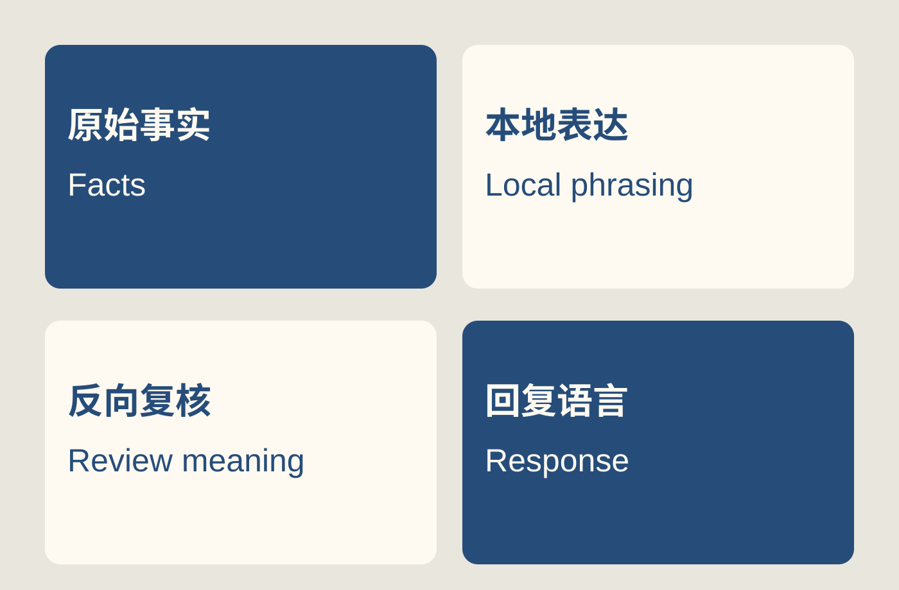

# Facebook 本地语言合作怎样校准

状态：本地审阅稿；正式发布日期待确认。

按 Facebook 语境处理 Fejsbuk 搜索词，用本地创作者的真实表达解释品牌任务，同时核对事实、商业语境和回复语言。

本文将“fejsbuk marketing”按 Facebook 营销语境理解，不因一种拼写推定受众国家或达人籍贯。品牌做本地语言合作，应先确认观众问题、实际语言与服务条件，再让合适创作者提出自然表达。翻译后的意思、产品事实、商业关系和回应路径都要核对。会说某种语言，不自动证明拥有特定地区受众或能够承担全部本地服务。

## 先确认语言与工作情境

关键词拼写可以提示搜索语境，但不足以判断项目在哪个市场、面向哪类人。先向品牌负责人核对实际受众、语言和任务，不凭输入词补出地区事实。

可以区分内容语言、创作者所在地、拍摄地点和受众所在地。它们可能一致，也可能不同，各自用适当来源确认，不在资料表中混成一个“本地”。

例如，面向使用某语言的专业人群，可能需要相关工作经验；面向某城市活动，则另有到场与服务条件。两种任务不能只靠语言能力互换。

[Facebook 主页服务方法](https://www.quickkol.com/zh/blog/facebook-marketing-page-service-workflow/#answer)帮助明确品牌能提供的下一步。本篇聚焦创作者怎样把这项任务讲清，而不是将 Fejsbuk 当成独立平台或另一套未经核验的账号功能。

## 平台能力按实际账号核对

[Meta Business Suite 推出说明](https://about.fb.com/news/2020/09/a-faster-and-easier-way-to-manage-your-business-on-facebook-and-instagram/)介绍过跨应用管理与发布背景。引用这份 2020 年资料时，保留历史范围，不将它当成今天所有市场、账号和语言界面的统一教程。

品牌与达人分别确认谁发布、哪个 Page 或账号、需要什么内容形式，以及哪些动作要由实际负责人完成。翻译平台名称不会自动改变权限或取得合作功能。

若工具界面与参考资料不同，回到当前官方说明与实际账号核对，不要求创作者照着另一地区截图操作。对尚未验证的功能，保留状态并讨论可执行替代。

内容可以使用本地语言，但公开身份、角色与链接要准确。一个流畅的文案无法修复错误账号或不匹配的目的地。

## 让创作者解释，不只替换词

先给品牌确认的事实与观众问题，再让创作者提出适合其作品的表达。逐字翻译可能保留字面，却丢掉使用情境、语气和必要前提。

创作者应能解释某个词为什么影响理解，而不只说“当地都这样说”。如果一个口语表达可能被理解成产品保证，回到事实范围，选择自然且准确的替代。

不要编造本地俚语、常见偏好或文化规律。没有适当证据时，使用清楚的普通表达，并请合适审阅者核对。单人经验可以帮助提问，不能冒充整个市场研究。

也保留创作者个人风格。品牌可以要求事实一致，不必要求其复制另一语言创作者的性格或情绪。相关表达比表面的口音模仿更有价值。

## 对照意思而不是逐词验收

审稿可以按主张、条件、对象、时间与下一步逐项对照。重点是意思有没有扩大或改变，不是每个词能否按字典回译。

例如，“适用于某项任务”不能变成“任何人都能获得相同效果”；“可询问”不能变成“保证接受”。这些变化会影响观众决定，也可能改变合作方责任。

保留原语言与本地版本的对应关系，并让有能力的人解释实质差异。机器翻译可以提供草稿线索，但不自动完成专业事实或本地表达审阅。

若品牌无法核对某段表达，先澄清，不把不懂的语言当成已经通过。清楚的意思说明可以比冗长逐词争论更快完成审稿。

自然表达与准确条件需要同时成立。

## 商业关系也要能被理解

在适用的美国指导中，[FTC 达人披露说明](https://www.ftc.gov/business-guidance/resources/disclosures-101-social-media-influencers)要求重要品牌关系清楚。对本地语言合作，应按实际受众与适用要求核对表达，不假定一个外语缩写会被所有人理解。

这不是为每个国家规定同一种标记。品牌应与合适负责人确认文字、平台设置和出现位置，不能仅因参考稿已经用过，就照搬到所有语言版本。

关系说明与产品依据分别检查。清楚披露不能代替事实，也不能将未经体验的意见变成真实经历。

创作者需要知道自己在表达什么合作关系。品牌也应提供准确说明，不让翻译人员或创作者从一份报价截图里猜测付款、寄样与用途安排。

## 回复语言与服务能力匹配

观众可能使用内容语言提问，品牌需要说明谁能回应、回应什么，以及何时转交。不能只翻译发布文案，却留下无法处理的咨询入口。

如果创作者只承担解释，不负责客户服务，就给合适品牌路径。对需要私下处理的问题，避免在评论中索取订单与身份资料。

在英国语境中，[ICO 准确性说明](https://ico.org.uk/for-organisations/uk-gdpr-guidance-and-resources/data-protection-principles/a-guide-to-the-data-protection-principles/accuracy/)提醒资料来源与状态要清楚。工作上可以保留原问题与经核对的译意，区分对方实际表达和团队推断；不将这个建议当成全球完整法律规则。

如果无法提供某语言的持续服务，缩小公开承诺或安排合适转接。不要让一条自然的本地邀请暗示品牌已经拥有未准备好的全部支持能力。

## 用假设本地委托核对范围

假设品牌请一位创作者解释一项活动报名流程，内容使用目标受众熟悉的语言。创作者提出更自然的说法，但其中一处可能暗示报名保证获得名额。这是编辑例子，不是实际活动。

品牌应回到真实条件修正文案，同时保留创作者其他自然表达。问题在于承诺改变，而不是本地化本身不可靠。

若活动信息页只支持另一语言，则安排准确说明与回应路径，或调整邀请，不要求创作者用口头解释弥补所有产品缺口。

复盘时分别检查作品是否清楚、目的地是否匹配和问题是否得到合适处理。不能因为文案流畅，就宣布全部本地营销能力已经建立。

## 交付可维护的本地版本

最终保留原事实、本地表达、差异说明、审阅人、版本与目的地。产品或活动条件变化时，能找到哪些语言版本需要更新，不只修改最熟悉的一种语言。

[定位 Brief 方法](https://www.quickkol.com/zh/blog/creator-brief-positioning-statement-proof/#answer)可以继续帮助保持不同表达背后的共同任务。定位可以一致，但不要求所有创作者逐字复制同一口号。

QuickKOL 帮助理解 Brief、发现相关达人和准备个性化联系；语言能力、受众地域、实际服务与效果仍需要核验，不能从工具匹配自动推断。

本地合作的价值在于让具体观众更清楚理解品牌问题。Fejsbuk 这样的搜索词可以作为起点，但最终决定应来自任务、作品和真实条件，而不是拼写带来的假设。

## 本地语言合作的核对

| 对象 | 确认 | 不推定 |
| --- | --- | --- |
| 受众 | 语言与实际任务 | 拼写决定国家 |
| 创作者 | 作品与合适角色 | 语言等于受众地域 |
| 表达 | 主张、条件和时间 | 流畅即事实正确 |
| 回应 | 负责人和适当路径 | 发布语言等于全部服务 |

编辑本地化框架，不规定统一国家或平台语言流程。

## 确认本地创作者 Brief

让表达、事实与下一步相匹配。

- [ ] 核对实际语言与人群。
- [ ] 按任务选择创作者。
- [ ] 逐项复核表达意思。
- [ ] 说明商业关系与依据。
- [ ] 准备合适回应路径。
- [ ] 保留版本与更新责任。

## 研究日期与使用边界

资料核验于 2026 年 11 月 20 日。文中方法、表格和决策规则为编辑建议，标为假设的示例不是实际客户结果或行业基准。外部资料的适用地区与时期按各段说明。

## 从任务开始达人研究

用 QuickKOL 理解 Brief、发现相关达人并研究作品与联系路径；数据、合作条件和结果仍需核验。

[了解 QuickKOL](https://www.quickkol.com/#capabilities)

## 来源

- [Meta Business Suite 推出说明](https://about.fb.com/news/2020/09/a-faster-and-easier-way-to-manage-your-business-on-facebook-and-instagram/)
- [FTC 达人披露说明](https://www.ftc.gov/business-guidance/resources/disclosures-101-social-media-influencers)
- [ICO：准确性原则](https://ico.org.uk/for-organisations/uk-gdpr-guidance-and-resources/data-protection-principles/a-guide-to-the-data-protection-principles/accuracy/)
