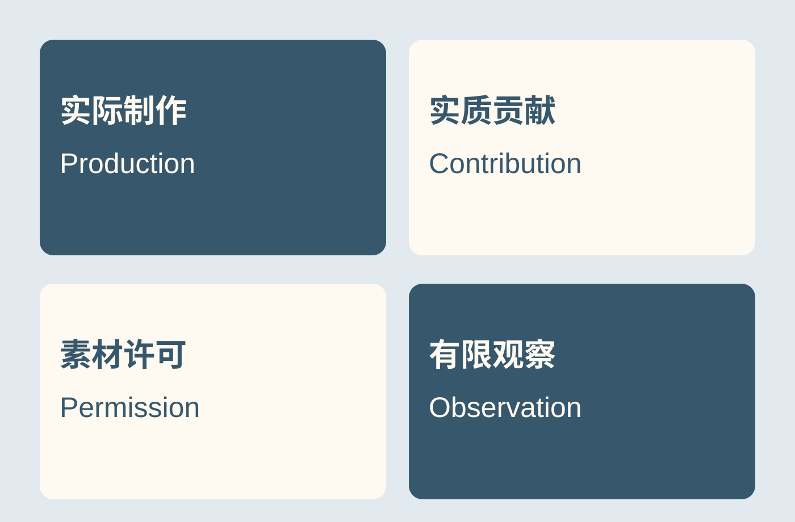

# Facebook Algorithm: Review the Creator’s Contribution

Status: local review draft; confirm the publication date before release.

Separate permission to use material from the creator’s original contribution when commissioning Facebook work.

For Facebook creator work, ask what the creator adds and separately whether the material is permitted for use. Original production, substantial explanation and new analysis are different contributions. Permission to reuse someone’s clip does not automatically turn a border, caption or narration of visible action into meaningful new work. Record the contribution, necessary sources and usage scope, then inspect actual platform feedback. This editorial review is not an algorithm score and cannot guarantee recommendation, monetization or a particular distribution result.

## Apply current guidance to the new commission

[Meta’s 2026 original-content explanation](https://about.fb.com/news/2026/03/rewarding-original-creators-on-facebook/) distinguishes original work and substantial new contributions from minor changes. Use that distinction when commissioning new work instead of requesting the same clip with another cover.

The [Facebook 2025 original-creator review method](https://www.quickkol.com/blog/facebook-2025-original-creator-content-review/#answer) covers an earlier context. This article uses the newer explanation to separate contribution, media rights and commercial acceptance. Earlier experience should not become a permanent recommendation formula.

Ask the creator to describe the new value in one sentence: personally demonstrate a step, perhaps, or explain a result under different conditions. If the answer consists only of cropping, borders and replacement captions, revisit the topic before production.

This review helps the brand request clearer work without making a final platform classification. Personal filming also leaves factual accuracy, commercial disclosure and other applicable requirements to address.

A defined contribution gives the producer something useful to commission and the reviewer something specific to inspect. It is more actionable than telling a creator to make content that the algorithm will like, because the team can assess the explanation while distribution remains dependent on circumstances it does not control.

## Review permission and contribution separately

In the U.S. context, [the U.S. Copyright Office’s photography guide](https://www.copyright.gov/engage/photographers/) explains protection for original photographs when fixed and generally identifies the photographer as the initial owner, subject to exceptions. That addresses rights rather than replacing a platform’s originality assessment.

A permitted clip can still receive only minor changes. Another work may contain a new explanation while lacking suitable permission for an included photograph. Those are separate problems requiring separate answers.

Keep source, permission scope and new contribution in different handover fields. Client supplied or found online is not complete rights information, and licensed is not an explanation of new analysis.

This is not a legal determination about a particular work. Resolve unclear authorization, intended use and duration with the relevant parties before proceeding.

Keeping the questions separate also improves revision requests. A producer can ask for a stronger demonstration without implying that more filming fixes a missing license. Equally, a rights owner’s approval should not be presented to the creator as proof that a minor edit will receive favourable platform treatment. Each review has its own evidence and owner.

## Locate the contribution in the work

Imagine a creator using a permitted desk-lamp clip. Reading the visible action aloud and personally explaining placement under different desk conditions are different commissions. This is a hypothetical example, not a platform enforcement record about an actual account.

Mark where original filming, referenced material and new explanation appear. A final instruction to add a personal opinion is weak if nobody can identify how that opinion improves understanding.

For a comparison, retain conditions. For an operation, retain prerequisites and steps. For commentary, distinguish reviewable facts from the creator’s judgment. New contribution need not mean agreement with the brand.

Avoid filling the work with irrelevant footage to prove originality. Organize it around a clear question so viewers understand why this creator’s explanation matters, rather than simply extending duration.

A practical review can follow the question from opening through evidence to conclusion. If the promised explanation disappears once borrowed material is removed, the team should discuss the substance again. That is an editorial test of the commissioned work, not a method for predicting a platform’s private classification or assigning a universal percentage of original footage.

Each check answers a different question.

## Retain suitable production evidence

Original recordings, script changes and demonstration conditions can help the team understand how the work developed. Retain relevant versions rather than collect everything on a creator’s private devices.

Production evidence has limits. Holding a raw file does not establish permission for every depicted object in an advertisement, and a recording date does not replace factual checking. Match the evidence to the question.

If the reviewer cannot understand why the demonstration supports a conclusion, inspect the relevant complete steps rather than only the final edit. If the issue concerns a third-party photograph, return to the permission record instead of answering with behind-the-scenes footage.

These records primarily support collaboration and correction. Do not promise that submitting originals will restore recommendation, or imply the brand can decide an issue for a platform review team.

The handover should therefore identify what each retained item can explain. A take can show the creator performed an action; an approved script can show what the brand commissioned. Neither automatically settles every later question about rights, accuracy or distribution. Keeping those limits visible makes a revision discussion more precise and fair.

## Review the work rather than substitute account scale

Follower counts and historical views can provide scoped background; they do not establish the contribution in this particular work. Research relevant original examples and whether the person can perform the requested demonstration or analysis.

The [Instagram format-commissioning method](https://www.quickkol.com/blog/instagram-ranking-creator-format-commission/#answer) starts with the viewing task. Cross-platform partnerships likewise need a considered commission rather than assuming a successful clip on one service is the best deliverable elsewhere.

Invite the creator to explain their method while the brand supplies necessary facts and reviewable material. An identical read-aloud script for every participant is a poor foundation for requesting a distinctive contribution.

Acceptance can examine whether the question is answered, conditions remain visible and sources are suitable. Missing a view target should not itself classify the work as unoriginal, and high views should not remove rights or accuracy questions.

This keeps creator selection connected to capability. A smaller portfolio may contain precisely the relevant explanation; a larger account may still need a different brief. The review should identify the fit with this task rather than turn account scale into a substitute for watching and understanding the proposed work.

Production evidence can explain the demonstration without replacing media permission.

## Keep ranking explanations within scope

[Meta’s ranking transparency explanation](https://about.fb.com/news/2023/06/how-ai-ranks-content-on-facebook-and-instagram/) describes multiple systems and signals, not a fixed public formula for calculating exposure. Original-content guidance also does not make other quality or policy considerations irrelevant.

Do not rewrite editorial suggestions as three guaranteed steps to recommendation. Equally careful production can receive different distribution across topics, audiences and periods.

Report the work review, actual platform notices and observed performance separately. When a platform has not supplied a clear reason, one metric should not become a confirmed algorithmic penalty.

If a notice appears, preserve it and the appropriate review route, then address the actual issue with relevant material. The brand can help organize records without claiming a private internal score or guaranteed restoration channel.

This distinction protects the quality of the collaboration review. The team can identify a missing explanation and request a revision even when no platform notice exists. It can also recognize that a distribution change needs further context rather than use uncertainty about ranking to assign an unsupported fault to the creator or to declare the commission a failure.

## Revise for understanding rather than packaging alone

Suppose a first draft relies mostly on permitted clips and the brand needs an explanation of relevant conditions. A useful revision may add a demonstration, explain a choice and reduce unnecessary references. Merely changing the title should not become a claim of entirely original production.

Define the problem and additional work before revising, including time, fees and usage scope. A later change in the brand’s commission is not automatically free corrective work owed by the creator.

If factual support is insufficient, narrow the conclusion or hold publication. Stronger language does not replace evidence, and more footage does not necessarily repair a mistaken inference.

Review the relationship between referenced and original material, along with required disclosure and permission. The final version should make sense without requiring viewers to have seen the source clip first.

That gives the revision a clear purpose: help the audience understand something the earlier draft did not adequately explain. It also lets both parties evaluate completion against the agreed task instead of endlessly changing surface presentation while leaving the substantive question unresolved.

## Close the review with a readable record

Hand over a short record: the question, the creator’s contribution, important media sources, actual permission scope, open issues and their owners. Do not compress every review action into an unexplained pass score.

After release, check continuing factual accuracy and agreed use, correcting where necessary. Performance review can suggest the next topic without rewriting what was actually produced.

QuickKOL can help interpret the brief and research relevant work and contact routes. Raw files, authorization, platform notices and commercial acceptance still require their respective sources. Do not imply the system has completed those checks for the user.

When the team can state what was added, what supports it and who must confirm the remaining question, the collaboration has an executable next step. Treat originality as a responsibility in the work rather than a distribution button guaranteed by marketing language.

That record can remain concise. Its value comes from connecting each conclusion to evidence and a practical action, so a future reviewer does not need to guess whether approved meant permitted, factually checked, commercially accepted or simply ready for another discussion.

## Four questions in an original-work review

| Question | Review | Does not establish |
| --- | --- | --- |
| Is material permitted? | Owner and actual scope | Platform originality guaranteed |
| What is added? | Demonstration, analysis and explanation | All media authorized |
| How was it produced? | Relevant recordings and conditions | Guaranteed recommendation |
| What did the platform say? | Actual notice and status | Brand can decide for the platform |

Editorial review framework, not an algorithm score or legal determination.

## Hand over the contribution review

Keep necessary evidence for the actual question.

- [ ] Define the new contribution in one sentence.
- [ ] Record source and permission separately.
- [ ] Locate the important demonstration or analysis.
- [ ] Retain relevant production evidence.
- [ ] Separate notices from performance speculation.
- [ ] Assign an owner to each open issue.

## Research date and limitations

Sources reviewed November 20, 2026. Methods, tables and decision rules are editorial recommendations. Hypothetical examples are not actual client results or industry benchmarks. Source geography and periods are specified where relevant.

## Start creator research with a clear task

Use QuickKOL to interpret a brief, discover relevant creators and research their work and contact routes. Verify data, commercial terms and outcomes at their source.

[Explore QuickKOL](https://www.quickkol.com/#capabilities)

## Sources

- [Meta’s 2026 original-content explanation](https://about.fb.com/news/2026/03/rewarding-original-creators-on-facebook/)
- [U.S. Copyright Office: photography and copyright](https://www.copyright.gov/engage/photographers/)
- [Meta’s ranking transparency explanation](https://about.fb.com/news/2023/06/how-ai-ranks-content-on-facebook-and-instagram/)
