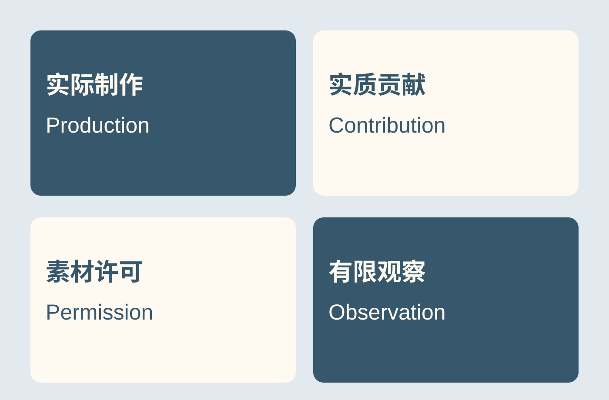
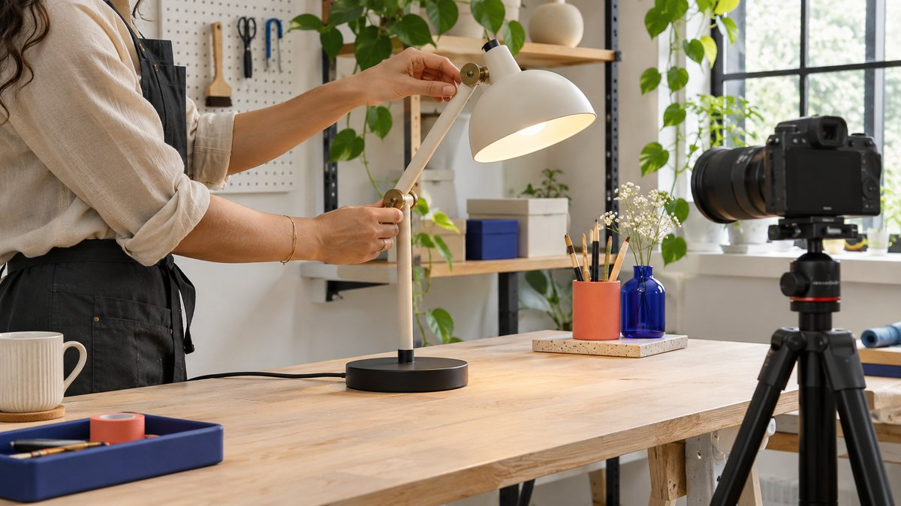

# Facebook 合作怎样核对原创贡献

状态：本地审阅稿；正式发布日期待确认。

把获得素材许可与真正新增的原创贡献分开，为 Facebook 达人合作明确拍摄、解释与复核依据。

为 Facebook 合作审稿时，先问创作者新增加了什么，再问素材是否获准使用。原创拍摄、实质性解释与新的分析可以构成不同贡献；拿到别人片段的许可，不会自动使加边框、字幕或复述画面成为有意义的新作品。记录新增内容、必要来源与使用范围，再核对实际平台反馈。品牌不能把这份审稿表写成算法评分或承诺一定获得推荐。

## 把现行说明带入新委托

[Meta 2026 原创内容说明](https://about.fb.com/news/2026/03/rewarding-original-creators-on-facebook/)强调原创作品和有实质贡献的新内容，区别于轻微加工。品牌应据此检查新委托的创作任务，而不是只要求将同一个片段换封面再发布。

[Facebook 2025 原创合作审稿方法](https://www.quickkol.com/zh/blog/facebook-2025-original-creator-content-review/#answer)讨论了较早背景。本篇按新的说明，进一步区分原创贡献、素材权利与合作验收，不能将旧经验写成永远有效的推荐公式。

先让创作者用一句话说明本次新增的价值，例如亲自演示一个步骤，或基于不同条件解释结果。答案若只有裁切、加框与换字幕，应回到选题阶段重新讨论。

这种检查帮助品牌提出更清楚的任务，不能替平台作最终分类。即使原作由本人拍摄，也仍需考虑事实准确、合作披露和其他适用要求。

## 分别审查许可与贡献

[美国版权局摄影说明](https://www.copyright.gov/engage/photographers/)在美国语境下说明照片通常自固定时受保护，摄影者一般为最初权利人，但有例外。这有助于理解素材权利，不能直接代替平台对原创内容的判断。

一个片段可以获得使用许可，但新版本仍只做轻微加工；另一个作品可能确有新的解释，却仍缺少其中图片的适当许可。两种问题需要分别解决。

交接时把来源、许可范围与新增贡献放在不同栏。不要用“客户提供”或“网上找到”填完权利信息，也不要把“已买授权”当作新分析的说明。

这里不是为任何具体作品作法律判断。涉及不清楚的权利或商业条件时，确认实际授权对象、用途和期限，再决定如何使用。

## 将新贡献落实到画面与解释

假设创作者使用获准片段介绍台灯。仅把可见动作读一遍，和亲自说明不同桌面条件下怎样摆位，是不同的创作任务。这是假设例子，不是平台对某个真实账号的处罚记录。

审稿标出具体时间段：哪里是原始拍摄，哪里是引用材料，哪里出现新的解释。不要只在结尾写“加入个人观点”，却无法指出观点怎样帮助理解。

如果任务是比较，保留比较条件；若是操作，保留前提与步骤；若是评论，区分可核对的事实与创作者判断。新的贡献不等于必须赞同品牌。

也不要为证明原创而填满不相关片段。作品应围绕一个明确问题组织，让观众看懂为什么需要这位创作者的解释，而不是只增加长度。

每一栏回答不同问题，不能相互代替。

## 保留适当的制作依据

原始拍摄文件、脚本变化和演示条件，可以帮助团队理解作品如何形成。保留与任务有关的版本，不需要无限收集创作者私人设备里的所有内容。

制作依据也有边界。拥有原始文件不自动证明其中每个对象都获准用于广告；一个拍摄日期也不能代替事实核查。按具体问题寻找对应证据。

例如审稿人不理解演示为何得出结论，可以查看相关完整步骤，而不是只看最终剪辑。若争议涉及第三方照片，则应回到许可记录，不能用花絮回答。

这类记录首先服务于合作沟通和修正。不要向创作者承诺提交原片就必然恢复推荐，也不要冒称品牌能够替平台审查部门作决定。

## 审稿时不要用规模代替作品

粉丝数和历史观看量可以作为有范围的背景，不能证明这一次内容的原创贡献。研究候选时优先查看相关原作，确认其能否完成所需演示或分析。

[按格式委托 Instagram 内容的方法](https://www.quickkol.com/zh/blog/instagram-ranking-creator-format-commission/#answer)提醒团队先理解观看任务。跨平台合作同样需要重写任务，不把一个平台上表现好的片段直接当作另一个平台的最佳交付。

让创作者解释其方法，品牌提供必要事实与可核对材料。不要只给一份全员照读的脚本，再要求每个人呈现“独特表达”。

验收可以检查任务是否回答、条件是否保留、来源是否合适。避免把未达到某个观看数直接判为作品不原创，也不因播放量高就忽略素材与事实问题。

制作依据应帮助理解实际演示，不替代素材许可。

## 把排序说明放在正确范围内

[Meta 排序透明度说明](https://about.fb.com/news/2023/06/how-ai-ranks-content-on-facebook-and-instagram/)介绍多个排序系统与信号，不是一份供品牌计算曝光的固定公开公式。原创内容说明也不意味着其他内容质量和适用政策都不重要。

不要把编辑建议写成“做完三步必然获得推荐”。即使同样认真制作，不同主题、受众与时期也可能出现不同分发结果。

报告中分开记录作品评审、实际平台提示与观察到的表现。若平台没有给出明确原因，不要用一个指标猜成已证实的算法处罚。

出现提示时保留原始通知与适当申诉路径，按实际问题补充材料。品牌可以协助整理记录，不应假称有未公开的内部评分或百分百恢复渠道。

## 修改应增加理解而非换包装

假设初稿主要由获准片段组成，品牌想让创作者解释适用条件。合适的修改可能是补拍演示、讲清一个选择理由，并减少无关引用；不是仅换标题来宣称完全原创。

修改前说明希望解决的问题与新增工作，确认时间、费用和使用范围。不要将品牌后来改变的任务全部当作创作者应免费返工。

如果事实依据不足，可以缩小结论或暂停发布。更有力度的语气不能代替缺失证据，增加镜头也不一定修好错误判断。

完成后再次检查引用与原创部分之间的关系，以及必要的披露和许可。最终版本应独立可理解，而不是让观众必须先看到原始素材才知道创作者在解释什么。

## 用可复查记录结束合作评审

交接一份简短记录：合作问题、创作者新增贡献、重要素材来源、实际许可范围、待解决事项及负责方。不要将每个审核动作压成一个没有解释的通过分数。

上线后观察作品是否继续符合事实和约定，必要时作更正。表现复盘可以提出下一次题目，但不能反过来重写当时实际制作了什么。

QuickKOL 可用于理解 Brief、研究相关作品与联系路径。实际原片、授权、平台通知与商业验收仍回到各自来源，不暗示系统已经替用户完成这些核验。

当团队能清楚说出“新增了什么、依据是什么、谁还需要确认”，合作就有了可执行的下一步。把原创当作内容责任，而不是一个由营销话术保证的分发按钮。

## 原创合作评审的四种问题

| 问题 | 核对内容 | 不能推出 |
| --- | --- | --- |
| 素材可用吗 | 权利人与实际范围 | 平台一定认定原创 |
| 新增了什么 | 演示、分析与解释 | 所有素材都获授权 |
| 怎样形成 | 有关原片和条件 | 必然得到推荐 |
| 平台说了什么 | 真实通知与状态 | 品牌可替平台决定 |

编辑审稿框架，不是算法评分或法律结论。

## 交接原创合作评审

按实际问题保留必要材料。

- [ ] 用一句话定义新增贡献。
- [ ] 分开记录来源与授权范围。
- [ ] 标出重要演示或分析的位置。
- [ ] 保留相关制作依据。
- [ ] 区分平台通知与表现推测。
- [ ] 为未决问题指定负责方。

## 研究日期与使用边界

资料核验于 2026 年 11 月 20 日。文中方法、表格和决策规则为编辑建议，标为假设的示例不是实际客户结果或行业基准。外部资料的适用地区与时期按各段说明。

## 从任务开始达人研究

用 QuickKOL 理解 Brief、发现相关达人并研究作品与联系路径；数据、合作条件和结果仍需核验。

[了解 QuickKOL](https://www.quickkol.com/#capabilities)

## 来源

- [Meta 2026 原创内容说明](https://about.fb.com/news/2026/03/rewarding-original-creators-on-facebook/)
- [美国版权局：摄影与版权](https://www.copyright.gov/engage/photographers/)
- [Meta 排序透明度说明](https://about.fb.com/news/2023/06/how-ai-ranks-content-on-facebook-and-instagram/)
