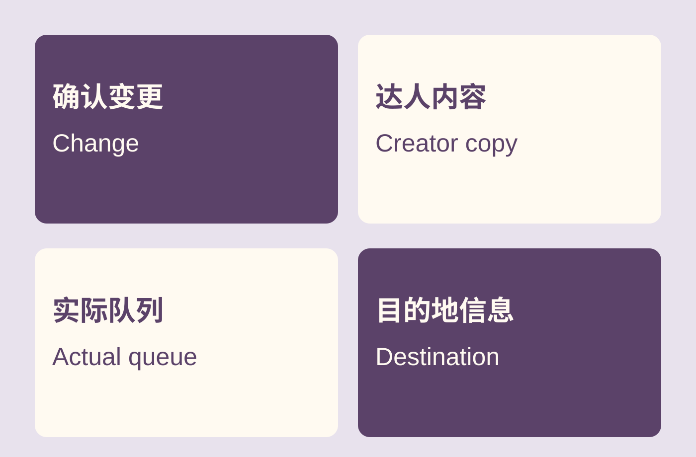

# Schedule Facebook Posts With Change Dependencies

Status: local review draft; confirm the publication date before release.

When timing changes in a Facebook creator partnership, review copy, queue, destinations and response arrangements together instead of updating only the calendar.

Confirm Facebook scheduling within the actual account and available tool. In creator partnerships, assigning a time is only one step. A timing change can affect conditions inside the work, usage, brand destinations, reminders and response responsibility. An internal calendar update does not establish that the actual queue changed or that the creator accepted additional work. Give each dependency an owner able to confirm it, then check what viewers actually encounter. This article focuses on connected changes rather than promising identical menus or scheduling windows for every account.

## Confirm the actual publishing object

Identify the Page, publisher, tool and whether the work belongs on a brand destination or creator account. A shared campaign name does not make them the same publishing object.

[Meta’s Business Suite launch explanation](https://about.fb.com/news/2020/09/a-faster-and-easier-way-to-manage-your-business-on-facebook-and-instagram/) introduced cross-app management and publishing in 2020. It is historical material, not evidence of identical current menus and capabilities for every account.

Check the scheduling route, permission and content form in the actual account. If a capability is unconfirmed, retain that state or discuss an alternative instead of applying an outdated screenshot as a universal procedure.

The [creator-event release-clock method](https://www.quickkol.com/blog/facebook-scheduling-creator-event-release-clock/#answer) concerns arranging time around an activity. This article concerns what else must change once that time moves. A correct object is the starting point; otherwise the team may revise a calendar that does not control the real publication.

The record should therefore say which person can inspect the actual queue. That is more useful than assuming everyone with the planning document can act on the platform, and it helps distinguish a request sent to a partner from a change already completed by an authorized operator.

## Separate planned time from publication state

[Meta’s Page-feed publishing reference](https://developers.facebook.com/docs/graph-api/reference/page/feed/) distinguishes publishing objects and fields, including API-level scheduling conditions. An API document is not a universal native Business Suite window, and this article does not ask readers to implement the interface.

The distinction helps explain why a time in the plan, a time accepted by the tool and an actual public state are different. Retain the object, date and state in the real tool, not only the internal target.

Make time zones explicit. The brand, creator and event may be in different places. A time without context in a sheet should not be assumed understood identically by everyone.

If the route uses a reminder rather than automatic publication, state who receives it and who acts. A created reminder does not guarantee release, and a draft is not a completed queue entry.

These states give the team a reliable basis for change. It can identify which part needs editing and which person can verify the result, rather than treating one date cell as though it were the only schedule or assuming that every route has the same automated behaviour.

## Inspect content that depends on time

Inspect spoken wording, subtitles, cover text, caption, links, event information and product conditions. Moving the date may make today, tomorrow or last opportunity inaccurate. The main video may need attention as well.

Separate technical changes from those requiring renewed content review. Rescheduling does not necessarily change a fact, but extending an offer or changing an attendance promise introduces conditions an operator should not decide alone.

Tell the creator exactly what needs changing and which information the brand has confirmed. A message saying the time changed leaves too much of the impact to guess.

If the original asset cannot be corrected proportionately, discuss an appropriate alternative rather than publish expired expression merely to preserve the plan. Judge the result through audience understanding, not only successful upload.

A useful change note links the timing adjustment to each affected statement. The team can then see why one asset needs no edit while another requires a new cut. That prevents unnecessary rework and also keeps a seemingly small scheduling action from slipping a materially different public promise into content that was approved under earlier conditions.

## Keep the destination valid with the content

If the work directs viewers to a product page, event route or booking destination, check that it remains accurate at the new time. Delaying the post while the destination closes on the old date defeats the invitation.

The appropriate brand team confirms product, availability, service or registration information. A creator should not guarantee destination conditions outside their control, and one working link does not establish readiness of everything behind it.

A dependency record can retain content readiness, destination readiness, response arrangements and actual publication, each with an owner. Notified should not automatically become completed.

This check does not require unrelated personal information or broader account access. Confirm the relevant object and necessary conditions. The purpose is a viewer route that matches the invitation.

It also helps resolve timing disagreements. If the content is ready but the destination is not, the brand can address that condition without making the creator repeatedly revise an accurate asset. If the destination changes the meaning of the invitation, the parties can identify the exact wording to revisit rather than treating every delay as a general production failure.

Changing a date does not automatically update its dependencies.

## Confirm notification and acceptance separately

[Eventbrite’s rescheduling guide](https://www.eventbrite.com.au/help/en-au/articles/267763/how-to-postpone-or-reschedule-an-event/) treats date, state and attendee communication separately. It is a concrete platform example of why changing one object does not automatically notify or modify others, not a Facebook rule.

A creator receiving a new time has not necessarily confirmed attendance, revision capacity or continued responses. Ask and record actual acceptance, particularly when the change adds work or alters usage.

Include the old arrangement, replacement, affected objects and the question requiring a response. A long chat history is not a clear task, and no reply should not mean accepted.

Distinguish people who need information from people who need to act. This reduces interruption and makes the remaining task easier to find, instead of repeatedly broadcasting the same reminder.

The practical outcome is a usable state record: proposed, acknowledged, accepted for a defined scope, or awaiting clarification. That record supports planning without pretending a communication tool automatically supplies commercial agreement. It also lets the brand identify when it must offer another arrangement rather than waiting for an operator to solve a partner’s availability through a calendar edit.

## Check the actual queue and final work

Have the person able to operate the queue check time and version on the real object. If an older entry remains, confirm whether it was removed or adjusted. The existence of a replacement does not establish that the old entry became inactive.

After release, check the correct account, work, wording and destination. A publication notification can be a lead, but return to what viewers encounter to ensure it is not another version or test object.

The [publication acceptance method](https://www.quickkol.com/blog/instagram-scheduled-post-release-verification/#answer) separates scheduling from actual release. Applied to Facebook, use current platform capability rather than transferring unconfirmed menu steps from another service.

For an early, duplicate or incorrect publication, establish facts and impact before an appropriate owner chooses a correction. Record actual state; do not overwrite real timing with the target merely to make the plan look orderly.

This closes the dependency loop. The team can identify which arrangement was accepted, which queue entry was changed and which work appeared. It no longer has to infer the final outcome from an internal calendar, a notification or someone’s memory of the original scheduling discussion.

## Test dependencies through a hypothetical delay

Imagine a creator explanation planned for Tuesday, moved to Thursday because product information is not ready. A date edit alone may leave a spoken available today, an old link and a response shift still assigned to Tuesday. This is an editorial scenario, not a project result.

The brand confirms product conditions, the creator assesses expression changes, the publisher checks the real queue and the response team confirms the new arrangement. Record each completed state separately.

If Thursday readiness still fails, make another decision rather than relying on the first plan. Completed production does not require everyone to pretend its other dependencies are satisfied.

The example prescribes no universal best publishing time and promises no performance benefit from delay. It checks how a timing change passes through actual work, letting the brand choose accurate publication rather than merely another calendar cell.

Use the scenario as a rehearsal before a real change. If the team cannot identify who confirms a destination or checks a partner queue, assign that responsibility while there is time, instead of discovering the gap after outdated information has reached the audience.

## Hand over to someone able to act

Retain actual account, object, time, version, acceptance, destination and public result. Give unconfirmed items an owner and next step instead of hiding differences under everything changed.

If another adjustment follows, continue from this record rather than reconstructing the task from the earliest chat screenshot. Historical arrangements explain the change; they should not remain apparently current.

QuickKOL helps interpret a brief, discover relevant creators and prepare contact. Sources and counterparties still confirm actual scheduling, usage and publication results. The product’s positioning does not establish that publishing management has been performed.

Reliable scheduling means time and dependencies hold together. Brand and creator need an executable, reviewable shared arrangement, not only an impressive content calendar.

That arrangement can remain simple. A clear object, responsible person and actual state for each dependency are enough to prevent many misunderstandings. The important step is keeping those facts connected as the work changes, so the next operator knows what has already happened and which action still needs their attention.

## Dependencies of a timing change

| Object | Confirm | Evidence |
| --- | --- | --- |
| Creator work | Conditions and expression remain accurate | Approved version |
| Actual queue | Old and new entries and time | Actual object state |
| Destination | Information and service readiness | Current page and owner |
| Response arrangement | Work and accepted scope | Specific confirmation |

Editorial change framework; API conditions are not native scheduling windows.

## Confirm a scheduling change

Check time and its dependencies.

- [ ] Identify actual account and object.
- [ ] Specify time and time zone.
- [ ] Review time-dependent expression.
- [ ] Check destination and response.
- [ ] Separate notification and acceptance.
- [ ] Return to the actual queue and public work.

## Research date and limitations

Sources reviewed November 20, 2026. Methods, tables and decision rules are editorial recommendations. Hypothetical examples are not actual client results or industry benchmarks. Source geography and periods are specified where relevant.

## Start creator research with a clear task

Use QuickKOL to interpret a brief, discover relevant creators and research their work and contact routes. Verify data, commercial terms and outcomes at their source.

[Explore QuickKOL](https://www.quickkol.com/#capabilities)

## Sources

- [Meta’s Business Suite launch explanation](https://about.fb.com/news/2020/09/a-faster-and-easier-way-to-manage-your-business-on-facebook-and-instagram/)
- [Meta’s Page-feed publishing reference](https://developers.facebook.com/docs/graph-api/reference/page/feed/)
- [Eventbrite’s rescheduling guide](https://www.eventbrite.com.au/help/en-au/articles/267763/how-to-postpone-or-reschedule-an-event/)
