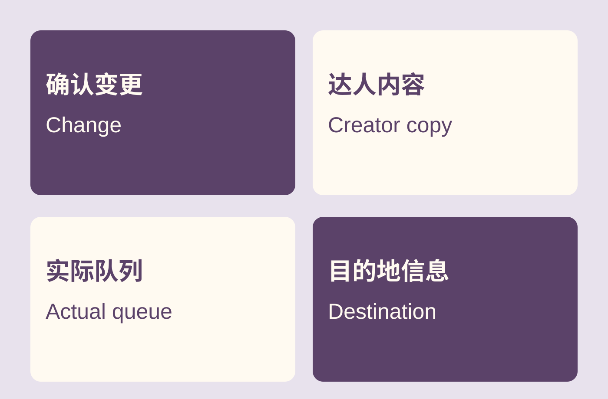

# Facebook 排期改变怎样同步合作

状态：本地审阅稿；正式发布日期待确认。

Facebook 达人合作的时间改变后，同时检查文案、队列、目的地与回应安排，避免只改日历而留下旧承诺。

Facebook 排期应在实际账号与可用工具中确认；对达人合作，排好时间只是其中一步。日期改变后，还要核对作品中的条件、用途、品牌目的地、提醒和回应责任。内部日历更新不等于真实队列已修改，更不等于对方接受新增工作。把每项依赖交给能确认的人，再检查观众最终看到的内容。

## 先确认实际发布对象

先核对是哪个 Page、由谁发布、使用什么工具，以及本次是品牌作品还是达人账号的内容。不要把相同活动名当成同一发布对象。

[Meta Business Suite 推出说明](https://about.fb.com/news/2020/09/a-faster-and-easier-way-to-manage-your-business-on-facebook-and-instagram/)在 2020 年介绍跨应用管理与发布的背景。这是历史资料，不是今天每个账号菜单和功能相同的证明。

在实际账号内核对排期入口、权限和内容形式。如果无法确认某项能力，保留待核验或讨论替代安排，不直接套用过时截图中的菜单。

[活动排期时钟方法](https://www.quickkol.com/zh/blog/facebook-scheduling-creator-event-release-clock/#answer)处理发布时间如何围绕活动安排。本篇关注一旦时间改变，哪些相关内容也需要变化。正确对象是起点，否则团队可能修改了一份不控制真实发布的日历。

## 计划时间与发布状态分开

[Meta 主页发布接口说明](https://developers.facebook.com/docs/graph-api/reference/page/feed/)将发布对象和相应字段区分，并说明接口层面的排期条件。接口文档不能直接当成原生 Business Suite 的统一窗口；本文也不要求读者实现接口。

这个区别提醒团队，写进计划的时间、工具接受的时间和真实公开状态不同。保留实际工具中的对象、日期与状态，而不只记录内部目标。

时区也要明确。品牌所在地、创作者所在地与活动地点可能不同；不默认表格里一个没有背景的时间已经被所有人同样理解。

如果存在人工提醒而非自动发布，明确谁收到提醒、谁执行。不能把提醒已建立报成内容必定上线，也不把一份草稿当成已完成排期。

## 检查时间依赖的内容

逐项检查口播、字幕、封面文字、文案、链接、活动说明与产品条件。日期移动后，“今天”“明天”“最后机会”可能不再准确，视频主体也可能需要调整。

把只需技术改动和需要重新审稿的内容分开。更换排期不一定改变事实，但延长优惠或改变到场承诺就涉及新条件，不能由操作者自行决定。

创作者应知道具体需要修改什么，以及品牌已经确认哪些信息。不要只发一条“时间改了”就让对方自行猜测所有影响。

如果原素材无法低成本修正，讨论合适替代，而不是为了保持原计划继续发布过期表达。评估以观众理解为准，不只看文件是否顺利上传。

## 让目的地与内容同时有效

若作品引导观众到产品页、活动入口或预约页面，核对目的地在新时间仍然准确。不能只把帖子延后，而让落地页按旧日期关闭。

品牌负责的商品、库存、服务或报名信息，由适当团队确认。创作者不应被要求保证自己无法控制的目的地条件，也不能靠一条链接推断所有事项就绪。

可以用依赖表记录：内容准备、目的地准备、回应安排和实际发布。每项保留负责人，不将“已通知”自动转为“已完成”。

这类检查不必收集无关个人资料或扩大账号权限。确认可用对象与所需条件即可，重点是让观众从邀请走到与之相符的信息。

改日期不自动改好其他内容。

## 通知与接受需要实际确认

[Eventbrite 改期说明](https://www.eventbrite.com.au/help/en-au/articles/267763/how-to-postpone-or-reschedule-an-event/)把日期、状态与参与者沟通分开处理。这里用它作为具体平台例子，说明更新一个对象并不自动通知或改变其他对象，而不把该平台政策扩展为 Facebook 规则。

达人收到新时间，不代表已经确认可出席、可修改或可持续回应。询问与记录实际接受状态，尤其是变更增加工作或改变用途时。

消息应包含旧安排、新安排、影响对象和需要答复的问题。不要将一份很长的聊天记录当成清楚任务，也不将没有回复视为默认接受。

对只需知道信息的人与需要执行的人分别处理。这样沟通更少打扰，也更容易找到真正尚未完成的动作，而不是反复广播同一句提醒。

## 核对真实队列与最终作品

由能够操作的人核对真实对象中的时间与版本。若还有旧条目，明确是否已经移除或调整，不把一个新条目的存在当成旧条目已失效。

实际发布后，检查正确账号、作品、文案与目的地。发布通知可以提供线索，但应回到观众看到的内容，确认不是另一个版本或测试对象。

[Instagram 发布验收方法](https://www.quickkol.com/zh/blog/instagram-scheduled-post-release-verification/#answer)说明排期与真实发布需要分开判断；应用于 Facebook 时，仍按当前平台实际能力核对，不迁移未经确认的菜单步骤。

若发生提前、重复或错误发布，先确认事实与影响，再由适当负责人决定更正。记录真实状态，不为了让计划看起来顺利而用目标时间覆盖实际时间。

## 用假设延后检查依赖

假设一条达人解释原定周二发布，品牌因产品说明未就绪改到周四。仅调整日期，还可能留下口播中的“今天上线”、旧链接和周二的回复值班。这是编辑场景，不是实际项目。

品牌先确认产品条件，创作者评估需要修改的表达，发布人检查真实队列，回应团队确认新安排。各项完成状态分别记录。

如果周四仍未就绪，应重新决定，而不是依靠最初排期继续。某条内容已经制作完成，不意味着其他依赖必须被假装满足。

这个例子没有规定通用最佳发布时间或保证延后提升效果。它检查时间变化怎样穿过真实工作，让品牌能够选择准确发布，而不是只选择一个新的日历格。

## 交接下一位能够执行的人

结项保留实际账号、对象、时间、版本、接受状态、目的地与公开结果。未确认事项有负责人和下一步，不用一个整体“已改好”掩盖差异。

如果后续再变更，从这份记录继续，不从最早聊天截图重新猜测。保留历史安排的意义，在于解释变化，而不是把旧计划当成仍有效。

QuickKOL 帮助理解 Brief、发现相关达人和准备联系；真实账号排期、素材用途和发布结果仍由来源与合作方确认。不能把工具定位扩展成已执行发布管理。

可靠排期是时间与依赖一起成立。品牌和达人需要的是可以执行、可以核对的共同安排，而不只是一个看起来很完整的内容日历。

## 时间变化的依赖表

| 对象 | 需要确认 | 证据 |
| --- | --- | --- |
| 达人作品 | 条件与表达仍准确 | 批准版本 |
| 真实队列 | 新旧条目与时间 | 实际对象状态 |
| 目的地 | 信息与服务就绪 | 当前页面与负责人 |
| 回应安排 | 工作与接受范围 | 具体确认 |

编辑变更框架；API 条件不等于原生排期窗口。

## 确认排期变更

检查日期，也检查依赖。

- [ ] 固定实际账号与对象。
- [ ] 明确时间与时区。
- [ ] 核对所有时间依赖表达。
- [ ] 检查目的地与回应。
- [ ] 区分通知与接受。
- [ ] 回到真实队列和公开作品。

## 研究日期与使用边界

资料核验于 2026 年 11 月 20 日。文中方法、表格和决策规则为编辑建议，标为假设的示例不是实际客户结果或行业基准。外部资料的适用地区与时期按各段说明。

## 从任务开始达人研究

用 QuickKOL 理解 Brief、发现相关达人并研究作品与联系路径；数据、合作条件和结果仍需核验。

[了解 QuickKOL](https://www.quickkol.com/#capabilities)

## 来源

- [Meta Business Suite 推出说明](https://about.fb.com/news/2020/09/a-faster-and-easier-way-to-manage-your-business-on-facebook-and-instagram/)
- [Meta 主页发布接口说明](https://developers.facebook.com/docs/graph-api/reference/page/feed/)
- [Eventbrite 改期说明](https://www.eventbrite.com.au/help/en-au/articles/267763/how-to-postpone-or-reschedule-an-event/)
