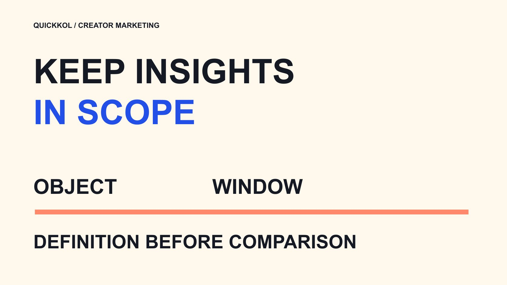
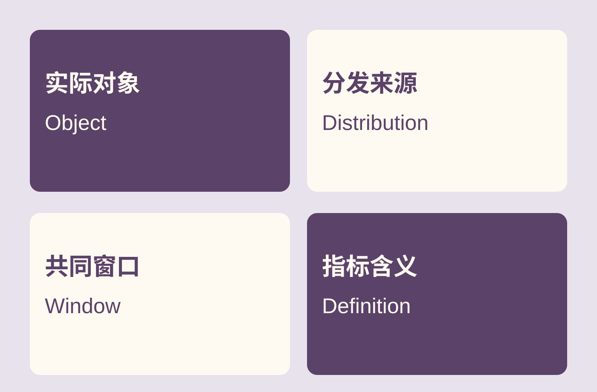

# Facebook Insights: Reconcile Creator Post Scope

Status: local review draft; confirm the publication date before release.

Align post, distribution and time window before interpreting creator results in Facebook Insights.

QuickKOL editorial graphic; not actual account metrics or a platform interface.

For creator collaboration, first identify the Page, post, distribution source and time window behind a Facebook Insights number. A Page total is not one creator’s contribution, views are not necessarily unique people, and organic and paid figures should not be added without compatible definitions. Inspect the actual field documentation and preserve estimates, missing values and access limitations. State the observation the data supports, then decide the next content or distribution action rather than substitute the largest visible number for an explanation.

## Begin with an identified object

[Meta’s Insights endpoint reference](https://developers.facebook.com/docs/insights/references) distinguishes endpoints for different objects. Page, content and advertising reports are not one interchangeable table; similar labels still need scope checking.

Record Page and post identifiers, the creator relationship and observation window. Explain who produced the work, where it appeared and whether other versions exist.

The [social-media metrics decision method](https://www.quickkol.com/blog/social-media-metrics-creator-decision-tree/#answer) starts with the decision required. This article examines object and measurement scope for a specific Facebook collaboration so a Page-wide change is not assigned to one piece of work.

For a screenshot-only handover, preserve the report context and request necessary fields. Do not infer Page or post scope from a crop, or treat inaccessible data as nonexistent.

When a post is edited or cross-published, keep the relationship to the original commission without assuming every published instance is identical. A reviewer should be able to locate the exact item counted, not merely the creator’s profile or the campaign name. This initial identification makes later comparisons meaningful. Without it, two people can discuss the same campaign while one reports a Page summary and another a selected post. The numbers may both be accurate within their own reports, yet the comparison can still be invalid. A short object record prevents that mismatch before it reaches a creator evaluation or budget decision.

## Check the field and access conditions

[Meta’s Insights overview](https://developers.facebook.com/docs/insights/overview) relates metrics to objects, permissions and tasks. Available fields depend on the applicable conditions; not every creator can promise an identical report.

Have an authorized person confirm field name, definition and source, including export date. Do not request private logins to finish the report or present one API field as a permanent label in every native interface.

When a measure is absent, distinguish not supplied, inaccessible and not applicable. Zero, blank and an unavailable field are different states. Filling them all with zero makes the table appear complete at the expense of meaning.

If the source later changes, retain the actual version and period. A changed definition requires a comparability review rather than letting the same column name conceal a different meaning.

This is particularly useful when combining creator-supplied evidence with brand-side reports. The two sources may expose different information without either party withholding something improperly. Start with the actual access and object limitations, then decide what can fairly be evaluated instead of treating every gap as evidence of poor performance.

## Map the work to its distribution

One piece of work may appear on a creator post, a brand Page and an advertisement. Record actual versions and distribution relationships instead of treating them as independent additions to the audience.

Define organic and paid scope as well. If a summary includes paid impact, adding related advertising views again cannot establish a larger unique reach.

Imagine the brand holds an original-post screenshot and an advertising report. First determine whether they concern the same work and overlapping periods. This is a hypothetical reconciliation task, not client data or a recommended benchmark.

Preserving the relationship between work, posts and distribution helps explain later differences. Identical filenames do not establish identical reports, and different versions do not imply non-overlapping viewers.

A useful map can be very small: the commissioned asset, its published instance and the distribution that promoted it. Its purpose is to keep the measurement connected to what actually happened. It also helps reviewers ask the right person for clarification instead of asking the creator to explain brand-side advertising that was outside the creator’s operational responsibility.

## Keep observation windows comparable

Posts published on the same day are not equally mature if one report is exported a day later and another a week later. Record publication, reporting start and end, and export time.

Campaign period, the full life of a piece and an advertising attribution window are also different concepts. Describe the actual report rather than force one platform’s timing convention onto another.

Before comparing, establish the same observation rule, then examine remaining differences in topic, distribution and audience. Equal timing does not itself create a causal conclusion.

Preserve the state of late data and revisions instead of hiding subsequent changes. The decision owner needs to know which window supports the conclusion and when it will be reviewed, rather than select the most impressive number across screenshots.

This is a practical fairness issue in creator evaluation. A recently released piece should not be penalized merely because it has had less time to accumulate the reported measure. Where a comparable window is unavailable, state that limitation and use the evidence for a narrower operational observation instead of pretending the comparison is complete.

Align measurement scope before comparing numbers.

## Retain estimation and attribution qualifications

[Meta’s ad-insight reference](https://developers.facebook.com/docs/graph-api/reference/adaccount/insights) identifies qualifications for estimated or in-development metrics. Check the particular field rather than expand that warning into a claim that all organic data is estimated.

For advertising results, retain attribution settings and report scope. A displayed result does not establish that one creator independently caused it, and it is not automatically an order or revenue.

The [creator KPI decision-agreement method](https://www.quickkol.com/blog/social-kpi-creator-decision-contract/#answer) connects a measure to an action. A report may justify inspecting a destination, but a related change is not by itself causal proof.

Where material is insufficient, a conclusion can remain open. Stating scope transparently helps a decision owner more than removing qualifications to obtain an apparently definite number.

This does not make the report unusable. Many operational decisions can rely on a clearly limited observation: verify tracking, review a version or investigate an unexpected discrepancy. The important step is matching the strength of the action and the wording of the conclusion to the evidence available, rather than giving every visible result the same certainty.

## Keep counts, people and conversions distinct

Views, reach, interactions and business outcomes answer different questions. Without the actual definition, do not rewrite views as unique viewers or comments as leads.

Some monetization reports also use viewing definitions tied to earning eligibility. Those should not substitute for brand sales. Establish the measure’s purpose before interpreting a word such as qualified as evidence of business quality.

Imagine one report counts repeated plays while another records unique reach. A smaller second figure need not be an error; the counted object may differ and needs checking.

Business outcomes require an actual source and an appropriate relationship to the content. When that connection is unavailable, report content performance and business observations separately rather than turn every view into revenue with an assumed conversion factor.

This helps the brand choose the next investigation. A high view count with unresolved product questions may call for a clearer demonstration. A destination problem requires a different owner. Treating all measures as one success total would conceal those distinctions and make the report less useful for improving the next creator collaboration.

## Reconcile discrepancies before judging the creator

When two reports differ, check object, version, distribution, window and definition in order. Do not start by accusing the creator of falsification or demand information beyond their access.

Retain sources and correction history. Explain resolved discrepancies; leave unresolved ones open rather than allowing internal speculation to become an official evaluation.

Review whether the collaboration task was answered before selecting relevant evidence. Total views alone cannot establish whether a step-by-step demonstration made the operation understandable.

The team can agree on evidence for the next collaboration, but confirm availability and workload in advance. Settlement should not introduce a new reporting requirement that was never agreed and cannot be obtained by the creator.

A fair reconciliation process also separates an error from misconduct. A mislabeled export can need correction without justifying a broader allegation about the person. Keep the response proportionate to what the evidence establishes, preserve the corrected interpretation and avoid carrying an unsupported negative label into future creator research or partnership decisions.

## Hand over a conclusion that supports action

The final table retains post identity, distribution, window, field definition, qualifications and next action. A reviewer should be able to return to the evidence rather than see a contextless total.

An actionable conclusion can be modest: obtain a field, check a destination, postpone a comparison or improve the next explanation. Every review need not prove sales growth.

QuickKOL supports research of creators and their work from a brief. Actual Insights, advertising reports and business outcomes require their own sources. Do not imply all data has been automatically combined or attributed by the tool.

A clear review helps the team decide where it needs new content and where it needs better evidence. Returning numbers to the correct object and task supports the next collaboration more effectively than repeatedly pursuing the largest total.

The handover succeeds when another person can understand both the finding and its boundary. They should know what can be done now, what must be confirmed first and which apparent comparisons were deliberately left unresolved because the underlying reports did not describe the same thing.

## Reconcile creator-post metrics

| Field | Specify | Avoid inferring |
| --- | --- | --- |
| Object | Page, post or ad | All belongs to one creator |
| Distribution | Organic, paid and overlap | Sum into unique reach |
| Time | Window and export date | Unequal maturity is comparable |
| Measure | Definition, estimates and gaps | Views equal sales |

Editorial reconciliation fields, not a complete platform metric dictionary.

## Hand over a Facebook creator review

Keep scope attached to each number.

- [ ] Identify the actual Page and post.
- [ ] Map organic and paid distribution.
- [ ] Record window and export date.
- [ ] Check definitions and access limits.
- [ ] Separate zero and missing values.
- [ ] Attach an action and owner to the finding.

## Research date and limitations

Sources reviewed November 20, 2026. Methods, tables and decision rules are editorial recommendations. Hypothetical examples are not actual client results or industry benchmarks. Source geography and periods are specified where relevant.

## Start creator research with a clear task

Use QuickKOL to interpret a brief, discover relevant creators and research their work and contact routes. Verify data, commercial terms and outcomes at their source.

[Explore QuickKOL](https://www.quickkol.com/#capabilities)

## Sources

- [Meta’s Insights endpoint reference](https://developers.facebook.com/docs/insights/references)
- [Meta’s Insights overview](https://developers.facebook.com/docs/insights/overview)
- [Meta’s ad-insight reference](https://developers.facebook.com/docs/graph-api/reference/adaccount/insights)
