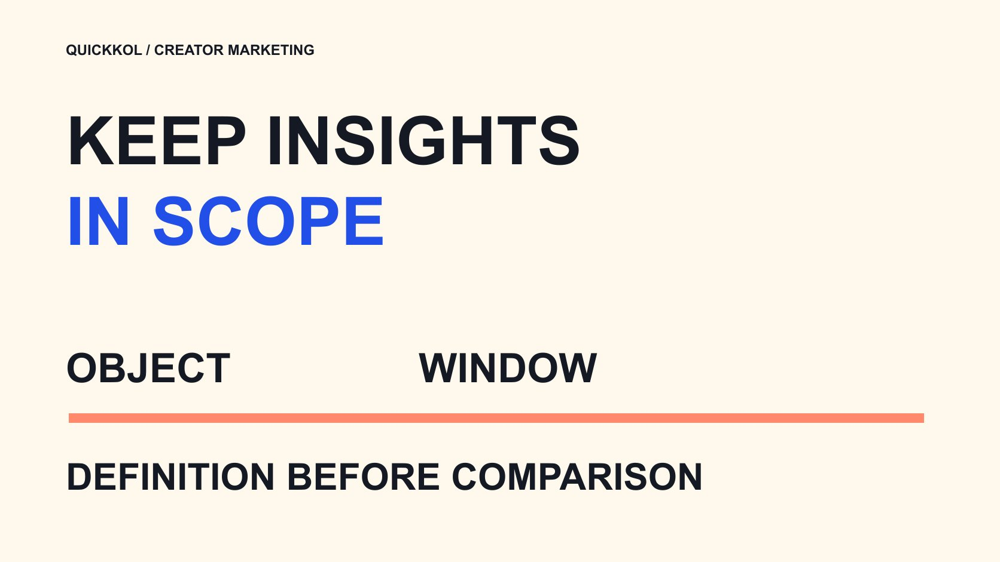
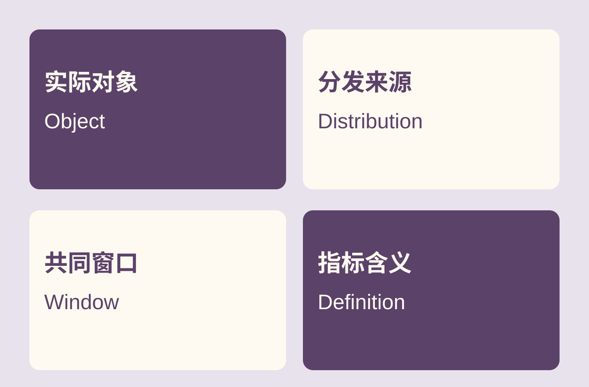

# Facebook Insights 怎样核对合作帖

状态：本地审阅稿；正式发布日期待确认。

先对齐帖子、分发与时间窗口，再解释 Facebook Insights 中的合作表现，避免把不同对象的数字直接相加。

QuickKOL 编辑图形；不呈现真实账号指标或平台界面。

用 Facebook Insights 复盘达人合作，先说明数字属于哪个主页、帖子、分发来源和时间窗口，再解释指标。主页总量不等于某位创作者的贡献，观看次数不等于独立人数，自然与付费也不能在不清楚口径时直接相加。对照实际字段说明，保留估算、缺失与权限限制。把可以支持的观察写清楚，再决定下一步内容或投放行动，而不是用最大数字代替结论。

## 从一个明确对象开始

[Meta Insights 对象说明](https://developers.facebook.com/docs/insights/references)区分不同对象的接口。主页、内容与广告相关报告不是可以随意互换的同一张表，名称相似也要核对实际范围。

记录主页与帖子标识、创作者关系及观察窗口。合作作品由谁制作、发布在哪里、是否存在其他版本，需要在报告里说清楚。

[社交媒体指标决策方法](https://www.quickkol.com/zh/blog/social-media-metrics-creator-decision-tree/#answer)先问需要什么决定。本篇继续处理 Facebook 具体合作帖的对象与口径，帮助团队避免把主页整体变化归到单条作品。

帖子改编或跨平台发布后，也保留与原委托的关系，并定位实际被统计的版本，不只指向创作者主页或活动名称。若只拿到截图，保留原报告范围并请求必要字段。不应靠页面裁切猜测它属于帖子还是主页，也不要把看不到的权限范围默认为不存在数据。

## 确认字段与访问条件

[Meta Insights 概览](https://developers.facebook.com/docs/insights/overview)说明指标与对象、权限及任务有关。实际能查看的字段取决于对应条件，不能承诺每一位创作者都能提供完全相同的报告。

请有权限的人确认字段名称、定义与来源，记录导出日期。不要为完成报告索取私人登录，也不要将某个接口字段说成所有原生界面的固定名称。

缺少指标时先标明未提供、无权限或不适用。零值、空白和不存在字段是不同状态，不应统一填成零让表格看起来完整。

如果来源在后续更新，保留实际版本与时期。字段定义发生变化时，需要评估可比性，不能让相同列名掩盖背后含义已经改变。

## 为作品建立分发关系

一份作品可能出现在创作者帖子、品牌主页与广告中。记录实际版本与分发关系，不将它们当作彼此独立的全部新增受众。

自然与付费的范围也需要定义。一个汇总包含付费影响时，不能再把相关广告观看直接叠加，声称得到更高的独立覆盖。

假设品牌保存了原帖截图和一份广告报告，应先判断是否涉及相同内容与重叠期间。这是假设核对场景，不是实际客户数据或推荐基准。

保留作品、帖子和分发记录的关系，可以帮助解释后续差异。不要仅凭文件名相同就认定报告完全相同，也不因版本不同就假定观看人群没有重叠。

## 保持时间窗口可比较

同一天发布的帖子，如果一个在发布后一天导出，另一个在一周后导出，不能直接作为同样成熟的结果比较。记录发布、统计起止与导出时点。

活动期间、完整作品生命周期与广告归因窗口也不是同一概念。具体报告采用哪一个，就按其真实定义说明，不将平台之间的时间习惯硬套在一起。

需要比较时，先形成相同观察规则，再判断是否还受主题、分发和受众差异影响。统一时间并不自动产生因果结论。

迟到的数据与修正应保留状态，不把后来更新隐藏掉。负责人需要知道当前结论依据哪个窗口，下一次何时复查，而不是在多个截图之间寻找一个最好看的数字。

先对齐口径，再比较数字。

## 保留估算与归因的限定

[Meta 广告指标说明](https://developers.facebook.com/docs/graph-api/reference/adaccount/insights)提示某些指标属于估算或仍在开发。应核对具体字段的限定，不能把这句话扩大成所有自然数据都只是估算。

涉及广告结果时保留归因设置与实际报告范围。显示一次结果，不等于已经证明仅由某位创作者独立造成，也不自动代表完成订单或收入。

[达人 KPI 决策约定方法](https://www.quickkol.com/zh/blog/social-kpi-creator-decision-contract/#answer)强调指标要服务行动。报告可以说明某个观察支持进一步检查落地页，但不能把一次相关变化直接写成因果证明。

如果资料不足，结论可以暂时保留。透明地说明范围，比删除限定词获得一个看似明确的数字更有助于负责人作决定。

## 不要混同次数、人数与转化

观看次数、覆盖人数、互动与业务结果回答不同问题。没有实际字段定义时，不把观看改写为独立观众，也不把评论直接称为潜在客户。

某些变现报表还会使用与收入资格有关的观看口径，不能直接拿来代替品牌销量。解释数字前先确认其用途，而不是因为名称含有“合格”就推断业务质量。

假设一个报告显示多次播放，另一个报告记录独立触达，即使后者较小，也不一定是数据错误。它们可能在计数对象上不同，需要核对定义。

业务结果应有实际来源和适当关联依据。无法连接时可以分开报告内容表现与业务观察，不用一个推算系数把所有观看换算成收入。

## 差异先核对再评价创作者

两份报告不一致时，按对象、版本、分发、窗口与定义逐项检查。不要第一反应就指控创作者造假，也不应要求其提供不在权限范围内的数据。

保留原始来源与更正记录。能解释的差异写出原因；暂时不能解释的保持未决，不让内部猜测变成正式评价。

复盘先问合作任务是否得到回答，再看相应证据。如果任务是演示操作，只有总观看量不足以判断内容是否讲清步骤。

团队可以约定下一次需要哪些报告，但应在合作前确认可用性与工作量。不要到结算时新增一套从未约定且创作者无法获得的证据要求。

## 交接可以采取行动的结论

最终表格保留帖子对象、分发来源、窗口、字段定义、限定与下一步。负责人应能回到证据，而不是只看到一个失去上下文的总数。

可采取行动的结论可以很小：补齐一个字段、核对目的地、延后比较，或给下一支作品改进解释。这不等于每次都要证明销售增长。

QuickKOL 支持从 Brief 研究达人及其作品，实际 Insights、广告报告与业务结果仍需各自来源。不要暗示所有数据已被工具自动合并或归因。

清楚的复盘帮助团队判断哪里需要新内容、哪里需要更好证据。把数字放回正确对象和任务，比反复追逐最大总量更能支持下一次合作。

## 合作帖指标核对表

| 字段 | 必须说明 | 避免推断 |
| --- | --- | --- |
| 对象 | 主页、帖子或广告 | 全部属于单个达人 |
| 分发 | 自然、付费与重叠 | 直接相加为独立覆盖 |
| 时间 | 起止与导出时点 | 不同成熟度可直接比较 |
| 指标 | 定义、估算与缺失 | 观看就是销售 |

编辑核对字段，不是平台完整指标字典。

## 交接 Facebook 合作复盘

让每个数字保留范围。

- [ ] 确认实际主页与帖子。
- [ ] 标出自然与付费关系。
- [ ] 记录观察窗口与导出日期。
- [ ] 核对字段与访问限制。
- [ ] 分别记录零值与缺失。
- [ ] 给结论附上下一步与责任人。

## 研究日期与使用边界

资料核验于 2026 年 11 月 20 日。文中方法、表格和决策规则为编辑建议，标为假设的示例不是实际客户结果或行业基准。外部资料的适用地区与时期按各段说明。

## 从任务开始达人研究

用 QuickKOL 理解 Brief、发现相关达人并研究作品与联系路径；数据、合作条件和结果仍需核验。

[了解 QuickKOL](https://www.quickkol.com/#capabilities)

## 来源

- [Meta Insights 对象说明](https://developers.facebook.com/docs/insights/references)
- [Meta Insights 概览](https://developers.facebook.com/docs/insights/overview)
- [Meta 广告指标说明](https://developers.facebook.com/docs/graph-api/reference/adaccount/insights)
