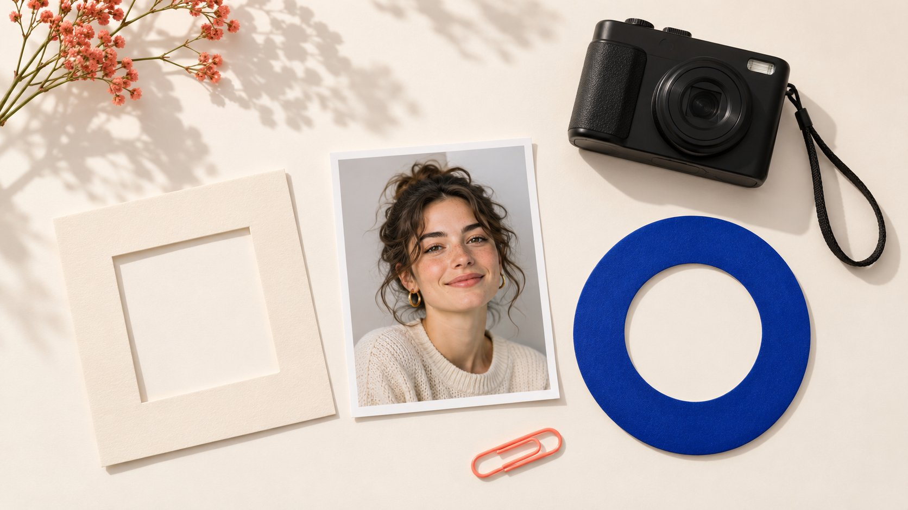
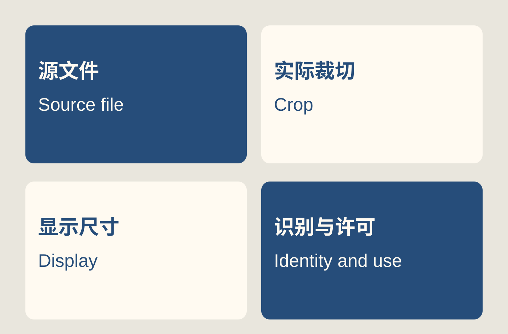
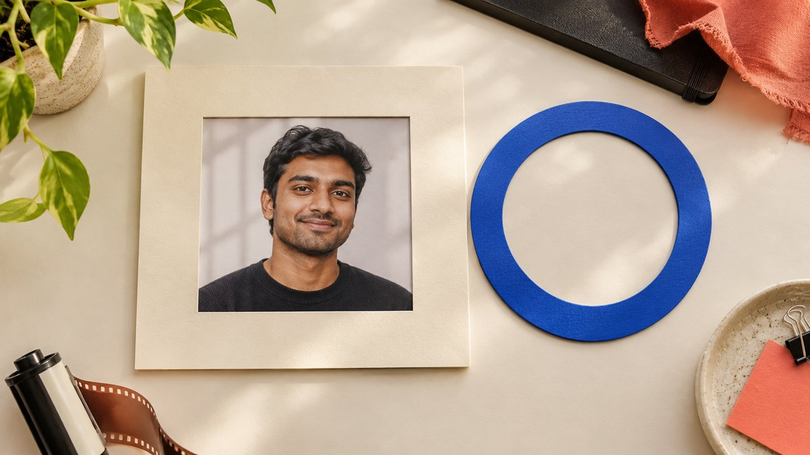

# Facebook Profile Picture Measurements for Creator Work

Status: local review draft; confirm the publication date before release.

Prepare Facebook profile imagery for creator partnerships by separating source file, crop and display while preserving identity and usage scope.

For a Facebook creator partnership, first identify Page versus personal profile and separate upload pixels from display size. A 1024×1024 square master with space around the face and a circular crop preview is a practical editorial starting point, not a Meta minimum. The native dimensions help page could not be fully retrieved for this review, so republished numbers are not presented as verified requirements. Inspect recognition, crop and clarity in the actual account preview, and confirm permission for the portrait’s intended use.

## Define the account and intended use first

The image may belong to a creator’s Page, a partnership Page or another specific object. Identify the actual account, purpose and approval responsibility before treating every Facebook image position as one specification.

The [Facebook partnership-cover composition method](https://www.quickkol.com/blog/facebook-cover-creator-partnership-composition/#answer) concerns a wider cover. This article addresses profile imagery and creator recognition, not moving cover dimensions into an avatar or treating a comment thumbnail as an upload requirement.

If the objective is simply to show a partnership, first ask whether the creator’s profile picture needs changing. A temporary campaign may suit another asset position; changing long-standing personal recognition should not be assumed.

Define use before booking photography and export. The producer then knows whose identity to preserve, which elements are necessary and which decisions need confirmation in the actual interface.

This framing keeps the task connected to creator marketing. The image is part of how audiences recognize the person and their work, not merely a small advertising surface. A brief should therefore consider the creator’s existing identity and the real partnership purpose before asking for decorative additions that may make the person harder to recognize.

## Separate the source file from returned image dimensions

[Meta’s Page-picture reference](https://developers.facebook.com/docs/graph-api/reference/v3.2/page/picture) provides technical context about dimensions, type and cropping for that object. Those parameters should not become a universal native-upload requirement.

Do not confuse an editable master with the selected delivery file. Preserve a suitable original and make the agreed crop as a separate version, so later adjustments do not require enlarging a compressed thumbnail. If someone requests a different placement, review that placement rather than assume the same export will remain appropriate. Label the file’s actual pixels and version, and record its intended placement. The source image is a production input; on-screen display size is another layer. Both using pixels does not make them interchangeable.

A larger master can produce different exports without guaranteeing that the platform displays one particular size. Inspect the actual crop and rendering instead of allowing internal file properties to decide what the interface will do.

No user account upload was performed for this article. API documentation explains object differences; it is not a request to build an integration, change website code or automatically replace a creator’s picture.

The distinction gives the designer a useful instruction: preserve a workable source and test the intended output. It also prevents the reviewer from rejecting a high-resolution master merely because it differs from a small display thumbnail, or approving an unsuitable crop just because the exported file has a familiar pixel count.

A working master is not the display size or an official minimum.

## Give the master a clear, limited recommendation

This article recommends a 1024×1024 square master as an editorial working size for later cropping and export. It is not a verified Meta minimum, optimum or acceptance condition.

Retain the original photograph rather than repeatedly enlarging an already compressed thumbnail. If the source lacks clarity, choose or produce another image instead of using sharpening to invent missing detail.

Leave space around the face, hair and necessary identifying elements, then make a separate circular preview. That is a framing check, not a universal percentage claiming every interface has the same safe zone.

Follow the target account’s current instructions for the actual export. When the public help page cannot be fully retrieved, preserve that limitation rather than present third-party repeated numbers as checked official specifications.

A limited recommendation is still actionable: the designer can prepare a square working file and review recognition while the account operator confirms current acceptance requirements. Keeping those tasks separate avoids both guessing an official rule and stopping all useful production merely because a public documentation route is unavailable during research.

## Check recognition at a smaller scale

An avatar is not simply a reduced poster. Group photographs, complex backgrounds, long slogans and tiny brand marks may fail to communicate at a small display size; judge the actual preview.

For creator collaboration, preserve the principal person instead of covering the face with temporary promotional elements. A partnership mark needs agreement and a reason to remain useful when reduced.

Compare square and circular previews for lost information, then inspect the actual account. A magnified design canvas does not establish equally clear mobile rendering.

Imagine one option preserves recognizable identity and another fills the space with campaign wording. Discuss whether the first better answers the task. This is a hypothetical composition exercise, not an experiment proving a particular image increases followers.

The review can focus on a few observable questions: can the person be identified, does the crop omit something necessary, and does the background compete with the face? These questions help the designer revise a concrete composition without claiming a scientifically established universal avatar formula or turning aesthetic preference into a promised growth result.

Check space around the person, then inspect the actual crop in the target account.

## Confirm portrait use and photograph rights separately

In the U.S. context, [the U.S. Copyright Office’s photography guide](https://www.copyright.gov/engage/photographers/) distinguishes ownership of photographic work. Being depicted does not automatically give a person every copyright in the photograph; actual circumstances and exceptions require checking.

Confirm both the creator’s agreement to this portrait use and the image source and permission. Brand-supplied photography, a photographer’s delivery and a creator’s self-portrait can involve different conditions.

Specify account, purpose, period and permitted changes. A profile-image collaboration should not silently expand into advertising or reuse by another brand. Correct dimensions do not resolve missing authorization.

If uncertain, choose material with a clear permitted scope. Addressing permission before design can prevent discovering at the end that the central photograph cannot be used as planned.

This is a proportionate collaboration question, not a request for unrelated private documents. The team needs enough evidence to understand the particular asset and use. A clear source and agreement can support production while questions outside that scope remain with the appropriate parties rather than being assumed away by the creator’s willingness to participate.

## Inspect rendering in the actual interface

[Meta’s profile-picture source reference](https://developers.facebook.com/docs/graph-api/reference/profile-picture-source/) describes dimensions and expiry properties of returned images. A retrieved image URL should not become the permanent master, and its dimensions cannot establish native upload requirements.

Have an authorized person inspect the actual preview for face crop, clarity and current version. Where needed, compare mobile and desktop rather than assume both update at the same instant.

If an older picture remains, first check account and saved state, then inspect rendering differences. Replacing several versions in succession can leave the team unsure which was accepted.

Record the actual observation time and result. No real Facebook upload test was performed here; the handover must identify the target-account check still required.

This is where a well-prepared master meets the actual publishing environment. The designer can supply a clear source and suitable crop candidates, while the account operator confirms what the service currently accepts and displays. Neither person needs to claim knowledge beyond the part they have actually inspected.

## Do not confuse an image update with verification

A clearer profile image can improve recognition without proving verification, signing authority or ownership of a claimed account. Identical pictures do not make two accounts identical.

The [Instagram verification and partnership-authority method](https://www.quickkol.com/blog/instagram-verification-partnership-authority/#answer) distinguishes identity clues from commercial authority. A Facebook avatar is likewise a limited clue that needs actual public routes and partnership confirmation.

The brand should not use composition to imply an official relationship that does not exist. When a temporary collaboration ends, handle relevant marks as agreed rather than let an old picture imply current endorsement.

If the objective is helping viewers recognize the creator, review that objective directly. Every design action need not be marketed as identity verification or follower-growth technology.

This boundary is useful when an image is approved by several teams. The designer may be approving composition while the creator agrees portrait use and the brand confirms relationship wording. A combined approval label should not erase those different responsibilities or imply that changing the image has settled the account’s complete commercial status.

## Hand over files, previews and responsibility together

Deliver the master, selected export, crop previews and usage scope, identifying actual-interface checks still required. Label editorial recommendations separately from official requirements so that distinction survives later file reuse.

Retain the creator-approved version and define who can update it, when to review it and what happens when the collaboration ends. Asset delivery is not indefinite control of a personal account.

QuickKOL supports research of relevant creators and work; image production and actual account settings remain with the responsible parties. Pictures encountered during research are not automatically a commercial asset library.

Clear files, recognizable identity, agreed scope and an inspected actual preview make an executable delivery. Dimensions are one part; recognition, permission and correct use also determine whether the collaboration task is complete.

The final record need not contain every design experiment. It should make the selected version, its intended placement and the remaining confirmation easy to find, allowing the next person to act accurately without treating a working-size suggestion as a platform guarantee.

## Different measurement questions in a profile-image handover

| Layer | Treatment here | Not equivalent to |
| --- | --- | --- |
| Working master | 1024×1024 editorial recommendation | Official upload minimum |
| Crop preview | Square and circular checks | A fixed rule for every native placement |
| Actual display | Inspect target account and device | Source-file pixels |
| Usage scope | Account, purpose and permission | Dimensions establish commercial permission |

Native dimensions help could not be fully retrieved; this table does not assert Meta pixel requirements.

## Hand over creator profile imagery

Prepare usable assets and retain actual review states.

- [ ] Identify Page or personal profile and purpose.
- [ ] Retain original and identified master.
- [ ] Inspect smaller and differently cropped views.
- [ ] Confirm portrait agreement and image permission.
- [ ] Inspect current instructions and account preview.
- [ ] Record selected version and future responsibility.

## Research date and limitations

Sources reviewed November 20, 2026. Methods, tables and decision rules are editorial recommendations. Hypothetical examples are not actual client results or industry benchmarks. Source geography and periods are specified where relevant.

## Start creator research with a clear task

Use QuickKOL to interpret a brief, discover relevant creators and research their work and contact routes. Verify data, commercial terms and outcomes at their source.

[Explore QuickKOL](https://www.quickkol.com/#capabilities)

## Sources

- [Meta’s Page-picture reference](https://developers.facebook.com/docs/graph-api/reference/v3.2/page/picture)
- [U.S. Copyright Office: photography and copyright](https://www.copyright.gov/engage/photographers/)
- [Meta’s profile-picture source reference](https://developers.facebook.com/docs/graph-api/reference/profile-picture-source/)
