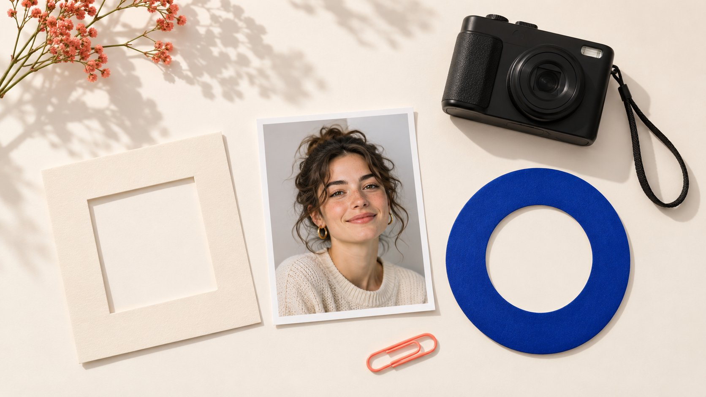
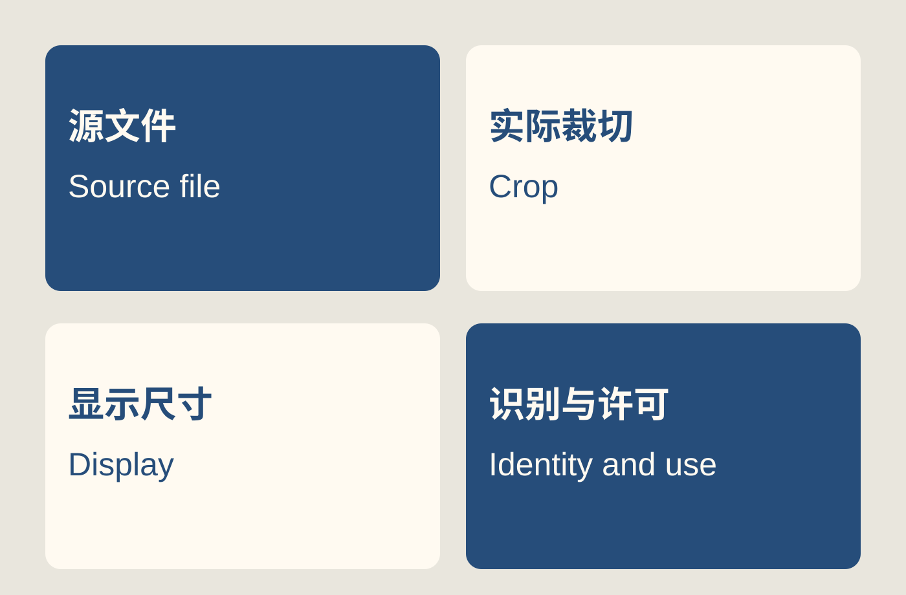

# Facebook 头像怎样保留达人识别

状态：本地审阅稿；正式发布日期待确认。

为达人合作准备 Facebook 头像时，分清源文件、实际裁切与显示，保留人物识别和素材使用范围。

为 Facebook 达人合作准备头像，先确认是主页还是个人账号，再区分上传文件与实际显示。可先制作 1024×1024 的方形母版、保留脸部周围空间，并做圆形裁切预览；这是编辑制作建议，不是 Meta 官方像素下限。本文未能完整读取原生尺寸帮助页，不把转载数字写成已核验要求。上传前在实际账号预览中检查识别、裁切与清晰度，并确认肖像使用范围。

## 先定义要更新的账号与用途

头像可能属于创作者本人主页、品牌合作主页或其他具体对象。先记录实际账号、使用目的与批准责任，不把所有 Facebook 图片位置都看成相同规格。

[Facebook 合作封面构图方法](https://www.quickkol.com/zh/blog/facebook-cover-creator-partnership-composition/#answer)处理较宽的封面。本篇只讨论头像与达人识别，不将封面尺寸搬到小头像，也不把评论区缩略显示当作上传文件要求。

如果用户只是想展示合作关系，先判断是否真的需要更换创作者头像。短期活动可以使用其他适合的素材位置，不应默认要求对方改变长期个人识别。

明确用途后再安排拍摄与导出。这样制作人员知道要保留谁的识别、哪些元素必要，以及哪些设计决定还要在实际界面确认。

## 区分源文件与返回图片尺寸

[Meta 主页头像对象说明](https://developers.facebook.com/docs/graph-api/reference/v3.2/page/picture)提供技术对象中的尺寸、类型与裁切相关背景；这些接口参数不能直接当成所有原生上传位置的统一要求。

可编辑母版与选定交付文件也应分开。保留适合的原图，另存确认的裁切版本，后续调整就不必放大已经压缩的缩略图。如果更换使用位置，重新核对该位置，不默认同一份导出永远适用。给文件标注真实像素与版本，同时记录使用位置。源图是制作输入，界面中的显示大小是另一层信息，两者不能只因都用像素表示就混为一谈。

例如一张较大母版可以导出不同版本，但不能由此保证平台一定按某个大小显示。实际裁切和呈现仍需查看，不用内部文件属性替界面作结论。

本文没有用用户账号执行上传。有关 API 的资料用于解释对象差异，不表示需要编写接口、更改网站代码或自动替创作者更新头像。

工作母版尺寸不等于实际显示或官方下限。

## 给母版一个明确但有限的建议

本篇建议先准备 1024×1024 方形母版，作为方便继续裁切和导出的编辑工作尺寸。它不是已核验的 Meta 最小值、最佳值或必然接受条件。

保留原始照片，不要反复将已压缩的小图放大。若来源不够清楚，可以重新选择或拍摄，而不是用锐化制造不存在的细节。

在方形中给脸、头发和必要识别元素留空间，再另做圆形预览。这是取景检查方式，不用一个通用百分比假称所有界面都有相同安全区。

实际导出仍按照目标账号当前提示处理。公开帮助页无法完整读取时，应保留这个限制，而不是把第三方转载的数字包装成已经核对的官方规范。

## 缩小后仍需认出创作者

头像不是缩小后的海报。多人合影、复杂背景、长标语和小品牌标志，在很小显示中可能无法表达原本目的，应按具体预览判断。

为达人合作保留主要人物，避免让临时促销元素遮住脸。是否放合作标识，需要创作者同意，也要考虑它在缩小后是否仍有意义。

以方形与圆形预览比较关键部分是否被裁掉，再查看实际账号。不要只在设计软件里看放大的画布，就认为手机上的显示同样清楚。

假设两个方案中，一个有完整人物识别，另一个填满活动文字，可以优先讨论前者是否更符合任务。这是假设构图练习，不是证明某种头像必然增加关注的实验。

先检查人物周围空间，再在目标账号预览实际裁切。

## 肖像同意与照片权利分别确认

[美国版权局摄影说明](https://www.copyright.gov/engage/photographers/)在美国语境下区分摄影作品的权利归属。人物出现在照片中，不自动表示其拥有照片全部版权，具体情况与例外需要核对。

因此既要确认创作者同意本次肖像使用，也要核对图片来源与相应许可。品牌提供、摄影师交付与创作者自拍，可能涉及不同条件。

写清使用账号、目的、时期与允许改动，不把头像合作默认扩展成广告投放或其他品牌再使用。头像尺寸适合，也不能解决缺失授权。

若无法确认，可选择已经清楚获准的素材。把许可问题放到制作前处理，能避免设计完成后才发现核心照片不能按计划使用。

## 在实际界面核对显示与缓存

[Meta 图片尺寸字段说明](https://developers.facebook.com/docs/graph-api/reference/profile-picture-source/)提醒技术返回图片也有尺寸与有效期等属性。一个抓取到的图片地址不应被当作永久母版，也不能仅凭其尺寸倒推原生上传要求。

由有权限的人查看实际头像预览，检查脸部裁切、清晰度与当前版本。必要时比较手机和桌面，但不要假定两者一定同时更新。

如果仍显示旧图，先确认当前账号与保存状态，再检查可能的呈现差异。不要连续替换多个版本，最后却不知道哪一份已被接受。

记录实际观察时点与结果。这里没有执行真实 Facebook 上传测试；交接给操作人的检查任务，应明确它仍需在目标账号完成。

## 不要让头像变化冒充身份认证

更换清楚的头像可以改善识别，但不能证明账号获得认证、联系者有权签约，或页面属于所称对象。图片相同也不代表两个账号相同。

[Instagram 认证与合作权限方法](https://www.quickkol.com/zh/blog/instagram-verification-partnership-authority/#answer)讨论身份线索与商业权限的区别。Facebook 头像同样只是有限线索，需要结合实际公开路径与合作确认。

品牌不应使用构图制造并不存在的官方关系。临时合作已经结束时，按约定处理相关标识，不让旧图片继续暗示当前代言。

如果目标是帮助观众认出创作者，围绕这个目标检查即可。没有必要把每个设计动作都包装成身份核验或粉丝增长技术。

## 把文件、预览与责任一起交接

交付母版、选定导出、裁切预览与使用范围，并说明哪些实际界面检查尚待完成。把编辑建议与官方要求分开标注，避免下次复制文件时丢失边界。

保留创作者确认的版本，明确谁可以更新、何时复查以及合作结束如何处理。不要把一次素材交接写成长期接管个人账号。

QuickKOL 支持研究相关达人与作品，头像制作和实际账号设置仍由相应负责方完成。研究页面中的图片不应自动变成可商用素材库。

当文件清楚、人物可识别、范围已同意且预览经过实际检查，团队就有可执行的交付。尺寸是其中一项，识别、许可与正确使用同样决定这次合作是否完成。

## 头像交接中不同的尺寸问题

| 层次 | 本篇处理 | 不能等同 |
| --- | --- | --- |
| 工作母版 | 1024×1024 编辑建议 | 官方上传下限 |
| 裁切预览 | 方形与圆形检查 | 所有原生位置的固定规则 |
| 实际显示 | 目标账号与设备查看 | 源文件像素 |
| 使用范围 | 账号、目的与许可 | 文件合格即可商用 |

未完整读取原生尺寸帮助页；本表不声明 Meta 官方像素要求。

## 交接达人头像文件

准备可用素材并保留真实核对状态。

- [ ] 确认主页或个人账号与目的。
- [ ] 保留原图与明确母版。
- [ ] 检查缩小及不同裁切。
- [ ] 核对肖像同意与图片许可。
- [ ] 在实际账号查看当前要求与预览。
- [ ] 记录选定版本与后续责任。

## 研究日期与使用边界

资料核验于 2026 年 11 月 20 日。文中方法、表格和决策规则为编辑建议，标为假设的示例不是实际客户结果或行业基准。外部资料的适用地区与时期按各段说明。

## 从任务开始达人研究

用 QuickKOL 理解 Brief、发现相关达人并研究作品与联系路径；数据、合作条件和结果仍需核验。

[了解 QuickKOL](https://www.quickkol.com/#capabilities)

## 来源

- [Meta 主页头像对象说明](https://developers.facebook.com/docs/graph-api/reference/v3.2/page/picture)
- [美国版权局：摄影与版权](https://www.copyright.gov/engage/photographers/)
- [Meta 图片尺寸字段说明](https://developers.facebook.com/docs/graph-api/reference/profile-picture-source/)
