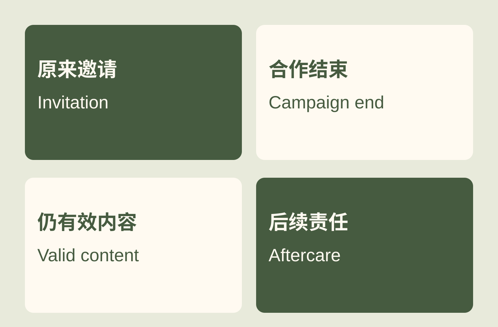

# Gain Instagram Followers: Maintain the Partnership Promise

Status: local review draft; confirm the publication date before release.

After a creator partnership brings new visitors, maintain the reason to continue through useful work, clear next content and defined aftercare.

To gain Instagram followers through creator partnerships in a sustainable way, fulfil the content invitation after the campaign ends. Identify which work remains useful, whether a series continues, where older links lead and who handles later questions. Maintenance does not mean rewriting all historical work into a new promotion. It means helping viewers understand what they can expect now. Observe new follows, continuing viewing and business outcomes separately. One period of growth does not guarantee future loyalty, and an ended commercial activity should not leave viewers with an invitation nobody still owns.

## Identify the invitation viewers encountered

Review what the public work actually said. It may invite viewers to follow a series, wait for another demonstration, receive event information or continue through the creator’s related work. Different invitations require different maintenance.

Do not check only the internal plan. The published caption, spoken invitation and destination may differ from the early brief. Closeout should start with the actual public expression, then connect it to the parties’ agreement.

The [Instagram new-visitor context method](https://www.quickkol.com/blog/instagram-creator-collaboration-welcome-context/#answer) concerns welcoming people at the start of a collaboration. This article looks later: once the activity is complete, which reasons remain valid and which need an explicit ending?

Retain an object and owner for each invitation. Brand content, a creator’s own programme and a joint series may have different maintainers. Appearing within one post does not make them all the creator’s continuing responsibility.

This inventory gives the team something concrete to review. Instead of asking whether the account still looks active, it can determine whether a promise someone may still encounter has a current, accurate destination and an appropriate person responsible for the next step.

## Separate continuing work from campaign information

Some work remains a useful explanation after the campaign ends. Other material depends on a temporary offer, event location or particular product version. Distinguish them instead of deleting everything or continuing to promote everything indiscriminately.

[Meta’s 2023 collaboration-and-carousel announcement](https://about.fb.com/news/2023/08/music-and-collabs-on-instagram/) supplies historical context for co-authorship and display arrangements. It does not determine post-campaign usage or replace agreement about maintenance periods.

If the parties want to retain the work, confirm that existing usage and timing conditions support it. Handle expired information proportionately while preserving historical context, so an old activity does not appear ongoing.

Continuing value can come from an explanation that remains accurate rather than an endless sequence of promotions. Make that work findable and identify when current product information is needed.

The review is therefore both editorial and commercial. The team needs to know whether the content still communicates accurately and whether its continued use fits the arrangement. Answering only one of those questions can leave a polished but misleading route, or a useful piece of work being used outside conditions the creator actually accepted.

## Keep older routes connected to accurate content

Check links, pinned explanations and work catalogues that people may still use. The destination should relate to the original invitation. A new campaign is not a reason to send all historical traffic to an unrelated page.

If product changes affect the explanation, distinguish the current version from the historical work. Supply new information where useful without pretending an old video explained a new feature, or changing its publication date merely to make it look fresh.

The brand maintains pages it controls; creator-controlled work requires an appropriate conversation. Updating a shared sheet does not establish that the creator account has changed, and maintenance does not authorize unagreed access.

Set scope according to actual need. Every historical piece does not require continuous remaking, but an expired promise affecting a viewer’s decision should have an owner.

This is a practical way to preserve useful work without treating the archive as a current promotion. The team can retain context, direct people accurately and identify the limited corrections that matter, instead of repeatedly rewriting everything or assuming that a campaign ending automatically removes every public route associated with it.

A visible invitation still needs accurate context after the campaign ends.

## Retain relationship context after the campaign

In the relevant US guidance, [the FTC’s endorsement FAQ](https://www.ftc.gov/business-guidance/resources/ftcs-endorsement-guides-what-people-are-asking) discusses appropriate context for each new endorsement. A relationship explained earlier is not automatically understood by every person encountering a later recommendation.

If new work continues to reference an experience from the old collaboration, check the relationship and present expression. Do not portray an ended activity as ongoing, or remove commercial context that could affect interpretation.

This article does not establish one retention period or format for every country. Check the actual claim, applicable requirements and usage with the partners instead of treating general guidance as a universal rule.

Creators can continue their related work. If the brand wants additional recommendations after the campaign, discuss that work explicitly. Keep attention going is not a defined new commission.

This boundary helps both parties plan a reasonable ending. The creator can maintain a professional relationship without being expected to provide indefinite promotion, and the brand can decide which continuing activities merit a new agreement. Accuracy about the past then supports future work rather than forcing the archive to imply a relationship that no longer exists.

## Assign response responsibility by question

Questions may continue about use, availability, event results or the next instalment. A creator can explain their work without becoming responsible for brand customer service or project reconciliation.

Assign an owner by question and provide an appropriate public route. Do not send viewers repeatedly between accounts with the same inquiry, or ask them to disclose unrelated personal information in comments.

If another instalment is unconfirmed, say so. Stay tuned should not become an indefinite commitment. For a real plan, distinguish what is confirmed from what still needs arranging.

The [Instagram series-following method](https://www.quickkol.com/blog/instagram-creator-series-following-choice/#answer) can support a continuing choice backed by actual work. The maintenance objective is not to keep every question in the comment section. It is an appropriate answer and an understandable creator responsibility.

That division is useful for resources as well as communication. The brand can anticipate support needs instead of measuring all unanswered questions as creator engagement, while the creator can distinguish a reasonable explanation from an operational issue requiring another team’s access or authority. A clear route can preserve the invitation’s credibility without promising unlimited personal availability.

## Observe continuation without overstating it

[Meta’s Insights overview](https://developers.facebook.com/docs/insights/overview) describes access by object, metric and permission. Use information actually obtainable. A follower change does not provide a complete record of continuing viewing.

For before-and-after comparisons, retain window, concurrent publishing, known paid distribution and destination changes. Several factors may affect a count; do not assign them all to aftercare or one creator.

Separately record completed maintenance, whether relevant work remains findable and actual questions received. These support a working-quality judgment without automatically demonstrating sales or loyalty improvements.

If audience evidence is insufficient, narrow the conclusion rather than filling it with an estimate. The brand can still repair a known incorrect route without waiting for a complete causal model.

This gives the team two legitimate review levels: whether it fulfilled the invitation operationally and what audience response it can observe. Keeping them separate prevents a good maintenance task from being oversold as growth proved, while also preventing incomplete attribution from becoming an excuse to leave an obvious broken promise unaddressed. The next decision can follow the evidence available at each level.

## Check expectations through a hypothetical closeout

Imagine a creator series ending while earlier work still invites viewers to wait for the next instalment. The brand is moving to another project and the creator has not agreed to continue. This is an editorial scenario, not a client result.

A proportionate response may explain the series state, keep existing work available through older routes and remove unconfirmed future plans from the current promise. Do not merely redirect the link to a new promotion while retaining the invitation to wait for another instalment.

If the parties later agree a new series, define role, content and usage again before arranging the transition. Viewers can choose whether to continue; the brand should not treat every departure as content failure.

The example forecasts no follower gain from maintenance. It checks whether the reason to follow remains accurate and whether the brand takes responsibility for the parts it controls.

This can produce a useful closeout even if the next project never occurs. Existing work remains understandable, the creator is not assigned an unagreed future obligation and the viewer receives a clearer account of what is available now. Those are concrete outcomes rather than a speculative growth forecast.

## Keep the reason to follow fulfilable

The closeout record should identify work still valid, expired conditions, maintenance actions and owners. Review it before the next collaboration so older invitations do not conflict with a new assignment.

If a route cannot be maintained, narrow the promise or arrange an appropriate ending. An honest boundary is more executable than a general requirement for continuing activity, and respects the creator’s working conditions.

QuickKOL can help interpret the next brief, discover suitable creators and prepare personalized contact. Actual publication, permission, maintenance and results still need checking. Finding a candidate does not assign every post-campaign responsibility.

Following should rest on relevant value. Aftercare keeps that value clear instead of treating audience retention as an objective that needs no explanation.

Hand over the remaining questions as well as completed actions. A later owner can then decide whether to commission another explanation, update a destination or end a route without reconstructing the original agreement. This is how a bounded campaign can support a dependable professional presence, while leaving future partnerships and future audience choices genuinely open rather than silently promised in an old post.

## Following-related aftercare

| Item | Check | Owner |
| --- | --- | --- |
| Series invitation | Continuation and confirmation | Programme owner |
| Product explanation | Version and current information | Brand product team |
| Existing-work usage | Period and agreement | Partnership owners |
| Later questions | Content, service or project | Appropriate response team |

Editorial maintenance framework; no follower or retention forecast.

## Hand over partnership aftercare

Start with the invitation in the actual public work.

- [ ] List still-visible invitations.
- [ ] Separate valid and expired content.
- [ ] Check destinations and product versions.
- [ ] Confirm continuing usage and relationship context.
- [ ] Assign actual response responsibility.
- [ ] Retain observation and attribution limits.

## Research date and limitations

Sources reviewed November 20, 2026. Methods, tables and decision rules are editorial recommendations. Hypothetical examples are not actual client results or industry benchmarks. Source geography and periods are specified where relevant.

## Start creator research with a clear task

Use QuickKOL to interpret a brief, discover relevant creators and research their work and contact routes. Verify data, commercial terms and outcomes at their source.

[Explore QuickKOL](https://www.quickkol.com/#capabilities)

## Sources

- [Meta’s 2023 collaboration-and-carousel announcement](https://about.fb.com/news/2023/08/music-and-collabs-on-instagram/)
- [the FTC’s endorsement FAQ](https://www.ftc.gov/business-guidance/resources/ftcs-endorsement-guides-what-people-are-asking)
- [Meta’s Insights overview](https://developers.facebook.com/docs/insights/overview)
