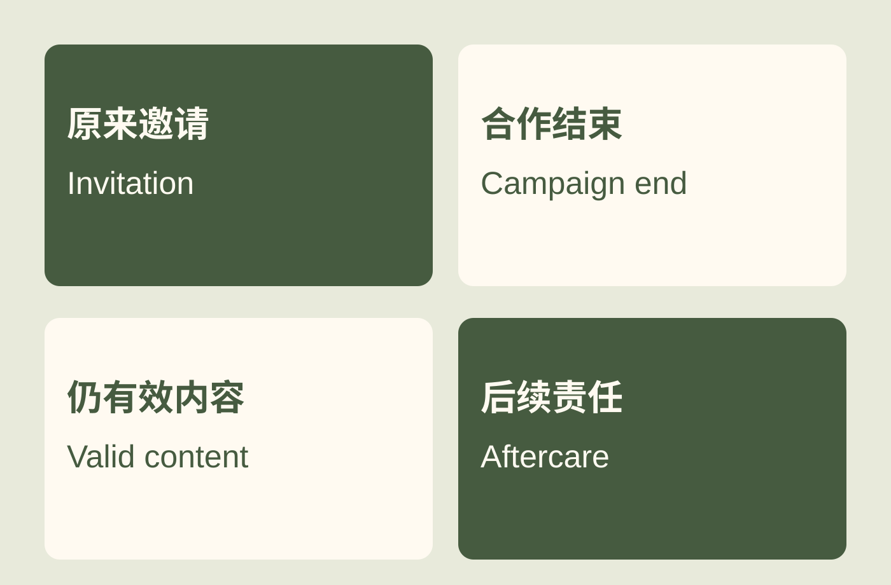

# 合作结束后怎样兑现关注理由

状态：本地审阅稿；正式发布日期待确认。

达人合作带来新访客后，维护仍然成立的关注理由：保留可用作品、明确后续内容与合作结束后的责任。

品牌想通过达人合作获得可持续的 Instagram 关注，需要在活动结束后仍兑现原来的内容邀请。明确哪些作品继续有效、系列是否延续、旧链接指向哪里，以及由谁回应后续问题。维护不是把所有历史内容改成新活动，而是让观众知道现在可以期待什么。新增关注、持续观看和业务结果分别观察，不能用一次增长保证未来忠诚。

## 找出观众实际接受的邀请

先回看公开作品里实际说了什么。可能邀请观众关注一个系列、等待下一次演示、获得活动信息，或继续看创作者相关作品。不同邀请需要不同维护。

不要只查内部计划。最后发布的文案、口播和目的地可能与早期 Brief 不同，活动收尾应以实际公开表达为依据，再核对双方约定。

[Instagram 新访客语境方法](https://www.quickkol.com/zh/blog/instagram-creator-collaboration-welcome-context/#answer)处理合作启动时如何欢迎观众。本篇往后看：当活动已经完成，哪些理由仍然成立，哪些需要明确结束。

对每项邀请保留对象和负责人。品牌内容、创作者个人节目和联合系列可能由不同人维护，不能因为它们曾在同一条帖子里出现，就默认全由达人长期负责。

## 把持续内容与活动信息分开

有些作品即使活动结束仍能解释一个问题，另一些依赖限时优惠、活动地点或特定产品版本。先区分，不必将全部内容一律删除或一律继续推广。

[Meta 2023 共创与轮播说明](https://about.fb.com/news/2023/08/music-and-collabs-on-instagram/)提供过共同作者与展示安排的历史背景。它不能决定一项合作结束后每份素材怎样继续使用，也不替双方约定维护期限。

若双方希望保留作品，确认原有用途与时间条件是否支持。对过期信息选择适当处理，保留历史语境，不让旧活动看起来仍在进行。

持续的价值可以来自一篇仍准确的解释，而不是不断追加促销。品牌应让新关注者容易找到这些作品，同时清楚说明何时需要查看当前产品资料。

## 让旧入口通向准确内容

检查仍有人可能使用的链接、置顶说明和作品目录。目的地应与原邀请有关，不因为新活动开始就把所有旧流量送往无关页面。

如果产品变化影响解释，说明当前版本与历史作品的关系。可以提供新的补充资料，不要伪造旧视频已经讲过新功能，也不要只改发布日期制造新鲜感。

品牌负责的页面由品牌维护；创作者控制的作品需要适当沟通。不要将共享表更新当成对方账号已经修改，也不直接动用未获授权的权限。

维护范围根据实际需要确定。不是每条历史作品都要持续重做，但真正影响观众选择的过期承诺应有负责处理的人。

活动结束后，仍然可见的邀请需要准确语境。

## 结束合作也保留关系背景

在适用的美国指导中，[FTC 代言问答](https://www.ftc.gov/business-guidance/resources/ftcs-endorsement-guides-what-people-are-asking)讨论每次新的代言表达都应有适当背景。曾经说明过关系，不意味着后来出现的每次推荐都自动被所有人理解。

因此，新内容若继续引用旧合作中的体验，应核对原关系与现在的表达，不把一项已经结束的活动写成仍在持续，也不抹去可能影响理解的商业背景。

本文不为所有国家规定同一保留期限或格式。与合作方核对实际主张、适用要求和用途，避免把一般建议当成普遍规则。

创作者可以继续分享自己的相关工作，但品牌若希望其在活动后追加推荐，需要明确讨论。不要用“保持关注热度”作为没有范围的新委托。

## 把回应责任写到具体问题

活动后仍可能有人询问使用、库存、活动结果或下一期内容。创作者可以解释自己的作品，但品牌客户服务和项目结算不一定属于其职责。

按问题分配负责人，并给出适合公开的路径。不要让观众在两个账号之间反复转发同一问题，也不要要求在评论里公开无关个人信息。

如果下一期尚未确认，就如实说明没有确认，不把“敬请期待”变成无期限承诺。对真正存在的计划，写清哪些已经确定，哪些仍需安排。

[Instagram 系列关注方法](https://www.quickkol.com/zh/blog/instagram-creator-series-following-choice/#answer)可以继续规划有实际内容的后续选择。维护目标不是让每个问题都留在评论区，而是让观众获得适当回应，也让创作者知道自己需要承担什么。

## 观察留下来的人做了什么

[Meta Insights 概览](https://developers.facebook.com/docs/insights/overview)按对象、指标和权限说明资料访问。以实际可取得的信息观察，不假设关注者变化就提供完整的持续观看记录。

如果需要比较活动前后，保留窗口、同期发布、已知付费分发和目的地变化。一个计数变化可能有多种原因，不应全部归给收尾维护或某位达人。

可以分别记录维护是否完成、相关作品是否仍可找到，以及实际收到的问题。它们支持工作质量判断，不自动证明销售或忠诚提升。

没有足够受众资料时，缩小结论而不是补估计。品牌仍可以据已知错误修复入口，无需等到能建立完整因果模型才处理明确问题。

## 用假设收尾检查期待

假设达人系列结束时，旧作品仍邀请观众等待下一期。品牌准备转向新项目，而创作者没有确认继续。这是编辑场景，不是真实客户结果。

合适的处理可能是明确系列状态，让旧入口继续提供已有内容，并把未确认的未来计划从当前承诺中移开。不能只把链接换成新促销，却保留原来等待下一期的邀请。

若双方后来同意新的系列，重新说明角色、内容和用途，再安排过渡。观众可以自主决定是否继续，品牌不应把全部流失都视为内容失败。

这个例子不承诺维护会产生多少关注。它检查的是关注理由是否仍然准确，以及品牌能否对自己控制的部分承担责任。

## 让关注理由可以持续兑现

结项记录应写明仍有效的作品、过期条件、维护动作与负责人。下一轮合作开始时，先查看这些记录，不让旧邀请与新任务互相冲突。

如果没有资源维护某个入口，缩小承诺或安排合适结束。诚实的范围往往比空泛的持续活跃更可执行，也更尊重创作者的工作条件。

QuickKOL 可以帮助理解后续 Brief、发现合适达人和准备个性化联系；具体发布、授权、维护与结果仍需核对。发现候选人不等于已经有人承担活动后所有责任。

获得关注应建立在相关价值上。合作结束后的维护，让这份价值继续清楚，而不是把观众留下来当成不需要解释的目标。

## 合作结束后的关注维护

| 事项 | 核对 | 负责 |
| --- | --- | --- |
| 系列邀请 | 是否继续与确认状态 | 节目负责人 |
| 产品说明 | 版本与当前资料 | 品牌产品团队 |
| 旧作品用途 | 期限与同意 | 双方合作负责人 |
| 后续问题 | 内容、服务或项目 | 适当回应团队 |

编辑维护框架，不预测关注或留存效果。

## 交接合作后维护

先看公开作品实际邀请了什么。

- [ ] 列出仍可见的邀请。
- [ ] 区分有效与过期内容。
- [ ] 核对目的地与产品版本。
- [ ] 确认持续用途与关系背景。
- [ ] 分配实际回应责任。
- [ ] 保留观察与归因边界。

## 研究日期与使用边界

资料核验于 2026 年 11 月 20 日。文中方法、表格和决策规则为编辑建议，标为假设的示例不是实际客户结果或行业基准。外部资料的适用地区与时期按各段说明。

## 从任务开始达人研究

用 QuickKOL 理解 Brief、发现相关达人并研究作品与联系路径；数据、合作条件和结果仍需核验。

[了解 QuickKOL](https://www.quickkol.com/#capabilities)

## 来源

- [Meta 2023 共创与轮播说明](https://about.fb.com/news/2023/08/music-and-collabs-on-instagram/)
- [FTC 代言问答](https://www.ftc.gov/business-guidance/resources/ftcs-endorsement-guides-what-people-are-asking)
- [Meta Insights 概览](https://developers.facebook.com/docs/insights/overview)
