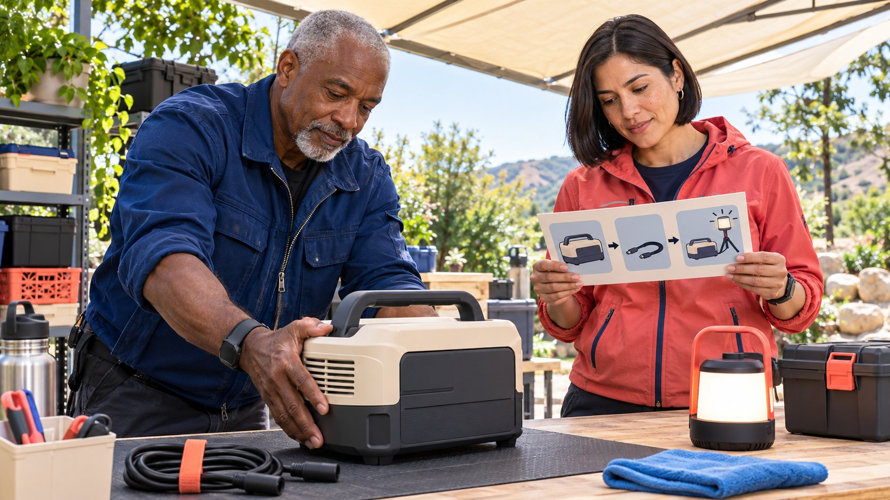
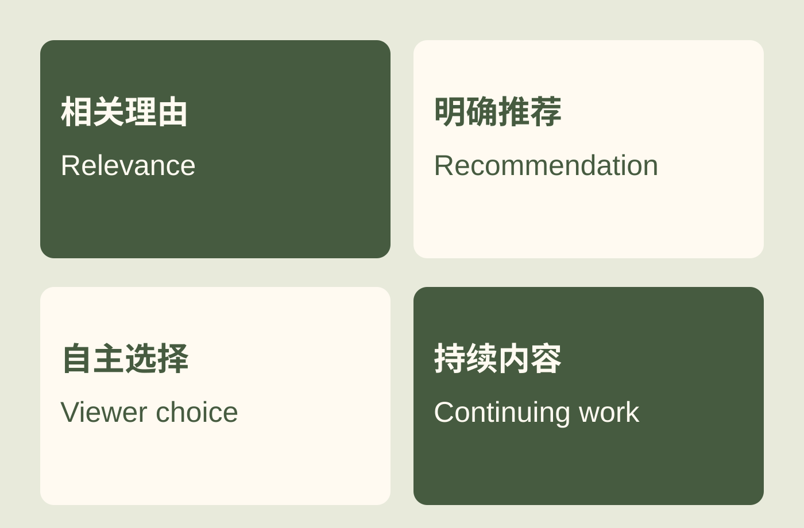

# Get More Instagram Followers Through Relevant Co-Promotion

Status: local review draft; confirm the publication date before release.

Use complementary creator collaboration to give viewers a relevant reason to follow, with clear relationships and continuing content rather than promised audience transfer.

To gain Instagram followers through creator collaboration, give viewers a relevant reason to continue. Complementary creators can explain a shared question and recommend each other’s related work, but followers are not inventory that automatically transfers. Define roles, the basis of the recommendation, publication conditions and continuing content before observing account changes. Co-authorship, a mention and a follow are different events. None guarantees a new loyal audience. For the brand, the useful goal is a partnership whose invitation is understandable and whose next piece of work can fulfil that invitation.

## Give co-promotion a shared question

Start with a viewer question both creators can help explain, rather than whether their follower counts are similar. Different fields can be complementary, but the team should be able to explain why the work belongs together.

For example, an equipment demonstrator and a relevant workflow educator might explain how a tool operates and when it is appropriate. This is an editorial scenario, not an existing partnership or a growth result. Check contributions through actual work rather than matching occupational labels alone.

The viewer benefit can be a more complete explanation, without requiring a follow of both accounts to continue. Define subsequent content clearly, while avoiding promises beyond what both parties have agreed to provide.

The [Instagram following-invitation method](https://www.quickkol.com/blog/instagram-following-invitation-creator-touchpoint/#answer) concerns expression at one touchpoint. This article addresses a different question: how two creators form a reasonable recommendation relationship. It is not another profile-optimization checklist.

A useful starting brief describes the shared question and each person’s distinct contribution. If those cannot be separated, the partnership may be duplicating roles rather than adding understanding. Resolve that before asking either creator to recommend work they cannot meaningfully explain or stand behind.

## Express relevance as a concrete reason

A recommendation should return to actual work: how the other person adds to an explanation, for example, rather than this account is great. The brand can supply factual information while letting the creator express the connection in a suitable voice.

Do not invent long-term use, professional approval or personal friendship. A creator can value one public contribution or accept a new commission without presenting either as an established private relationship.

If the two contributors understand the use case differently, discuss that difference first. Useful disagreement can remain. The audience may need decision conditions rather than identical praise from everyone involved.

Identify the recommendation object precisely: one piece, a series or a confirmed future collaboration. A clear object is easier to fulfil and less likely to become an endorsement of every historical statement on an account.

This also makes review fairer to the creators. The brand can check whether the stated reason is accurate without demanding an exaggerated expression of personal enthusiasm. A relevant invitation can be persuasive because it explains what the viewer will find, while leaving the final choice to the viewer rather than depending on an invented relationship narrative.

A recommendation gives a reason; following remains the viewer’s choice.

## Separate platform actions from partnership terms

[Meta’s 2023 collaboration-and-carousel announcement](https://about.fb.com/news/2023/08/music-and-collabs-on-instagram/) described co-authorship and display after invitation acceptance. Retain its historical date. It does not guarantee identical current availability for every account or establish a deduplicated combined audience.

Separately state who films, who publishes, who appears as co-author and who supplies assets. A platform invitation does not replace agreement about fees, usage, revisions or subsequent responses.

If a feature is unavailable on the actual account, discuss another agreed publication route. Do not preserve the original plan by asking a creator to change account arrangements or extend permission without understanding the consequences.

Co-publication also does not mean every existing follower sees the work, or that each will follow the other creator. Report the technical action as its actual state rather than as an audience-growth outcome.

This keeps the collaboration workable when interface options differ. The brand can still commission a useful explanation and a relevant recommendation, provided the parties understand how it will be delivered. Availability of one button should not determine the whole relationship, and absence of that button should not be used to imply that a creator failed to deliver conditions they never accepted.

## Explain the relationship and contribution

Where the US guidance applies, [the FTC’s influencer-disclosure guide](https://www.ftc.gov/business-guidance/resources/disclosures-101-social-media-influencers) emphasizes making material brand relationships clear. If a brand commissions the co-promotion, the creators recommending each other should not make the arrangement appear entirely non-commercial.

Distinguish facts supplied by the brand from each creator’s own observations. Retain the relevant basis for experience, performance and suitability claims. Do not ask the second contributor to copy the first person’s personal feeling.

Commercial context can be clear without consuming the whole explanation. Supply an understandable relationship statement, then let the actual contribution carry the work. A long string of ambiguous tags is not a substitute for meaning.

Confirm excerpts and later advertising separately. A shared explanation suitable for organic publication does not make both identities and every segment available for all future brand uses.

These conditions should be discussed with the creators while the proposed roles are still clear. They can then decide whether the recommendation fits their work and whether the intended use is acceptable, instead of discovering after filming that a narrow collaboration has become an open-ended endorsement arrangement.

## Provide something real after the follow

A reason to follow needs fulfilment. If the invitation promises a kind of explanation, the account’s subsequent work should make it findable. A one-off project can also be described honestly; it does not need a fictional continuing series.

Coordinate existing programmes and the brand activity so they do not present conflicting next steps. Viewers should not be sent repeatedly between profiles that contain no corresponding information.

Plan maintenance at the start, including older routes and later responsibilities. Otherwise a growth target can become disconnected from anything useful for the new follower to encounter.

Responsibility does not all belong with the creator. Product information, destination accuracy and customer questions may require brand support. If continuing creator answers are needed, define work and time rather than hiding the expansion inside stay active.

The practical question is what the viewer can reasonably expect after choosing to follow. Answering it makes the invitation more specific and gives the brand a concrete review criterion beyond account growth. It also allows the parties to end a limited campaign responsibly, because the promised content and support arrangement have an agreed scope rather than an implied indefinite commitment.

The [Instagram series-following method](https://www.quickkol.com/blog/instagram-creator-series-following-choice/#answer) can help arrange that continuing choice.

## Retain account scope when observing growth

[Meta’s Insights overview](https://developers.facebook.com/docs/insights/overview) describes access through account or content objects, metrics and permissions. Use reports actually available, without assuming both accounts have identical fields or asking for unrelated information.

Keep each account’s period, concurrent publishing and known distribution separately. Do not add follower totals into a newly acquired unique audience, or attribute all concurrent growth to the co-promotion.

Where source information is insufficient, report the limited observation and retain other possible influences. A follow also does not establish continuing viewing, purchase or customer status.

Connect evaluation to the original question. A fuller explanation can support a content judgment. Studying follower effects requires suitable evidence. One form of success should not answer for another missing record.

This is useful even without a complex attribution model. The team can state what was published, what was observed and which questions remain open. That gives procurement a more responsible basis for a further commission than an undifferentiated before-and-after number or a guarantee that the other creator’s existing audience will move across in predictable proportions.

## Test the plan through complementary roles

Imagine a brand inviting two creators to explain professional equipment: one demonstrates setup, the other explains working conditions. Each recommends relevant work and retains a clear next piece. This is an editorial example, not a documented growth case.

If the viewer needs only one quick answer, there is no need to require following both accounts. If the contributions overlap heavily, change the division of work before adding more reciprocal tags.

If one person cannot confirm a product fact, the brand should supply support or assign that portion to a more suitable role. Co-promotion does not require everyone to make the same statement about every detail.

The value is that viewers can complete a decision more easily, while those who want to continue can find suitable content. Further commissioning should follow the task and bounded observations rather than a presumed audience-transfer percentage.

Use the scenario to check whether the plan remains useful without the growth forecast. If the only reason to work together disappears when a guaranteed follower number is removed, the brand has not yet defined a strong creator contribution. Revisit relevance before turning the arrangement into a production request.

## Hand the review to the next partnership

State which explanations were useful, which recommendations were accurate, which routes need maintenance and which growth questions remain unanswered. The next owner should know whom to contact, rather than receive only a follower difference.

For continuing work, refine roles and content using the actual findings. One observation should not become a permanent growth formula. Evaluate delivery quality separately from distribution the creator cannot fully control.

QuickKOL helps interpret a brief, discover complementary creators and prepare personalized contact. Original work, audience evidence, usage and results still need verification. Candidate matching should not be described as growth already validated.

Useful co-promotion is a clear, relevant recommendation the parties can fulfil. A viewer can choose to continue or simply use the current explanation. That choice belongs in the design rather than being treated as resistance to remove.

Keep the review attached to the proposed next commission, including unfulfilled promises or unresolved evidence requests. The team can then improve the collaboration without making a creator responsible for an audience migration nobody established or allowing a short campaign to imply a continuing commitment that neither partner accepted.

## Co-promotion roles and checks

| Item | Confirm | Does not establish |
| --- | --- | --- |
| Role | Distinct contribution | Equal follower size |
| Recommendation | Relevant original work | Endorsement of all past work |
| Publication | Capability and agreement | All followers reached |
| Following | Account-specific observation | Loyalty or purchase |

Editorial partnership framework; no guaranteed growth or audience transfer.

## Confirm relevant co-promotion

Start with why viewers need the collaboration.

- [ ] Choose a shared viewer question.
- [ ] Distinguish roles through original work.
- [ ] Explain recommendation and commercial context.
- [ ] Agree usage and publication separately.
- [ ] Prepare real continuing content.
- [ ] Record account observations separately.

## Research date and limitations

Sources reviewed November 20, 2026. Methods, tables and decision rules are editorial recommendations. Hypothetical examples are not actual client results or industry benchmarks. Source geography and periods are specified where relevant.

## Start creator research with a clear task

Use QuickKOL to interpret a brief, discover relevant creators and research their work and contact routes. Verify data, commercial terms and outcomes at their source.

[Explore QuickKOL](https://www.quickkol.com/#capabilities)

## Sources

- [Meta’s 2023 collaboration-and-carousel announcement](https://about.fb.com/news/2023/08/music-and-collabs-on-instagram/)
- [the FTC’s influencer-disclosure guide](https://www.ftc.gov/business-guidance/resources/disclosures-101-social-media-influencers)
- [Meta’s Insights overview](https://developers.facebook.com/docs/insights/overview)
