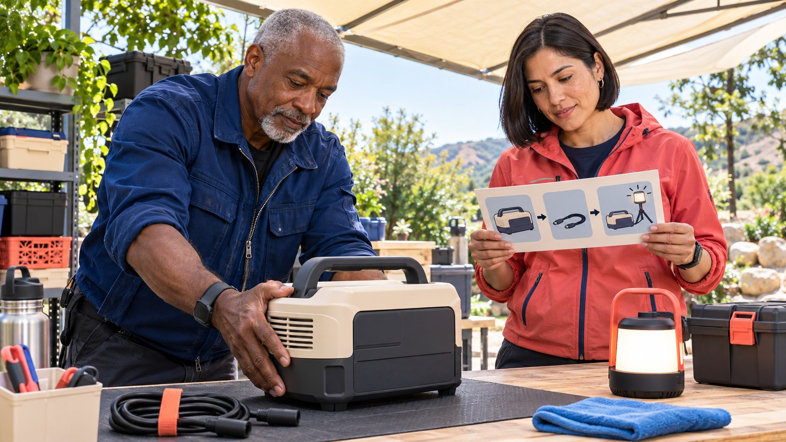
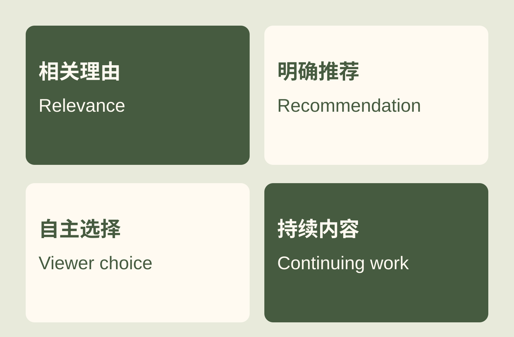

# 达人互推怎样尊重观众选择

状态：本地审阅稿；正式发布日期待确认。

用互补的创作者合作给观众一个相关的关注理由，说明推荐关系与后续内容，不承诺粉丝必然迁移。

品牌通过达人合作增加 Instagram 关注，应先提供与观众有关的后续价值。互补创作者可以共同解释一个问题、推荐对方的相关作品，但不能把粉丝当成可自动转移的库存。先确定合作角色、真实推荐依据、发布条件与持续内容，再观察实际账号变化。共同发布、互相提及和关注行为是不同事项，任何一种都不保证新增忠诚受众。

## 让互推服务一个共同问题

先找双方能共同解释的观众问题，而不是只看粉丝规模是否接近。不同领域可以互补，但应能说明为什么这些作品值得放在一起。

例如，一位设备演示者与一位相关工作流讲解者，可以分别解释工具怎样用与何时适用。这是编辑示例，不是已有合作或增长效果。品牌应按实际作品核对贡献，不只按职业标签配对。

给观众的价值可以是更完整的解释，而不是关注两个账号才能继续。对合作提出明确后续内容，但不把未来交付写得超过双方已经同意的范围。

[Instagram 关注邀请方法](https://www.quickkol.com/zh/blog/instagram-following-invitation-creator-touchpoint/#answer)处理单一接触点的表达。本篇进一步处理两个创作者之间如何形成合理推荐关系，不重复一般性的主页优化或涨粉清单。

## 把相关性写成具体理由

推荐理由应能回到作品，例如对方怎样补充某项解释，而不是“这个账号很棒”。品牌可以准备事实资料，让创作者用适合自己的语气说明关系。

不要替对方虚构长期使用、专业评价或私人友谊。创作者可以认可某段公开作品，也可以接受一次新委托；这些不必包装成早已存在的关系。

如果两人对产品使用场景理解不同，先讨论差异。可以保留有帮助的不同观点，不要求所有内容都变成相同赞美。观众需要的可能是判断条件，而非统一口号。

将推荐对象写准确：某篇作品、某个系列，还是未来确认的合作。对象越清楚，后续越容易兑现，也越不容易把一次推荐扩展为对所有历史内容的背书。

推荐提供理由，关注仍由观众选择。

## 平台动作与合作安排分开

[Meta 2023 共创与轮播说明](https://about.fb.com/news/2023/08/music-and-collabs-on-instagram/)介绍过共同作者功能及接受邀请后的展示安排。引用时保留历史日期，不据此保证今天每个账号都有相同功能，也不保证去重后的合并受众。

合作中分别说明谁拍摄、谁发布、谁共同署名和谁提供素材。一个平台邀请不足以代替费用、用途、修改与后续回应条件。

若某个功能在实际账号不可用，可以讨论其他已同意的发布路径。不要为了维持原方案，让创作者改账号设置或扩大许可而不理解影响。

共同发布也不意味着每位原有粉丝都会看见，更不意味着都会关注另一位创作者。把技术发布动作写成其实际状态，不把它直接报成受众增长成果。

## 说明商业关系与实际贡献

在适用的美国指导中，[FTC 达人披露说明](https://www.ftc.gov/business-guidance/resources/disclosures-101-social-media-influencers)强调重要品牌关系需要清楚表达。互推由品牌委托时，不能因为两个创作者彼此推荐，就让观众误以为完全没有商业安排。

同时区分品牌提供的事实与创作者自己的观察。对体验、效果和适用性保留各自依据，不要求第二位创作者复制第一位的个人感受。

商业语境可以清楚而不占满内容。给观众适当说明，再让真正的解释承担主体；不要用大量含糊标签代替可理解的关系表达。

对摘用与后续广告另行确认。一次共同解释可能适合自然发布，却不代表两人的身份与每个片段都能进入品牌任何未来用途。

## 关注之后要有真实内容

关注理由需要后续兑现。若邀请承诺某类解释，账号接下来的内容应能让人找到；如果只是一次性项目，也可以如实说明，不伪造长期系列。

协调双方已有节目与品牌活动，避免同时提出互相冲突的行动。观众不应为了理解一个产品问题，被反复送往多个没有对应内容的主页。

合作结束后的维护方法可以继续处理旧入口和后续责任。本篇在启动时就安排这些问题，让新增关注不是一个没有内容承接的数字目标。

责任不一定都由创作者承担。产品信息、目的地准确性与客户问题可能需要品牌支持。若要求创作者持续答疑，应明确工作和时间，不把它隐藏在“保持活跃”的要求中。

[Instagram 系列关注方法](https://www.quickkol.com/zh/blog/instagram-creator-series-following-choice/#answer)可以继续安排观众在后续内容中的选择。

## 观察增长时保留账号范围

[Meta Insights 概览](https://developers.facebook.com/docs/insights/overview)按账号或内容对象、指标和权限说明资料访问。品牌应以实际可取得的报告为准，不假设双方后台字段一致，也不要求共享无关资料。

分别记录各账号的观察期、同期发布和已知分发。不要把两个关注者总数相加后当成新增独立人群，更不能将同期增长全部归因于互推。

如果没有足够资料识别来源，就报告有限观察，并保留其他可能因素。观众愿意关注，也不自动说明会持续观看、购买或成为品牌客户。

评估应与原始问题连接。如果合作让某项解释更完整，可以作为内容判断；若要研究关注效果，需要相应证据。不要用其中一项成功替另一项缺失作答。

## 用互补角色检查方案

假设品牌邀请两位创作者共同解释专业设备：一位展示设置，一位说明工作条件。他们各自推荐相关作品，并保留下一步内容。这是编辑示例，不是真实增长案例。

如果观众只需要一次快速答案，就不必强制引导关注两个账号。若两人的内容高度重复，先调整分工，而不是增加更多相互标签。

若其中一位无法确认某项产品事实，应由品牌补依据，或将该部分交给更适合的角色。互推不意味着每个人都要对全部细节作同样声明。

方案的价值是让观众更容易完成判断，并让愿意继续的人找到适合自己的内容。是否继续合作，应看实际任务和有限观察，而不按预想的粉丝迁移比例评价个人。

## 把复盘交给下一轮合作

结论写明哪些解释有价值、哪些推荐准确、哪些入口需要维护，以及还不能判断的增长问题。让下一位负责人知道需要联系谁，而不是只看到一个粉丝差额。

如果继续合作，按实际发现完善角色和内容，不把一次观察变成永久的增长公式。对创作者的评价也应区分交付质量与不可完全控制的分发。

QuickKOL 帮助理解 Brief、发现互补达人和准备个性化联系；公开作品、受众证据、用途与结果仍需要来源核验。不能把候选匹配说成增长已经得到验证。

适合品牌的互推，是清楚、相关且能被兑现的推荐。观众可以选择继续，也可以只使用当前解释；这种自主选择应成为合作设计的一部分，而不是被当作需要消除的阻力。

## 互推角色与核对事项

| 事项 | 确认 | 不等于 |
| --- | --- | --- |
| 角色 | 各自贡献 | 粉丝规模相同 |
| 推荐 | 相关原作 | 全部历史背书 |
| 发布 | 实际功能与同意 | 全部粉丝触达 |
| 关注 | 各账号观察 | 忠诚或购买 |

编辑合作框架，不保证增长或受众迁移。

## 确认相关互推

先说明观众为什么需要这次合作。

- [ ] 选择共同的观众问题。
- [ ] 按原作区分双方角色。
- [ ] 说明推荐和商业关系。
- [ ] 单独约定用途与发布。
- [ ] 准备真实后续内容。
- [ ] 分别记录账号观察。

## 研究日期与使用边界

资料核验于 2026 年 11 月 20 日。文中方法、表格和决策规则为编辑建议，标为假设的示例不是实际客户结果或行业基准。外部资料的适用地区与时期按各段说明。

## 从任务开始达人研究

用 QuickKOL 理解 Brief、发现相关达人并研究作品与联系路径；数据、合作条件和结果仍需核验。

[了解 QuickKOL](https://www.quickkol.com/#capabilities)

## 来源

- [Meta 2023 共创与轮播说明](https://about.fb.com/news/2023/08/music-and-collabs-on-instagram/)
- [FTC 达人披露说明](https://www.ftc.gov/business-guidance/resources/disclosures-101-social-media-influencers)
- [Meta Insights 概览](https://developers.facebook.com/docs/insights/overview)
