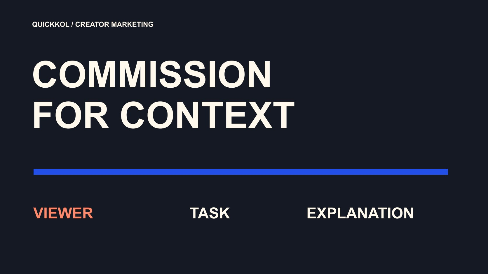
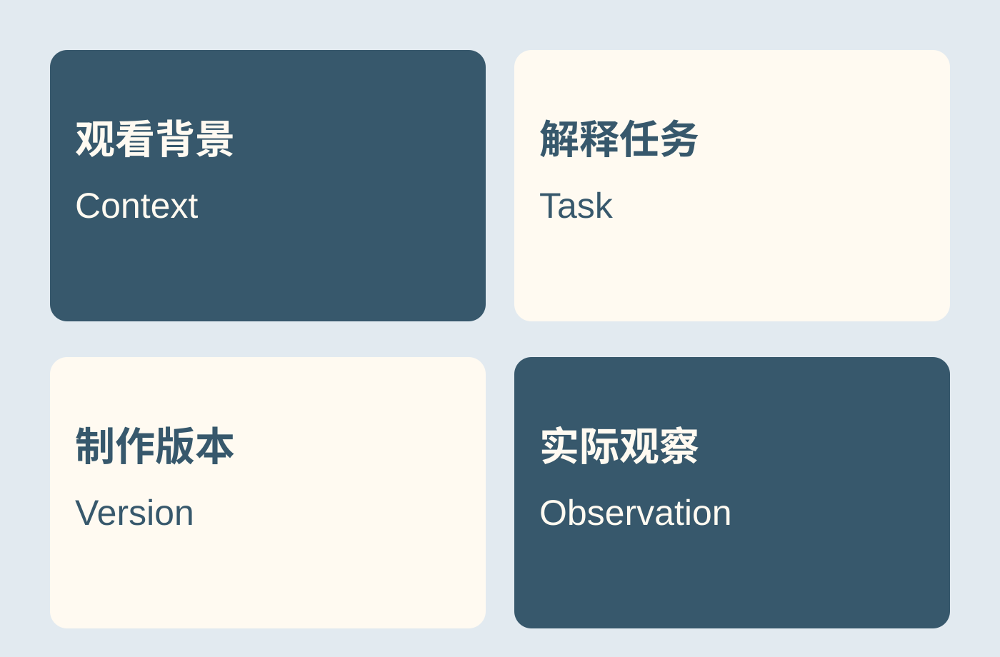

# IG Algorithm: Commission for the Viewing Context

Status: local review draft; confirm the publication date before release.

Choose a creator’s explanation task for its viewing context before filming, separating publication conditions, format and observation.

QuickKOL editorial graphic; not actual account metrics or a platform interface.

For a brand, the useful consequence of understanding the IG algorithm is a clearer commission: where should viewers encounter and understand this creator’s work? Feed, Stories, Reels and discovery contexts provide different surroundings. Define the contribution, necessary context and next step before production, then check actual publication and reporting. Ranking explanations do not guarantee recommendation for a particular asset. They also do not replace checks of account capability, permission or factual accuracy. A format is a container for the task, not a reason to assume the task has already been solved.

## Name the viewing context before optimization

[Meta’s ranking transparency explanation](https://about.fb.com/news/2023/06/how-ai-ranks-content-on-facebook-and-instagram/) introduced 22 system cards covering Facebook and Instagram in June 2023, including different surfaces and connected and unconnected content. This historical disclosure is a reason not to treat every viewing experience as one simple rule. It is not a complete table of live ranking weights.

Specify the surroundings in which the work may be encountered: whether the viewer knows the creator, whether earlier content supplies context, whether product information is visible and where the next action happens. Post on Instagram does not answer these questions.

The [Instagram sponsored-reach diagnosis method](https://www.quickkol.com/blog/instagram-algorithm-kol-surface-diagnosis/#answer) helps review gaps after publication. This article works earlier, at commissioning. If the team waits for disappointing results before asking whom the content should inform, production choices may no longer be inexpensive to change.

One creator can perform different roles. A continuing explanation for familiar viewers may need different introductory information from a first encounter with strangers. Express those differences in the brief. That is more executable than asking the creator to adapt to the algorithm without explaining which audience problem the commissioned work should address or what surrounding information the audience can reasonably be expected to have.

## Identify what the viewer already knows

Separate context supplied inside the asset from context supplied elsewhere. If the story depends on an earlier post, explain where viewers can recover that information instead of assuming everyone sees a sequence. If the explanation requires a particular product version, retain that condition in the image or wording.

Imagine a brand commissioning a software demonstration. Work intended for new viewers may first establish the task, while a continuation for people already discussing it may move more quickly into detail. This is an editorial scenario, not a finding that one surface necessarily performs better.

Do not turn every prerequisite into a long opening. Identify the conditions that change interpretation and place information where it is needed. Unrelated company history may belong elsewhere; a necessary limitation should not disappear merely to accelerate the edit.

Tell the creator which facts the brand has confirmed and which questions require experience or research. That focuses the creator’s contribution on explanation instead of guessing product information. The brief can then distinguish an intentional introduction from avoidable repetition, and a concise treatment from a treatment that becomes misleading because viewers lack a necessary premise.

## Give the format a defined job

State what the creator needs to accomplish before choosing a format. A sequence of images can support staged observation, video can explain an action that needs movement, and a temporary update can carry a timely reminder. These are task judgments, not promises of platform reward.

For an action, record the before-and-after states viewers need to see. For a choice, preserve comparison conditions. For a reminder, specify its valid period and destination. When adapting the format, check whether this information survives.

Different surfaces are not automatic copy-and-paste locations for the same asset. A segment can be reorganized, but usage, music, wording and meaning still require review. Approval of the original does not cover every new claim created by a subsequent edit.

If the creator believes the assigned format cannot complete the task, ask for the reason and an alternative. Compare whether the proposal accomplishes the communication job rather than only whether it follows the first filename in the brief. This creates room for relevant expertise while keeping the brand’s factual requirements and agreed commercial scope visible to everyone reviewing the work.

The viewing context helps define the task; it does not guarantee an outcome.

## Discovery tools are not automatically experiments

[Meta’s Trial Reels explanation](https://about.fb.com/news/2024/12/trial-reels-try-content-non-followers-first-see-what-perfoms-best/) describes showing work to non-followers first, followed by manual or configured wider sharing. Retain the announcement period and actual account conditions. This mechanism should not be described as a private test or a randomized experiment by default.

If the team observes an expression through this route, record settings, content and period. Subsequent wider distribution may change the meaning of the totals. Do not combine different stages as though they shared one unchanged experimental condition.

A team can use limited production to review whether an explanation is clear before commissioning more work. Sample review, platform-distribution observation and a formal effectiveness study are nevertheless different activities. Their names should not become interchangeable in the report.

Likewise, a strong observation in a discovery context can formulate a follow-up question. It does not establish that every future commission for the creator will be suitable. Keep the particular asset and circumstances attached to the result. That lets the brand use the observation responsibly while avoiding a general promise that neither the creator nor a platform feature can make about the next campaign’s distribution.

Use [Trial Reels result interpretation](https://www.quickkol.com/blog/instagram-trial-reels-result-interpretation/#answer) to review the observation scope before and after wider sharing.

## Do not let a metric replace the task

[Meta’s Insights overview](https://developers.facebook.com/docs/insights/overview) describes access in terms of objects, metrics and permissions. Establish whom and what the report measures before using it. The documentation does not prove every account has identical native fields, or that QuickKOL has obtained access to those fields.

At commissioning, identify the records needed for the principal question. If the task explains a choice, the team may retain actual questions and corrections alongside viewing context. A small set of comments should not become a survey of the entire audience.

Views, reach and interactions are not interchangeable because they all appear as numbers. Keep window, publishing object, distribution method and missing information with comparisons. Avoid calculating an impressive-looking ratio from reports that describe different things.

If the necessary record cannot be obtained, narrow the conclusion or choose a question that can be checked. Do not introduce an inaccessible backend requirement after the creator has completed the work. Early agreement about measurement is useful because it reveals whether the intended evaluation is feasible before the team buys production whose value will later be judged against information nobody agreed to supply.

## Preserve realistic production boundaries

Ranking knowledge cannot solve every production problem. Check location, equipment, product access, demonstration conditions and review time. A reasonable task can still become impossible if the resources required to perform it are missing.

Separate content approval, actual publication, advertising usage and data delivery. A backend scheduling option does not establish brand approval of every caption. A creator’s agreement to film does not establish willingness to provide continuing customer support.

Give each new request an owner and an explanation of the work involved. Changing one explanation into a series of responses may require additional time and product-support participation. Do not hide that expansion inside an instruction to improve engagement.

Keep the original and adapted assets connected through their version records. Each finished file should correspond to a real task, permitted use and review state. This prevents an algorithm discussion from becoming a reason for unlimited deliverables. It also makes production disagreements easier to resolve, because the team can identify whether the issue concerns factual accuracy, a newly requested format or a commercial condition that was never part of the original assignment.

## Make a hypothetical brief executable

Imagine a brand asking a creator familiar with a professional workflow to explain a new feature. The original instruction is make a video suitable for the algorithm. It says little about the viewer, question, product conditions or acceptance process.

A clearer proposal would ask the creator to explain one actual task to a relevant professional role unfamiliar with the feature, show necessary prerequisites and a complete operation, retain the specified product version and direct interested viewers to accurate information. The parties still need to agree these conditions; the example is not a ready-made contract.

If another surface is intended, specify the adaptation: additional background, shorter treatment, a different next step or extra usage permission. Another export is not always a sufficient description, and does not establish that renewed review is unnecessary.

At review, check whether the agreed task was delivered before interpreting observations. This hypothetical brief supplies no outcome figures and does not establish that its format is inherently superior. Its value is practical: the creator can propose work, the brand can review meaning and the reporting owner can see which question the resulting observation was meant to inform.

## Give the commission an accountable owner

At sign-off retain viewing context, viewer question, creator contribution, fixed facts, expressive choices, usage and observation records. Each should have someone able to confirm it, rather than everyone leaving a shared label of needs optimization.

If an account feature has not been checked, mark it unverified and prepare an alternative deliverable where appropriate. Do not promise identical access across regions and accounts. When interfaces change, preserve the underlying task judgment rather than mechanically repeating an old menu sequence.

QuickKOL helps interpret a brief, discover relevant creators and prepare outreach. Appropriate sources and counterparties must still confirm actual publishing capability, permission and results. The product connection should support the task without converting every ranking discussion into a sales message.

A good brief tells the creator what to explain and for whom, and tells the brand why this viewing context is appropriate. It can guide a clear, reviewable partnership without pretending to know every platform weight. That is a useful operational outcome: a concrete production decision with an explicit basis, rather than a confident but untestable instruction to satisfy a single imagined Instagram algorithm.

## Choose an arrangement for the task

| Task | Required context | Review |
| --- | --- | --- |
| First explanation | Question and product premises | Can an unfamiliar viewer understand? |
| Continue a discussion | Earlier question and original work | Is context missing? |
| Timely reminder | Valid period and destination | Still accurate at publication? |
| Observe a new treatment | Settings and delivery stage | Does the conclusion overreach? |

Editorial task framework, not a ranking of surface effectiveness.

## Confirm the creator commission

Confirm with the appropriate owners before filming.

- [ ] Define the actual viewing context.
- [ ] State the viewer’s decision.
- [ ] Preserve premises that affect understanding.
- [ ] Separate format from contribution.
- [ ] Define usage and observation records.
- [ ] Check account capability and alternatives.

## Research date and limitations

Sources reviewed November 20, 2026. Methods, tables and decision rules are editorial recommendations. Hypothetical examples are not actual client results or industry benchmarks. Source geography and periods are specified where relevant.

## Start creator research with a clear task

Use QuickKOL to interpret a brief, discover relevant creators and research their work and contact routes. Verify data, commercial terms and outcomes at their source.

[Explore QuickKOL](https://www.quickkol.com/#capabilities)

## Sources

- [Meta’s ranking transparency explanation](https://about.fb.com/news/2023/06/how-ai-ranks-content-on-facebook-and-instagram/)
- [Meta’s Trial Reels explanation](https://about.fb.com/news/2024/12/trial-reels-try-content-non-followers-first-see-what-perfoms-best/)
- [Meta’s Insights overview](https://developers.facebook.com/docs/insights/overview)
