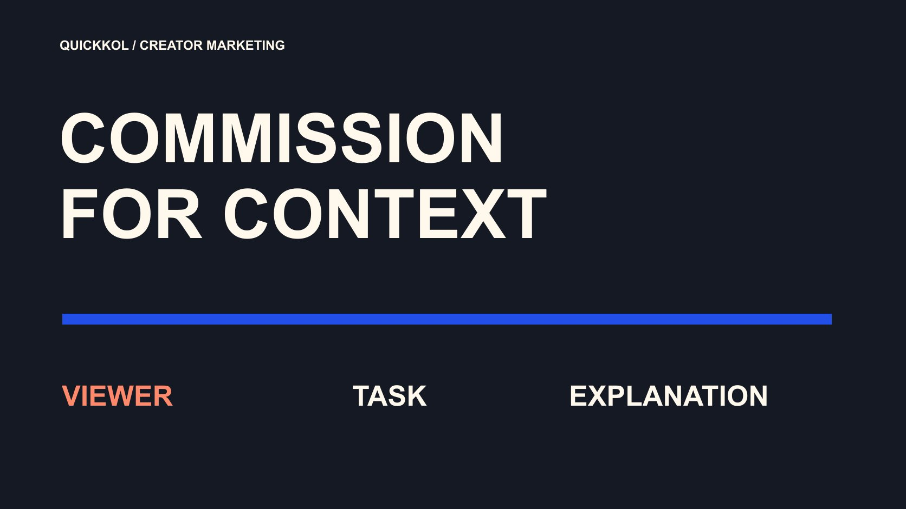
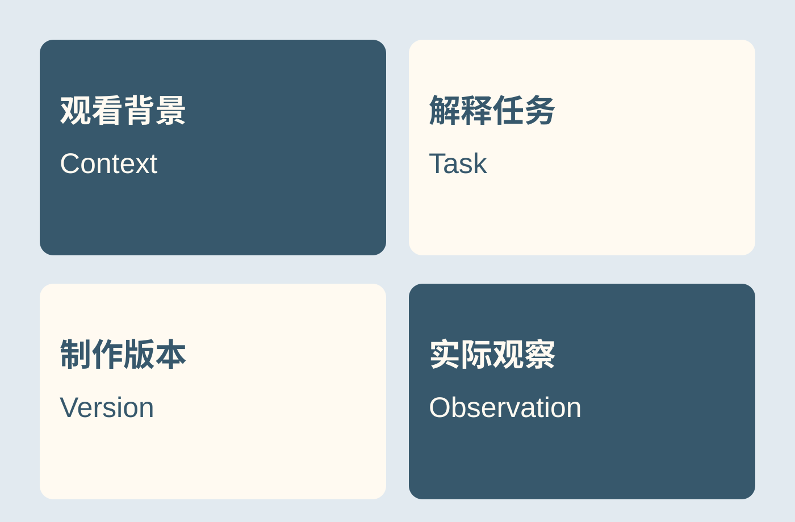

# Instagram 排序怎样影响内容委托

状态：本地审阅稿；正式发布日期待确认。

在拍摄前按观看入口安排达人解释任务，区分发布资格、内容格式和观察方式，避免把算法当成万能脚本。

QuickKOL 编辑图形；不呈现真实账号指标或平台界面。

理解 IG algorithm 对品牌最有用的结果，是在委托前说清内容准备在哪里被理解，而不是追求一套通用开场公式。Feed、Stories、Reels 与发现入口存在不同观看背景；品牌应据此安排达人贡献、必要前提与下一步，再用实际发布和报告核对。排序解释不能保证某个内容获得推荐，也不能替代账号功能、许可和事实检查。

## 先说入口，再讨论优化

[Meta 排序透明度说明](https://about.fb.com/news/2023/06/how-ai-ranks-content-on-facebook-and-instagram/)在 2023 年 6 月介绍了覆盖 Facebook 与 Instagram 的 22 张系统说明卡，涉及多种入口及已关注与未关注内容。这个历史披露说明不应将全部观看体验当成一套简单规则，不代表完整的实时权重表。

品牌先说明作品可能出现在什么背景：观众是否认识达人，是否有前一段内容，是否能看到产品信息，以及行动发生在哪里。不要仅用“发 Instagram”代替这些条件。

[Instagram 触达诊断方法](https://www.quickkol.com/zh/blog/instagram-algorithm-kol-surface-diagnosis/#answer)帮助复盘发布后的差距；本篇更早一步，处理拍摄前的委托。如果等待结果不理想后才问内容应该让谁看懂，制作选择可能已无法低成本修改。

同一个达人可以承担不同角色。熟悉受众的持续解释，与面向陌生观众的一次介绍，需要的前提未必相同。把这些差异写成 Brief，比要求创作者“适应算法”更可执行。

## 区分观看者知道的前提

把必需前提分成作品内部与作品外部。若故事依赖上一条内容，说明观众从哪里补齐，而不默认每个人按顺序看到。若讲解需要特定产品版本，就在画面或文案中保留。

假设品牌委托一位创作者演示软件操作。面向新观众的内容可能先解释任务，面向已参与讨论的人可以更快进入细节。这是编辑示例，不是某种入口一定更有效的结论。

不要把所有前提塞成冗长片头。选择会改变理解的条件，让信息在实际需要的位置出现。与任务无关的品牌历史可能放在别处，必要限制不能因为节奏被删除。

向创作者说明哪些问题品牌已有确认，哪些需要体验或研究。这样对方能把注意力放在真正的表达贡献，而不是猜测产品事实。

## 让格式承担明确工作

先说达人需要完成什么，再选格式。连续图片可以支持分步观察，短视频适合需要动作才能理解的说明，临时更新可以承担即时提醒；这些是任务判断，不是平台奖励保证。

对一项动作，记录观众必须看到的前后状态。对一项选择，保留比较条件。对一条提醒，说明有效时间和目的地。格式改变时，检查这些信息有没有随之丢失。

不把不同入口看作同一作品的机械复制位置。同样的片段可以重新组织，但应核对用途、音乐、文字与原意。不能因为原片已通过，就忽略新增剪辑造成的新主张。

若创作者认为任务不适合指定格式，让其说明原因并提出替代。品牌应比较任务完成情况，而不是只判断提案是否服从最初文件名。

入口帮助定义任务，不替品牌保证结果。

## 发现机会不等于随机实验

[Meta Trial Reels 说明](https://about.fb.com/news/2024/12/trial-reels-try-content-non-followers-first-see-what-perfoms-best/)描述先向非粉丝展示的方式，以及之后手动或按设置分享给更多人的安排。应保留公告时期与实际账号条件，不能把这种机制写成私密测试或默认随机分组。

如果用它观察一种表达，记录当时设置、内容与观察期。后续扩大分发可能改变数字的含义；不要把不同阶段的总数放在一起当成同一测试条件。

团队可以先用小范围制作判断解释是否清楚，再决定是否追加完整合作。但样片审稿、平台分发观察与正式效果研究属于不同工作，不应在报告中混用名称。

同样，发现入口上的一次好表现，可以提出后续问题，而不是证明某个达人今后所有委托都适用。保留具体对象与实际条件，才能负责任地使用这条观察。

[Trial Reels 结果解读](https://www.quickkol.com/zh/blog/instagram-trial-reels-result-interpretation/#answer)可用于继续梳理扩展分发前后的观察范围。

## 不要用指标替代任务

[Meta Insights 概览](https://developers.facebook.com/docs/insights/overview)按对象、指标和权限描述资料访问，提醒团队应先知道报告测量谁与什么。它不是所有账号都拥有同样原生字段的证明，也不是 QuickKOL 已取得相关权限的声明。

委托时就写明主要问题需要什么记录。若任务是解释一项选择，除了观看背景，还可以保留实际收到的问题与修正记录，但不要将少量评论当作整个受众调查。

不同内容的观看数、触达和互动不能只因都显示为数字就互换。对比时记录窗口、发布对象、分发方式和缺失信息，避免从不一致的报表计算漂亮却无意义的比率。

如果无法取得所需资料，调整结论或选择可核验的问题，不让创作者提供无法访问的后台来满足一个事后新增的要求。

## 给制作保留真实边界

排序知识不能解决所有制作问题。核对拍摄地点、设备、产品取得、演示条件与审阅时间。一个合理任务若缺少必要资源，也可能无法按预期完成。

区分内容被批准、实际发布、广告用途和数据交付。某个后台允许排期，不等于品牌已经同意所有文案；某位创作者同意拍摄，也不代表愿意承担持续客服。

为每项新增要求说明工作量与负责人。例如，将一次讲解改成多轮回应，可能涉及额外时间和产品支持。不要把它隐藏在“提高互动”的一句话里。

达人内容分发版本方法可以帮助保持原作与改编之间的关系。每个最终文件应对应实际任务、用途与审稿状态，避免排序讨论变成无限增加交付的理由。

## 假设 Brief 怎样变得具体

假设品牌需要一位熟悉专业工作流的达人解释新功能。原要求只有“做一条适合算法的视频”。这无法说明观众、问题、产品条件和验收方式。

改写后可以是：为尚不了解该功能的相关岗位解释一个实际任务，展示必要前提和一次完整操作，保留指定产品版本，并将有兴趣的人引向准确说明。这里仍需双方确认，不是现成合同。

如果还希望在另一个入口使用，另列调整需要：是否补背景、缩短内容、改变行动或获得额外用途。不要只标注“再导出一份”就假定无需审稿。

复盘时检查这些约定是否兑现，再解释实际观察。假设场景没有提供效果数字，也不意味着这一格式必然优于别的表达；它只是让任务可执行。

## 把委托交给实际负责人

定稿时留下观看背景、观众问题、创作者贡献、固定事实、可变表达、用途与观察记录。每一项都应有人能确认，而不是共同写上“待优化”。

若某项平台功能未在账号内核验，明确待核验，必要时准备替代交付；不要承诺所有地区和账号具有一致入口。原生界面变化时，保留同样的任务判断，而不是盲目照搬旧菜单。

QuickKOL 帮助理解 Brief、发现相关达人并准备联系；实际发布功能、许可和效果仍在来源与合作方核对。产品关联应服务任务，不必把每段排序讨论变成销售话术。

一份好 Brief 让达人知道要为谁解释什么，让品牌知道为何选择这个入口。它不需要假装掌握平台所有权重，仍然能够指导一次清楚、可复盘的合作。

## 按任务选择内容安排

| 任务 | 必要信息 | 检查 |
| --- | --- | --- |
| 首次解释 | 问题与产品前提 | 陌生观众能否理解 |
| 延续讨论 | 此前问题与原作 | 是否缺失背景 |
| 即时提醒 | 有效期与目的地 | 发布时仍准确 |
| 观察新表达 | 设置与分发阶段 | 结论是否越界 |

编辑任务框架，不是入口效果排名。

## 确认达人委托

拍摄前由相应负责人确认。

- [ ] 明确实际观看背景。
- [ ] 写清观众需要判断什么。
- [ ] 保留影响理解的前提。
- [ ] 区分格式与内容贡献。
- [ ] 明确用途与观察记录。
- [ ] 核验账号内功能与替代方案。

## 研究日期与使用边界

资料核验于 2026 年 11 月 20 日。文中方法、表格和决策规则为编辑建议，标为假设的示例不是实际客户结果或行业基准。外部资料的适用地区与时期按各段说明。

## 从任务开始达人研究

用 QuickKOL 理解 Brief、发现相关达人并研究作品与联系路径；数据、合作条件和结果仍需核验。

[了解 QuickKOL](https://www.quickkol.com/#capabilities)

## 来源

- [Meta 排序透明度说明](https://about.fb.com/news/2023/06/how-ai-ranks-content-on-facebook-and-instagram/)
- [Meta Trial Reels 说明](https://about.fb.com/news/2024/12/trial-reels-try-content-non-followers-first-see-what-perfoms-best/)
- [Meta Insights 概览](https://developers.facebook.com/docs/insights/overview)
