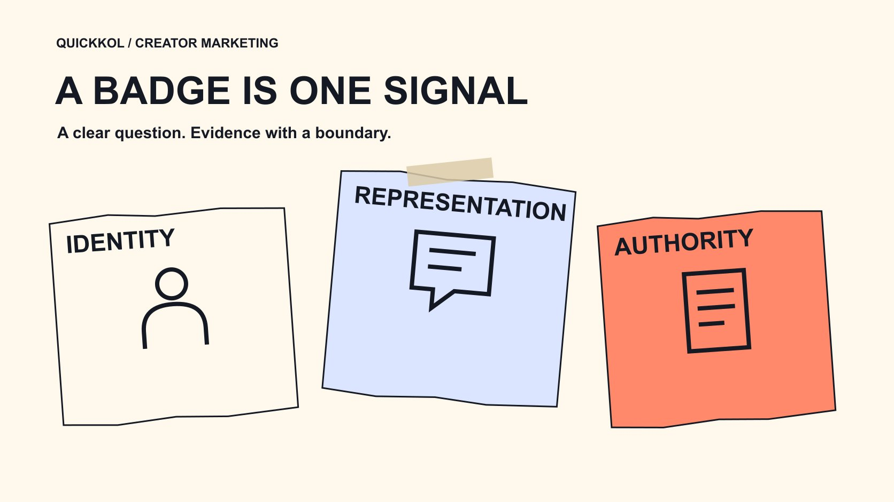
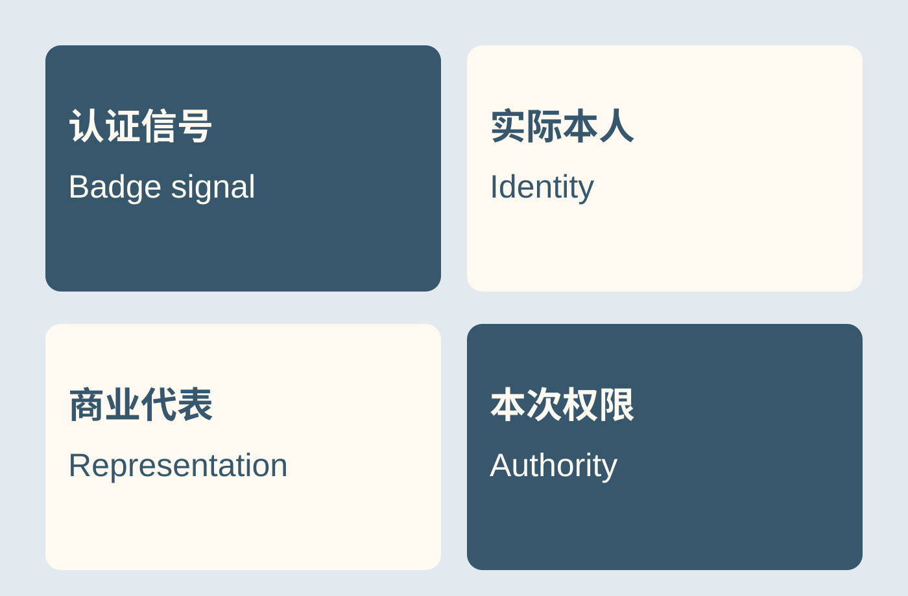

# Instagram Verification: Check Partnership Authority

Status: local review draft; confirm the publication date before release.

A verification badge can inform identity research; creator partnerships still need checks of representation, agreement and media-use authority.

QuickKOL editorial graphic; not actual account metrics or a platform interface.

Instagram verification can inform account-identity research, but it does not by itself establish that the person contacting you may sign, receive payment or authorize media. Confirm the actual account and a public business route, then check representation, work scope and acceptance for this partnership. Verification does not guarantee work quality, audience fit or payment safety, and it does not permit advertising with every previous asset. Keep identity, representation and specific authority separate instead of letting one badge answer the entire partnership review.

## Describe the badge within its actual scope

[Meta’s Verified product explanation](https://www.meta.com/meta-verified/) connects verification with account activity or supplied information and documents, with feature and regional differences. Avoid describing every badge as one identical application route or checking method.

The [Instagram verification routes-and-evidence method](https://www.quickkol.com/blog/instagram-verification-routes-evidence/#answer) distinguishes that background. This article addresses the subsequent partnership: what still needs confirmation after the brand encounters a badge?

For a new invitation, record which identity question the badge helps answer and which commercial questions still require another source. Record the actual account and observation date, not only a detached badge screenshot. Usernames and pages can change; research conclusions should identify the object actually reviewed.

Even when identity evidence is useful, inspect relevant work and the present task. A badge is not the platform recommending a commercial partnership or guaranteeing every quotation, claim and result.

This scope helps a brand use the signal without overstating it. The account may be easier to corroborate while the commission remains an independent business decision. A reviewer can acknowledge verification in the identity record and still ask the creator ordinary questions about availability, relevant experience and the work being proposed, without treating those questions as a challenge to the badge itself.

## Corroborate contact through a public business route

An email can come from the creator, a team member or an unrelated person. Compare it with the account’s public business route and, when needed, confirm the relationship through an already corroborated channel rather than rely on an avatar or display name.

A badge should not justify accepting a sudden change in payment or media instructions. Confirm that an authorized person requested the change and follow the relevant business process instead of requesting private material in public comments.

The [creator contact-record correction method](https://www.quickkol.com/blog/blueskt-creator-contact-record-correction/#answer) distinguishes account, person and representation. Similar spelling or the same photograph does not establish that two objects are connected.

When public material is insufficient, record the question and ask appropriately. Unable to confirm is not equivalent to proven fraud; do not turn a cautious status into an accusation.

The objective is a reliable route for this collaboration, not an intrusive personal investigation. The brand generally needs enough information to communicate with the appropriate partner and understand who can decide the proposed work. Collecting unrelated private details adds little to that task and can distract from the specific relationship that actually requires confirmation.

## Confirm representation for this commission

An agency may handle parts of the conversation without every contact being able to accept every use. Confirm who represents whom, which work they handle and whose final agreement is needed.

For example, a team member may coordinate scheduling without authority to license older work for a new advertisement. A prompt reply does not establish permission to accept additional use for the creator. This is hypothetical, not an evaluation of a particular agency.

Give the confirmation request a defined scope: asset, publishing account, delivery and conditions requiring acceptance. A general willing to collaborate cannot replace an understanding of the actual commission.

Conversely, the creator appearing in an email does not mean all commercial questions are settled. Participation, willingness to discuss and acceptance of particular terms still need distinct states.

This becomes especially useful when several people join a project. A producer can manage files while a representative confirms fees and the creator reviews factual expression. Naming those roles prevents an operational message from silently becoming authorization for a decision that belongs elsewhere, while allowing routine work to continue through the appropriate person.

## Keep facts, observations and opinions distinct

In the UK data-protection context, [the ICO’s accuracy guidance](https://ico.org.uk/for-organisations/uk-gdpr-guidance-and-resources/data-protection-principles/a-guide-to-the-data-protection-principles/accuracy/) emphasizes source and status, distinguishing opinion, historical information and current facts. It is a reference for careful records here, not a universal legal conclusion for every region.

A research table can state that a badge was observed on a date. It should not silently become every commercial authority verified; that exceeds the evidence.

If a contact explains that representation changed, retain source and confirmation state, then update active execution lists. A previous relationship can remain historical context without continuing as current authorization.

Mark the basis of subjective work evaluation too. Believing an explanation fits the brief and establishing account identity are different conclusions. They need not be compressed into one broad trust score.

A useful record lets another person distinguish what was seen, what someone stated and what remains to be confirmed. That makes correction possible when circumstances change, and avoids carrying an old assumption into a fresh commission simply because a familiar account still displays the same visible badge.

Each step needs evidence; a badge cannot confirm the whole partnership.

## Do not substitute identity for media permission

In the U.S. context, [the U.S. Copyright Office’s photography guide](https://www.copyright.gov/engage/photographers/) explains ownership and protection of photographs. The photographer is generally the initial owner, subject to exceptions; the person depicted and the rights holder need not be identical.

The creator confirming an account does not establish authority over every photograph on the profile. Identify the assets needed for the collaboration and confirm sources and actual use rather than fill a permission field with the badge.

Portraits, older partnership images and brand-supplied photographs can have different conditions. Public visibility establishes availability to view, not automatic permission to download, adapt or advertise.

If unclear, request material suitable for the intended scope or choose other assets. Resolve identity and work-rights questions separately instead of making one answer carry a conclusion it cannot support.

This distinction is practical even in a friendly collaboration. The creator may readily supply their own recording while needing to check a photographer’s terms for a portrait. Recognizing the difference helps the team choose appropriate media without implying dishonesty or delaying unrelated work that is already clear.

## Still research work fit after identity checks

Does this commission require a personal demonstration, specialist explanation or a situational story? Inspect relevant original work and its relationship to the question rather than make verification the sole selection condition.

Record the specific work and observation supporting the judgment. An explanation retaining operating conditions can justify discussing a demonstration commission; it does not establish suitability for every product.

Audience information also needs its own source and scope. Verification does not prove location, purchase intent or follower quality, and it supplies no universal partnership conversion rate.

Explain why the task is relevant, then discuss actual experience, availability and terms. A useful invitation comes from the connection between work and question rather than you have a badge, so you fit our brand.

That approach also makes the eventual brief more specific. The creator can see which capability the team values and propose a suitable explanation. The brand can evaluate the proposal against the intended audience task instead of asking a general identity signal to do the separate work of editorial selection and commercial planning.

## Update confirmation when circumstances change

When account name, representation, delivery plan or usage changes, check which earlier confirmations still apply. A minor edit need not restart all research, but new authority cannot be covered automatically by an older record.

For publication through another account, confirm the actual party and responsibility. For added advertising use, return to usage conditions. Describe the change specifically rather than leave an ambiguous everything is fine in a conversation.

For an unconfirmed change, hold the affected part while continuing preparation that is already clear. A deadline should not turn unknown into approved.

Retain necessary versions and dates so the decision owner knows the current basis for execution. Later review should neither overwrite historical facts with a new relationship nor present a previous representative as still authorized today.

This makes ongoing research useful rather than repetitive. The team revisits the question that changed, preserves what remains supported and gives the creator a precise request. It avoids both unnecessary rechecking of settled details and casual expansion of permission through the momentum of an otherwise active project.

## Hand over a differentiated partnership record

The final record can distinguish identity evidence, public contact route, representation, accepted scope and media permission. Each has a source and state instead of one badge standing in for every check.

QuickKOL helps research relevant creator work and contact routes from a brief. Verification, commercial authority, payment and authorization still require their actual sources; a research tool should not guarantee transaction safety.

When evidence is limited, state what is known and what remains to be confirmed. A suitable uncertain state starts the next task rather than becoming a problem to conceal with a confident sentence.

The brand can then arrange collaboration more accurately: reach the right party, ask the right question and confirm actual work. Verification is a usable clue; the complete judgment comes from task-relevant evidence and explicit agreement.

A concise handover is sufficient when the next person can identify the basis of each conclusion. They should not need to reverse-engineer a broad verified label to discover whether it referred to an account badge, a business contact or a specific authorization that has never actually been requested.

## What remains after verification

| Object | Evidence needed | Badge does not prove |
| --- | --- | --- |
| Account | Actual page and date | Fit for every task |
| Contact | Business route and relationship | Sender necessarily authorized |
| Representative | Confirmation for this scope | Every future use accepted |
| Media | Rights source and usage conditions | Every image available for advertising |

Partnership research framework, not a transaction-safety guarantee.

## Hand over a verified-account review

Answer identity and commercial questions separately.

- [ ] Record account and date.
- [ ] Corroborate the public business route.
- [ ] Confirm representation for this scope.
- [ ] Retain the specific acceptance state.
- [ ] Check media conditions separately.
- [ ] Give changes and unknowns a next action.

## Research date and limitations

Sources reviewed November 20, 2026. Methods, tables and decision rules are editorial recommendations. Hypothetical examples are not actual client results or industry benchmarks. Source geography and periods are specified where relevant.

## Start creator research with a clear task

Use QuickKOL to interpret a brief, discover relevant creators and research their work and contact routes. Verify data, commercial terms and outcomes at their source.

[Explore QuickKOL](https://www.quickkol.com/#capabilities)

## Sources

- [Meta’s Verified product explanation](https://www.meta.com/meta-verified/)
- [ICO: accuracy principle](https://ico.org.uk/for-organisations/uk-gdpr-guidance-and-resources/data-protection-principles/a-guide-to-the-data-protection-principles/accuracy/)
- [U.S. Copyright Office: photography and copyright](https://www.copyright.gov/engage/photographers/)
