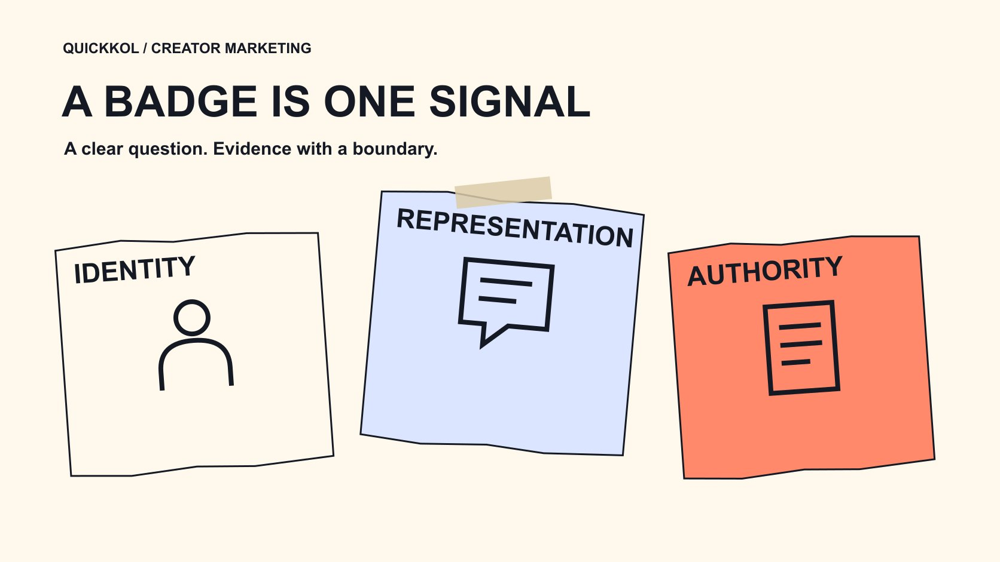
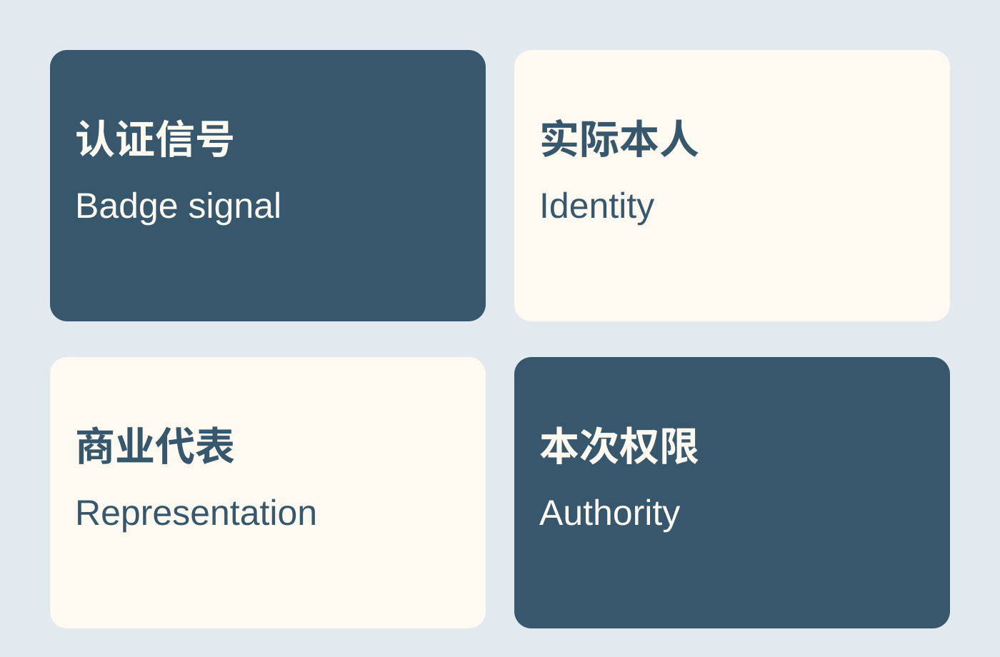

# Instagram 认证怎样用于合作核验

状态：本地审阅稿；正式发布日期待确认。

认证标识可以作为身份线索，但达人合作还要确认商业代表、签约与素材使用权限。

QuickKOL 编辑图形；不呈现真实账号指标或平台界面。

Instagram 认证可以帮助研究账号身份，但不能独自证明联系你的人有权签约、收款或授权素材。先确认实际账号与公开业务路径，再核对本次合作代表、工作范围与接受记录。认证不保证作品质量、受众适配或支付安全，也不代表所有旧素材可用于广告。把身份、代表关系与具体权限分开确认，避免让一个标识替代整次合作核验。

## 准确描述认证标识的范围

[Meta Verified 产品说明](https://www.meta.com/meta-verified/)将认证与账号活动或所提供信息、文件的核验联系起来，并说明功能与地区可能不同。不要把所有认证都解释为相同申请路径或统一检查方式。

[Instagram 认证路径与证据方法](https://www.quickkol.com/zh/blog/instagram-verification-routes-evidence/#answer)介绍如何区分认证相关背景。本篇处理后续合作：品牌看见标识后，还需要确认什么，才能安排真实商业工作。

为新邀请说明认证线索回答了哪个身份问题，哪些商业问题仍需要其他来源。记录实际账号和观察日期，不只保存一个脱离主页的蓝标截图。用户名与页面可能变化，研究结论应指向实际对象。

即使身份线索成立，也要继续看作品与本次任务。认证不是平台替品牌推荐此人合作，更不是对每个报价、主张或结果的担保。

## 从实际公开业务路径核对联系

一封邮件可能来自创作者本人、团队或完全无关的人。对照账号公开业务路径，必要时通过已经核对的渠道确认来信关系，不只看头像和显示名称。

不要以认证为由直接接受突然变化的收款或素材要求。确认变化由有权限的人提出，并按实际业务流程处理，不在公开评论里索取私人材料。

[平台与联系人记录更正方法](https://www.quickkol.com/zh/blog/blueskt-creator-contact-record-correction/#answer)提醒团队区分账号、人物与代表关系。拼写类似或使用相同照片，不能证明两个对象已经连接。

如果公开资料不足，记录待确认的问题并适当询问。无法核对不等于已经发现欺诈；避免把审慎状态写成对个人的指控。

## 确认代表权限适用于本次工作

代理机构可以处理部分沟通，不代表每位联系人都可以接受所有用途。确认谁代表谁、处理哪些工作，以及需要由谁最后同意。

例如团队成员负责排期，却不负责授权旧作品用于新广告。不要因其回复迅速，就推定他可以替创作者同意新增用途。这是假设场景，不是对某机构的评价。

给确认请求提供明确范围：具体作品、发布账号、交付内容与需要接受的条件。一个笼统的“可以合作”无法代替对实际范围的理解。

也不要反过来假定本人出现在邮件里，就已经完成全部商业确认。参与沟通、愿意讨论与接受具体条款，仍需要清楚记录各自状态。

## 将事实、观察与意见分开保存

[ICO 准确性说明](https://ico.org.uk/for-organisations/uk-gdpr-guidance-and-resources/data-protection-principles/a-guide-to-the-data-protection-principles/accuracy/)在英国数据保护语境下强调记录来源与状态，并区分意见、历史记录和当前事实。这里将它作为准确记录的参考，不将其写成所有地区的统一法律结论。

研究表可以写“在某日看到认证标识”，不能顺手改成“已核验此人所有商业权限”。后一句超出了实际证据。

如果联系人解释代理关系已变更，保留来源与确认状态，及时更新执行名单。旧关系可以作为历史背景，但不能继续被当作现行授权。

主观作品评价也应标明依据。认为某种表达适合 Brief，与已经证明账号身份，是不同结论，不需要用一个笼统可信分数将两者混在一起。

每一步都有自己的证据，蓝标不能代替整次合作确认。

## 不要让身份确认代替素材许可

[美国版权局摄影说明](https://www.copyright.gov/engage/photographers/)讨论摄影作品权利归属与保护。在美国语境下，摄影者通常是最初权利人，但存在例外；被拍摄的人与照片权利人不必是同一对象。

创作者本人确认账号，不代表其有权授权每张出现在主页的照片。合作需要哪些素材，就核对相应来源与实际用途，不用认证标识填满许可栏。

头像、旧合作图和品牌提供的图片可能有不同条件。公开能看到只能说明可见，不能自动推出可以下载、改编或投放广告。

不清楚时请求适合本次范围的材料或选择其他素材。身份问题与作品权利问题分别解决，避免要求一个回答承担它不能证明的结论。

## 确认账号身份后仍要研究作品适配

本次任务需要亲自演示、专业解释还是场景叙事？查看相关原作，判断创作者实际表达与合作问题的关系，而不是让认证成为唯一筛选条件。

记录能够支持判断的具体作品与观察。例如某段解释保留操作条件，可以支持进一步讨论演示任务；它不保证该创作者适合所有产品。

受众资料也需要自己的来源和范围。认证不证明地区、购买意图或粉丝质量，更不提供一个通用合作转化率。

向创作者说明为什么这次任务相关，再讨论其真实体验、可用时间与商业条件。好的邀请来自作品和问题之间的联系，而不是一句“你有蓝标，所以适合我们”。

## 在变化时更新本次确认

账号名称、代理关系、交付计划或素材用途变化后，检查哪些原确认仍适用。不是每次小修改都要重做全部研究，但新增权限不能由旧记录自动覆盖。

如果改为另一个账号发布，确认实际主体与责任；如果增加广告用途，回到使用条件。把变化写成具体事项，避免只在聊天中出现一个模糊的“都可以”。

对于尚未确认的变更，可以暂停受影响部分，同时继续已经清楚的准备工作。不要为赶进度把未知状态标成通过。

保留必要版本与日期，让负责人知道当前执行依据。日后复盘时不要用新关系覆盖历史事实，也不要让历史关系继续被当作今天的有效代表。

## 交付一份分层合作记录

最终记录可以分别说明账号身份线索、公开联系路径、代表关系、接受范围和素材许可。每项有来源与状态，不以一个认证标识代替所有检查。

QuickKOL 可帮助从 Brief 研究相关达人作品与联系路径。认证、商业权限、支付与授权仍在实际来源核对，不暗示研究工具能保证交易安全。

如果证据有限，如实说明已知与待确认部分。适当的不确定状态是下一步工作的起点，不是必须用肯定句掩盖的问题。

品牌因此能够更准确地安排合作：找对人、问对问题、确认实际工作。认证是可以使用的一条线索，完整判断仍来自与本次任务有关的证据与明确同意。

## 认证以后仍需确认什么

| 对象 | 需要证据 | 标识不能证明 |
| --- | --- | --- |
| 账号 | 实际页面与观察日期 | 作品适合每个任务 |
| 联系人 | 公开业务路径与关系确认 | 来信者一定有权限 |
| 商业代表 | 本次范围的明确确认 | 全部未来用途已同意 |
| 素材 | 权利来源与使用条件 | 所有图片可用作广告 |

合作研究框架，不是交易安全保证。

## 交接认证账号合作核验

分别回答身份与商业问题。

- [ ] 记录实际账号与日期。
- [ ] 核对公开业务联系路径。
- [ ] 确认本次代表范围。
- [ ] 保存具体接受状态。
- [ ] 单独检查素材使用条件。
- [ ] 给变更与未知事项明确下一步。

## 研究日期与使用边界

资料核验于 2026 年 11 月 20 日。文中方法、表格和决策规则为编辑建议，标为假设的示例不是实际客户结果或行业基准。外部资料的适用地区与时期按各段说明。

## 从任务开始达人研究

用 QuickKOL 理解 Brief、发现相关达人并研究作品与联系路径；数据、合作条件和结果仍需核验。

[了解 QuickKOL](https://www.quickkol.com/#capabilities)

## 来源

- [Meta Verified 产品说明](https://www.meta.com/meta-verified/)
- [ICO：准确性原则](https://ico.org.uk/for-organisations/uk-gdpr-guidance-and-resources/data-protection-principles/a-guide-to-the-data-protection-principles/accuracy/)
- [美国版权局：摄影与版权](https://www.copyright.gov/engage/photographers/)
