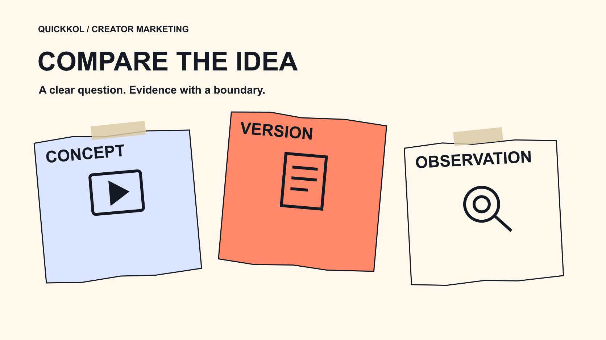
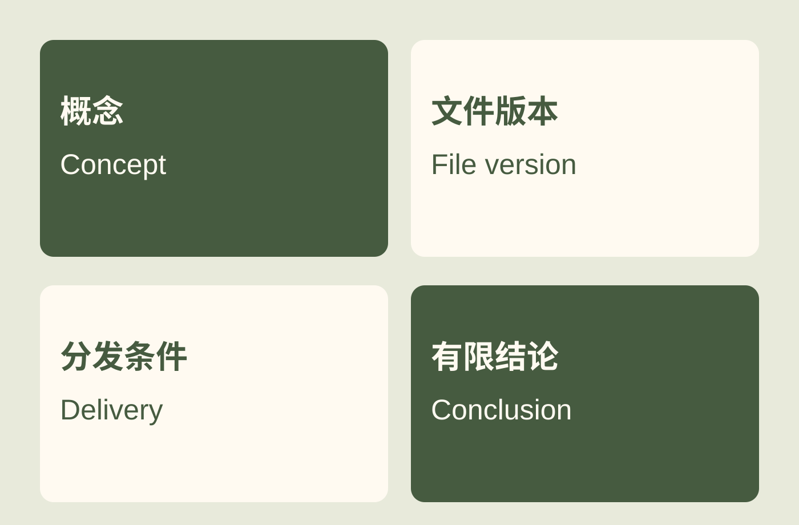

# Meta Andromeda: Compare Creator Concepts

Status: local review draft; confirm the publication date before release.

Separate Andromeda engineering from creator commissioning, then compare concepts, versions and delivery against an answerable question.

QuickKOL editorial graphic; not actual account metrics or a platform interface.

Meta Andromeda is an ad-retrieval system, not a checklist prescribing how many creator videos a brand must purchase. Define the viewer question, conceptual difference and evidence before commissioning versions or arranging distribution. The method here is editorial guidance. Aggregate system improvements do not forecast an individual partnership’s return, and collecting more files does not automatically create a more informative test. A useful comparison explains what the team wants to learn, what changes between treatments and what evidence would justify the next commission.

## Keep the engineering claim within its scope

[Meta’s 2026 retrieval explanation](https://engineering.fb.com/2026/10/28/ml-applications/meta-andromeda-next-gen-ads-retrieval-gpu-co-design/), published October 28, discusses model, system and GPU co-design. Retrieval precedes a later ranking stage. It does not prescribe a brand’s creator count, video quota or mandatory opening line.

[Meta’s 2024 Andromeda explanation](https://engineering.fb.com/2024/12/02/production-engineering/meta-andromeda-advantage-automation-next-gen-personalized-ads-retrieval-engine/) supplies the earlier engineering context. These disclosures concern different stages of system development. Neither turns a reported aggregate improvement into a promised return that belongs in an individual creator quotation.

The earlier [Andromeda mechanism guide](https://www.quickkol.com/blog/meta-andromeda-creator-creative-interpretation/#answer) addresses what the system does. The commissioning question here is different: how can the next set of ideas produce an interpretable contrast? Keep official statements, production hypotheses and actual campaign observations in separate parts of the brief. A hypothesis can guide work without becoming a platform requirement.

If a supplier says a fixed purchase quantity is mandatory, ask for the current supporting document, applicable product and conditions. Without that evidence, record the quantity as the supplier’s proposed package. Evaluate whether the package meets the task, but do not treat its commercial structure as proof of an algorithmic rule. The distinction keeps the brand’s production judgment attached to its own question rather than to an unexplained system slogan.

## Give each concept a viewer question

Write what the viewer needs to decide before listing style labels. A portable-device campaign might explain a task away from a desk. A business-software partnership might help one professional role understand when a workflow is appropriate. Increase awareness is too broad to determine what the creator should explain.

Then describe the creator’s contribution in one sentence: demonstrate the task, compare situations or explain a limitation through relevant experience. The contribution should remain intelligible without filters, music or an animated opening.

For example, compare a step-by-step demonstration with an explanation that establishes the decision context before showing the same operation. The question stays stable while the explanatory route changes. If product, creator, principal claim and usage all change together, the later difference becomes difficult to interpret.

Name what should remain consistent: product version, factual basis, principal next step and permitted usage. This does not eliminate creative freedom. It shows the creator which choices are expressive and which need a common foundation. The result is a commission someone can produce and review without guessing the underlying question or discovering new conditions after filming has already finished.

## Distinguish concepts from file versions

Changing background, subtitle colour or crop can solve a placement problem without introducing a new idea. Record both the concept name and the purpose of each exported version. An export count is a production inventory, not a concept count.

A vertical and square export of the same demonstration are two files. They may still express one concept. Reorganizing the story so viewers first encounter an obstacle and then the action that addresses it can change the explanation itself and require renewed review.

A comparison need not be restricted to a single pixel-level change. A team can deliberately compare complete concepts. Its conclusion should then concern the overall treatment, rather than claim the opening sentence alone caused the observed difference. More precise questions require designs capable of supporting that precision.

Ask the producer to attach a brief change note to meaningful revisions: what changed, why and whether factual support or permission is affected. This is particularly useful when several people revise a cut. Individually reasonable edits should not quietly transform the original comparison into another assignment, leaving the team unable to connect the first approved concept with the version actually distributed.

Identify the layer that changes before deciding what the observation supports.

## Check credibility before distribution

Do not use an unsupported claim as the difference that makes one concept appear bolder. Have the appropriate owner check product performance, conditions of use and personal experience. A creator can describe an actual observation; the brand should not request an experience the creator never had.

Give both concepts an equally clear factual foundation and let the creator identify language that does not suit their work. If a concept only functions through an unreasonable promise, revise it before distribution. A later performance result should not decide whether an inaccurate claim becomes acceptable.

Check whether viewers can identify the product, understand the demonstrated action and recognize the next step. Removing a necessary condition may change the apparent meaning. Retain limitations that affect the decision rather than treating every qualification as editing friction.

This concerns content credibility, not a forecast of commercial effectiveness. Supportable work can still miss the campaign objective. Its value is that the team can use it responsibly in a comparison. Record corrections and save the approved version, so the person arranging distribution does not accidentally receive an earlier cut whose factual problem has already been identified.

## Confirm usage conditions separately

Content approval does not establish agreement to advertising use. Specify organic creator publication, use on a brand account or a partnership-ad arrangement. Record relevant media, territory, duration, editing and identity conditions separately.

The [creator-ad placement preflight](https://www.quickkol.com/blog/instagram-ads-creator-placement-preflight/#answer) helps identify the finished asset’s actual destination. A technical article discussing Facebook and Instagram does not establish permission for every platform or subsequent edit.

Connect usage conditions to the version inventory. If concept A is licensed for the brand account while B is approved only for creator publication, do not silently place both into the same advertising comparison. Obtain the relevant agreement or narrow the question to something the available material can support.

Separate production, publication and usage in the commercial discussion. Additional versions outside the agreed scope require an explanation of work and timing before confirmation. A statement that the system needs more assets is not an instruction for unlimited revisions. Clear conditions protect the working relationship and make a later comparison easier to reconstruct, without assuming every file in a shared folder carries identical rights or that creative approval authorizes any future commercial use.

## Retain the actual observation conditions

Before distribution, record concept, actual file, objective, period, delivery settings and principal evaluation measure. Label organic publication, paid distribution and mixed exposure accurately. Two outcome numbers without their sources lose information needed for interpretation.

[Meta’s ad-insight reference](https://developers.facebook.com/docs/graph-api/reference/adaccount/insights) notes that some metrics are estimated or in development. Preserve the actual label and reporting source. Do not automatically describe every interface number as an exact count of people, or dismiss every observation because some measures have limitations.

If concepts reach different audiences or run at different times, the observations can formulate another question. They do not automatically form a controlled causal comparison. Describe the design before deciding how strongly to state the result.

Agree who interprets the information, who authorizes further production and which conditions require waiting. Limited or missing evidence can reasonably produce no decision yet. It need not be compressed into a winner and loser, especially when a creator’s next commission depends on the recommendation. Retain enough context for another reviewer to see whether the conclusion follows from the design and the available observations, rather than from the team’s preference for a particular treatment.

## Check the interpretation with a hypothetical case

Consider a hypothetical equipment brand commissioning two concepts from the same creator. A demonstrates an operation immediately. B explains when the operation is useful before showing it. Product and destination link stay the same; usage agreements and distribution records remain attached to each treatment. This is an editorial scenario, not a customer result.

Suppose B records more viewing but receives different distribution. The team can say the combination deserves investigation. It cannot conclude that contextual openings are always better, or that inquiries and sales consequently increased.

If both concepts produce the same misunderstanding, improve the product explanation before buying more decorative variants. If the problem is inconsistent destination information, assign the correction to the brand instead of treating every issue as a creator-production failure.

The example makes the conclusion as broad or narrow as the evidence. It provides no platform-approved budget, statistical sample size or preferred version count. Before expanding production, the team should understand what remains unknown and how the next observation would address it. That sequence gives a real purpose to the next commission instead of making additional output the default response to uncertainty.

## Hand over the next defined commission

End the review with the question to continue, facts to retain, expression to change and owner of additional agreement. Keep unverified explanations in an open-question field rather than letting them become unexplained acceptance requirements.

Insufficient evidence can still produce a useful decision: complete distribution records, correct the factual foundation or narrow the next comparison. A project can learn without declaring a creative winner.

QuickKOL can help interpret a brief, research relevant creators and prepare personalized outreach. The appropriate sources and partners must still confirm advertising settings, measurement and usage. A discovery tool should not be presented as an experiment system that has already verified creative effectiveness.

The next producer or media owner should understand the question without guessing from similar filenames. Andromeda provides context for asking better questions; the brand remains responsible for explaining the commission and the evidence that would justify the next step. Preserve the record with the approved assets so the decision remains understandable after the original reviewers move on to another campaign. That is a more usable outcome than a large folder accompanied only by an instruction to satisfy the algorithm.

## Scope of a creative comparison

| Change | Retain | Interpretation |
| --- | --- | --- |
| Concept | Common question | Overall treatment |
| Dimensions | File and placement | Adaptation |
| Facts | Evidence and review | Correct foundation first |
| Delivery | Objective and window | Retain confounding factors |

Editorial method, not a Meta quota.

## Confirm the comparison

Give production and delivery the same question.

- [ ] Define the viewer decision.
- [ ] Separate concepts from file versions.
- [ ] Check the common factual foundation.
- [ ] Confirm usage and publication separately.
- [ ] Retain actual observation conditions.
- [ ] Assign an owner for the next step.

## Research date and limitations

Sources reviewed November 20, 2026. Methods, tables and decision rules are editorial recommendations. Hypothetical examples are not actual client results or industry benchmarks. Source geography and periods are specified where relevant.

## Start creator research with a clear task

Use QuickKOL to interpret a brief, discover relevant creators and research their work and contact routes. Verify data, commercial terms and outcomes at their source.

[Explore QuickKOL](https://www.quickkol.com/#capabilities)

## Sources

- [Meta’s 2026 retrieval explanation](https://engineering.fb.com/2026/10/28/ml-applications/meta-andromeda-next-gen-ads-retrieval-gpu-co-design/)
- [Meta’s 2024 Andromeda explanation](https://engineering.fb.com/2024/12/02/production-engineering/meta-andromeda-advantage-automation-next-gen-personalized-ads-retrieval-engine/)
- [Meta’s ad-insight reference](https://developers.facebook.com/docs/graph-api/reference/adaccount/insights)
