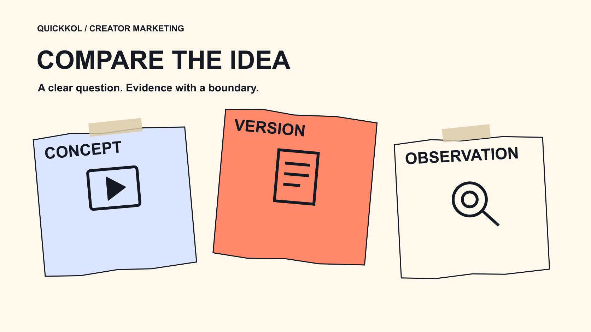
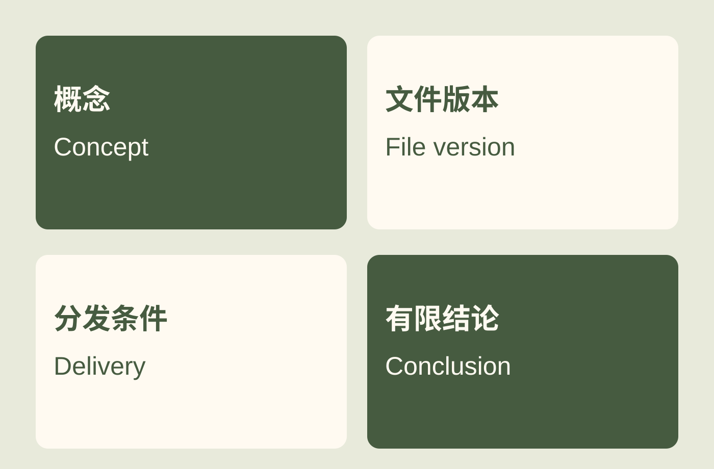

# Andromeda 怎样比较达人创意

状态：本地审阅稿；正式发布日期待确认。

把 Andromeda 技术说明与达人创意委托分开，用可回答的问题比较概念、版本与分发条件。

QuickKOL 编辑图形；不呈现真实账号指标或平台界面。

Meta Andromeda 是广告检索系统，不是规定品牌必须采购多少达人视频的制作清单。比较创意时，先定义观众问题、概念差异和证据，再安排文件版本与分发。本文提供编辑方法，不把系统整体改进变成单个合作的回报预测，也不把更多文件自动等同于更有价值的测试。

## 技术事实保持原有范围

[Meta 2026 检索技术说明](https://engineering.fb.com/2026/10/28/ml-applications/meta-andromeda-next-gen-ads-retrieval-gpu-co-design/)发表于 2026 年 10 月 28 日，讨论模型、系统与 GPU 的协同设计。检索位于推荐流程前段，后面还有排序。资料没有为单个品牌规定达人数量、视频配额或固定开场。

[Meta 2024 Andromeda 说明](https://engineering.fb.com/2024/12/02/production-engineering/meta-andromeda-advantage-automation-next-gen-personalized-ads-retrieval-engine/)提供较早的技术背景。两份披露属于不同阶段，不应把任何系统整体改进直接写进本次达人报价单，承诺相同比例的收益。

上一篇 [Andromeda 机制解读](https://www.quickkol.com/zh/blog/meta-andromeda-creator-creative-interpretation/#answer)解释系统做什么。本篇处理不同的问题：怎样让下一批创意产生可解释的差异。团队应分开记录官方事实、制作假设和活动观察。

若供应商声称固定采购数量属于平台要求，请其说明当前依据、产品和条件。没有对应文件时，将其视为供应商方案，按实际工作价值评估，不让平台名字取代制作判断。

## 给概念一个观众问题

先写观众需要判断什么，再列风格。便携设备可以解释外出时如何完成某项操作，B2B 工具可以说明哪种业务条件适合某个工作流。“提高认知”还不足以指导达人拍摄。

再描述达人的贡献：亲自演示、比较场景，或用经验解释限制。这项贡献在去掉滤镜、音乐和片头后仍应成立。

例如，比较按步骤演示和先建立决策情境再演示。两者回答同一问题，却提供不同理解路径。如果同时更换产品、达人、主张和用途，后来的结果就很难解释。

写明保持一致的内容，包括商品版本、事实依据、主要行动和用途。这样创作者知道表达空间在哪里，哪些条件需要同一基础，而不是在反复审稿时才发现任务已经改变。

## 分清概念与文件版本

换背景、字幕颜色或裁切可能解决版位适配，却未必创造新信息。每个文件同时记录概念名称与版本用途，不把导出数量当成概念数量。

同一演示的竖版和方版是两个文件，可能仍是一个概念。若重新安排产品出现的理由，让观众先看障碍再看解决动作，则改变了解释逻辑，需要重新审稿。

比较也不必只允许一个像素变化。可以比较两个完整概念，但结论应属于整体表达组合，不能声称仅开场句造成差异。问题越精细，设计越需要支持相应精度。

制作人应说明每次实质修改改了什么、为什么改，以及是否影响事实与许可。这样多人修改不会悄悄把原有比较变成另一个任务，原版与最终投放版也能对应起来。

先说明改变在哪一层，再决定观察能支持什么。

## 先判断内容是否可信

不要把无依据的宣称当成大胆创意。产品表现、使用条件和个人体验由相应负责人先核对。达人可以表达实际观察，不能被要求陈述未经历的效果。

给两个概念同样清楚的事实底稿，让创作者指出不适合自身作品的表达。如果某概念只有依靠不合理承诺才能成立，先修改，而不是用后来表现决定是否接受。

还要判断观众能否识别产品、看懂操作与下一步。删掉必要前提可能改变演示含义；影响选择的限制应该保留，不能一概当作节奏障碍。

这是质量判断，不是效果预测。可信内容仍可能没有达到目标；它提供的是可以负责任使用的比较基础。修正后保存实际批准版本，避免投放人员拿到更早、仍含错误的成片。

## 用途条件独立确认

内容通过不等于广告用途也已同意。区分达人自然发布、品牌账号使用与合作广告，分别记录媒体、地区、时长、编辑和身份展示条件。

[达人广告版位检查方法](https://www.quickkol.com/zh/blog/instagram-ads-creator-placement-preflight/#answer)帮助判断成片进入哪个位置。技术资料同时提到 Facebook 与 Instagram，不代表素材已经取得所有平台、所有改剪的许可。

将许可与版本表连接。如果概念 A 获准用于品牌账号、B 仅限达人自然发布，就不能悄悄放进同一种广告比较。先取得同意，或缩小问题。

费用也分开制作、发布与用途。未约定的追加版本先说明工作和时间再确认，不能将“系统需要更多素材”当成无限返工理由。商业条件越清楚，后来的结果越容易放回真实合作背景。

## 保留真实观察条件

开始前记录概念、实际文件、目标、时期、分发设置和主要评价口径。自然、付费与混合分发如实标注，不只比较没有来源的结果数。

[Meta 广告指标说明](https://developers.facebook.com/docs/graph-api/reference/adaccount/insights)提醒部分指标属于估计或开发中口径。保留标签和报告来源，不把每个数字都当成精确人数，也不因此否定所有观察。

若两个概念到达不同人群或在不同时期发布，结果可以提出新问题，却不自动构成控制良好的因果比较。报告先说明设计，再决定结论力度。

预先约定谁解释数据、谁决定追加制作，以及何时等待。资料少或缺失时可以暂不判断，不必压成输赢，尤其不要让尚未成立的结论直接决定对某位达人的评价。

## 用假设场景检验解释

假设一家专业设备品牌让同一达人制作两种概念。A 直接展示操作，B 先解释什么时候值得做。商品与链接相同，另保留各自用途和分发记录。这是编辑假设，不是真实客户结果。

若 B 观看更高，但分发与 A 不一致，只能说这个组合值得进一步研究，不能断言情境开场一定更好，更不能直接推断咨询或销售增加。

如果两者都引起同一种误解，先修正产品解释。若问题在目的地信息不一致，由品牌改目的地，不把所有问题归给达人，也不继续购买无关装饰变体。

案例让结论与证据保持同样宽窄，不提供平台认可的预算、样本量或版本数。团队应先知道缺少什么、下一步怎样补，才决定是否扩大制作。

## 交付下一轮明确任务

复盘最后写明继续哪个问题、保留哪些事实、改变哪些表达，以及谁取得额外同意。未验证的解释放在问题栏，不混进验收要求。

依据不足时也能交付有价值的决定：补分发记录、改事实底稿，或缩小下轮比较。没有宣布胜者并不等于没有学习。

QuickKOL 可以帮助理解 Brief、研究相关达人和准备个性化联系；广告设置、测量与用途仍需在相应来源和合作方核对。发现工具不是已经验证创意效果的实验系统。

下一位制作或投放负责人应能看懂正在回答什么，而不用从相似文件名中猜测。技术背景帮助提出问题，品牌仍应自己说清委托、证据与决定。

## 创意差异的解释范围

| 改变 | 保留 | 解释 |
| --- | --- | --- |
| 概念 | 同一问题 | 整体表达组合 |
| 尺寸 | 文件与版位 | 适配表现 |
| 事实 | 依据与审稿 | 先修正基础 |
| 分发 | 目标与窗口 | 保留混杂因素 |

编辑方法，不是 Meta 配额。

## 确认比较任务

让制作与投放使用同一问题。

- [ ] 明确观众需要判断什么。
- [ ] 区分概念与文件版本。
- [ ] 核对共同事实基础。
- [ ] 单独确认用途与发布。
- [ ] 保留实际观察条件。
- [ ] 给下一步指定负责人。

## 研究日期与使用边界

资料核验于 2026 年 11 月 20 日。文中方法、表格和决策规则为编辑建议，标为假设的示例不是实际客户结果或行业基准。外部资料的适用地区与时期按各段说明。

## 从任务开始达人研究

用 QuickKOL 理解 Brief、发现相关达人并研究作品与联系路径；数据、合作条件和结果仍需核验。

[了解 QuickKOL](https://www.quickkol.com/#capabilities)

## 来源

- [Meta 2026 检索技术说明](https://engineering.fb.com/2026/10/28/ml-applications/meta-andromeda-next-gen-ads-retrieval-gpu-co-design/)
- [Meta 2024 Andromeda 说明](https://engineering.fb.com/2024/12/02/production-engineering/meta-andromeda-advantage-automation-next-gen-personalized-ads-retrieval-engine/)
- [Meta 广告指标说明](https://developers.facebook.com/docs/graph-api/reference/adaccount/insights)
