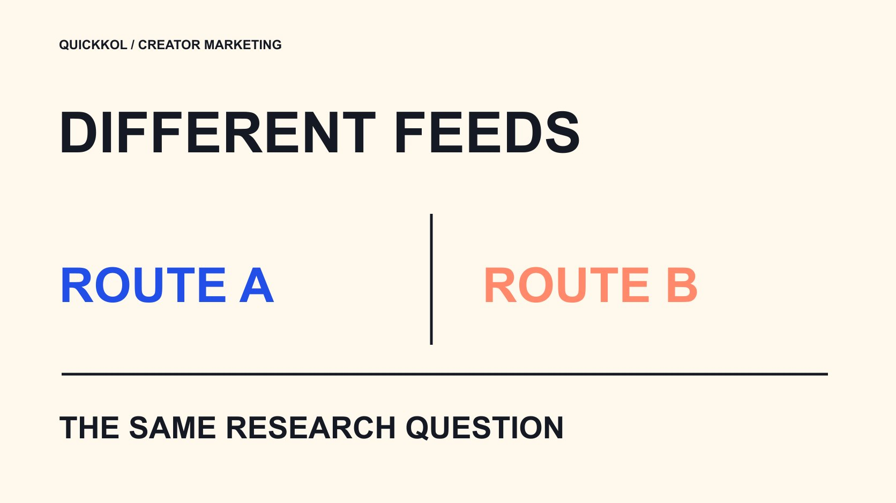
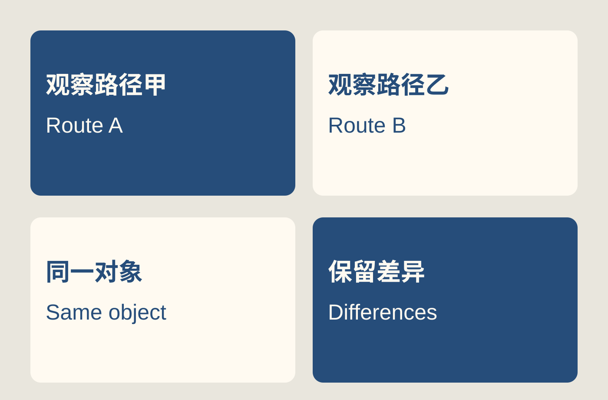

# Newsfeeds: Compare Creator Observations Carefully

Status: local review draft; confirm the publication date before release.

When researchers encounter different creators, compare feed conditions, samples and original work before deciding that someone missed the market.

QuickKOL editorial graphic; not actual account metrics or a platform interface.

Newsfeeds are selected and ordered streams of content, not a complete creator-market register. When colleagues encounter different work, compare platform, feed, account context, time and selection conditions before comparing the same objects. Differences may reflect the observation setup or reveal useful new leads. Keep that uncertainty. Frequent appearances in one personal feed do not establish industry representativeness or partnership priority. A responsible comparison makes the observation process visible enough for another person to understand why the lists differ and what decision the evidence can actually support.

## Turn disagreement into an observation question

A team may say everyone in this field is discussing one person, while another colleague has never encountered them. Do not immediately explain that difference as poor research or a market change.

Write the original question: finding creators who can explain a tool, for example, or observing public questions prompted by a brand message. A feed is one discovery route. It should not quietly become the only research population.

The [creator-newsfeed brief method](https://www.quickkol.com/blog/creator-newsfeed-editorial-evidence-selection/#answer) concerns turning an incidental discovery into a content requirement. This article concerns comparison between observers, so the team can explain why different inputs produced different lists.

Define the purpose: checking omissions, expanding sources or examining a trend claim. If the objective is merely to make everyone’s screens look the same, the exercise may consume time without improving a creator decision. Preserving differences can reveal blind spots.

The comparison record should therefore begin with the task and the proposed use of the result. That prevents a discussion about personal browsing habits from becoming an unbounded audit or a reason to reject relevant work simply because it did not appear in the first researcher’s feed.

## Record the type of feed first

[Bluesky’s custom-feed explanation](https://bsky.social/about/blog/7-27-2023-custom-feeds) describes user choice and third-party feeds. [Meta’s ranking transparency explanation](https://about.fb.com/news/2023/06/how-ai-ranks-content-on-facebook-and-instagram/) describes multiple surfaces and predictions. They support a limited conclusion: different streams need not supply identical content. They do not reveal every current ranking weight.

Record the actual feed name and entry point, not just the platform. Following, recommended, topic and search views can have different composition. Appearing within one application does not make them one sample.

If a feed has a public inclusion explanation, preserve it. Otherwise mark the rule unknown. Do not reverse-engineer a complete algorithm from a few observations and present the guess as platform fact.

Keep this context proportionate. The team needs conditions that affect the sample, not a researcher’s private browsing history.

A useful note identifies whether the person was reviewing a selected topic feed or encountering general recommendations, along with any relevant visible setting. That is enough to prevent a basic mismatch from being mistaken for a disagreement about creator quality. It also helps another colleague choose a supplementary route without trying to reproduce every detail of someone else’s personalized experience.

## Interface changes can alter the comparison

[Reddit’s 2026 feed update](https://support.reddithelp.com/hc/en-us/articles/55472297340308-Changelog-November-10-2026), dated November 10, describes the rollout of For You and Following, an October 27 start and some entry-point experiments. Describe the announcement and actual interface rather than assuming every device changed identically on one day.

An older screenshot may therefore concern a different page structure. If the team uses home as a sampling definition, add the actual feed, client and observation time instead of retaining only an ambiguous label.

An interface change does not require abandoning the research. Keep earlier observations within their period and record new ones under their current conditions. Explain which parts of a cross-period comparison may be affected rather than attributing list differences directly to creator performance.

If the earlier setup cannot be reconstructed, verified original work may still be useful. Narrow conclusions about trends and coverage. Unknown interface conditions should not be filled with a guess.

The practical consequence is a change in how strongly the team describes its comparison. It can still discuss the works it has reviewed, while avoiding a broader claim that the same observation process measured the same population before and after the interface change.

## Align objects before aligning counts

One researcher may record the original author while another records the republishing account. One may record a channel while the other records a particular piece of work. Establish the object before deciding that an omission exists.

For each observation retain original URL, author or publisher, time and discovery route. Connect reposts with originals without assuming the republisher owns commercial permission or represents the author.

Distinguish repeated encounters with the same work from several relevant works by the same creator. The former describes repetition in the stream. The latter may justify investigating a continuing contribution. Neither should automatically become a common exposure conclusion.

If counting the sample, define the deduplication unit first. Deduplicating by work, account or person produces different counts. Do not choose whichever unit later makes the trend claim look strongest.

Keeping the object definition makes the result more useful than a detached total. Another researcher can inspect why a record was included, identify a genuine missing original and preserve multiple relevant works without accidentally inflating the number of independent creators or treating a repost network as several separate sources of expertise.

Align the observed object without requiring identical feeds.

## Design a small comparison someone can review

Give two colleagues the same question, a defined observation period and shared recording fields while allowing their actual feeds to differ. The purpose is not to erase differences but to make them interpretable.

Imagine both seeking creators who explain outdoor-equipment care. One encounters work through a Following feed and the other through a topic feed. Retain each route and original, then compare whether the work answers the task. Do not simply compare who supplied the longer list.

Add another independent route, such as the creator’s own work catalogue or public business website. This checks blind spots; it does not guarantee a complete market register.

The hypothetical example supplies no optimal sample size or viewing duration. Set the scope according to the decision and resources, with a stopping condition. Avoid scrolling indefinitely until the preferred claim finally acquires a convenient example.

A bounded comparison can still be useful when the lists overlap only partly. It can reveal complementary sources or an unclear role definition. Those findings may improve the brief more directly than forcing the observations into an artificial agreement that hides the limitations of each discovery route.

## Use disagreement to improve the creator requirement

If the lists differ substantially, inspect whether the requirement is too broad. Knows technology could mean product experience, software instruction, news commentary or specialist research. The researchers may be applying different meanings.

Attach a specific contribution and reason to each candidate. Comparing reasons may reveal that nobody searched incorrectly: the brand may need two roles, or a narrower practical question.

Not appearing in my feed is not negative evidence about a creator. Nor does recognition by several colleagues establish audience fit. Shared exposure may result from similar feeds and following networks.

Resolve the role difference before shortlisting. This can reduce irrelevant outreach and give creators clearer invitations, because one broad topic no longer asks them to perform every communication function.

The comparison should therefore produce a revised requirement where appropriate, not only a combined list. Keep the reason for the revision with the brief. A later researcher can then distinguish an intentional expansion of roles from inconsistent searching, and the purchasing team can evaluate the actual contribution needed rather than treating feed visibility as the qualification for a commercial assignment.

## Retain what cannot be compared

A report can separate common discoveries, unique discoveries and unchecked material. It need not compress every observation into one agreed ranking. State the route and sample supporting each conclusion.

If original work or timing is missing, label the record incomplete rather than treating it as evidence that relevant content does not exist. When scopes differ, explain which trend question the comparison cannot answer.

Do not expand sentiment or questions within a feed sample into the opinion of an entire population. The material can suggest further research or a creative question. It does not automatically provide brand health, market share or audience demographics.

For colleagues citing the result, supply enough context that an extracted conclusion still identifies object, period and limitation. Professional value comes from that reviewable boundary, not stronger wording about a small sample.

A short statement such as these routes surfaced different examples for the defined task may be more accurate and useful than the market has shifted. It leaves room for further evidence while still communicating what the exercise changed in the team’s creator research and why the next action is justified.

## Turn the comparison into the next research step

Finish by deciding which source to add, which role requirement to revise, which candidates to contact and which material cannot yet be used. Give each action an owner rather than handing over only a diagram of differences.

The [Bluesky feed-discovery method](https://www.quickkol.com/blog/blue-sky-social-media-kol-discovery-feed/#answer) can extend platform-specific sourcing. For another channel, return to its original work and actual capability instead of moving one feed’s assumptions across platforms.

QuickKOL helps interpret a brief, discover relevant creators and prepare personalized contact. Platform context, creative contribution and audience evidence still require checking. A comparison of lists should not become a claim that a tool has completely mapped the market.

Good research collaboration allows colleagues to encounter different work while sharing a method for explaining those differences. The result is a clearer question and a stronger basis for candidate selection, not a uniform page pretending everyone sees the same world. Preserve the decision and its supporting observation record so the next research session can build on it without having to repeat the original argument about whose feed was right.

## Fields for comparing feed observations

| Field | Record | Avoid inferring |
| --- | --- | --- |
| Entry | Feed and client | Same platform means same sample |
| Time | Window and update context | All differences are performance |
| Object | Work, account or person | Repost means another expert |
| Selection | Question and deduplication unit | Visible means complete market |

Editorial observation framework; hypothetical examples are not representative market research.

## Complete the sample comparison

Retain differences and a proportionate next step.

- [ ] Define the original creator question.
- [ ] Record the actual feed and period.
- [ ] Anchor observations to original work.
- [ ] Explain duplicates and missing records.
- [ ] Separate sample and market conclusions.
- [ ] Assign findings to specific owners.

## Research date and limitations

Sources reviewed November 20, 2026. Methods, tables and decision rules are editorial recommendations. Hypothetical examples are not actual client results or industry benchmarks. Source geography and periods are specified where relevant.

## Start creator research with a clear task

Use QuickKOL to interpret a brief, discover relevant creators and research their work and contact routes. Verify data, commercial terms and outcomes at their source.

[Explore QuickKOL](https://www.quickkol.com/#capabilities)

## Sources

- [Bluesky’s custom-feed explanation](https://bsky.social/about/blog/7-27-2023-custom-feeds)
- [Meta’s ranking transparency explanation](https://about.fb.com/news/2023/06/how-ai-ranks-content-on-facebook-and-instagram/)
- [Reddit’s 2026 feed update](https://support.reddithelp.com/hc/en-us/articles/55472297340308-Changelog-November-10-2026)
