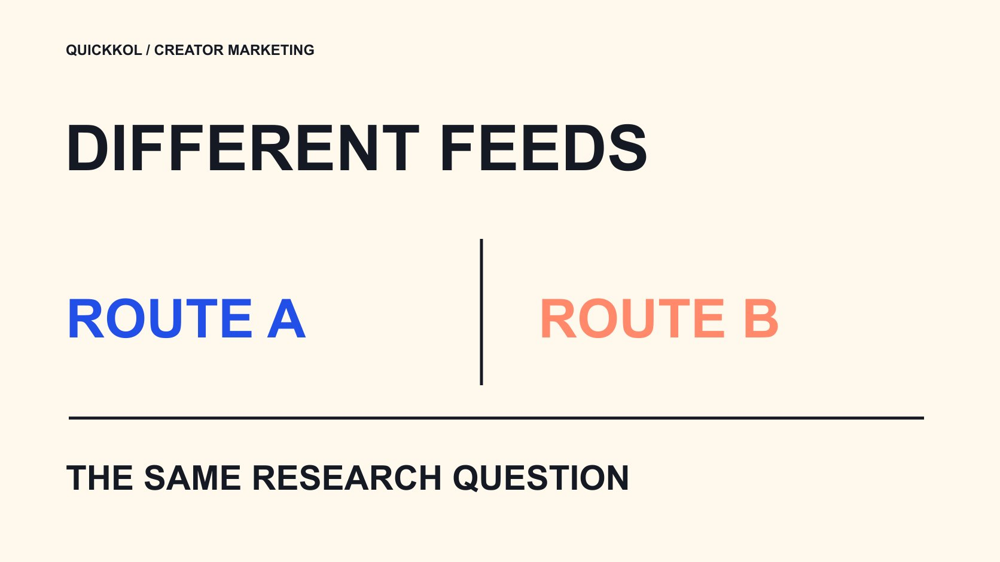
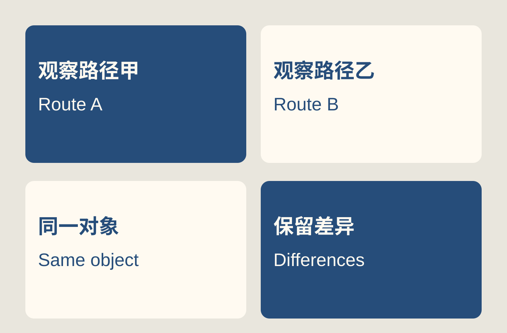

# 不同信息流怎样比较达人样本

状态：本地审阅稿；正式发布日期待确认。

两位研究者看到不同达人，不必急着判断谁遗漏。先比较信息流条件、样本与原作，再决定 Brief 是否需要调整。

QuickKOL 编辑图形；不呈现真实账号指标或平台界面。

Newsfeeds 是经过选择与排序的内容流，不是完整的达人市场清单。两位同事看到不同内容时，应先核对平台、入口、账号背景、时间与筛选条件，再比较相同对象。差异可能来自观察条件，也可能提示新的作品线索。品牌需要保留这种不确定性，不把个人信息流中的高频出现直接写成行业代表性或合作优先级。

## 把争论改成观察问题

团队常会说“这个领域大家都在讨论某个人”，但另一个同事可能完全没有见过。先不要把这种差异解释成能力不足或市场变化。

写下原来需要回答的问题，例如寻找能解释某项工具的创作者，或观察品牌信息引起哪些公开问题。信息流只是发现方式之一，不应该悄悄变成唯一研究对象。

[信息流 Brief 取材方法](https://www.quickkol.com/zh/blog/creator-newsfeed-editorial-evidence-selection/#answer)处理从偶然发现到内容需求的转化。本篇关注多个观察者之间怎样比较，让团队能解释不同输入为什么产生不同名单。

先明确比较目的：是检查遗漏、拓展来源，还是验证某条趋势说法？如果目的只是让所有人的页面看起来一样，可能浪费时间而没有改善达人判断。保留差异本身，有时反而能帮助识别研究盲点。

## 先记录信息流的类型

[Bluesky 自定义信息流说明](https://bsky.social/about/blog/7-27-2023-custom-feeds)介绍用户选择与第三方信息流。[Meta 排序透明度说明](https://about.fb.com/news/2023/06/how-ai-ranks-content-on-facebook-and-instagram/)则描述多种入口与预测。这些资料支持一个有限结论：不同流不必给出同样内容，不提供今天所有排序权重。

记录实际看到的流名称与入口，不只写平台。关注流、推荐流、主题流和搜索结果可能有不同组成，不能因为都在同一个应用里就当成同一份样本。

如果某流有公开的纳入规则，保留相关说明；没有，就标明未知。不要从观察到的少量内容反向猜一个完整算法，并将猜测当作平台事实。

这类背景应够用而不过度。团队需要知道哪些条件会影响样本，不需要收集研究员私人浏览历史来解释每一项差异。

## 界面更新也会改变比较

[Reddit 2026 信息流更新](https://support.reddithelp.com/hc/en-us/articles/55472297340308-Changelog-November-10-2026)在 11 月 10 日说明 For You 与 Following 的推广，并记录自 10 月 27 日开始的安排及部分入口实验。应按公告和实际界面描述，不假设所有设备在同一天一致。

这意味着旧截图可能属于不同页面结构。若团队将“首页”作为固定样本定义，应补上实际流、客户端与观察时间，而不是只保留一个模糊标签。

不必因界面变化放弃研究。把旧观察保留在原时期，新的观察按新条件记录。跨时期比较时说明变化可能影响哪些部分，不直接把名单差异归给达人表现。

如果无法还原旧条件，可以继续使用其中可核对的原作，但缩小对趋势和覆盖的结论。未知的界面状态不应该通过猜测被填成确定值。

## 先对齐对象，再对齐计数

一位研究者可能记录原作者，另一位记录转发账号；也可能一方记录频道，另一方记录单篇作品。先确定对象，才知道是否真的遗漏。

为每条观察保留原作链接、作者或发布者、时间和发现路径。将转载与原作连接，但不假设转发者拥有原作品的商业许可或代表关系。

重复出现也应区分同一作品多次被看到与同一创作者有多份相关作品。前者说明流里的重复，后者可能支持对持续贡献的进一步研究，两者不应合并成一个曝光结论。

若需要统计样本，先定义去重单位。按作品、账号或人去重会得到不同数量；不能事后选择最有利于趋势说法的单位。记录口径，比一个脱离对象的总数更重要。

先对齐观察对象，不要求信息流显示完全一致。

## 设计一次可复查的小比较

可以给两位同事同一个问题、明确的观察期和记录字段，同时允许实际流不同。目标不是消除差异，而是把差异放在可解释条件下。

假设双方都寻找能讲解户外设备维护的达人。一人从关注流找作品，另一人从主题流找作品。记录各自路径和原作，再比较作品是否回答任务，而不是直接比较谁交的名单更长。

再补一种独立路径，例如创作者自己的作品目录或公开业务网站。补充路径用于检验盲点，不保证形成完整市场清单。

这个编辑示例没有规定最佳样本量或观察时长。团队应根据决定的风险和资源确定范围，保留结束条件，避免为了证明某种观点一直滚动直到找到想要的例子。

## 用分歧改善达人要求

如果两个名单差异很大，检查任务定义是否过宽。例如“懂科技”可能包含产品体验、软件培训、新闻评论和专业研究，研究者也许各自采用了不同含义。

让每条候选附上具体贡献与理由。比较理由时，团队可能发现并非谁找错了，而是品牌真正需要两个不同角色，或需要缩小到某个实际问题。

不要把“未在我的流里出现”作为否定证据。也不要因为多个人都看见某个账号，就认定其受众符合品牌。共同曝光可能来自相同流与关注网络。

在候选筛选前先解决角色差异，能够减少无关外联。达人收到的邀请也更清楚，因为品牌不再用一个模糊主题要求对方承担所有沟通任务。

## 结果中保留不可比较部分

报告可以分开写共同发现、各自独有发现与未核对部分，不必把所有观察压成一个一致排名。每个结论说明依赖什么路径与样本。

如果缺少原作或时间，标记资料不完整；不能当成没有相关内容。若比较范围本来不同，也可以解释无法回答哪种趋势问题。

不把信息流样本中的情绪或问题扩展为整个人群意见。它可以提示后续调查或创作问题，但不自动提供品牌健康、市场份额或受众人口统计。

对需要引用研究结果的同事，提供足够背景，让其截取结论后仍知道对象、时期与限制。专业性来自这种可复核边界，不是把小样本写得更肯定。

## 将比较变成下一次研究

最后决定需要补哪种来源、修改哪条角色要求、联系哪些候选，以及哪些资料还不能使用。给每项行动一个负责人，而不是只交一张差异图。

[Bluesky 信息流发现方法](https://www.quickkol.com/zh/blog/blue-sky-social-media-kol-discovery-feed/#answer)可以继续拓展具体平台来源；如果当前任务需要不同渠道，也应回到对应的原作与实际功能核对，不能把一种流的规则直接迁移过去。

QuickKOL 帮助理解 Brief、发现相关达人和准备个性化联系；平台背景、作品贡献和受众依据仍需复核。一次列表比较不能变成工具已经完整覆盖市场的宣传。

好的研究协作允许同事看到不同内容，同时有共同的方法解释差异。团队得到的是更清楚的问题与更可靠的候选依据，而不是一个假装人人都看到同样世界的统一页面。

## 两次信息流观察的对齐字段

| 字段 | 记录 | 避免推断 |
| --- | --- | --- |
| 入口 | 流名称与客户端 | 平台相同即样本相同 |
| 时间 | 观察期与更新背景 | 差异全来自表现 |
| 对象 | 原作、账号或人物 | 转载是独立专家 |
| 选择 | 问题与去重单位 | 可见就是市场全量 |

编辑观察框架；假设案例不是代表性市场研究。

## 完成样本比较

保留差异和适当的下一步。

- [ ] 明确原始达人问题。
- [ ] 记录实际信息流与时期。
- [ ] 以原作固定观察对象。
- [ ] 解释重复与缺失。
- [ ] 区分样本与市场结论。
- [ ] 把发现交给具体负责人。

## 研究日期与使用边界

资料核验于 2026 年 11 月 20 日。文中方法、表格和决策规则为编辑建议，标为假设的示例不是实际客户结果或行业基准。外部资料的适用地区与时期按各段说明。

## 从任务开始达人研究

用 QuickKOL 理解 Brief、发现相关达人并研究作品与联系路径；数据、合作条件和结果仍需核验。

[了解 QuickKOL](https://www.quickkol.com/#capabilities)

## 来源

- [Bluesky 自定义信息流说明](https://bsky.social/about/blog/7-27-2023-custom-feeds)
- [Meta 排序透明度说明](https://about.fb.com/news/2023/06/how-ai-ranks-content-on-facebook-and-instagram/)
- [Reddit 2026 信息流更新](https://support.reddithelp.com/hc/en-us/articles/55472297340308-Changelog-November-10-2026)
