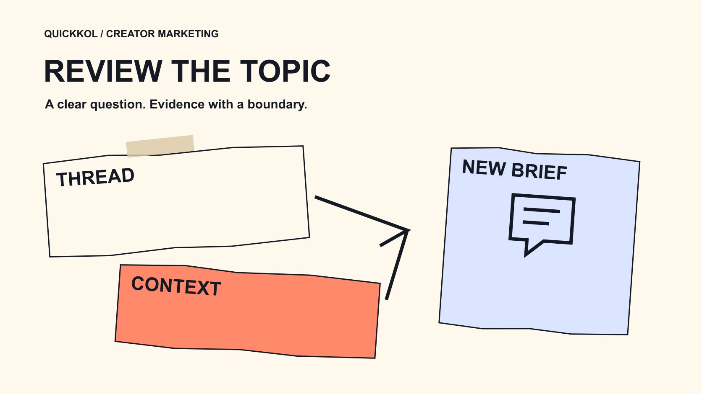
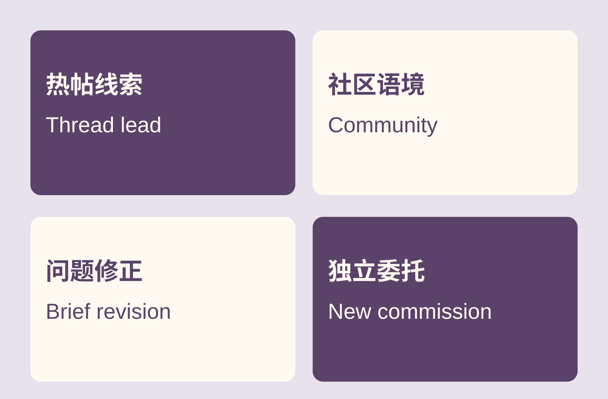

# Front Page Reddit: Challenge a Creator Topic Brief

Status: local review draft; confirm the publication date before release.

Use a Reddit front-page thread to challenge a creator-topic assumption, then inspect community context and original contributions before commissioning independent work.

QuickKOL editorial graphic; not actual account metrics or a platform interface.

A Reddit front-page thread can reveal something a brand’s creator-topic brief overlooks. It does not establish that the whole market cares about the same issue. Record the actual feed and period, then inspect community rules, the original thread and specific contributions. Carry a supported question into a new brief for independent creator work rather than copy the thread, coordinate votes or disguise promotional discussion as ordinary participation. The research improves the question; popularity does not establish a contributor’s commercial suitability or make the discussion a representative audience study.

## Return the thread to its actual feed

[Reddit’s 2026 feed update](https://support.reddithelp.com/hc/en-us/articles/55472297340308-Changelog-November-10-2026) describes the rollout of For You and Following and some experiments with Popular placement. Do not treat everyone’s front page as one identical view or rely only on an outdated screenshot.

Record client, observation period and actual feed name. Recommendations, joined communities and popular entry points may differ. Visibility is a conditioned observation, not proof every user encountered the same thread.

The [Reddit front-page research-scope method](https://www.quickkol.com/blog/reddit-front-page-creator-research-scope/#answer) helps define entry and sample. This article asks a later question: how should the discussion change the topic the brand planned to commission? It is not another platform trending list.

If the lead is only a screenshot, locate the original. An unlocated item can remain a verification lead without becoming a verified trend.

This scope matters because the same thread can play a useful role without carrying a market-wide conclusion. It may expose a missing condition or an unclear product assumption. That limited use is enough to improve a brief, provided the team preserves what it actually reviewed and does not turn personal feed exposure into a claim about universal audience demand.

## Do not treat communities as interchangeable samples

[Reddit’s feed-entry guide](https://support.reddithelp.com/hc/en-us/articles/9124397463572-How-do-I-access-r-all-r-popular-news-latest-or-my-home-feed) notes platform-dependent access. Even after locating a thread, retain community, time and discussion context instead of only its vote count.

Read the community’s own rules and subject. A specialist issue can be relevant in one community and off-topic in another. Platform user is not one uniform identity that removes those differences.

Distinguish the original question, additions in comments and cited material. Participants may have different experiences. One statement should not be rewritten as a community consensus.

Do not infer private occupation, location or contact information from an anonymous account. A reviewable public contribution can support further reading without establishing identity or representative authority.

These distinctions let the brand learn from a discussion while respecting its limits. A useful research note can say which concern appeared, where and why it matters to the proposed creator explanation. It need not decide who every participant really is or convert every reply into a potential commercial contact. The thread is a source of questions and evidence to examine, not a ready-made shortlist.

## Use the discussion to challenge an assumption

Write the assumption in the original brief: viewers care only about speed, perhaps, or everyone already understands an operation. Then inspect whether the discussion adds a missing condition, practical obstacle or different choice.

Do not select only comments supporting the brand. Preserve reasonable counterexamples and distinguish unverifiable personal statements from sourced material. A counterexample can raise another question without overturning the whole plan.

Imagine repeated discussion of setup complexity while the proposed topic emphasizes feature count alone. The next task might examine how a creator can explain setup prerequisites, rather than use an exaggerated title saying everyone hates complex setup.

This is a hypothetical editorial scenario, not a finding from a particular community. The point is to turn the lead into an executable question instead of letting popularity decide all content judgment.

A useful change note identifies the assumption, the observed challenge and the proposed revision. That makes the reasoning reviewable and leaves room for the creator to contribute another interpretation, rather than receiving a copied thread as though it were a finished audience brief or a statement the brand has independently proved.

Turn discussion into a better question, not a qualification based on popularity.

## Return to original evidence before using it

If the discussion cites research, platform rules or product documentation, check the original source, date and scope. High placement does not verify every external fact inside the thread.

For a creator explanation, supply checked material and open questions rather than ask for a rewritten popular reply. Original contribution needs its own understanding, structure and suitable sources.

A briefly encountered screenshot may omit a correction or later clarification. Preserve the original thread relationship and observation state rather than hide subsequent change.

Research and media permission remain separate. Public readability does not automatically permit brand advertising with text, avatars or images. Check actual scope for quotation or use instead of allowing we were researching to authorize every later adaptation.

This makes the thread a responsible starting point. The brand can extract a question and return factual support to its source, while the creator develops new work rather than reproduces another person’s contribution under a different name. Where evidence remains uncertain, retain it as a question rather than use polished editing to make the claim appear settled.

## Keep research from becoming community disruption

[Reddit’s community-disruption rules](https://support.reddithelp.com/hc/en-us/articles/360043066412-Disrupting-Communities) prohibit coordinated voting, enforcement evasion and other interference while emphasizing community-specific rules. A brand partnership should not become organized promotion of a thread or disguised ordinary discussion.

If participation is proposed, understand the rules and transparency appropriate to that community and define the creator’s actual role. A thread inspiring the brief does not establish that commercial posting there is suitable.

Do not treat disagreement with the brand as a target for suppression or reporting. Separate reasonable criticism, inaccurate facts and actual policy violations before using an appropriate route.

The research method can involve no posting at all: read, verify sources, revise the internal brief and commission independent work. Its value does not depend on manufacturing popularity or redirecting the original discussion.

This is a useful boundary for a campaign owner. They can seek a better explanation without asking the creator to perform activities unrelated to the commission or promising a favourable community reception. The resulting work can answer a genuine question elsewhere, retaining its source context without presenting the community as a promotional resource the brand controls.

## Choose a creator for the revised task

The person raising a question may not be suitable for a public demonstration. Research creators whose original work can explain conditions, show an operation or supply relevant professional context, then use an appropriate business route.

If the task changed from introduction to technical comparison, reassess the shortlist. A scale-based list may need more specific work evidence instead of everyone receiving the same revised script.

The [newsfeed sample-comparison method](https://www.quickkol.com/blog/newsfeeds-creator-observation-comparison/#answer) helps explain why different research routes produce different candidates. Appearing in a popular discussion should not establish market representativeness.

In outreach, explain the question and scope of new work. Do not claim the community recommended the person or imply every participant supports the brand. Relevance comes from the creator’s work, not borrowed thread prestige.

This keeps the revised brief connected to actual capability. The brand can seek a person able to answer the now-clearer question without expecting them to speak for anonymous contributors or reproduce the original debate. The creator receives a defined commission rather than an instruction to recreate a viral moment whose conditions the team cannot reproduce or guarantee.

## Review whether the question became clearer

At content review, check whether the work answers the revised task and retains necessary conditions and sources. Do not judge it only by whether it matches the original thread’s popularity.

If understanding needs observation, retain actual questions and an appropriate research scope. Public interaction can indicate remaining issues without representing every viewer’s attitude.

The original thread may evolve and the new work may raise different questions. Keep each period separate rather than force different discussions into one trend or causal chain.

The conclusion may be a more specific topic, an assumption needing research or insufficient evidence. Every discovery need not become the brand has acquired market insight. Bounded learning can still guide the next collaboration.

This review preserves what the research was supposed to do. It challenged a premise and improved the proposed explanation. Whether the resulting work later produces a commercial outcome is a separate question with its own evidence requirements, not something established by a thoughtful thread or by the fact that a creator used it as a starting point.

## Keep a reviewable topic revision

Hand over the original question, thread source, checked material, reason for revision and new assignment. The next owner should distinguish a lead from something confirmed.

QuickKOL can help interpret the revised brief, discover relevant creators and prepare personalized contact. Community context, contribution, usage and results still need checking. It should not be described as guaranteeing front-page placement or completely representing Reddit’s population.

The most useful role of a popular thread may be revealing a question the brand had not asked. Commissioning an appropriate creator to explain it independently can have more continuing value than copying highly rated wording.

The final brief should be more accurate and specific while respecting the original discussion’s boundaries. It does not require pretending the brand owns the community or that one browsing session completed market research.

Keep that distinction with the archive so future teams can reuse the question without inheriting an exaggerated origin story. They can then verify current facts, choose the right role and produce another explanation without treating an old popularity signal as permanent evidence of demand or endorsement.

## Evidence boundaries from thread to brief

| Finding | May do | Does not establish |
| --- | --- | --- |
| Popular question | Inspect a missing premise | Whole-market demand |
| Specialist comment | Trace original support | Identity and availability |
| Community rules | Assess suitable participation | Commercial posting permitted |
| New work | Review revised task | Guaranteed repeat popularity |

Editorial research route; hypothetical examples are not actual community studies.

## Hand over a Reddit topic lead

Retain original context before defining new work.

- [ ] Record actual feed and period.
- [ ] Return to original thread and rules.
- [ ] Identify the challenged assumption.
- [ ] Check important original sources.
- [ ] Avoid coordinated voting or disguised participation.
- [ ] Research creators for the revised task.

## Research date and limitations

Sources reviewed November 20, 2026. Methods, tables and decision rules are editorial recommendations. Hypothetical examples are not actual client results or industry benchmarks. Source geography and periods are specified where relevant.

## Start creator research with a clear task

Use QuickKOL to interpret a brief, discover relevant creators and research their work and contact routes. Verify data, commercial terms and outcomes at their source.

[Explore QuickKOL](https://www.quickkol.com/#capabilities)

## Sources

- [Reddit’s 2026 feed update](https://support.reddithelp.com/hc/en-us/articles/55472297340308-Changelog-November-10-2026)
- [Reddit’s feed-entry guide](https://support.reddithelp.com/hc/en-us/articles/9124397463572-How-do-I-access-r-all-r-popular-news-latest-or-my-home-feed)
- [Reddit’s community-disruption rules](https://support.reddithelp.com/hc/en-us/articles/360043066412-Disrupting-Communities)
