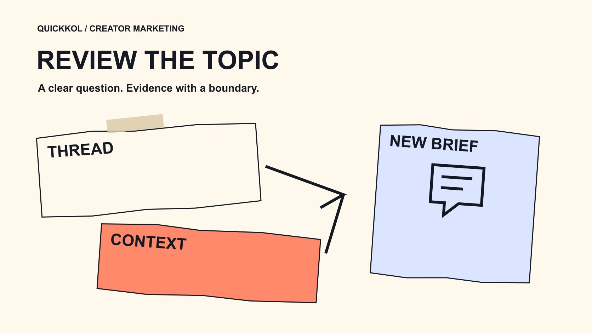
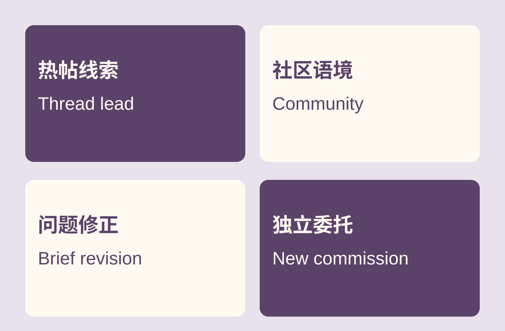

# Reddit 热帖怎样修正达人选题

状态：本地审阅稿；正式发布日期待确认。

把 Reddit 热帖当作检验达人选题的线索，回到社区与原始贡献，修正假设后再委托独立内容。

QuickKOL 编辑图形；不呈现真实账号指标或平台界面。

Reddit 首页热帖可以提醒品牌某个达人选题忽略了什么，但不能直接证明整个市场都关心同一件事。先记录实际信息流与时期，再回到社区规则、原帖和具体贡献。把有依据的问题带入新 Brief，让创作者独立解释，而不是复制帖子、组织投票或伪装成普通用户推动讨论。研究的价值是改进问题，不是借热度替合作资格作答。

## 把热帖放回实际入口

[Reddit 2026 信息流更新](https://support.reddithelp.com/hc/en-us/articles/55472297340308-Changelog-November-10-2026)记录了 For You 与 Following 的推广，以及部分 Popular 入口实验。不能再将所有人看到的“首页”简单当作同一页面，也不应只保留过时截图。

记录客户端、观察期和实际流名称。研究者的推荐、关注社区与热门入口可能不同，热度是带条件的可见观察，不是全体用户同时看到的证明。

[Reddit 首页研究范围方法](https://www.quickkol.com/zh/blog/reddit-front-page-creator-research-scope/#answer)帮助理解入口与样本。本篇继续问：这条讨论会怎样修正品牌原先准备委托的题目，而不是再整理一个平台热帖榜。

如果来源只是一张截图，先找原帖。无法定位时可以保留为待核对线索，不把它写成已经验证的趋势。

## 社区不是可互换的样本

[Reddit 信息流入口说明](https://support.reddithelp.com/hc/en-us/articles/9124397463572-How-do-I-access-r-all-r-popular-news-latest-or-my-home-feed)指出访问方式随平台而异。即使找到同一个帖子，也要保留所属社区、时间与讨论背景，不能只记录点赞数。

阅读社区自己的规则与主题。某个专业问题在一个社区可能是深入讨论，在另一个社区则不相关。品牌需要理解语境，不以“平台用户”作为所有人的统一身份。

区分原帖问题、评论中的补充与引用资料。不同参与者可以有不同经验，不能把其中一句话改写成社区共同结论。

也不要用匿名账号猜测私人职业、地域或联系方式。可核对的公开贡献可以支持进一步阅读，不能自动证明真实身份或商业代表范围。

## 用讨论挑战原来的假设

把原 Brief 中的假设写出来，例如观众只关心速度，或默认某项操作人人熟悉。再看讨论是否提出遗漏的条件、实际使用障碍或不同选择。

不要只挑支持品牌观点的评论。保留合理反例，也区分无法核对的个人说法与有来源的资料。反例可以提出新问题，不一定推翻整个方案。

假设一条讨论反复提到设置复杂，品牌原题却只强调功能数量。下一步可以研究创作者怎样讲清设置前提，而不是复制“大家都讨厌复杂设置”的夸张标题。

这是假设编辑场景，不是某个实际社区的调研发现。关键是让线索改变可执行问题，而不是让热度决定全部内容判断。

把讨论转成更好的问题，不把热度当成合作资格。

## 回到原始证据再使用

若讨论引用研究、平台规则或产品说明，回到相应原始资料核对日期与范围。不要因为帖子排名高，就把里面所有外部事实当成已核验。

如果创作者要解释某个问题，给其已经核对的材料和未解问题，而不是要求照着热门回复重写。原创贡献需要自己的理解、结构与适当来源。

短暂看到的截图可能缺少更正或后续澄清。保存实际原帖关系，并记录观察时的状态，不把后来变化隐去。

研究与素材许可也要分开。公开可读不自动表示可以将文字、头像或图片用于品牌广告。需要引用或使用时，按实际范围核对，不以“我们只是在研究”为后续用途作默认授权。

## 不要将研究变成社区干扰

[Reddit 社区干扰规则](https://support.reddithelp.com/hc/en-us/articles/360043066412-Disrupting-Communities)禁止组织投票、规避执行和其他破坏社区的行为，并强调社区自己的规则。品牌不应把达人合作安排成集体推帖或伪装的普通讨论。

如果计划参与某个社区，先理解适用规则和透明表达要求，明确创作者实际角色。不能因为某条热帖提供了灵感，就默认在那里发布商业内容合适。

也不要将不同意品牌的观点当成需要压低或举报的目标。区分合理批评、错误事实与实际违规，再按适当渠道处理。

这里的研究方法可以完全不发帖：阅读、核对来源、修改内部 Brief，再委托独立内容。研究价值不依赖制造热度或改变原讨论方向。

## 为新委托选择合适创作者

讨论中提出问题的人，不一定适合承担公开演示。品牌可以通过相关原作寻找能够解释条件、展示操作或连接专业背景的创作者，再按实际业务渠道沟通。

任务改变后重新检查候选依据。若从一般介绍转成技术比较，原先只按规模筛选的名单可能不足，需要更具体作品，而不是给所有人同一份新脚本。

[信息流样本比较方法](https://www.quickkol.com/zh/blog/newsfeeds-creator-observation-comparison/#answer)可以帮助团队解释不同研究路径找到的候选差异。不要只因某个账号出现在热门讨论里，就将其认定为市场代表。

外联时说明希望解决的问题与新作品范围，不冒称社区已经推荐了此人，也不暗示所有参与者支持品牌。相关性来自作品，不是借用热帖的声望。

## 复盘问题是否真的变清楚

成片审稿先看是否回答了修正后的任务，是否保留必要条件与来源。不要只比较新作品有没有达到原帖热度。

如果需要观察理解，保留实际问题与适当研究范围。公开互动可以提示仍有疑问，但不自动代表全部观众态度。

原帖可能继续变化，新作品也可能引出不同问题。保留各自时期，不将不同时间的讨论硬接成同一趋势或因果链。

结论可以是选题更具体、某项假设需要研究，或当前资料不足。不必把每次发现都写成品牌已经掌握市场洞察。有限学习仍可以指导下一次合作。

## 留下可引用的选题修正

交接原问题、讨论出处、核对资料、修正理由和新任务。哪些只是线索，哪些已经确认，要让下一位负责人能够区分。

QuickKOL 可以帮助理解修正后的 Brief、发现相关达人并准备个性化联系；社区语境、作品贡献、用途和结果仍需核对。它不应被描述为可以保证热帖或完整代表 Reddit 人群。

热帖最有价值的作用，可能是让品牌意识到一个原先没有问的问题。把这个问题交给合适创作者独立解释，比复制高赞表达更有持续价值。

最终的 Brief 应当更准确、更具体，并尊重原讨论的边界。它不需要假装品牌拥有社区，也不需要把一次浏览说成完成了市场研究。

## 从热帖到 Brief 的证据边界

| 发现 | 可以做 | 不能直接推导 |
| --- | --- | --- |
| 热门问题 | 检查遗漏前提 | 全部市场需求 |
| 专业评论 | 追溯原始依据 | 身份与可合作 |
| 社区规则 | 判断参与是否合适 | 商业发布已获许可 |
| 新作品 | 核对修正任务 | 必然复制热度 |

编辑研究路径，假设场景不是实际社区调研。

## 交接 Reddit 选题线索

保留原始语境，再提出独立任务。

- [ ] 记录真实流与观察期。
- [ ] 回到原帖和社区规则。
- [ ] 找出被挑战的具体假设。
- [ ] 核对重要原始资料。
- [ ] 避免组织投票与伪装参与。
- [ ] 按新任务研究创作者。

## 研究日期与使用边界

资料核验于 2026 年 11 月 20 日。文中方法、表格和决策规则为编辑建议，标为假设的示例不是实际客户结果或行业基准。外部资料的适用地区与时期按各段说明。

## 从任务开始达人研究

用 QuickKOL 理解 Brief、发现相关达人并研究作品与联系路径；数据、合作条件和结果仍需核验。

[了解 QuickKOL](https://www.quickkol.com/#capabilities)

## 来源

- [Reddit 2026 信息流更新](https://support.reddithelp.com/hc/en-us/articles/55472297340308-Changelog-November-10-2026)
- [Reddit 信息流入口说明](https://support.reddithelp.com/hc/en-us/articles/9124397463572-How-do-I-access-r-all-r-popular-news-latest-or-my-home-feed)
- [Reddit 社区干扰规则](https://support.reddithelp.com/hc/en-us/articles/360043066412-Disrupting-Communities)
