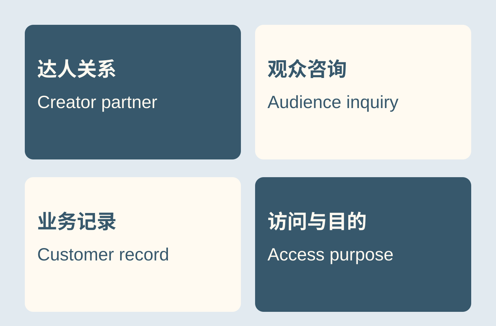

# Social CRM for Creator Relationship Records

Status: local review draft; confirm the publication date before release.

Connect creator partnerships, audience inquiries and customer service without merging their purposes, sources, recipients or responsibilities.

Social CRM connects social interactions with purposeful relationship management. In creator marketing, distinguish at least the creator-partnership record, an audience inquiry and an actual brand-customer record. They can be related without being automatically merged or shared in full. Define why information is recorded, who needs it and who handles the next step before choosing software. Discovering a comment does not establish unlimited permission for subsequent marketing or copying private messages. A useful arrangement preserves the context of each relationship instead of treating every person encountered through a campaign as the same kind of contact.

## Identify the relationship being managed

[Salesforce’s CRM explanation](https://www.salesforce.com/crm/what-is-crm/) places CRM in the context of relationships with customers and potential customers. It is a supplier definition used as background here. The article does not claim QuickKOL integrates with Salesforce or has tested a particular feature.

A creator is a partner, an audience member may simply be asking a question, and a customer may have a specific service relationship. One person can hold different roles without erasing the original purpose of each record.

State the problem: reducing repeated inquiries, handing over a partnership accurately or routing product questions. Do not begin with centralize all data and include unrelated information by default.

Clear roles help select fields. A creator quotation and a viewer’s order issue may both need an owner without belonging in one broadly accessible list.

This is the foundation of a useful social CRM arrangement. The team can connect a campaign with relevant interactions while preserving why each record exists, rather than assuming that a shared origin makes every contact suitable for the same follow-up, evaluation or commercial treatment.

## Make fields correspond to the present task

A creator record may retain public account, relevant work, role, business contact route and conversation state. An audience inquiry may need only the question, source, appropriate recipient and handling state, without a complete personal profile.

In the UK context, [the ICO’s data-minimisation guidance](https://ico.org.uk/for-organisations/uk-gdpr-guidance-and-resources/data-protection-principles/a-guide-to-the-data-protection-principles/data-minimisation/) emphasizes sufficient, relevant and necessary information, while noting that the guidance is under review. The working point here concerns purpose and fields, not a complete legal basis for processing in every jurisdiction.

If the team cannot explain a field’s purpose, do not collect it merely because the software supports it. Conversely, do not remove necessary provenance and state so completely that the next owner cannot assess usability.

Let fields explain the task. Awaiting product-team answer guides action more clearly than an unexplained low-interest label, and avoids turning an explanation need into a judgment about personal value.

The record can remain small while being useful. A question, source, status and owner may be enough for one workflow; another may need a separately controlled commercial detail. Match the information to the actual work rather than treating the most extensive profile as the default standard.

## Label source, fact and opinion separately

In the UK context, [the ICO’s accuracy guidance](https://ico.org.uk/for-organisations/uk-gdpr-guidance-and-resources/data-protection-principles/a-guide-to-the-data-protection-principles/accuracy/) emphasizes source and state and distinguishes facts, opinions and historical records. It too is under review. The operational point is that a later reader should understand where a judgment came from.

Public biography, information supplied by the person, representative statements and researcher inference have different status. Do not infer creator location from audience geography or assume an audience question proves purchase.

Opinions can be useful when their author and basis are clear. Potentially suitable should not become certified, and copying a record into another tool should not remove an unknown state.

When an error is found, check and correct it according to the actual purpose. An older record may remain historical without appearing to be a current fact that guides future contact.

This is particularly important in creator relationships, where account names, agencies and proposed roles can change. A reliable record lets the team update the current route while preserving the meaning of earlier work, instead of either deleting all context or continuing to use obsolete information simply because it was once copied into a central system.

## Describe conversation state through actual actions

Discovered, reviewed, message prepared, sent, replied, interested and accepted are different states. Each should return to a corresponding fact instead of relying on a hot or cold label.

The same applies to audience inquiries: seen, routed, in progress and resolved are distinct. Forwarding to service does not establish that the person received an answer, and an automatic acknowledgment may not resolve the actual question.

The [WhatsApp campaign-inquiry handoff method](https://www.quickkol.com/blog/whatsapp-business-creator-conversation-handoff/#answer) describes accountable business conversation. The additional concern here is keeping relationship boundaries intact, so one state is not amplified incorrectly across several lists.

Clear states reduce duplicate contact. A colleague taking over should see what was asked, what the other person said and who should act next.

This is useful even in a small team using a simple sheet. The benefit does not depend on advanced automation. It comes from maintaining a shared meaning for the work, so a researcher’s lead does not become a sales commitment, a friendly response does not become a contract and a routed customer issue does not disappear under a completion label.

## Share the part the recipient needs

The product team may need the question, procurement the commercial terms and the creator an accurate response foundation. They do not necessarily all need the full quotation, order information or private-message history.

State task and recipient scope when sharing. A public comment can provide a question lead, but copying it into another system or using it for subsequent contact still needs consideration of purpose and the applicable arrangement. Public visibility is not a pass for every use.

For service questions requiring private handling, provide an appropriate route rather than asking someone to add order and identity information in public comments. The creator can hand over the question without becoming a transit point for all personal data.

Tool permissions and exports should match those boundaries. Do not describe clear separation in a document while automatically granting everyone unrelated full records.

A practical handoff can summarize the relevant issue and identify the responsible owner, with access to detailed material limited to people who need it. This makes the workflow easier to maintain and reduces the chance that an unrelated commercial team treats a support interaction as a new marketing opportunity simply because it appeared in the campaign record.

Related records can connect without merging purposes and access.

## Check relationships through a hypothetical conversation

Imagine a viewer asking beneath creator work whether a product suits a use case, then raising a service request through a brand channel. Meanwhile, the creator is discussing filming another instalment. This is an editorial example, not an actual customer workflow.

The team can use the public question to clarify the explanation while service handles the particular request. The creator-partnership record retains the content requirement without copying every personal detail of the service conversation.

If customer status is unconfirmed, do not label the viewer purchased or converted. If the creator only agrees to discuss the next instalment, do not count that as acceptance. The two relationships advance separately.

The example shows why connecting does not mean merging. One discovery route can produce several subsequent tasks, each retaining its purpose, state and owner.

Use this scenario to inspect the proposed tool setup. Can it preserve those distinctions, or does one broad campaign contact automatically receive every status? A system that retains separate meanings may be more useful for this task than one that offers a visually unified profile at the cost of losing why each interaction happened.

## Evaluate tools through handoff capability

Do not choose from an unsupported feature ranking or unverified price. Use the team’s task to check preservation of source, role, state and recipient scope, including the manual maintenance required.

Ask a demonstration to include correction, duplicates and handoff, not only creation of a new record. When a contact changes, retaining history without misleading current work matters as well.

Do not assume QuickKOL or another named product has unverified CRM integration, synchronization or automated sending. Public positioning can explain intended workflow; actual capability and permission need checking in the product.

For a limited number of clear relationships, a suitable sheet may support the current stage. Tool scope should serve the work rather than importing the entire historical archive merely to obtain one interface.

A useful evaluation ends with a bounded conclusion: the system can support these fields and handoffs, while these other tasks remain manual or untested. That is more reviewable than a general claim that the platform creates a complete view of everyone encountered through influencer marketing or makes follow-up appropriate by default.

## Make the relationship record serve the next step

The handoff should tell the next owner which relationship is being managed, why information is retained, what actually happened and which action is appropriate. Unnecessary information should not accumulate indefinitely because it might someday be useful.

Review current records and open questions according to purpose, preserving reasons for corrections. Relationship management should not permanently fix someone inside their earliest label. It should keep facts clear as the work changes.

The [creator contact-record correction method](https://www.quickkol.com/blog/blueskt-creator-contact-record-correction/#answer) can help with platform and account fields. Where person and representative relationships are involved, an automatic merge should not complete verification the team has not performed.

QuickKOL can help interpret a brief, discover relevant creators and prepare contact. Particular sharing, commercial terms, service handling and outcomes still require confirmation.

The value of social CRM is an appropriate next step for different people, not one marketing list containing every relationship. Keep that purpose with the working record. It gives future colleagues a basis for continuity while making it possible to stop, correct or redirect an action when the evidence or the person’s actual relationship to the brand changes.

## Relationship records in a creator project

| Relationship | Task | Relevant state |
| --- | --- | --- |
| Creator partner | Research, commission and delivery | Interest, acceptance and completion separate |
| Audience inquiry | Question and suitable response | Seen, routed and resolved separate |
| Customer service | Specific service handling | Identity and handling confirmed appropriately |
| Public research | Work and question leads | Facts, inference and unknown separate |

Editorial workflow distinctions; no claim of completed integration or automatically obtained permission.

## Confirm relationship-record boundaries

Define the task before fields and tools.

- [ ] Distinguish partner, audience and customer.
- [ ] Give each information item a purpose.
- [ ] Retain source, state and opinion attribution.
- [ ] Share the portion the recipient needs.
- [ ] Confirm actual actions rather than vague labels.
- [ ] Assign next-step and correction owners.

## Research date and limitations

Sources reviewed November 20, 2026. Methods, tables and decision rules are editorial recommendations. Hypothetical examples are not actual client results or industry benchmarks. Source geography and periods are specified where relevant.

## Start creator research with a clear task

Use QuickKOL to interpret a brief, discover relevant creators and research their work and contact routes. Verify data, commercial terms and outcomes at their source.

[Explore QuickKOL](https://www.quickkol.com/#capabilities)

## Sources

- [Salesforce’s CRM explanation](https://www.salesforce.com/crm/what-is-crm/)
- [the ICO’s data-minimisation guidance](https://ico.org.uk/for-organisations/uk-gdpr-guidance-and-resources/data-protection-principles/a-guide-to-the-data-protection-principles/data-minimisation/)
- [ICO: accuracy principle](https://ico.org.uk/for-organisations/uk-gdpr-guidance-and-resources/data-protection-principles/a-guide-to-the-data-protection-principles/accuracy/)
