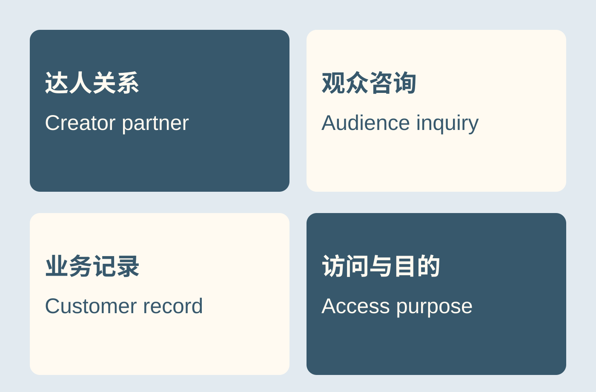

# Social CRM 怎样管理达人关系

状态：本地审阅稿；正式发布日期待确认。

将达人合作、观众咨询与客户服务记录分开连接，保留目的、来源、接收范围和负责人，避免把一次互动变成不相关营销名单。

Social CRM 可以理解为将社交互动与有目的的关系管理连接。达人营销中至少要分清创作者合作记录、观众提出的问题，以及品牌实际客户记录。它们可能有关联，却不应自动合并或共享全部内容。先定义为什么记录、谁需要看、下一步由谁处理，再选择工具；发现某条评论不等于获得无限后续营销或复制私信的授权。

## 先分清正在管理的关系

[Salesforce CRM 说明](https://www.salesforce.com/crm/what-is-crm/)将 CRM 放在客户与潜在客户关系管理的语境。本文将其作为供应商定义参考，再讨论达人项目中的工作区分，不声称 QuickKOL 已接入 Salesforce 或使用了某项未经测试的功能。

创作者是合作方，观众可能只是提问者，客户则可能有具体服务关系。一个人也可能同时具有不同角色，但不能因此抹去每份记录原来的目的。

先说明本项目希望解决什么：减少重复询问、准确交接合作，还是让产品问题进入合适团队。不要从“集中所有数据”开始，把无关信息也纳入。

清楚角色有助于选择字段。达人报价与观众订单问题可能都需要负责人，却不应该默认出现在同一份可以广泛查看的名单里。

## 让字段对应当前任务

创作者记录可以保留公开账号、相关原作、本次角色、业务联系路径和沟通状态。观众咨询则可能只需要问题、来源、适当接收人和处理状态，不必复制整个人物资料。

在英国数据保护语境中，[ICO 数据最小化说明](https://ico.org.uk/for-organisations/uk-gdpr-guidance-and-resources/data-protection-principles/a-guide-to-the-data-protection-principles/data-minimisation/)强调充分、相关与必要，并提示指导正在审查。本文据此说明目的与字段关系，不提供所有地区的完整处理依据。

如果团队不知道某个字段用于什么，先不要因为工具支持就收集。反过来，必要的来源与状态不能全部删掉，否则下一位负责人无法判断信息是否可用。

用字段说明记录目的。例如，“等待产品团队回答”比一个没有理由的“低意向”标签更能指导行动，也避免让解释问题变成对个人价值的判断。

## 来源、事实与意见分别标识

[ICO 准确性说明](https://ico.org.uk/for-organisations/uk-gdpr-guidance-and-resources/data-protection-principles/a-guide-to-the-data-protection-principles/accuracy/)在英国语境中要求关注资料来源与状态，并区分事实、意见和历史记录；该指导也在审查中。对团队而言，关键是让后来的人知道每条判断从哪里来。

公开简介、本人提供资料、代理说明与研究员推断应标明不同性质。创作者所在地不能从受众地域猜出，观众提问也不自动证明已经购买。

意见可以有用，但要说明是谁在何种依据上提出。不要把“可能适合”变成“已认证”，也不要在复制到另一工具后丢失原来的未知状态。

发现错误时，核对并按实际目的更正。旧记录可以作为历史保留，但不能继续显示为当前事实，让后续外联和合作决定依赖已经失效的信息。

## 把沟通状态写成真实动作

候选被发现、资料已审、消息准备、已经发出、收到回复、有兴趣和明确接受，不是同一状态。每一项都应能回到相应事实，而不靠一个“热”或“冷”标签代替。

对观众咨询也一样：看见、转交、正在处理和已经解决分别记录。转给服务团队不能直接算成观众已经得到答案，自动回复也未必完成实际问题。

[WhatsApp 合作咨询交接方法](https://www.quickkol.com/zh/blog/whatsapp-business-creator-conversation-handoff/#answer)可以继续说明业务对话怎样有人负责。本文更关注不同关系如何保持边界，避免一个状态在多个名单里被错误放大。

用清楚状态减少重复联系。如果另一个同事接手，应能看懂已经问过什么、对方回复了什么，以及现在适合由谁采取哪种下一步。

## 共享只交付需要的部分

品牌产品团队可能需要问题内容，采购需要合作条件，创作者需要准确答复素材。三方不一定都需要看全部报价、订单或私信历史。

给共享说明任务与接收范围。公开评论可以提供问题线索，但将其复制到其他系统或用于后续联系仍需考虑实际目的与适用安排，不把公开可见当成所有用途通行证。

对于需要私下处理的服务问题，提供合适渠道，不要求当事人在公开评论里补充订单和身份资料。创作者可以交接问题，不必成为所有个人资料的中转站。

工具权限和导出也要与这些范围一致。不要一边在文档说分工明确，一边让所有人默认取得不相关的完整记录。

相关记录可以连接，不必把目的与权限合并。

## 用假设对话检查记录关系

假设观众在达人作品下问产品是否适合自己的用途，后来通过品牌渠道提出服务请求。达人则同时在讨论下一期拍摄。这是编辑例子，不是实际客户流程。

团队可以将公开问题用于修正解释，同时让服务团队处理具体请求。达人合作记录保留相应内容需求，但不必复制服务对话的全部个人信息。

如果服务情况没有确认，就不把该观众标成已购买或已转化；如果达人只说愿意讨论下一期，也不把它计成已接受。两种关系分别前进。

这个例子说明连接不等于合并。一个来源路径可以有多种后续任务，而每项任务仍需要合适的目的、状态与负责人。

## 选择工具时检查交接能力

不要从功能排名或未经核实价格选择系统。用本团队任务检查能否保留来源、角色、状态与接收范围，并说明需要多少人工维护。

可以要求演示更正、重复项处理和交接，而不只看新记录怎样创建。旧联系人变化时，系统能否保留历史而不误导当前工作，同样重要。

不假设 QuickKOL 或任何具名产品已经具备未验证的 CRM 集成、同步或自动发送能力。官网描述可以帮助理解定位，具体功能与权限要按实际产品核对。

如果只需管理少量清楚关系，一份妥当表格也可能支持当前阶段。工具范围应服务工作，而不是为了统一界面先迁入全部历史资料。

## 让关系记录服务下一步

最终交接应让下一位负责人知道在管理哪种关系、为什么保留信息、实际发生了什么，以及什么动作合适。没有必要的信息不因它可能将来有用就无限堆积。

定期按用途复核当前资料和未解问题，保留更正理由。关系管理不是把一个人永久固定在最早的标签里，而是让工作中的事实保持清楚。

[达人联系记录更正方法](https://www.quickkol.com/zh/blog/blueskt-creator-contact-record-correction/#answer)可继续处理平台和账号字段变化。涉及人物与代理关系时，不让自动合并替团队完成尚未做过的核验。

QuickKOL 可帮助理解 Brief、发现相关达人和准备联系；具体资料共享、商业条件、服务处理与效果仍需确认。Social CRM 的价值，是让不同人得到合适下一步，而不是让所有关系变成同一份营销对象名单。

## 达人项目中的关系记录

| 关系 | 任务 | 必要状态 |
| --- | --- | --- |
| 创作者合作 | 研究、委托与交付 | 兴趣、接受与完成分开 |
| 观众咨询 | 问题与适当回应 | 看见、转交与解决分开 |
| 客户服务 | 具体业务处理 | 身份与处理由合适团队确认 |
| 公开研究 | 作品与问题线索 | 事实、推断与未知分开 |

编辑工作区分，不声称任何产品已完成集成或自动取得授权。

## 确认关系记录边界

先明确任务，再选择字段与工具。

- [ ] 区分合作方、观众与客户。
- [ ] 给每项资料一个目的。
- [ ] 保留来源、状态与意见归属。
- [ ] 只共享接收方需要的部分。
- [ ] 确认实际动作而非模糊标签。
- [ ] 为下一步和更正指定负责人。

## 研究日期与使用边界

资料核验于 2026 年 11 月 20 日。文中方法、表格和决策规则为编辑建议，标为假设的示例不是实际客户结果或行业基准。外部资料的适用地区与时期按各段说明。

## 从任务开始达人研究

用 QuickKOL 理解 Brief、发现相关达人并研究作品与联系路径；数据、合作条件和结果仍需核验。

[了解 QuickKOL](https://www.quickkol.com/#capabilities)

## 来源

- [Salesforce CRM 说明](https://www.salesforce.com/crm/what-is-crm/)
- [ICO 数据最小化说明](https://ico.org.uk/for-organisations/uk-gdpr-guidance-and-resources/data-protection-principles/a-guide-to-the-data-protection-principles/data-minimisation/)
- [ICO：准确性原则](https://ico.org.uk/for-organisations/uk-gdpr-guidance-and-resources/data-protection-principles/a-guide-to-the-data-protection-principles/accuracy/)
