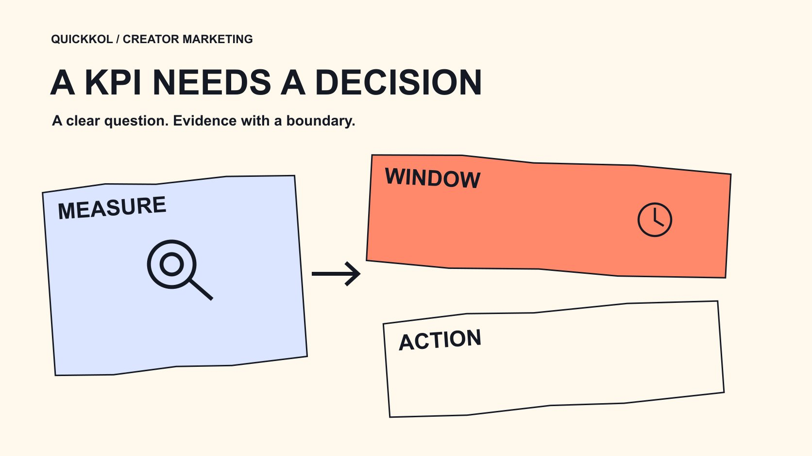
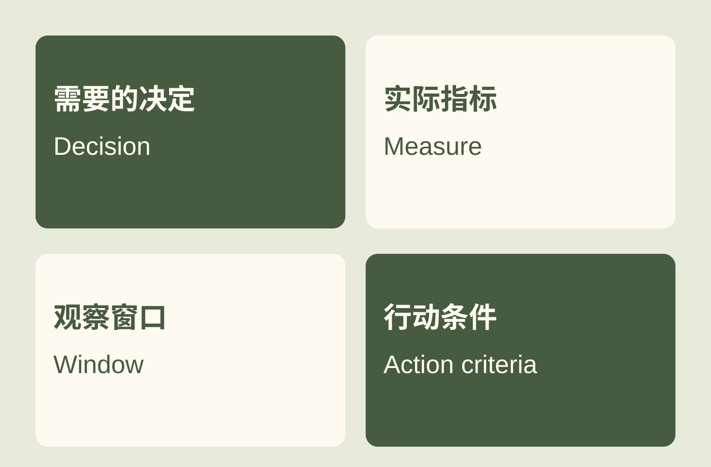

# Social Media KPIs That Guide Creator Decisions

Status: local review draft; confirm the publication date before release.

Attach each KPI to a creator-partnership decision, then agree object, definition, window, responsibility and action conditions instead of relying on one score.

QuickKOL editorial graphic; not actual account metrics or a platform interface.

A social media KPI is a defined measure used to judge an important objective, not every visible number in a report. In creator partnerships, begin with the decision, then specify the object, counted conditions, observation window, source and next step. Counts, rates and qualitative questions can work together if each has a purpose. An unsupported target does not become an industry benchmark merely because it appears in a brief, and a creator should not be expected to guarantee every outcome associated with platform distribution or later brand operations.

## Start with the decision the measure will change

A brand may need to continue a series, revise a product explanation, add service support or design further research. Each decision needs different records; none automatically requires the same engagement rate.

Write an executable question, such as whether another explanation is needed, rather than improve performance. Then state which information helps and who can act.

The [social-metric decision-tree method](https://www.quickkol.com/blog/social-media-metrics-creator-decision-tree/#answer) can help match observations with actions. This article focuses on agreeing conditions before the partnership, so review does not become a retrospective search for an attractive success number.

If a measure changes no next step, it may belong in background rather than as a KPI. A smaller set of clear important measures communicates priority better than marking every field key.

This also makes the conversation with the creator more concrete. They can see which part concerns their delivery, which part involves platform observations and which part depends on another team. The resulting brief is easier to negotiate and use than a long collection of targets whose purposes only become apparent when the campaign is being judged.

## Retain object, definition and window together

[Meta’s Insights overview](https://developers.facebook.com/docs/insights/overview) describes access through objects, metrics and permissions. Establish whether the record concerns an account, piece of work or advertising object before interpreting the value. Similar labels in different reports are not automatically interchangeable.

For every KPI define counted action, denominator, period and unit. For a descriptive rate, explain why it does not automatically represent unique people. Do not blindly add a cumulative value to a period-specific one.

Confirm how information will actually be obtained before work begins. Label public observation, authorized reports and estimates separately. Missing information should not silently become zero, and a late reporting request should not exceed the scope originally agreed.

Definition is the foundation of comparison. A simple stable measure can be more useful than a complex composite that cannot be reviewed. A later reader should know what the number answers rather than merely encounter a percentage sign.

Keep the definition with the result, not only in the initial brief. As information moves between creator, analyst and manager, the original context can otherwise disappear while the number remains, acquiring stronger or different meaning through each successive summary.

## Give delivery and outcomes different responsibilities

Delivery records can establish whether content arrived as agreed, information was accurate and publication actually occurred. Reach, responses and business outcomes may also depend on platform distribution, concurrent activity and brand follow-through.

Do not place every responsibility with the creator because it belongs to one campaign. Problems in a brand-controlled destination, product explanation or inquiry process need an appropriate brand owner.

Delivery checks and outcome observations can coexist without making each a guarantee. The important distinction is what each party can execute directly, what can be observed and what needs stronger research to interpret.

This makes a disappointing review fairer. Check task completion before discussing which causal explanation the evidence supports. One outcome number should not become an automatic judgment of work quality.

A useful record can therefore show a completed creator deliverable beside an unresolved measurement or service question. Those states are compatible. Keeping them visible allows the brand to commission a correction where needed, recognize valid work and avoid paying for more production when the actual issue sits elsewhere in the audience journey or reporting arrangement.

## Give action thresholds a basis

Conditions for continuing, revising or waiting should relate to the task. Actual baseline, resources and research design can support planning conditions, clearly labelled as this project’s decisions rather than global benchmarks.

Where no credible baseline exists, arrange appropriate observation instead of copying a ratio from elsewhere. Platform, format, population and denominator may differ, so the same high or low value may not inform the same action.

A threshold need not always be numerical. A verified product-fact error can trigger correction; a missing essential source can trigger a pause in interpretation. These conditions should be specific, not a substitute phrase such as feels wrong.

For quantitative criteria, include denominator and window and explain what happens with missing or limited observations. Do not force cannot judge into pass or fail, particularly when the result affects creator evaluation and future work.

Agreeing these conditions early gives both parties a reviewable basis. It also leaves room to change the plan with a stated reason when reality differs, rather than quietly moving the target after results arrive or treating a planning assumption as an unconditional obligation.

Connect the measure to a decision before choosing a target from visible numbers.

## Keep estimates and monetization metrics in scope

[Meta’s ad-insight reference](https://developers.facebook.com/docs/graph-api/reference/adaccount/insights) notes that some measures are estimated or in development. Preserve actual labels and sources. Do not treat every value as an exact unique-person count, or dismiss every report because some measures have limitations.

[Meta’s creator-monetization metric explanation](https://about.fb.com/news/2026/03/creator-fast-track-grow-your-audience-earn-money-on-facebook/) places Qualified View within potential monetization and describes an earnings rate per thousand qualified views. That is not a brand conversion, unique reach or fixed creator quotation.

If these fields appear in a report, establish their relevance to the current task. A number resembling income should not replace brand orders. Platform earnings should not automatically offset an agreed fee for commissioned work.

Similar words can mean different things in different workflows. Keeping definitions with values is more practical than forcing every partnership into one unexplained dictionary.

This step is especially useful when creator and brand teams bring reports from different systems. The team can retain the information each source actually provides without pretending all views qualify for the same purpose or all forms of earnings belong to the same commercial arrangement. The KPI should follow the decision, not the most financially suggestive label in the export.

## Test action conditions through a hypothetical record

Imagine twelve questions relevant to the commissioned content: three answered, six awaiting product confirmation and three requiring service handling. This is a hypothetical editorial record, not a campaign result or response benchmark.

If the objective is to reduce explanation gaps, three answered alone should not become low creator performance. Six need confirmation from the brand’s product team; the other three may not be suitable for public handling by the creator.

Assign the next work: the product owner supplies support, the response team handles service and the creator develops an explanation from confirmed information. Each action needs timing and an owner before the counts actually guide operations.

The example prescribes no optimal reply rate and does not treat more questions as worse content. A question may reflect interest, misunderstanding or a practical use need. Examine its actual meaning.

The KPI record becomes useful when it distinguishes the state of the work from the reason for that state. It can identify a bottleneck and an appropriate action without converting an operational dependency into a negative judgment of the person who does not control it.

## Preserve reasons when definitions change

Platform fields or project tasks can change. When revising a KPI, retain old definition, replacement, effective time and consequence. Do not quietly join incompatible observations into one curve.

If a new objective better suits the work, adopt it explicitly and identify historical comparisons that no longer hold. An honest definition is more valuable than continuing an unsuitable metric for the appearance of an uninterrupted report.

The [brand-health tracking method](https://www.quickkol.com/blog/brand-health-creator-message-associations/#answer) addresses comparability of survey wording and samples. It illustrates why changing measurement is more than changing a display label.

Communicate consistently with the creator. If the new request requires additional information, time or work, explain and confirm the scope. A renamed indicator should not silently expand delivery obligations.

This lets measurement improve during a real project without turning every change into a dispute. The team can preserve the old basis, make a reasoned revision and distinguish what was observed under each definition. It also protects later reporting from a false impression that all periods were assessed using conditions the partners had agreed from the beginning.

## Deliver a decision someone can use

The final handoff should include question, definition, source, window, observation, limitation and recommended action. The next owner needs the reason for acting, not only a red or green state.

Unverified is not zero, and no conclusion yet does not mean no progress. Completed work and open research questions can be reported separately, recognizing delivery while preserving uncertainty.

QuickKOL helps interpret a brief, discover creators suited to the task and prepare contact. A KPI article does not give it every backend permission or attribution capability. Sources still confirm particular data, terms and outcomes.

Good KPIs reduce vague judgments and help the team find its next step. They do not require every observation to become one score, and an unsupported target should not make every decision for brand and creator.

Archive the definition with the action so the next partnership can reuse what was learned while checking whether the same conditions still apply. That makes the measurement agreement a practical aid to work, rather than a collection of numbers whose original purpose has disappeared by the time someone is asked to explain them.

## Fields in a KPI agreement

| Field | Answer | Avoid |
| --- | --- | --- |
| Decision | Which work changes? | Every number is key |
| Definition | Object, unit and denominator | Same label means interchangeable |
| Criteria | Basis and waiting state | Hearsay as benchmark |
| Responsibility | Who can execute next? | Every outcome assigned to creator |

Editorial agreement framework; the twelve-question example is hypothetical, not a benchmark.

## Confirm the KPI and decision

Clarify evaluation before the partnership starts.

- [ ] Give each KPI a defined decision.
- [ ] Retain object, window and definition.
- [ ] Confirm evidence can actually be obtained.
- [ ] Separate delivery and outcome responsibilities.
- [ ] Explain criteria and unknown states.
- [ ] Give the next step an owner.

## Research date and limitations

Sources reviewed November 20, 2026. Methods, tables and decision rules are editorial recommendations. Hypothetical examples are not actual client results or industry benchmarks. Source geography and periods are specified where relevant.

## Start creator research with a clear task

Use QuickKOL to interpret a brief, discover relevant creators and research their work and contact routes. Verify data, commercial terms and outcomes at their source.

[Explore QuickKOL](https://www.quickkol.com/#capabilities)

## Sources

- [Meta’s Insights overview](https://developers.facebook.com/docs/insights/overview)
- [Meta’s ad-insight reference](https://developers.facebook.com/docs/graph-api/reference/adaccount/insights)
- [Meta’s creator-monetization metric explanation](https://about.fb.com/news/2026/03/creator-fast-track-grow-your-audience-earn-money-on-facebook/)
