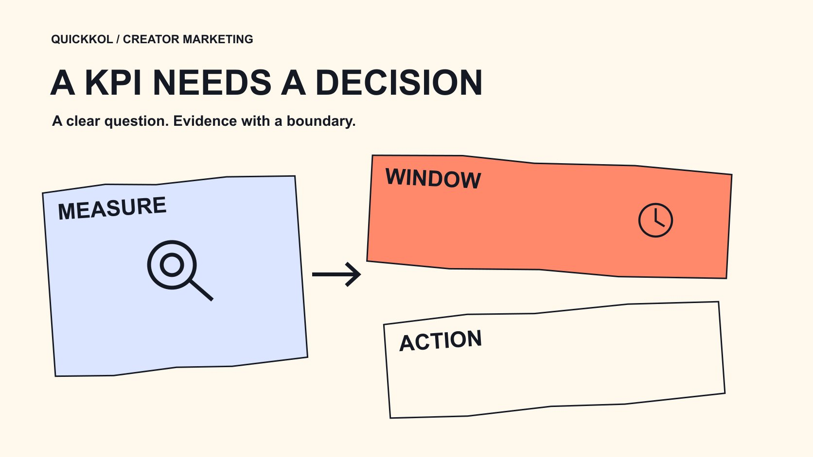
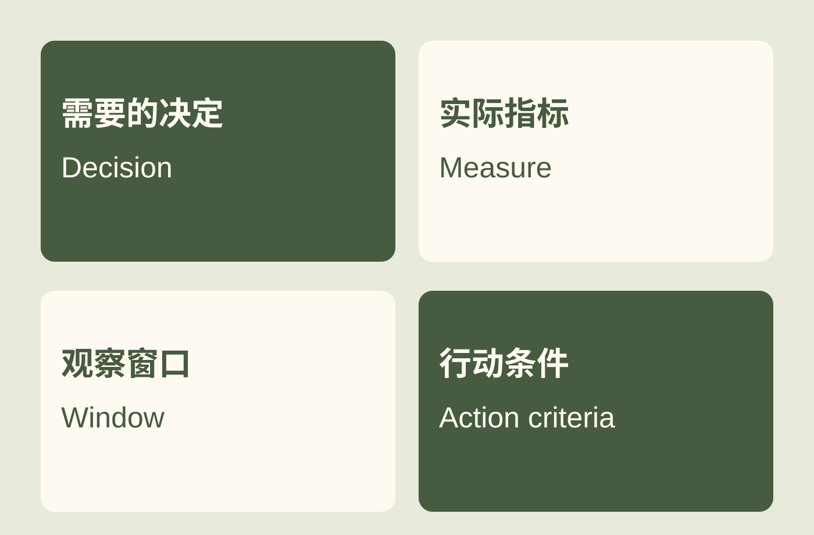

# 达人 KPI 怎样对应真实决定

状态：本地审阅稿；正式发布日期待确认。

KPI 先对应一项达人合作决定，再约定对象、口径、窗口、责任与行动条件，不用一个总分替代判断。

QuickKOL 编辑图形；不呈现真实账号指标或平台界面。

社媒 KPI 是用于判断一项重要目标的明确指标，不是报表里所有可见数字。达人合作应先写要决定什么，再定义指标对象、计入条件、观察窗口、资料来源和下一步。数量、比率与定性问题可以共同使用，但必须各有用途。没有证据支持的统一达标线，不能因为写进 Brief 就变成行业基准或创作者必须保证的结果。

## 先写指标将改变哪个决定

品牌可能要决定继续某个系列、修正产品解释、补充客服支持，或设计进一步研究。每种决定需要不同记录，不必都用同一个互动率。

把问题写成可执行形式，例如是否需要增加一段解释，而不只写“提升表现”。然后说明什么资料有助于判断，以及谁能采取行动。

[社媒指标决策树方法](https://www.quickkol.com/zh/blog/social-media-metrics-creator-decision-tree/#answer)可以继续帮助匹配观察与行动。本篇聚焦在合作前如何约定这些条件，让复盘不必临时寻找一个好看的数字作为成功标准。

如果一个指标不会影响任何下一步，可以放在背景，而不一定成为 KPI。保留较少但清楚的重要指标，比将所有字段都标成关键更能帮助品牌和创作者理解优先级。

## 对象、定义与窗口一起保留

[Meta Insights 概览](https://developers.facebook.com/docs/insights/overview)按对象、指标与权限描述资料访问。先确认记录的是账号、作品还是广告对象，再看数值，不假设不同报表同名字段可直接互换。

每个 KPI 写清计入动作、分母、时间与单位。若是描述性比率，说明它不自动代表独立人数；若是累计数，不要与另一份时期数盲目相加。

实际资料取得方式也应在启动前确认。公开观察、授权报告和估计值各自标注，不能让缺失默默变成零，也不能让事后新增要求超出原来同意范围。

定义是比较的基础。一个简单但稳定的口径，往往比复杂却无法复核的综合分更有用。让后来的读者能知道数字究竟回答什么，而不是只看到百分号。

## 交付与效果需要不同责任

内容是否按约交付、信息是否准确、作品是否实际发布，可以对应明确执行记录。触达、回应与业务结果还可能受平台分发、同期活动与品牌承接影响。

不要因为都属于活动，就把责任全部放给创作者。品牌负责的页面、产品信息或咨询处理若有缺口，应由适当团队解决。

可以分别设置交付检查与结果观察，但不必将每项都写成保证。关键在于各方理解哪些能直接执行，哪些只能观察，哪些需要更强研究才能解释。

这也让未达预期的复盘更公平。团队能检查任务是否完成，再讨论证据支持什么原因，而不是从一个结果数字直接推断创作者工作质量。

## 阈值需要理由，不是传闻

继续、修改或等待的条件应与任务有关。可以根据实际基线、资源与研究设计提出规划条件，但明确这是本项目决定，不冒充全球行业基准。

若没有可信基线，先安排合适观察，而不是复制网上一个比率。不同平台、格式、人群和分母可能无法直接比较；一个高低数字未必改变同样决定。

阈值也不必总是数字。出现经核对的产品事实错误，可以触发修正；缺少关键来源，可以触发暂缓解释。这类条件应具体，不用“感觉不好”代替。

对有数量的条件，写明分母与观察期，说明缺失或小量时怎么办。不要将无法判断强行归入达标或失败，特别是当结论会影响创作者评价与下一轮合作。

指标先对应决定，不能仅凭可见数字选择目标。

## 估计与变现指标保留原意

[Meta 广告指标说明](https://developers.facebook.com/docs/graph-api/reference/adaccount/insights)指出有些指标属于估计或开发中口径。保留实际标签与来源，不把所有结果都当成精确独立人数，也不因此把全部报告视为无用。

[Meta 创作者变现指标说明](https://about.fb.com/news/2026/03/creator-fast-track-grow-your-audience-earn-money-on-facebook/)将 Qualified View 放在可能获得变现的观看语境中，并介绍每千次符合条件观看的收益率。这不是品牌转化、唯一触达或达人固定报价。

如果报表包含这些字段，先确定它们在当前任务中是否相关。不能因为一个数字看起来像收入，就拿来替代品牌订单；也不能将平台奖励直接减掉创作者已经约定的工作费用。

同名词在不同工作中可能有不同含义。让定义随数字一起进入报告，比为所有合作强行套用一个统一词典更安全且实用。

## 用假设记录检验行动条件

假设品牌收集到 12 条与委托内容有关的问题，其中 3 条已回答、6 条等待产品确认、3 条属于服务处理。这是编辑算例，不是实际活动或回应标准。

如果目标是减少解释缺口，不能只看“已回答 3 条”就宣布达人表现低。六条需要品牌产品团队确认，另外三条可能不适合由创作者公开处理。

可以安排下一步：产品负责人补依据、回应团队处理服务问题、创作者按确认内容补讲解。每项有时间与负责人，数字才真正指导工作。

这个例子没有规定最佳回复率，也不把问题多解释成内容差。提问可能是兴趣、理解不足或实际使用需要，必须回到具体内容判断。

## 改口径也需要保留理由

平台字段或项目任务可能变化。修改 KPI 时记录旧定义、新定义、生效时间和影响，不将新旧数据悄悄连成同一曲线。

如果新目标确实更适合当前工作，可以明确采用，并说明哪些历史比较不再成立。保持诚实口径，比为了连续报表而继续使用错误指标更有价值。

[品牌健康追踪方法](https://www.quickkol.com/zh/blog/brand-health-creator-message-associations/#answer)处理调查问题与样本的可比性；它提醒团队，换了一种测量不只是换了一个显示标签。

对创作者沟通也要一致。新要求涉及额外资料、时间或工作时，说明范围再确认，不让一个指标名称变化默默增加交付义务。

## 交付一个可以继续使用的决定

最终交接应包括问题、指标定义、来源、窗口、观察、限制与建议动作。让下一位负责人知道为什么采取行动，不只看到红绿状态。

未核验不是零，尚无结论也不等于项目没有进展。把已完成交付和待研究问题分别说明，可以同时认可工作与保留不确定性。

QuickKOL 帮助理解 Brief、发现适合任务的达人并准备联系；它不因一篇 KPI 文章而获得所有后台权限或归因能力。具体数据、条款与结果仍在来源核对。

好的 KPI 减少模糊判断，帮助团队找到下一步。它不需要把全部观察压成一个分数，更不应该让一个无来源目标替品牌与创作者做所有决定。

## KPI 约定中的必要字段

| 字段 | 要回答 | 避免 |
| --- | --- | --- |
| 决定 | 要改变什么工作 | 所有数字都关键 |
| 口径 | 对象、单位与分母 | 同名自动互换 |
| 条件 | 依据与等待状态 | 传闻当基准 |
| 责任 | 谁能执行下一步 | 所有结果归给达人 |

编辑约定框架；12 条问题的例子为假设，不是行业标准。

## 确认 KPI 与决定

在合作开始前说清评价方式。

- [ ] 给每项 KPI 一个明确决定。
- [ ] 保留对象、窗口与定义。
- [ ] 确认资料实际可取得。
- [ ] 区分交付与效果责任。
- [ ] 说明阈值依据和未知状态。
- [ ] 让下一步有负责人。

## 研究日期与使用边界

资料核验于 2026 年 11 月 20 日。文中方法、表格和决策规则为编辑建议，标为假设的示例不是实际客户结果或行业基准。外部资料的适用地区与时期按各段说明。

## 从任务开始达人研究

用 QuickKOL 理解 Brief、发现相关达人并研究作品与联系路径；数据、合作条件和结果仍需核验。

[了解 QuickKOL](https://www.quickkol.com/#capabilities)

## 来源

- [Meta Insights 概览](https://developers.facebook.com/docs/insights/overview)
- [Meta 广告指标说明](https://developers.facebook.com/docs/graph-api/reference/adaccount/insights)
- [Meta 创作者变现指标说明](https://about.fb.com/news/2026/03/creator-fast-track-grow-your-audience-earn-money-on-facebook/)
