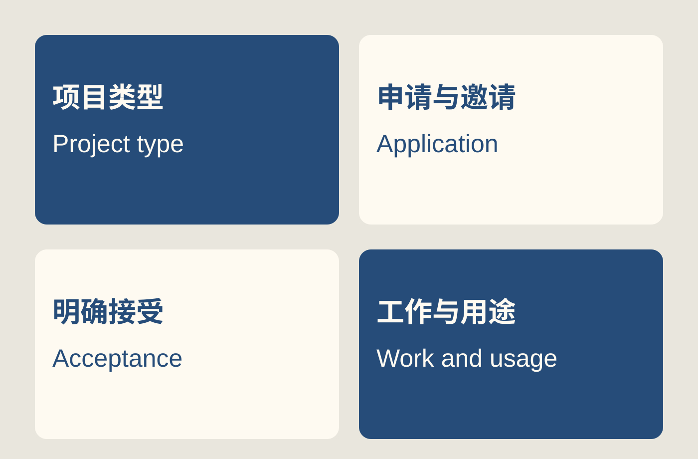

# TikTok Creator Program: Clarify Project Acceptance

Status: local review draft; confirm the publication date before release.

Distinguish TikTok creator project types, then confirm application, acceptance, compensation and usage before treating an opportunity as commissioned work.

TikTok creator program is not one universal label for every monetization and brand opportunity. Identify whether an invitation concerns a TikTok One project, Creator Rewards or a direct brand commission, then check this project’s type, eligibility and acceptance state. Registration, access to opportunities and an application are not the same as an accepted paid partnership. Confirm who accepts, what work is required, how compensation is determined, where material may be used and who handles commercial-content requirements before scheduling production.

## Identify what the invitation concerns

[TikTok One’s project-type guide](https://ads.tiktok.com/resources/help/article/types-of-projects-for-tiktok-one-creators?lang=en), updated in November 2026, describes distinct project types. Flat fees, performance-based allocations and permission for advertising with existing work should not become one income mechanism.

Retain the project name, initiator and actual page when an invitation arrives. Check whether it belongs to the claimed programme rather than assume a creator program heading means the platform, brand and intermediary have jointly confirmed everything.

The [TikTok monetization requirement map](https://www.quickkol.com/blog/tiktok-monetization-program-requirement-map/#answer) distinguishes programmes. This article follows a specific brand opportunity from visibility to explicit acceptance instead of applying one threshold to every programme.

Confirm who is entitled to accept for each party; an assistant forwarding an invitation may not have authority to agree commercial terms. A creator can handle different partnerships concurrently, but each needs its own work and compensation record. Experience with another project cannot fill missing terms in the current invitation.

This first distinction prevents an avoidable commissioning error: discussing payment or production as though everyone means the same opportunity while one person is describing platform rewards and another expects an advertisement. Name the actual project before comparing its conditions, and keep any unresolved programme identity visible in the conversation rather than silently choosing the most favourable interpretation.

## Separate registration from project participation

[TikTok One’s registration guide](https://ads.tiktok.com/resources/help/article/how-creators-can-sign-up-for-tiktok-one?lang=en) includes regional, age and policy conditions and notes additional project requirements. Inspect the current actual opportunity rather than turn a number on one page into a permanent threshold for every TikTok programme.

The brand can ask the creator to confirm the eligibility and state they see. It need not request account passwords or have someone submit inaccurate information. An inaccessible page should remain unverified rather than be assumed to establish eligibility.

Registration confirms a particular stage. An invitation, submission, selection and acceptance of work remain different events; an internal table should not label them all partnered.

When requirements change, return to this project’s record. Identify who notified the change, which work is affected and whether renewed acceptance is needed instead of letting an old screenshot overrule later conditions.

A practical status field can remain simple: application submitted, clarification requested, selected subject to terms, or accepted with a dated scope. These are editorial tracking suggestions, not official platform status names. Their purpose is to show what has actually happened and what still needs a decision before anyone relies on the project.

## Make acceptance refer to understandable work

The creator needs to know whether they are accepting production of a new video, file delivery, publication or authorization of existing work. File handover and public release are different actions; complete the content does not adequately define either.

Specify topic, format, important facts, delivery route, review and release responsibilities. Retain sources for information the brand must verify rather than require the creator to accept unsupported claims.

At acceptance, identify the version and open questions. An expression of interest supports further discussion without necessarily accepting every commercial condition.

For a project with several stages, state which stage is now agreed and what confirms a later stage. An early click should not silently authorize every future recording, adaptation or advertising use.

That makes acceptance useful to the production team. They can book time for an identifiable task, understand which assets are needed and see which decisions remain with the brand. If the invitation lacks those details, the next action is clarification rather than an assumption that the creator will discover the complete scope only after starting work.

Joining a programme and accepting a project are different stages.

## Discuss the actual compensation mechanism

A flat fee, performance bonus and revenue allocation require different questions. Do not rewrite an opportunity to earn as certain income, or treat advertising spend as money paid directly to the creator.

Specify the compensation basis, relevant period, settlement party, necessary evidence and route for disputed calculations. For performance-based work, establish the metric and visible source; preserve unclear terms as questions.

Imagine two projects each requesting one video. One offers a fixed production fee and another uses a defined performance calculation. Identical delivery quantity does not make their prices directly comparable. This is an editorial example, not a market income benchmark.

Connect fees to actual additional work as well. Confirm new uses, adaptations or extra production instead of allowing participation in a programme to mean unlimited further obligations.

This discussion also separates the headline opportunity from the payment process. The creator should know what event makes an amount payable and whom to contact about a missing statement. A polished opportunity description cannot answer those operational questions by itself, and neither party should improvise a new calculation after results are already visible.

## Separate content publication from advertising permission

A project may request new work or advertising use of an existing piece. Confirm the asset, account, use, duration and permitted changes instead of treating public visibility as unrestricted permission.

The [creator-marketplace proposal-to-contract method](https://www.quickkol.com/blog/creator-marketplace-proposal-to-contract/#answer) helps translate an opportunity page into an actual agreement. Project instructions and supplementary communication should align; resolve conflicts before execution.

When authorization occurs inside a system, record its actual state and scope. An old confirmation screenshot should not become permanent permission. Assign responsibility for later use when authorization ends.

Do not ask for personal login sharing to make brand operation easier. Use the available permission and confirmation routes. This article does not claim a user’s account has enabled an advertising feature or completed authorization.

The practical objective is clarity about the work being purchased. Publishing on the creator’s account, receiving a file and running an advertisement can involve different actions and permissions. Naming those actions prevents an otherwise reasonable project from expanding through assumptions that neither the creator nor the production reviewer has explicitly considered.

## Confirm commercial-content responsibilities before production

[TikTok’s commercial-content guide](https://support.tiktok.com/en/business-and-creator/creator-and-business-accounts/promoting-a-brand-product-or-service?from=HN) requires the relevant disclosure setting when promoting one’s own business or a third-party brand, product or service. Check the applicable account process rather than leave disclosure to a correction after publication.

Give the creator accurate relationship information so the setting and expression can reflect the partnership. Brand review should examine claims and commercial context rather than ask for a paid relationship to be hidden for a more natural appearance.

For project-specific automation or labels, return to current official instructions and the actual interface. This article includes no signed-in account test, so a changing menu should not become the sole workflow asserted for every user.

Assign responsibility for both content and technical settings. If either remains unclear before release, obtain confirmation instead of allowing an imminent schedule to justify an unchecked version.

That responsibility belongs in the production plan, where it can affect wording and review. It should not appear only as a vague reminder after the video is approved. A clear commercial context helps the creator make accurate work and lets the brand judge the finished piece against the actual relationship.

## Give changes and cancellation a clear state

Not every invitation needs acceptance. A creator may lack time, relevant experience or the required capability, or disagree with the proposed use. Retain the actual response instead of treating silence as consent.

Distinguish clarification from additional work when the task changes. A small factual correction, a new creative direction and extra advertising variants should not automatically carry identical time and fee implications.

If a project pauses, confirm completed work, publication that has not happened and later asset handling. Return settlement and authorization questions to the agreement rather than assume an internal closed label resolves everything.

Keep necessary records and remove expired invitations from active execution lists. For a later partnership, confirm the new scope rather than reuse one old acceptance for another commission.

A clear state helps both parties plan without unnecessary friction. The brand can stop assigning work to someone who has declined, and the creator can see which commitments remain active. It also allows a future project to begin from a fresh, accurate understanding instead of inheriting a history of incomplete assumptions.

## State exactly where the project stands

A handover should identify project type, initiator, acceptance record, actual work, compensation basis, usage and open questions. The management table can be concise if it answers who does what next.

Avoid reporting joined, therefore earning will start immediately. A more accurate state may be application submitted, invitation verified, terms awaiting confirmation or a specific commission explicitly accepted.

QuickKOL supports research of relevant creator work and contact routes from a brief. Platform eligibility, invitation authenticity, contract terms and payment results require their respective sources; a research tool should not be presented as guaranteeing them.

Progressing through real stages reduces avoidable rework and helps the creator understand their commitment. Opportunity visibility is a starting point. Clear acceptance and executable scope give the production arrangement a basis.

That is the useful end of a programme search for a brand: an identifiable collaboration with an appropriate person, clear work and understood conditions. It is a stronger operational outcome than a large list of apparent programme members whose willingness, availability and actual project status have never been confirmed.

## Describe partnership states

| Actual event | Record | Still confirm |
| --- | --- | --- |
| Opportunity visible | For evaluation | Eligibility and authenticity |
| Application submitted | Awaiting response | Selection |
| Invitation received | Scope to review | Terms and acceptance |
| Explicit acceptance | Execute confirmed version | Changes and release owner |

Editorial tracking states, not universal platform labels.

## Confirm a creator project

Answer these practical questions before production.

- [ ] Identify project and initiator.
- [ ] Check eligibility and application state.
- [ ] Retain the accepted version.
- [ ] Define delivery and compensation basis.
- [ ] Separate publication and advertising use.
- [ ] Assign disclosure, change and settlement responsibilities.

## Research date and limitations

Sources reviewed November 20, 2026. Methods, tables and decision rules are editorial recommendations. Hypothetical examples are not actual client results or industry benchmarks. Source geography and periods are specified where relevant.

## Start creator research with a clear task

Use QuickKOL to interpret a brief, discover relevant creators and research their work and contact routes. Verify data, commercial terms and outcomes at their source.

[Explore QuickKOL](https://www.quickkol.com/#capabilities)

## Sources

- [TikTok One’s project-type guide](https://ads.tiktok.com/resources/help/article/types-of-projects-for-tiktok-one-creators?lang=en)
- [TikTok One’s registration guide](https://ads.tiktok.com/resources/help/article/how-creators-can-sign-up-for-tiktok-one?lang=en)
- [TikTok’s commercial-content guide](https://support.tiktok.com/en/business-and-creator/creator-and-business-accounts/promoting-a-brand-product-or-service?from=HN)
