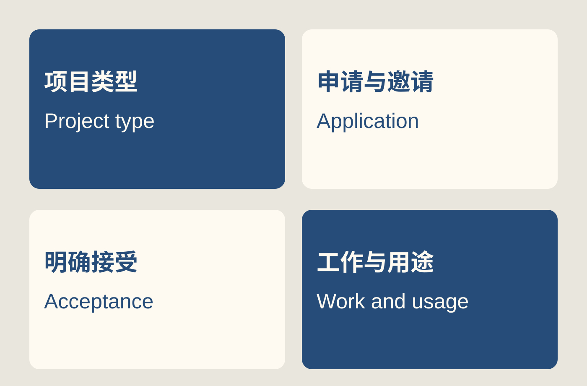

# TikTok 创作者项目怎样确认接受

状态：本地审阅稿；正式发布日期待确认。

先区分 TikTok 创作者项目的类型，再确认申请、接受、计酬与素材使用，避免把注册成功当成合作成立。

TikTok creator program 不是所有变现与品牌合作机会的统一名称。先查邀请究竟指 TikTok One 项目、Creator Rewards，还是品牌直接委托，再核对本次项目类型、实际资格与接受状态。注册成功、能看到机会或提交申请，都不等于已经获得有偿合作。明确谁接受、做什么、怎样计酬、素材可用在哪里，以及商业内容由谁确认，再安排制作。

## 先辨认邀请指的是什么

[TikTok One 项目类型说明](https://ads.tiktok.com/resources/help/article/types-of-projects-for-tiktok-one-creators?lang=en)在 2026 年 11 月列出不同项目类型。固定费用、按表现分配与授权已有作品用于广告等安排，不应被写成相同的收入机制。

收到邀请时保留项目名称、发起方与实际页面，检查它是否真的属于所述计划。不根据一个“creator program”标题推断平台、品牌与中介已经共同确认。

[TikTok 变现计划要求地图](https://www.quickkol.com/zh/blog/tiktok-monetization-program-requirement-map/#answer)帮助区分不同计划。本篇继续处理具体品牌项目从可见机会走到明确接受的过程，而不是再给所有计划套用一个门槛。

还要确认双方实际接受人的权限；转发邀请的助理不一定有权同意商业条款。同一创作者可以同时处理不同合作，但每次需要自己的工作与费用记录。不能用另一个项目的成功经验补全当前邀请缺失的条款。

## 把注册和参与资格分开

[TikTok One 注册说明](https://ads.tiktok.com/resources/help/article/how-creators-can-sign-up-for-tiktok-one?lang=en)包含地区、年龄与政策条件，并说明参与项目可能还有其他要求。查看最新实际项目，不把页面上的某个数字改写为所有 TikTok 计划的永久门槛。

品牌可以请创作者确认自己看到的资格与状态，但不需要索取账号密码或替其填写不真实信息。无法访问的页面应记为未核实，而不是推断已经合格。

注册通过只说明到达相应阶段。收到邀请、提交资料、被选中和接受工作，仍是不同事件，不应在内部表格中全都写成“已合作”。

若项目要求变化，回到本次记录核对。确认由谁通知、哪些工作受影响以及是否需要重新接受，不能让旧截图覆盖后来的实际条件。

## 让接受对应可理解的工作

达人需要知道自己接受的是拍新视频、交付文件、发布内容，还是授权已有作品。文件交接与公开发布不是同一动作，不能只用“完成内容”概括。

列出主题、格式、关键事实、交付方式、评审和发布责任。为品牌必须核实的信息保留来源，不要求创作者无条件接受缺乏依据的主张。

接受时确认具体版本和未决问题。口头表示感兴趣可以支持继续沟通，不宜直接登记为已接受所有商业条款。

如果计划包含多个阶段，说明哪一阶段现在成立，后续阶段需要什么确认。不要以最早的一次点击推导所有未来拍摄、改编或广告用途都已获得同意。

进入计划与接受具体项目是不同阶段。

## 按实际计酬机制讨论费用

固定费用、表现奖金与收入分配需要不同的核对问题。不要将平台介绍中的“有机会获得”换成确定收入，也不要把广告花费直接当作创作者所得。

写清计酬基础、有关期间、结算方、必要证据及争议处理路径。若与表现有关，确认指标定义和可见来源；尚不清楚的部分保留待确认。

假设两个项目都要求一条视频，一个承诺固定制作费，另一个按特定表现计算。它们可以有相同交付数量，却不能直接比较成同一个报价。这是编辑示例，不是市场收入基准。

费用还应与实际新增工作相连。后来增加用途、改编或补拍时重新确认，不以“参加计划”概括无限期的额外义务。

## 分开内容发布与广告授权

项目可能要求新作品，也可能围绕已有内容的广告使用。确认具体作品、账号、用途、期限与允许改动，不把公开可见当作可自由使用。

[达人市场合作条款方法](https://www.quickkol.com/zh/blog/creator-marketplace-proposal-to-contract/#answer)帮助团队把机会页转成实际交付约定。平台内的项目说明与双方补充沟通需要一致，发现冲突时在执行前解决。

如果授权在系统里完成，记录实际状态与范围，避免将一张旧确认截图当作永远有效。授权结束后谁处理后续用途，也应有对应责任。

不要让创作者共享个人登录来“方便品牌操作”。使用实际可用的权限与确认路径；本篇不声称任何用户账号已经开启某个广告功能或完成授权。

## 在制作前确认商业表达责任

[TikTok 商业内容说明](https://support.tiktok.com/en/business-and-creator/creator-and-business-accounts/promoting-a-brand-product-or-service?from=HN)要求推广自己业务或第三方品牌、产品与服务时使用相应披露设置。实际账号中的适用流程需要核对，不把披露留到发布后的补救阶段。

给创作者提供真实合作关系和必要信息，让其按适用要求设置与表达。品牌审稿要看关键主张和合作背景，而不是要求隐藏有偿关系来显得自然。

涉及具体项目的自动流程或标签时，回到最新官方说明和实际界面。本篇没有登录账号验证，不应把可能变化的菜单写成所有用户的唯一操作步骤。

内容与技术设置都需要责任人。若发布前仍不清楚，应先确认，不以排期临近为由让未经核对的版本直接上线。

## 让拒绝、修改和取消有状态

不是每一次邀请都要接受。创作者可能缺少时间、实际体验或所需能力，也可能不同意当前用途。品牌应保留真实答复，不把没有回复改成默认同意。

任务变化时区分澄清与新增工作。小的事实更正、重写创作方向和增加广告版本，不能在费用与时间上自动视为同一件事。

若项目暂停，确认已经完成的工作、尚未发生的发布与后续素材处理。让实际结算和授权问题回到约定，不凭内部“关闭”标签假设全部解决。

保留适量必要记录，避免让失效邀请继续出现在执行名单。未来再次合作时，重新确认当时范围，而不是复用一次旧接受覆盖新的委托。

## 交接时说明项目到底走到哪里

交接内容包括项目类型、发起方、接受记录、实际工作、计酬基础、用途与待确认事项。管理表可以简短，但要能回答下一步由谁做什么。

不要向负责人报告“已加入，所以马上会赚钱”。较准确的状态可能是申请已提交、邀请已核实、条款待确认或明确接受某次工作。

QuickKOL 支持从 Brief 研究相关达人作品与联系路径。平台资格、邀请真实性、合同条件与支付结果仍需要各自来源，不能暗示已由研究工具自动保证。

团队以真实阶段推进合作，既能减少不必要返工，也让创作者理解自己的承诺。项目可见只是起点，清楚的接受和可执行的范围才使制作安排有依据。

## 合作状态怎样表达

| 实际事件 | 合理记录 | 还需确认 |
| --- | --- | --- |
| 看见机会 | 待评估 | 资格与真实性 |
| 提交申请 | 等待答复 | 是否被选中 |
| 收到邀请 | 待核对范围 | 条款与接受 |
| 明确接受 | 按确认版本执行 | 变更与发布责任 |

编辑管理状态，不是平台统一状态名称。

## 确认一个创作者项目

制作前回答这些实际问题。

- [ ] 识别项目与实际发起方。
- [ ] 核对本次资格与申请状态。
- [ ] 保留明确接受的版本。
- [ ] 写清交付与计酬基础。
- [ ] 分开发布与广告用途。
- [ ] 确定披露、变更与结算责任。

## 研究日期与使用边界

资料核验于 2026 年 11 月 20 日。文中方法、表格和决策规则为编辑建议，标为假设的示例不是实际客户结果或行业基准。外部资料的适用地区与时期按各段说明。

## 从任务开始达人研究

用 QuickKOL 理解 Brief、发现相关达人并研究作品与联系路径；数据、合作条件和结果仍需核验。

[了解 QuickKOL](https://www.quickkol.com/#capabilities)

## 来源

- [TikTok One 项目类型说明](https://ads.tiktok.com/resources/help/article/types-of-projects-for-tiktok-one-creators?lang=en)
- [TikTok One 注册说明](https://ads.tiktok.com/resources/help/article/how-creators-can-sign-up-for-tiktok-one?lang=en)
- [TikTok 商业内容说明](https://support.tiktok.com/en/business-and-creator/creator-and-business-accounts/promoting-a-brand-product-or-service?from=HN)
