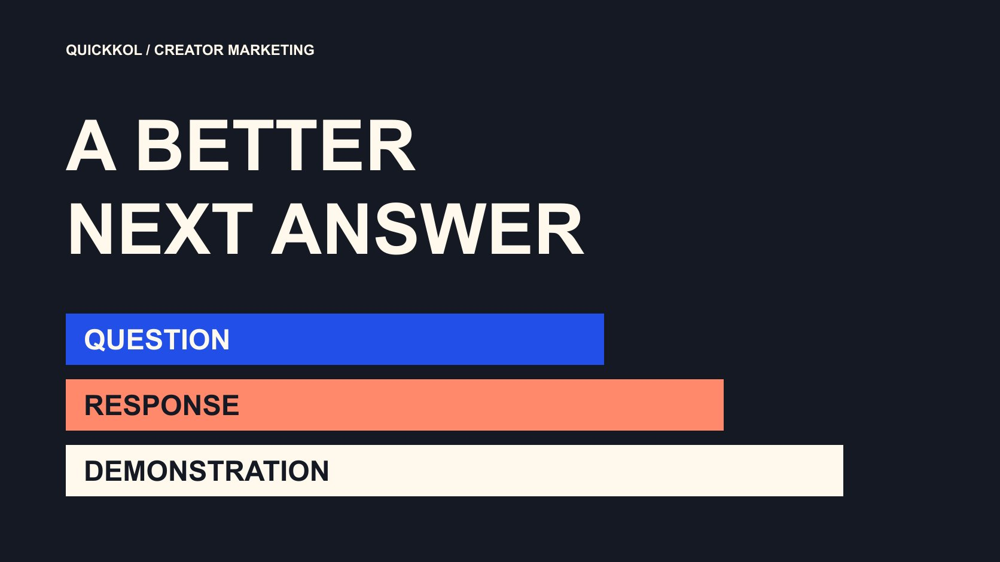
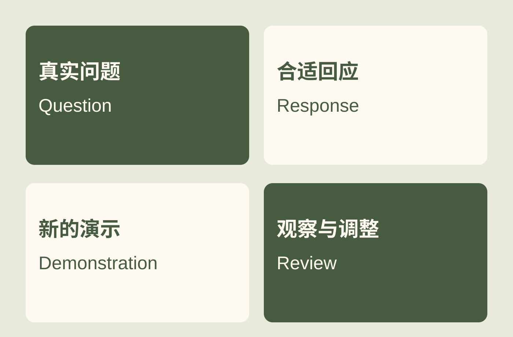

# Increase TikTok Engagement Through Better Follow-Up

Status: local review draft; confirm the publication date before release.

Turn real audience questions into the next useful creator demonstration, separating explanation, product confirmation and service from empty interaction prompts.

QuickKOL editorial graphic; not actual account metrics or a platform interface.

A brand seeking meaningful TikTok engagement can help a creator answer real viewer questions and turn suitable public explanations into the next demonstration. First distinguish content questions, product confirmation and service handling, then agree creator work and brand support. Comment volume is not comprehension and does not guarantee recommendation. The value of follow-up is a clearer viewer decision. Review the actual work and observation conditions rather than promise that a reply pattern will unlock distribution or make every question a creator obligation.

## Choose a question worth answering

Not every comment requires a response, and the most-liked one need not come first. Identify a task-relevant question that can receive a useful explanation: a prerequisite, use condition or comparison basis, for example.

Determine what is actually being asked. The viewer may need a demonstration, stock information or help with an individual order. The latter cases may not suit a creator video, and practical service should not be delayed to generate engagement.

The [creator-demonstration iteration method](https://www.quickkol.com/blog/tiktok-creator-strategy-demonstration-iterations/#answer) concerns improving a piece of work. This article starts with a specific question after publication and asks when another content item is justified, rather than merely repeating the same demonstration.

Preserve the question’s meaning and source. Do not rewrite it into a more theatrical misunderstanding the viewer never expressed. Where appropriate, summarize a shared issue without publishing unrelated personal information.

This selection gives the next commission a real reason to exist. The brand and creator can explain which understanding gap it addresses and why a public treatment helps, rather than treating every visible interaction as an opportunity to extend production regardless of the person’s actual need.

## Recommendation explanations do not supply a reply formula

[TikTok’s recommendation explanation](https://support.tiktok.com/en/using-tiktok/exploring-videos/how-tiktok-recommends-content?traffic_source=Direct) identifies user interactions, content information and user information, noting the importance of interactions such as watching for most users. It supplies no comment count or reply frequency that guarantees an outcome.

The fact that interactions matter does not turn more comments into more recommendations. Comments can come from a clear question, controversy or repetition. Their contexts should not be judged through total volume alone.

The brand can improve relevance and explanatory value without asking a creator to guarantee algorithmic response. Do not deliberately omit essential information to trigger questions and satisfy a count target.

Use the platform explanation as background while keeping the assignment executable. Check whether the answer is accurate, useful and related to the original issue, then decide what later observations can support.

This distinction prevents an engagement objective from distorting the content. The creator can invite a genuine question or explain a choice without promising a distribution mechanism they do not control. The brand can evaluate the commissioned work on its actual contribution, while treating platform results as observations rather than evidence that one fixed reply tactic works universally.

## Supply the factual basis before the response

If a question concerns product conditions, the brand should provide confirmed information and limitations rather than merely ask for a more positive reply. The creator supplies their actual experience; the appropriate owner confirms brand facts.

Record and route uncertain questions. Saying information is being checked differs from inventing an answer, but awaiting confirmation should not remain indefinitely without an owner.

For additional content beyond the original commission, define production, review, publication and usage. A comment appearing does not mean the creator accepted another video or permanent service work.

Connect the confirmed information to the original question so the next reviewer understands the response. This reduces repeated relaying and helps prevent limitations from disappearing through successive edits.

The brand should also identify which part of the answer can be public. Some issues can be addressed through general product information, while an individual case needs an appropriate private route. The creator can then deliver an accurate explanation without collecting unnecessary personal details or being asked to confirm an outcome that depends on another team’s records and authority.

## Give the next demonstration independent value

A follow-up should make its central question understandable to someone who never saw the original, while retaining the relationship to that work. Supply necessary background clearly instead of sending viewers repeatedly across several pages.

If the issue needs movement, show prerequisites and process. If a confirmed short fact answers it, use a suitable concise response. Do not produce an unnecessary demonstration merely to increase video output.

Imagine viewers unclear about when a setting is appropriate. The next piece might compare suitable and unsuitable conditions rather than reread the product introduction. This is an editorial scenario, not a tested outcome.

Let the creator propose expression while checking facts and usage. The response need not copy the original style, but separation from its context must not expand the product promise.

Independent value is the review criterion: can this piece help a relevant viewer understand something they could not understand from the earlier explanation? If the answer is unclear, refine the question before production. That gives the collaboration a useful next step even if the platform distribution is limited or the resulting interaction count differs from expectations.

Identify what the question needs before commissioning another piece.

## Commercial follow-up retains commercial context

[TikTok’s commercial-content guide](https://support.tiktok.com/en/business-and-creator/creator-and-business-accounts/promoting-a-brand-product-or-service?from=HN) requires the relevant disclosure setting for promotion of a brand, product or service, including own-business and third-party arrangements. A response format does not automatically change the work’s commercial nature.

Check settings and expression for the actual project and account rather than promise identical interfaces. For a platform-managed project, confirm actual conditions instead of inferring completion of every requirement from one visible label.

Keep disclosure separate from factual support. Explaining the partnership does not permit a creator to describe an experience that never occurred or present a pending product answer as confirmed.

If the brand later wants to advertise with the response, confirm usage and permission separately. A useful organic explanation does not automatically cover every future commercial adaptation.

This should be discussed while the work is being scoped, not after an informative response happens to attract attention. The parties can then decide whether additional use is appropriate and what changes need review, without treating successful audience interest as an automatic expansion of the creator’s original agreement.

## Use management tools as working routes

[TikTok Studio’s launch explanation](https://newsroom.tiktok.com/helping-creators-bring-creativity-to-life-with-tiktok-studio?lang=en) introduced creation, management and analytics tools in 2024, including management of published and scheduled work. This is launch material, not evidence that every feature was tested in every account for this article.

Use actual available tools to retain work, question and owner. Statistics do not establish how every viewer understood the content, and the task does not require unrelated full backend sharing.

Record which question was selected, who confirmed its basis, when the response was completed and whether similar questions remain. Fields should serve the decision rather than be exported simply because the tool displays them.

If a tool or feature is unavailable, a suitable record and handoff can still support the work. Clarity of the question–response relationship matters more than one dashboard.

This also makes the process transferable. A colleague should be able to understand the selected issue and next action without repeating the original browsing session. The platform can supply useful operational support while the team remains responsible for deciding what the question means, whether a response is appropriate and what evidence a later review can reasonably use.

## Review answer quality and observed response

First check whether the original question was answered, conditions survived and non-content issues reached an owner. Then examine actual viewing and interaction with window, object and concurrent distribution retained.

More comments are not necessarily better, and fewer do not necessarily mean the answer was useless. Someone may receive an answer without further interaction. Understanding needs an appropriate research method rather than a guess about silence.

New questions can feed another cycle without creating unlimited obligations. Decide continuation through relevance, resources and actual value.

The [social-KPI decision method](https://www.quickkol.com/blog/social-kpi-creator-decision-contract/#answer) helps agree which finding should prompt which action. A conclusion can continue an explanatory approach, repair a premise or transfer a question to the product team. It does not always need more publishing.

This keeps engagement tied to the purpose of the partnership. The team can recognize work that made a decision clearer even when it cannot prove a causal distribution effect, and it can identify content that attracted attention without answering the intended question. Those are different findings and should lead to different next commissions.

## Give the next interaction a clear purpose

Hand over the original question, factual basis, actual work, usage and unresolved items. The next owner should know what needs explaining, not only see an increase engagement target.

QuickKOL can help interpret a new brief, research creators suited to explanation and prepare contact. Product facts, account capability, terms and outcomes still need checking. Discussion of recommendation systems does not make it a system guaranteeing TikTok growth.

Creator follow-up can make understanding between brand and viewer clearer when it rests on real questions, accurate information and reasonable responsibilities. It is not a device for arbitrarily adding comments.

Under those conditions, interaction becomes an input to continuing content work. The brand receives actionable learning, the creator retains a defined scope and the viewer gets an explanation related to their need.

Keep the next assignment bounded as well. A useful cycle can end when the question is answered or transfer when another owner is better placed to act. That ending is part of good engagement management, rather than a failure to keep every conversation active indefinitely.

## Who should handle the question?

| Question | Suitable action | Principal owner |
| --- | --- | --- |
| Unclear step | Add an accurate demonstration | Creator and fact owner |
| Unconfirmed condition | Check product support | Brand product team |
| Individual service issue | Route appropriately | Brand service team |
| Unrelated or duplicate content | Decide by relevance | Content owner |

Editorial response framework; no guaranteed recommendation or growth.

## Confirm the next response

Make interaction serve real understanding.

- [ ] Preserve the actual question.
- [ ] Separate content, product and service.
- [ ] Supply a confirmed basis.
- [ ] Agree added work and usage.
- [ ] Check commercial context and account conditions.
- [ ] Use bounded observations for the next step.

## Research date and limitations

Sources reviewed November 20, 2026. Methods, tables and decision rules are editorial recommendations. Hypothetical examples are not actual client results or industry benchmarks. Source geography and periods are specified where relevant.

## Start creator research with a clear task

Use QuickKOL to interpret a brief, discover relevant creators and research their work and contact routes. Verify data, commercial terms and outcomes at their source.

[Explore QuickKOL](https://www.quickkol.com/#capabilities)

## Sources

- [TikTok’s recommendation explanation](https://support.tiktok.com/en/using-tiktok/exploring-videos/how-tiktok-recommends-content?traffic_source=Direct)
- [TikTok’s commercial-content guide](https://support.tiktok.com/en/business-and-creator/creator-and-business-accounts/promoting-a-brand-product-or-service?from=HN)
- [TikTok Studio’s launch explanation](https://newsroom.tiktok.com/helping-creators-bring-creativity-to-life-with-tiktok-studio?lang=en)
